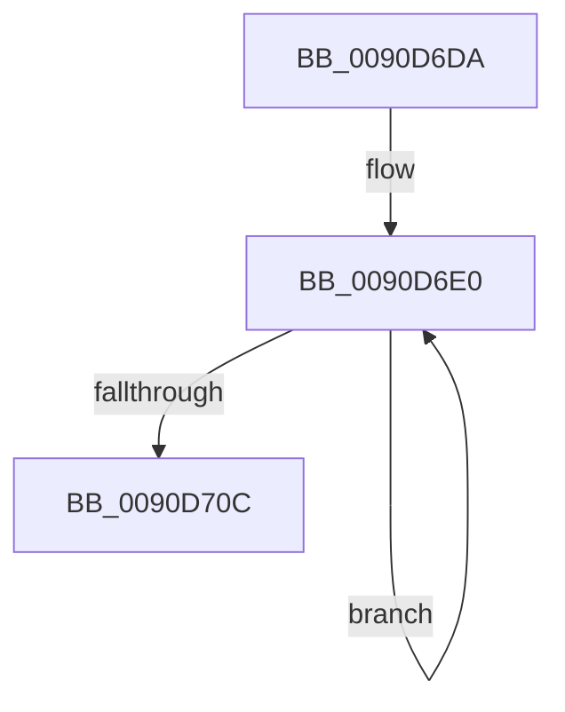

# sub_0090D6DA

- RVA: `0x0090D6DA`–`0x0090D711` (길이 `55` bytes)
- VA: `0x000000014090D6DA`
- 실행 섹션: `PAGE`
- PDB 이름 있음: `아니요`; PDB Function 태그: `아니요`
- unwind 정보 RVA: `0x00089448`
- 디코드: `17`개 명령, `55/55` bytes 표시
- 미해석 바이트: `0` (있으면 어셈블리에 `.byte`로 보존)

> 이 문서는 커널 이미지의 기계어와 PDB 기호를 분석해 생성했습니다. 4번과 5번은 함수 원형과 자료형을 바이너리 사용 방식에서 추정한 C 해석이며 원본 소스 복구 결과는 아닙니다.

## 1. Dependencies

- 직접 호출 지점: **1**; 고유 호출 대상: **1**
- 직접 호출자로 확인된 함수: **0**
- RIP 상대 이미지 참조: **0**

### Outgoing calls
- `0x0090D6E5` → [RtlpIsUtf8Process](RtlpIsUtf8Process_function_0090DB60.md) (function, `0x0090DB60`)

### Direct callers
- 이 함수 시작 RVA로 연결되는 직접 call은 확인되지 않았습니다. 간접 호출은 완전히 역산할 수 없습니다.

### Static image references
- 디코드된 RIP-relative 메모리 참조가 없습니다.

## 2. Other-region calls and transfers

- 다른 실행 섹션으로 향하는 call: **0**
- 별도 외부 분기/꼬리 이동을 확인하지 못했습니다.

## 3. Assembly (complete function range)

```asm
0090D6DA  48 89 7C 24 30                  mov qword ptr [rsp + 0x30], rdi
0090D6DF  90                              nop
0090D6E0  0F B6 3B                        movzx edi, byte ptr [rbx]
0090D6E3  33 C9                           xor ecx, ecx
0090D6E5  E8 76 04 00 00                  call 0x14090db60
0090D6EA  40 0F B6 C7                     movzx eax, dil
0090D6EE  8D 57 9F                        lea edx, [rdi - 0x61]
0090D6F1  34 20                           xor al, 0x20
0090D6F3  48 8D 76 01                     lea rsi, [rsi + 1]
0090D6F7  80 FA 19                        cmp dl, 0x19
0090D6FA  0F B6 C8                        movzx ecx, al
0090D6FD  48 8D 5B 01                     lea rbx, [rbx + 1]
0090D701  0F 47 CF                        cmova ecx, edi
0090D704  88 4E FF                        mov byte ptr [rsi - 1], cl
0090D707  83 C5 FF                        add ebp, -1
0090D70A  75 D4                           jne 0x14090d6e0
0090D70C  48 8B 7C 24 30                  mov rdi, qword ptr [rsp + 0x30]
```

## 4. C-style interpretation (structured pseudocode)

```c
__int64 __fastcall sub_0090D6DA(int a1, __int64 a2, __int64 a3, __int64 a4, __int64 a5, __int64 a6)
{
    __int64 result;
    __int64 v_rbp;
    unsigned __int64 v_stack_p30;

    v_stack_p30 = v_rdi;
loc_0090D6E0:
    a1 = 0;
    result = RtlpIsUtf8Process(a1, a2, a3, a4);
    result = (unsigned __int8)(((unsigned __int8)(*(unsigned __int8 *)(v_rbx))) ^ (32));
    a1 = (unsigned __int8)(result);
    if (((unsigned __int8)(*(unsigned __int8 *)(v_rbx) - 97)) > 25) { a1 = (unsigned int)(*(unsigned __int8 *)(v_rbx)); }
    *(unsigned __int8 *)(v_rsi + 1 - 1) = (unsigned __int8)(a1);
    v_rbp = (unsigned int)((v_rbp) + (-1));
    if (condition_is_not_equal) goto loc_0090D6E0;
    return result;
}
```

## 5. (Beta) C Style

```c
int64_t sub_0090D6DA(int32_t Arg1, int64_t Arg2, int64_t Arg3, int64_t Arg4, uint64_t Arg5, int64_t Arg6)
{
    int64_t result;
    int64_t local_rbp;
    uint64_t v_stack_p30;

    v_stack_p30 = local_rdi;
loc_0090D6E0:
    Arg1 = 0;
    result = RtlpIsUtf8Process(Arg1, Arg2, Arg3, Arg4);
    result = (uint8_t)(((uint8_t)(*(uint8_t *)(local_rbx))) ^ (32));
    Arg1 = (uint8_t)(result);
    if (((uint8_t)(*(uint8_t *)(local_rbx) - 97)) > 25) { Arg1 = (uint32_t)(*(uint8_t *)(local_rbx)); }
    *(uint8_t *)(local_rsi + 0x1 - 0x1) = (uint8_t)(Arg1);
    local_rbp = (uint32_t)((local_rbp) + (-1));
    if (condition_is_not_equal) goto loc_0090D6E0;
    return result;
}
```

## 6. Execution-region graph

[열기: 2D/3D 그래프와 함수 탐색 컨트롤 패널](../../../control-panel.html?section=page&rva=0x0090D6DA&view=graph)

- 2D 그래프는 위에서 아래로 흐르고, 3D 그래프는 빈 공간을 드래그해 회전합니다. Shift+드래그는 이동, 휠은 확대·축소, 함수 노드 선택은 대상 보고서 이동입니다.

### Static fallback


