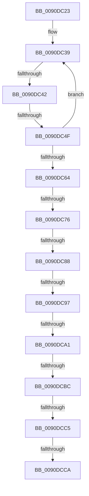

# sub_0090DC23

- RVA: `0x0090DC23`–`0x0090DCE6` (길이 `195` bytes)
- VA: `0x000000014090DC23`
- 실행 섹션: `PAGE`
- PDB 이름 있음: `아니요`; PDB Function 태그: `아니요`
- unwind 정보 RVA: `0x000894E8`
- 디코드: `51`개 명령, `195/195` bytes 표시
- 미해석 바이트: `0` (있으면 어셈블리에 `.byte`로 보존)

> 이 문서는 커널 이미지의 기계어와 PDB 기호를 분석해 생성했습니다. 4번과 5번은 함수 원형과 자료형을 바이너리 사용 방식에서 추정한 C 해석이며 원본 소스 복구 결과는 아닙니다.

## 1. Dependencies

- 직접 호출 지점: **0**; 고유 호출 대상: **0**
- 직접 호출자로 확인된 함수: **0**
- RIP 상대 이미지 참조: **0**

### Outgoing calls
- 직접 디코드된 call 명령이 없습니다.

### Direct callers
- 이 함수 시작 RVA로 연결되는 직접 call은 확인되지 않았습니다. 간접 호출은 완전히 역산할 수 없습니다.

### Static image references
- 디코드된 RIP-relative 메모리 참조가 없습니다.

## 2. Other-region calls and transfers

- 다른 실행 섹션으로 향하는 call: **0**
- call이 아닌 외부 분기/꼬리 이동: **9**
  - `0x0090DC3C` → [sub_0090DD33 + 0x72](Unknown_function_0090DD33.md) (`tail-transfer`)
  - `0x0090DC49` → [sub_0090DE6B](Unknown_function_0090DE6B.md) (`tail-transfer`)
  - `0x0090DC70` → [sub_0090DE6B + 0x28](Unknown_function_0090DE6B.md) (`tail-transfer`)
  - `0x0090DC82` → [sub_0090DDE6](Unknown_function_0090DDE6.md) (`tail-transfer`)
  - `0x0090DC91` → [sub_0090DD33 + 0x80](Unknown_function_0090DD33.md) (`tail-transfer`)
  - `0x0090DC9B` → [sub_0090DDE6 + 0x1F](Unknown_function_0090DDE6.md) (`tail-transfer`)
  - `0x0090DCBA` → [sub_0090DD33](Unknown_function_0090DD33.md) (`tail-transfer`)
  - `0x0090DCBF` → [sub_0090DD33 + 0x6A](Unknown_function_0090DD33.md) (`tail-transfer`)
  - `0x0090DCC8` → [sub_0090DCE7](Unknown_function_0090DCE7.md) (`tail-transfer`)

## 3. Assembly (complete function range)

```asm
0090DC23  48 89 6C 24 30                  mov qword ptr [rsp + 0x30], rbp
0090DC28  48 D1 E8                        shr rax, 1
0090DC2B  8B EA                           mov ebp, edx
0090DC2D  48 89 74 24 38                  mov qword ptr [rsp + 0x38], rsi
0090DC32  48 03 E9                        add rbp, rcx
0090DC35  49 8D 34 41                     lea rsi, [r9 + rax*2]
0090DC39  4C 3B CE                        cmp r9, rsi
0090DC3C  0F 83 63 01 00 00               jae 0x14090dda5
0090DC42  41 0F B7 11                     movzx edx, word ptr [r9]
0090DC46  45 85 D2                        test r10d, r10d
0090DC49  0F 85 1C 02 00 00               jne 0x14090de6b
0090DC4F  44 8B D2                        mov r10d, edx
0090DC52  49 83 C1 02                     add r9, 2
0090DC56  41 8D 82 00 28 FF FF            lea eax, [r10 - 0xd800]
0090DC5D  3D FF 03 00 00                  cmp eax, 0x3ff
0090DC62  76 D5                           jbe 0x14090dc39
0090DC64  41 8D 82 00 28 FF FF            lea eax, [r10 - 0xd800]
0090DC6B  3D FF 07 00 00                  cmp eax, 0x7ff
0090DC70  0F 86 1D 02 00 00               jbe 0x14090de93
0090DC76  BA 01 00 00 00                  mov edx, 1
0090DC7B  41 8B C2                        mov eax, r10d
0090DC7E  41 83 FA 7F                     cmp r10d, 0x7f
0090DC82  0F 87 5E 01 00 00               ja 0x14090dde6
0090DC88  48 8B C5                        mov rax, rbp
0090DC8B  48 2B C2                        sub rax, rdx
0090DC8E  48 3B C8                        cmp rcx, rax
0090DC91  0F 87 1C 01 00 00               ja 0x14090ddb3
0090DC97  41 83 FA 7F                     cmp r10d, 0x7f
0090DC9B  0F 87 64 01 00 00               ja 0x14090de05
0090DCA1  48 8B C6                        mov rax, rsi
0090DCA4  44 88 11                        mov byte ptr [rcx], r10b
0090DCA7  49 2B C1                        sub rax, r9
0090DCAA  48 FF C1                        inc rcx
0090DCAD  48 8B D5                        mov rdx, rbp
0090DCB0  48 D1 F8                        sar rax, 1
0090DCB3  48 2B D1                        sub rdx, rcx
0090DCB6  48 83 F8 0D                     cmp rax, 0xd
0090DCBA  77 77                           ja 0x14090dd33
0090DCBC  48 3B D0                        cmp rdx, rax
0090DCBF  0F 82 D8 00 00 00               jb 0x14090dd9d
0090DCC5  4C 3B CE                        cmp r9, rsi
0090DCC8  72 1D                           jb 0x14090dce7
0090DCCA  8B C3                           mov eax, ebx
0090DCCC  48 8B 6C 24 30                  mov rbp, qword ptr [rsp + 0x30]
0090DCD1  41 2B CB                        sub ecx, r11d
0090DCD4  48 8B 74 24 38                  mov rsi, qword ptr [rsp + 0x38]
0090DCD9  89 0F                           mov dword ptr [rdi], ecx
0090DCDB  48 8B 5C 24 40                  mov rbx, qword ptr [rsp + 0x40]
0090DCE0  48 83 C4 20                     add rsp, 0x20
0090DCE4  5F                              pop rdi
0090DCE5  C3                              ret
```

## 4. C-style interpretation (structured pseudocode)

```c
__int64 __fastcall sub_0090DC23(__int64 a1, int a2, __int64 a3, __int64 a4, __int64 a5, __int64 a6, __int64 a7, __int64 a8)
{
    __int64 result;
    __int64 v_rbp;
    __int64 v_rsp;
    unsigned __int64 v_stack_p30;
    unsigned __int64 v_stack_p38;

    v_stack_p30 = v_rbp;
    result = (result) >> (1);
    v_stack_p38 = v_rsi;
    v_rbp = ((unsigned int)(a2)) + (a1);
loc_0090DC39:
    a4 = (a4) + (2);
    if (((unsigned int)((unsigned int)((unsigned int)(*(unsigned __int16 *)(a4))) - 55296)) <= 0x3FFULL) goto loc_0090DC39;
    result = (v_rbp) - (1);
    *(unsigned __int8 *)(a1) = (unsigned __int8)((unsigned int)((unsigned int)(*(unsigned __int16 *)(a4))));
    result = (a4 + result * 2) - (a4);
    a1 = (a1) + 1;
    result = (result) >> (1);
    a2 = (v_rbp) - (a1);
    a1 = (unsigned int)((a1) - ((unsigned int)(v_r11)));
    *(unsigned int *)(v_rdi) = (unsigned int)(a1);
    v_rsp = (v_rsp) + (32);
    return (unsigned int)((unsigned int)(v_rbx));
}
```

## 5. (Beta) C Style

```c
int64_t sub_0090DC23(int64_t Arg1, int32_t Arg2, int64_t Arg3, void *Arg4, uint64_t Arg5, int64_t Arg6, int64_t Arg7, int64_t Arg8)
{
    uint8_t *arg4 = (uint8_t *)Arg4;

    int64_t result;
    int64_t local_rbp;
    int64_t local_rsp;
    uint64_t v_stack_p30;
    uint64_t v_stack_p38;

    v_stack_p30 = local_rbp;
    result = (result) >> (1);
    v_stack_p38 = local_rsi;
    local_rbp = ((uint32_t)(Arg2)) + (Arg1);
loc_0090DC39:
    Arg4 = (Arg4) + (2);
    if (((uint32_t)((uint32_t)((uint32_t)(*(uint16_t *)(arg4))) - 55296)) <= 0x3FFULL) goto loc_0090DC39;
    result = (local_rbp) - (1);
    *(uint8_t *)(Arg1) = (uint8_t)((uint32_t)((uint32_t)(*(uint16_t *)(arg4))));
    result = (Arg4 + result * 2) - (Arg4);
    Arg1 = (Arg1) + 1;
    result = (result) >> (1);
    Arg2 = (local_rbp) - (Arg1);
    Arg1 = (uint32_t)((Arg1) - ((uint32_t)(local_r11)));
    *(uint32_t *)(local_rdi) = (uint32_t)(Arg1);
    local_rsp = (local_rsp) + (32);
    return (uint32_t)((uint32_t)(local_rbx));
}
```

### 관측된 메모리 오프셋

구조체 형식이 확인되지 않은 접근은 인자 기준의 오프셋으로만 기록했습니다.

| 기준 인자 | 오프셋 표현 | 폭 (bit) | 접근 |
|---|---:|---:|---|
| `Arg4` | `+ 0x0 + rax*2` | `64` | `R` |

## 6. Execution-region graph

[열기: 2D/3D 그래프와 함수 탐색 컨트롤 패널](../../../control-panel.html?section=page&rva=0x0090DC23&view=graph)

- 2D 그래프는 위에서 아래로 흐르고, 3D 그래프는 빈 공간을 드래그해 회전합니다. Shift+드래그는 이동, 휠은 확대·축소, 함수 노드 선택은 대상 보고서 이동입니다.

### Static fallback


