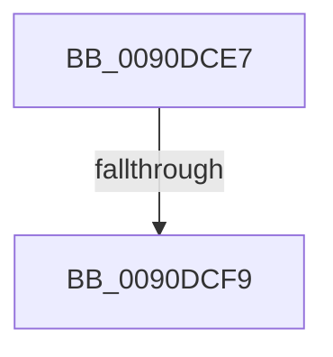

# sub_0090DCE7

- RVA: `0x0090DCE7`–`0x0090DD01` (길이 `26` bytes)
- VA: `0x000000014090DCE7`
- 실행 섹션: `PAGE`
- PDB 이름 있음: `아니요`; PDB Function 태그: `아니요`
- unwind 정보 RVA: `0x00089514`
- 디코드: `7`개 명령, `26/26` bytes 표시
- 미해석 바이트: `0` (있으면 어셈블리에 `.byte`로 보존)

> 이 문서는 커널 이미지의 기계어와 PDB 기호를 분석해 생성했습니다. 4번과 5번은 함수 원형과 자료형을 바이너리 사용 방식에서 추정한 C 해석이며 원본 소스 복구 결과는 아닙니다.

## 1. Dependencies

- 직접 호출 지점: **0**; 고유 호출 대상: **0**
- 직접 호출자로 확인된 함수: **0**
- RIP 상대 이미지 참조: **0**

### Outgoing calls
- 직접 디코드된 call 명령이 없습니다.

### Direct callers
- 이 함수 시작 RVA로 연결되는 직접 call은 확인되지 않았습니다. 간접 호출은 완전히 역산할 수 없습니다.

### Static image references
- 디코드된 RIP-relative 메모리 참조가 없습니다.

## 2. Other-region calls and transfers

- 다른 실행 섹션으로 향하는 call: **0**
- call이 아닌 외부 분기/꼬리 이동: **2**
  - `0x0090DCF3` → [sub_0090DC23 + 0x33](Unknown_function_0090DC23.md) (`tail-transfer`)
  - `0x0090DCFF` → [sub_0090DC23 + 0xA2](Unknown_function_0090DC23.md) (`tail-transfer`)

## 3. Assembly (complete function range)

```asm
0090DCE7  45 0F B7 11                     movzx r10d, word ptr [r9]
0090DCEB  49 83 C1 02                     add r9, 2
0090DCEF  41 83 FA 7F                     cmp r10d, 0x7f
0090DCF3  0F 87 5D FF FF FF               ja 0x14090dc56
0090DCF9  44 88 11                        mov byte ptr [rcx], r10b
0090DCFC  48 FF C1                        inc rcx
0090DCFF  EB C4                           jmp 0x14090dcc5
```

## 4. C-style interpretation (structured pseudocode)

```c
void __fastcall sub_0090DCE7(__int64 a1, __int64 a2, __int64 a3, __int64 a4)
{
    a4 = (a4) + (2);
    *(unsigned __int8 *)(a1) = (unsigned __int8)(*(unsigned __int16 *)(a4));
    a1 = (a1) + 1;
}
```

## 5. (Beta) C Style

```c
void sub_0090DCE7(void *Arg1, int64_t Arg2, int64_t Arg3, void *Arg4)
{
    uint8_t *arg1 = (uint8_t *)Arg1;
    uint8_t *arg4 = (uint8_t *)Arg4;

    Arg4 = (Arg4) + (2);
    *(uint8_t *)(arg1) = (uint8_t)(*(uint16_t *)(arg4));
    Arg1 = (Arg1) + 1;
}
```

### 관측된 메모리 오프셋

구조체 형식이 확인되지 않은 접근은 인자 기준의 오프셋으로만 기록했습니다.

| 기준 인자 | 오프셋 표현 | 폭 (bit) | 접근 |
|---|---:|---:|---|
| `Arg1` | `+ 0x0` | `8` | `W` |
| `Arg4` | `+ 0x0` | `16` | `R` |

## 6. Execution-region graph

[열기: 2D/3D 그래프와 함수 탐색 컨트롤 패널](../../../control-panel.html?section=page&rva=0x0090DCE7&view=graph)

- 2D 그래프는 위에서 아래로 흐르고, 3D 그래프는 빈 공간을 드래그해 회전합니다. Shift+드래그는 이동, 휠은 확대·축소, 함수 노드 선택은 대상 보고서 이동입니다.

### Static fallback


