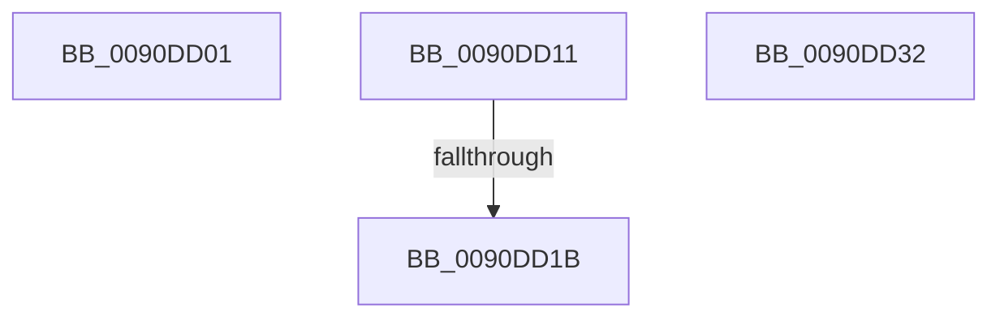

# sub_0090DD01

- RVA: `0x0090DD01`–`0x0090DD33` (길이 `50` bytes)
- VA: `0x000000014090DD01`
- 실행 섹션: `PAGE`
- PDB 이름 있음: `아니요`; PDB Function 태그: `아니요`
- unwind 정보 RVA: `0x0008952C`
- 디코드: `16`개 명령, `50/50` bytes 표시
- 미해석 바이트: `0` (있으면 어셈블리에 `.byte`로 보존)

> 이 문서는 커널 이미지의 기계어와 PDB 기호를 분석해 생성했습니다. 4번과 5번은 함수 원형과 자료형을 바이너리 사용 방식에서 추정한 C 해석이며 원본 소스 복구 결과는 아닙니다.

## 1. Dependencies

- 직접 호출 지점: **1**; 고유 호출 대상: **1**
- 직접 호출자로 확인된 함수: **0**
- RIP 상대 이미지 참조: **0**

### Outgoing calls
- `0x0090DD22` → [CountUnicodeToUTF8](../../text/45/CountUnicodeToUTF8_function_00457C1C.md) (function, `0x00457C1C`)

### Direct callers
- 이 함수 시작 RVA로 연결되는 직접 call은 확인되지 않았습니다. 간접 호출은 완전히 역산할 수 없습니다.

### Static image references
- 디코드된 RIP-relative 메모리 참조가 없습니다.

## 2. Other-region calls and transfers

- 다른 실행 섹션으로 향하는 call: **1**
  - `0x0090DD22` → [CountUnicodeToUTF8](../../text/45/CountUnicodeToUTF8_function_00457C1C.md) (`PAGE` → `.text`)
- call이 아닌 외부 분기/꼬리 이동: **1**
  - `0x0090DD15` → [sub_0090DE5A](Unknown_function_0090DE5A.md) (`tail-transfer`)

## 3. Assembly (complete function range)

```asm
0090DD01  B8 F2 00 00 C0                  mov eax, 0xc00000f2
0090DD06  48 8B 5C 24 40                  mov rbx, qword ptr [rsp + 0x40]
0090DD0B  48 83 C4 20                     add rsp, 0x20
0090DD0F  5F                              pop rdi
0090DD10  C3                              ret
0090DD11  CC                              int3
0090DD12  48 85 FF                        test rdi, rdi
0090DD15  0F 84 3F 01 00 00               je 0x14090de5a
0090DD1B  8B 54 24 50                     mov edx, dword ptr [rsp + 0x50]
0090DD1F  49 8B C9                        mov rcx, r9
0090DD22  E8 F5 9E B4 FF                  call 0x140457c1c
0090DD27  48 8B 5C 24 40                  mov rbx, qword ptr [rsp + 0x40]
0090DD2C  48 83 C4 20                     add rsp, 0x20
0090DD30  5F                              pop rdi
0090DD31  C3                              ret
0090DD32  CC                              int3
```

## 4. C-style interpretation (structured pseudocode)

```c
__int64 __fastcall sub_0090DD01(__int64 a1, __int64 a2, __int64 a3, __int64 a4, __int64 a5, __int64 a6, __int64 a7, __int64 a8)
{
    __int64 v_rsp;
    unsigned __int64 v_stack_p68;
    unsigned int v_stack_p78;

    v_rsp = (v_rsp) + (32);
    return (unsigned int)(0xC00000F2ULL);
}
```

## 5. (Beta) C Style

```c
int64_t sub_0090DD01(int64_t Arg1, int64_t Arg2, int64_t Arg3, int64_t Arg4, uint64_t Arg5, uint64_t Arg6, uint64_t Arg7, int64_t Arg8)
{
    int64_t local_rsp;
    uint64_t v_stack_p68;
    uint32_t v_stack_p78;

    local_rsp = (local_rsp) + (32);
    return (uint32_t)(0xC00000F2ULL);
}
```

## 6. Execution-region graph

[열기: 2D/3D 그래프와 함수 탐색 컨트롤 패널](../../../control-panel.html?section=page&rva=0x0090DD01&view=graph)

- 2D 그래프는 위에서 아래로 흐르고, 3D 그래프는 빈 공간을 드래그해 회전합니다. Shift+드래그는 이동, 휠은 확대·축소, 함수 노드 선택은 대상 보고서 이동입니다.

### Static fallback


