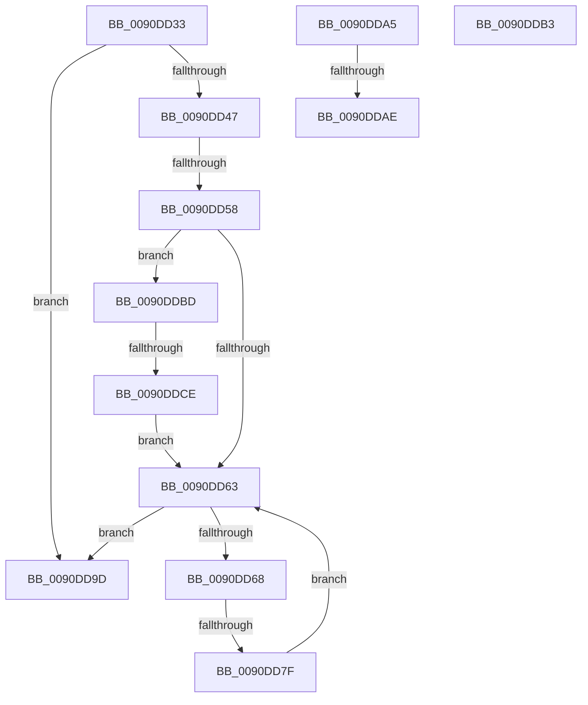

# sub_0090DD33

- RVA: `0x0090DD33`–`0x0090DDD5` (길이 `162` bytes)
- VA: `0x000000014090DD33`
- 실행 섹션: `PAGE`
- PDB 이름 있음: `아니요`; PDB Function 태그: `아니요`
- unwind 정보 RVA: `0x00089544`
- 디코드: `45`개 명령, `162/162` bytes 표시
- 미해석 바이트: `0` (있으면 어셈블리에 `.byte`로 보존)

> 이 문서는 커널 이미지의 기계어와 PDB 기호를 분석해 생성했습니다. 4번과 5번은 함수 원형과 자료형을 바이너리 사용 방식에서 추정한 C 해석이며 원본 소스 복구 결과는 아닙니다.

## 1. Dependencies

- 직접 호출 지점: **0**; 고유 호출 대상: **0**
- 직접 호출자로 확인된 함수: **0**
- RIP 상대 이미지 참조: **0**

### Outgoing calls
- 직접 디코드된 call 명령이 없습니다.

### Direct callers
- 이 함수 시작 RVA로 연결되는 직접 call은 확인되지 않았습니다. 간접 호출은 완전히 역산할 수 없습니다.

### Static image references
- 디코드된 RIP-relative 메모리 참조가 없습니다.

## 2. Other-region calls and transfers

- 다른 실행 섹션으로 향하는 call: **0**
- call이 아닌 외부 분기/꼬리 이동: **7**
  - `0x0090DD52` → [sub_0090DE6B + 0x55](Unknown_function_0090DE6B.md) (`tail-transfer`)
  - `0x0090DD79` → [sub_0090DE6B + 0x3F](Unknown_function_0090DE6B.md) (`tail-transfer`)
  - `0x0090DDA0` → [sub_0090DC23 + 0x16](Unknown_function_0090DC23.md) (`tail-transfer`)
  - `0x0090DDA8` → [sub_0090DC23 + 0xA7](Unknown_function_0090DC23.md) (`tail-transfer`)
  - `0x0090DDAE` → [sub_0090DC23 + 0x41](Unknown_function_0090DC23.md) (`tail-transfer`)
  - `0x0090DDB8` → [sub_0090DC23 + 0xA9](Unknown_function_0090DC23.md) (`tail-transfer`)
  - `0x0090DDC8` → [sub_0090DE6B + 0x55](Unknown_function_0090DE6B.md) (`tail-transfer`)

## 3. Assembly (complete function range)

```asm
0090DD33  48 3B D0                        cmp rdx, rax
0090DD36  48 0F 42 C2                     cmovb rax, rdx
0090DD3A  4C 8D 50 FB                     lea r10, [rax - 5]
0090DD3E  4F 8D 14 51                     lea r10, [r9 + r10*2]
0090DD42  4D 3B CA                        cmp r9, r10
0090DD45  73 56                           jae 0x14090dd9d
0090DD47  41 0F B7 11                     movzx edx, word ptr [r9]
0090DD4B  49 83 C1 02                     add r9, 2
0090DD4F  83 FA 7F                        cmp edx, 0x7f
0090DD52  0F 87 68 01 00 00               ja 0x14090dec0
0090DD58  88 11                           mov byte ptr [rcx], dl
0090DD5A  48 FF C1                        inc rcx
0090DD5D  41 F6 C1 02                     test r9b, 2
0090DD61  75 5A                           jne 0x14090ddbd
0090DD63  4D 3B CA                        cmp r9, r10
0090DD66  73 35                           jae 0x14090dd9d
0090DD68  45 8B 41 04                     mov r8d, dword ptr [r9 + 4]
0090DD6C  41 8B C0                        mov eax, r8d
0090DD6F  41 8B 11                        mov edx, dword ptr [r9]
0090DD72  0B C2                           or eax, edx
0090DD74  A9 80 FF 80 FF                  test eax, 0xff80ff80
0090DD79  0F 85 2B 01 00 00               jne 0x14090deaa
0090DD7F  88 11                           mov byte ptr [rcx], dl
0090DD81  49 83 C1 08                     add r9, 8
0090DD85  44 88 41 02                     mov byte ptr [rcx + 2], r8b
0090DD89  C1 EA 10                        shr edx, 0x10
0090DD8C  41 C1 E8 10                     shr r8d, 0x10
0090DD90  88 51 01                        mov byte ptr [rcx + 1], dl
0090DD93  44 88 41 03                     mov byte ptr [rcx + 3], r8b
0090DD97  48 83 C1 04                     add rcx, 4
0090DD9B  EB C6                           jmp 0x14090dd63
0090DD9D  45 33 D2                        xor r10d, r10d
0090DDA0  E9 94 FE FF FF                  jmp 0x14090dc39
0090DDA5  45 85 D2                        test r10d, r10d
0090DDA8  0F 84 1C FF FF FF               je 0x14090dcca
0090DDAE  E9 B1 FE FF FF                  jmp 0x14090dc64
0090DDB3  B8 23 00 00 C0                  mov eax, 0xc0000023
0090DDB8  E9 0F FF FF FF                  jmp 0x14090dccc
0090DDBD  41 0F B7 11                     movzx edx, word ptr [r9]
0090DDC1  49 83 C1 02                     add r9, 2
0090DDC5  83 FA 7F                        cmp edx, 0x7f
0090DDC8  0F 87 F2 00 00 00               ja 0x14090dec0
0090DDCE  88 11                           mov byte ptr [rcx], dl
0090DDD0  48 FF C1                        inc rcx
0090DDD3  EB 8E                           jmp 0x14090dd63
```

## 4. C-style interpretation (structured pseudocode)

```c
__int64 __fastcall sub_0090DD33(__int64 a1, __int64 a2, __int64 a3, __int64 a4)
{
    __int64 result;
    __int64 v_r10;

    if (a2 < result) { result = a2; }
    if (a4 >= (a4 + result - 5 * 2)) goto loc_0090DD9D;
    a4 = (a4) + (2);
    *(unsigned __int8 *)(a1) = (unsigned __int8)(*(unsigned __int16 *)(a4));
    a1 = (a1) + 1;
    if ((((unsigned __int8)(a4)) & (2)) != 0) goto loc_0090DDBD;
loc_0090DD63:
    if (a4 >= (a4 + result - 5 * 2)) goto loc_0090DD9D;
    result = (unsigned int)(((unsigned int)((unsigned int)((unsigned int)(*(unsigned int *)(a4 + 4))))) | ((unsigned int)((unsigned int)(*(unsigned int *)(a4)))));
    *(unsigned __int8 *)(a1) = (unsigned __int8)((unsigned int)(*(unsigned int *)(a4)));
    a4 = (a4) + (8);
    *(unsigned __int8 *)(a1 + 2) = (unsigned __int8)((unsigned int)(*(unsigned int *)(a4 + 4)));
    a2 = (unsigned int)(((unsigned int)(*(unsigned int *)(a4))) >> (16));
    a3 = (unsigned int)(((unsigned int)(*(unsigned int *)(a4 + 4))) >> (16));
    *(unsigned __int8 *)(a1 + 1) = (unsigned __int8)(a2);
    *(unsigned __int8 *)(a1 + 3) = (unsigned __int8)(a3);
    a1 = (a1) + (4);
    goto loc_0090DD63;
loc_0090DD9D:
    v_r10 = 0;
loc_0090DDBD:
    a4 = (a4) + (2);
    *(unsigned __int8 *)(a1) = (unsigned __int8)(*(unsigned __int16 *)(a4));
    a1 = (a1) + 1;
    goto loc_0090DD63;
}
```

## 5. (Beta) C Style

```c
int64_t sub_0090DD33(void *Arg1, int64_t Arg2, int64_t Arg3, void *Arg4)
{
    uint8_t *arg1 = (uint8_t *)Arg1;
    uint8_t *arg4 = (uint8_t *)Arg4;

    int64_t result;
    int64_t local_r10;

    if (Arg2 < result) { result = Arg2; }
    if (Arg4 >= (Arg4 + result - 5 * 2)) goto loc_0090DD9D;
    Arg4 = (Arg4) + (2);
    *(uint8_t *)(arg1) = (uint8_t)(*(uint16_t *)(arg4));
    Arg1 = (Arg1) + 1;
    if ((((uint8_t)(Arg4)) & (2)) != 0) goto loc_0090DDBD;
loc_0090DD63:
    if (Arg4 >= (Arg4 + result - 5 * 2)) goto loc_0090DD9D;
    result = (uint32_t)(((uint32_t)((uint32_t)((uint32_t)(*(uint32_t *)(arg4 + 0x4))))) | ((uint32_t)((uint32_t)(*(uint32_t *)(arg4)))));
    *(uint8_t *)(arg1) = (uint8_t)((uint32_t)(*(uint32_t *)(arg4)));
    Arg4 = (Arg4) + (8);
    *(uint8_t *)(arg1 + 0x2) = (uint8_t)((uint32_t)(*(uint32_t *)(arg4 + 0x4)));
    Arg2 = (uint32_t)(((uint32_t)(*(uint32_t *)(arg4))) >> (16));
    Arg3 = (uint32_t)(((uint32_t)(*(uint32_t *)(arg4 + 0x4))) >> (16));
    *(uint8_t *)(arg1 + 0x1) = (uint8_t)(Arg2);
    *(uint8_t *)(arg1 + 0x3) = (uint8_t)(Arg3);
    Arg1 = (Arg1) + (4);
    goto loc_0090DD63;
loc_0090DD9D:
    local_r10 = 0;
loc_0090DDBD:
    Arg4 = (Arg4) + (2);
    *(uint8_t *)(arg1) = (uint8_t)(*(uint16_t *)(arg4));
    Arg1 = (Arg1) + 1;
    goto loc_0090DD63;
}
```

### 관측된 메모리 오프셋

구조체 형식이 확인되지 않은 접근은 인자 기준의 오프셋으로만 기록했습니다.

| 기준 인자 | 오프셋 표현 | 폭 (bit) | 접근 |
|---|---:|---:|---|
| `Arg1` | `+ 0x0` | `8` | `W` |
| `Arg4` | `+ 0x0 + r10*2` | `64` | `R` |

## 6. Execution-region graph

[열기: 2D/3D 그래프와 함수 탐색 컨트롤 패널](../../../control-panel.html?section=page&rva=0x0090DD33&view=graph)

- 2D 그래프는 위에서 아래로 흐르고, 3D 그래프는 빈 공간을 드래그해 회전합니다. Shift+드래그는 이동, 휠은 확대·축소, 함수 노드 선택은 대상 보고서 이동입니다.

### Static fallback


