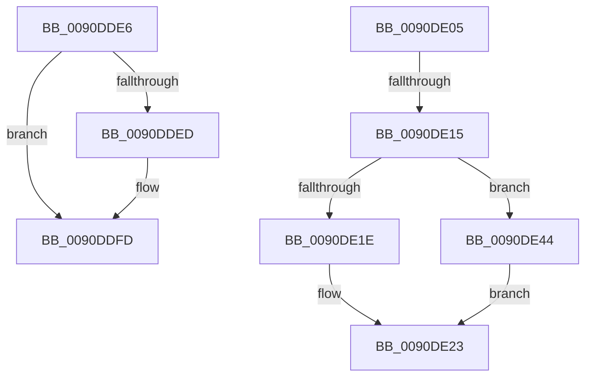

# sub_0090DDE6

- RVA: `0x0090DDE6`–`0x0090DE5A` (길이 `116` bytes)
- VA: `0x000000014090DDE6`
- 실행 섹션: `PAGE`
- PDB 이름 있음: `아니요`; PDB Function 태그: `아니요`
- unwind 정보 RVA: `0x00089570`
- 디코드: `35`개 명령, `116/116` bytes 표시
- 미해석 바이트: `0` (있으면 어셈블리에 `.byte`로 보존)

> 이 문서는 커널 이미지의 기계어와 PDB 기호를 분석해 생성했습니다. 4번과 5번은 함수 원형과 자료형을 바이너리 사용 방식에서 추정한 C 해석이며 원본 소스 복구 결과는 아닙니다.

## 1. Dependencies

- 직접 호출 지점: **0**; 고유 호출 대상: **0**
- 직접 호출자로 확인된 함수: **0**
- RIP 상대 이미지 참조: **0**

### Outgoing calls
- 직접 디코드된 call 명령이 없습니다.

### Direct callers
- 이 함수 시작 RVA로 연결되는 직접 call은 확인되지 않았습니다. 간접 호출은 완전히 역산할 수 없습니다.

### Static image references
- 디코드된 RIP-relative 메모리 참조가 없습니다.

## 2. Other-region calls and transfers

- 다른 실행 섹션으로 향하는 call: **0**
- call이 아닌 외부 분기/꼬리 이동: **3**
  - `0x0090DE00` → [sub_0090DC23 + 0x65](Unknown_function_0090DC23.md) (`tail-transfer`)
  - `0x0090DE0F` → [sub_0090DE6B + 0x38](Unknown_function_0090DE6B.md) (`tail-transfer`)
  - `0x0090DE3F` → [sub_0090DC23 + 0x7E](Unknown_function_0090DC23.md) (`tail-transfer`)

## 3. Assembly (complete function range)

```asm
0090DDE6  3D FF 07 00 00                  cmp eax, 0x7ff
0090DDEB  76 10                           jbe 0x14090ddfd
0090DDED  33 D2                           xor edx, edx
0090DDEF  41 81 FA FF FF 00 00            cmp r10d, 0xffff
0090DDF6  0F 97 C2                        seta dl
0090DDF9  48 83 C2 02                     add rdx, 2
0090DDFD  48 FF C2                        inc rdx
0090DE00  E9 83 FE FF FF                  jmp 0x14090dc88
0090DE05  41 8B C2                        mov eax, r10d
0090DE08  41 81 FA FF 07 00 00            cmp r10d, 0x7ff
0090DE0F  0F 86 8E 00 00 00               jbe 0x14090dea3
0090DE15  41 81 FA FF FF 00 00            cmp r10d, 0xffff
0090DE1C  77 26                           ja 0x14090de44
0090DE1E  C1 E8 0C                        shr eax, 0xc
0090DE21  0C E0                           or al, 0xe0
0090DE23  88 01                           mov byte ptr [rcx], al
0090DE25  41 8B C2                        mov eax, r10d
0090DE28  C1 E8 06                        shr eax, 6
0090DE2B  48 FF C1                        inc rcx
0090DE2E  24 3F                           and al, 0x3f
0090DE30  0C 80                           or al, 0x80
0090DE32  88 01                           mov byte ptr [rcx], al
0090DE34  41 80 E2 3F                     and r10b, 0x3f
0090DE38  48 FF C1                        inc rcx
0090DE3B  41 80 CA 80                     or r10b, 0x80
0090DE3F  E9 5D FE FF FF                  jmp 0x14090dca1
0090DE44  C1 E8 12                        shr eax, 0x12
0090DE47  0C F0                           or al, 0xf0
0090DE49  88 01                           mov byte ptr [rcx], al
0090DE4B  41 8B C2                        mov eax, r10d
0090DE4E  C1 E8 0C                        shr eax, 0xc
0090DE51  48 FF C1                        inc rcx
0090DE54  24 3F                           and al, 0x3f
0090DE56  0C 80                           or al, 0x80
0090DE58  EB C9                           jmp 0x14090de23
```

## 4. C-style interpretation (structured pseudocode)

```c
__int64 __fastcall sub_0090DDE6(__int64 a1, int a2)
{
    if (((unsigned int)(result)) >= = 0x7FFULL) {
        a2 = 0;
        a2 = (((unsigned int)(v_r10)) > 0xFFFFULL) ? 1 : 0;
        a2 = (a2) + (2);
    }
    a2 = (a2) + 1;
}
```

## 5. (Beta) C Style

```c
int64_t sub_0090DDE6(int64_t Arg1, int32_t Arg2)
{
    if (((uint32_t)(result)) >= = 0x7FFULL) {
        Arg2 = 0;
        Arg2 = (((uint32_t)(local_r10)) > 0xFFFFULL) ? 1 : 0;
        Arg2 = (Arg2) + (2);
    }
    Arg2 = (Arg2) + 1;
}
```

## 6. Execution-region graph

[열기: 2D/3D 그래프와 함수 탐색 컨트롤 패널](../../../control-panel.html?section=page&rva=0x0090DDE6&view=graph)

- 2D 그래프는 위에서 아래로 흐르고, 3D 그래프는 빈 공간을 드래그해 회전합니다. Shift+드래그는 이동, 휠은 확대·축소, 함수 노드 선택은 대상 보고서 이동입니다.

### Static fallback


