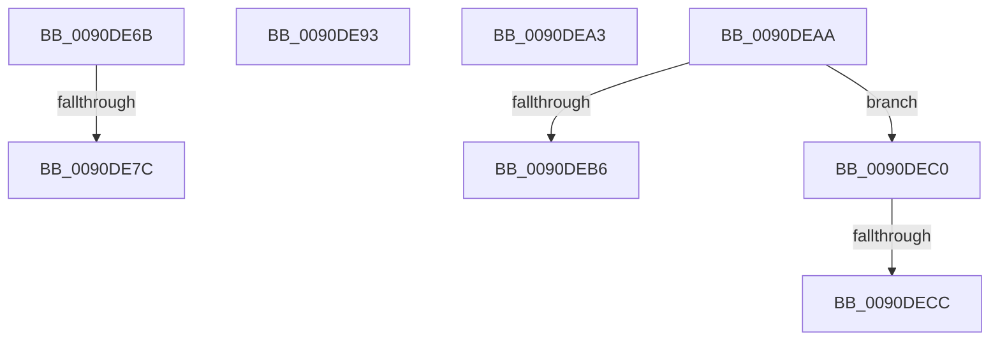

# sub_0090DE6B

- RVA: `0x0090DE6B`–`0x0090DED8` (길이 `109` bytes)
- VA: `0x000000014090DE6B`
- 실행 섹션: `PAGE`
- PDB 이름 있음: `아니요`; PDB Function 태그: `아니요`
- unwind 정보 RVA: `0x0008959C`
- 디코드: `26`개 명령, `109/109` bytes 표시
- 미해석 바이트: `0` (있으면 어셈블리에 `.byte`로 보존)

> 이 문서는 커널 이미지의 기계어와 PDB 기호를 분석해 생성했습니다. 4번과 5번은 함수 원형과 자료형을 바이너리 사용 방식에서 추정한 C 해석이며 원본 소스 복구 결과는 아닙니다.

## 1. Dependencies

- 직접 호출 지점: **0**; 고유 호출 대상: **0**
- 직접 호출자로 확인된 함수: **0**
- RIP 상대 이미지 참조: **0**

### Outgoing calls
- 직접 디코드된 call 명령이 없습니다.

### Direct callers
- 이 함수 시작 RVA로 연결되는 직접 call은 확인되지 않았습니다. 간접 호출은 완전히 역산할 수 없습니다.

### Static image references
- 디코드된 RIP-relative 메모리 참조가 없습니다.

## 2. Other-region calls and transfers

- 다른 실행 섹션으로 향하는 call: **0**
- call이 아닌 외부 분기/꼬리 이동: **7**
  - `0x0090DE76` → [sub_0090DC23 + 0x41](Unknown_function_0090DC23.md) (`tail-transfer`)
  - `0x0090DE8E` → [sub_0090DC23 + 0x41](Unknown_function_0090DC23.md) (`tail-transfer`)
  - `0x0090DE9E` → [sub_0090DDE6 + 0x7](Unknown_function_0090DDE6.md) (`tail-transfer`)
  - `0x0090DEA8` → [sub_0090DDE6 + 0x4C](Unknown_function_0090DDE6.md) (`tail-transfer`)
  - `0x0090DEBB` → [sub_0090DD33 + 0xF](Unknown_function_0090DD33.md) (`tail-transfer`)
  - `0x0090DEC6` → [sub_00B2127A](../B2/Unknown_function_00B2127A.md) (`tail-transfer`)
  - `0x0090DED3` → [sub_00B2127A + 0x6E](../B2/Unknown_function_00B2127A.md) (`tail-transfer`)

## 3. Assembly (complete function range)

```asm
0090DE6B  8D 82 00 24 FF FF               lea eax, [rdx - 0xdc00]
0090DE71  3D FF 03 00 00                  cmp eax, 0x3ff
0090DE76  0F 87 E8 FD FF FF               ja 0x14090dc64
0090DE7C  41 C1 E2 0A                     shl r10d, 0xa
0090DE80  41 81 C2 00 24 A0 FC            add r10d, 0xfca02400
0090DE87  44 03 D2                        add r10d, edx
0090DE8A  49 83 C1 02                     add r9, 2
0090DE8E  E9 D1 FD FF FF                  jmp 0x14090dc64
0090DE93  BB 07 01 00 00                  mov ebx, 0x107
0090DE98  41 BA FD FF 00 00               mov r10d, 0xfffd
0090DE9E  E9 4A FF FF FF                  jmp 0x14090dded
0090DEA3  C1 E8 06                        shr eax, 6
0090DEA6  0C C0                           or al, 0xc0
0090DEA8  EB 88                           jmp 0x14090de32
0090DEAA  0F B7 D2                        movzx edx, dx
0090DEAD  49 83 C1 02                     add r9, 2
0090DEB1  83 FA 7F                        cmp edx, 0x7f
0090DEB4  77 0A                           ja 0x14090dec0
0090DEB6  88 11                           mov byte ptr [rcx], dl
0090DEB8  48 FF C1                        inc rcx
0090DEBB  E9 82 FE FF FF                  jmp 0x14090dd42
0090DEC0  81 FA FF 07 00 00               cmp edx, 0x7ff
0090DEC6  0F 87 AE 33 21 00               ja 0x140b2127a
0090DECC  8B C2                           mov eax, edx
0090DECE  0D 00 30 00 00                  or eax, 0x3000
0090DED3  E9 10 34 21 00                  jmp 0x140b212e8
```

## 4. C-style interpretation (structured pseudocode)

```c
__int64 __fastcall sub_0090DE6B(__int64 a1, __int64 a2, __int64 a3, __int64 a4)
{
    __int64 v_r10;

    v_r10 = (unsigned int)((v_r10) << (10));
    v_r10 = (unsigned int)((v_r10) + (0xFCA02400ULL));
    v_r10 = (unsigned int)((v_r10) + ((unsigned int)(a2)));
    a4 = (a4) + (2);
}
```

## 5. (Beta) C Style

```c
int64_t sub_0090DE6B(int64_t Arg1, void *Arg2, int64_t Arg3, int64_t Arg4)
{
    uint8_t *arg2 = (uint8_t *)Arg2;

    int64_t local_r10;

    local_r10 = (uint32_t)((local_r10) << (10));
    local_r10 = (uint32_t)((local_r10) + (0xFCA02400ULL));
    local_r10 = (uint32_t)((local_r10) + ((uint32_t)(Arg2)));
    Arg4 = (Arg4) + (2);
}
```

### 관측된 메모리 오프셋

구조체 형식이 확인되지 않은 접근은 인자 기준의 오프셋으로만 기록했습니다.

| 기준 인자 | 오프셋 표현 | 폭 (bit) | 접근 |
|---|---:|---:|---|
| `Arg2` | `- 0xDC00` | `32` | `R` |

## 6. Execution-region graph

[열기: 2D/3D 그래프와 함수 탐색 컨트롤 패널](../../../control-panel.html?section=page&rva=0x0090DE6B&view=graph)

- 2D 그래프는 위에서 아래로 흐르고, 3D 그래프는 빈 공간을 드래그해 회전합니다. Shift+드래그는 이동, 휠은 확대·축소, 함수 노드 선택은 대상 보고서 이동입니다.

### Static fallback


