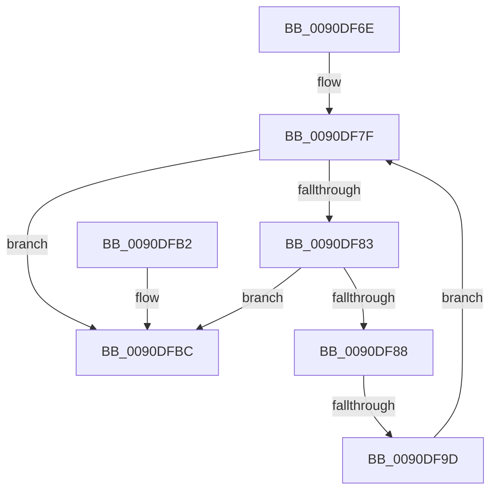

# sub_0090DF6E

- RVA: `0x0090DF6E`–`0x0090DFC6` (길이 `88` bytes)
- VA: `0x000000014090DF6E`
- 실행 섹션: `PAGE`
- PDB 이름 있음: `아니요`; PDB Function 태그: `아니요`
- unwind 정보 RVA: `0x000895D8`
- 디코드: `27`개 명령, `88/88` bytes 표시
- 미해석 바이트: `0` (있으면 어셈블리에 `.byte`로 보존)

> 이 문서는 커널 이미지의 기계어와 PDB 기호를 분석해 생성했습니다. 4번과 5번은 함수 원형과 자료형을 바이너리 사용 방식에서 추정한 C 해석이며 원본 소스 복구 결과는 아닙니다.

## 1. Dependencies

- 직접 호출 지점: **0**; 고유 호출 대상: **0**
- 직접 호출자로 확인된 함수: **0**
- RIP 상대 이미지 참조: **0**

### Outgoing calls
- 직접 디코드된 call 명령이 없습니다.

### Direct callers
- 이 함수 시작 RVA로 연결되는 직접 call은 확인되지 않았습니다. 간접 호출은 완전히 역산할 수 없습니다.

### Static image references
- 디코드된 RIP-relative 메모리 참조가 없습니다.

## 2. Other-region calls and transfers

- 다른 실행 섹션으로 향하는 call: **0**
- call이 아닌 외부 분기/꼬리 이동: **2**
  - `0x0090DF9B` → [sub_0090E010](Unknown_function_0090E010.md) (`tail-transfer`)
  - `0x0090DFC4` → [sub_0090DFC6 + 0x6](Unknown_function_0090DFC6.md) (`tail-transfer`)

## 3. Assembly (complete function range)

```asm
0090DF6E  48 89 74 24 48                  mov qword ptr [rsp + 0x48], rsi
0090DF73  49 8B 70 38                     mov rsi, qword ptr [r8 + 0x38]
0090DF77  48 89 7C 24 50                  mov qword ptr [rsp + 0x50], rdi
0090DF7C  49 8B FB                        mov rdi, r11
0090DF7F  85 C0                           test eax, eax
0090DF81  74 39                           je 0x14090dfbc
0090DF83  45 85 C9                        test r9d, r9d
0090DF86  74 34                           je 0x14090dfbc
0090DF88  0F B6 0B                        movzx ecx, byte ptr [rbx]
0090DF8B  FF C8                           dec eax
0090DF8D  41 FF C9                        dec r9d
0090DF90  48 8D 14 09                     lea rdx, [rcx + rcx]
0090DF94  0F B7 0C 32                     movzx ecx, word ptr [rdx + rsi]
0090DF98  66 85 C9                        test cx, cx
0090DF9B  75 73                           jne 0x14090e010
0090DF9D  49 8B 48 20                     mov rcx, qword ptr [r8 + 0x20]
0090DFA1  0F B7 14 0A                     movzx edx, word ptr [rdx + rcx]
0090DFA5  66 41 89 13                     mov word ptr [r11], dx
0090DFA9  49 83 C3 02                     add r11, 2
0090DFAD  48 FF C3                        inc rbx
0090DFB0  EB CD                           jmp 0x14090df7f
0090DFB2  33 DB                           xor ebx, ebx
0090DFB4  66 41 89 1B                     mov word ptr [r11], bx
0090DFB8  49 83 C3 02                     add r11, 2
0090DFBC  48 8B 74 24 48                  mov rsi, qword ptr [rsp + 0x48]
0090DFC1  4D 85 D2                        test r10, r10
0090DFC4  74 06                           je 0x14090dfcc
```

## 4. C-style interpretation (structured pseudocode)

```c
__int64 __fastcall sub_0090DF6E(__int64 a1, __int64 a2, __int64 a3, int a4, __int64 a5, __int64 a6, __int64 a7, __int64 a8, __int64 a9)
{
    __int64 result;
    __int64 v_r11;
    __int64 v_rbx;
    unsigned __int64 v_stack_p48;
    unsigned __int64 v_stack_p50;

    v_stack_p48 = v_rsi;
    v_stack_p50 = v_rdi;
loc_0090DF7F:
    if ((unsigned int)(result) == 0) goto loc_0090DFBC;
    if (a4 == 0) goto loc_0090DFBC;
    result = (unsigned int)((result) - 1);
    a4 = (unsigned int)((a4) - 1);
    *(unsigned __int16 *)(v_r11) = (unsigned __int16)(*(unsigned __int16 *)(*(unsigned __int8 *)(v_rbx) + *(unsigned __int8 *)(v_rbx) * 1 + *(unsigned __int64 *)(a3 + 32) * 1));
    v_r11 = (v_r11) + (2);
    v_rbx = (v_rbx) + 1;
    goto loc_0090DF7F;
loc_0090DFBC:
}
```

## 5. (Beta) C Style

```c
int64_t sub_0090DF6E(int64_t Arg1, int64_t Arg2, void *Arg3, int32_t Arg4, uint64_t Arg5, uint64_t Arg6, uint64_t Arg7, uint64_t Arg8, int64_t Arg9)
{
    uint8_t *arg3 = (uint8_t *)Arg3;

    int64_t result;
    int64_t local_r11;
    int64_t local_rbx;
    uint64_t v_stack_p48;
    uint64_t v_stack_p50;

    v_stack_p48 = local_rsi;
    v_stack_p50 = local_rdi;
loc_0090DF7F:
    if ((uint32_t)(result) == 0) goto loc_0090DFBC;
    if (Arg4 == 0) goto loc_0090DFBC;
    result = (uint32_t)((result) - 1);
    Arg4 = (uint32_t)((Arg4) - 1);
    *(uint16_t *)(local_r11) = (uint16_t)(*(uint16_t *)(*(uint8_t *)(local_rbx) + *(uint8_t *)(local_rbx) * 1 + *(uint64_t *)(arg3 + 0x20) * 1));
    local_r11 = (local_r11) + (2);
    local_rbx = (local_rbx) + 1;
    goto loc_0090DF7F;
loc_0090DFBC:
}
```

### 관측된 메모리 오프셋

구조체 형식이 확인되지 않은 접근은 인자 기준의 오프셋으로만 기록했습니다.

| 기준 인자 | 오프셋 표현 | 폭 (bit) | 접근 |
|---|---:|---:|---|
| `Arg3` | `+ 0x20` | `64` | `R` |
| `Arg3` | `+ 0x38` | `64` | `R` |

## 6. Execution-region graph

[열기: 2D/3D 그래프와 함수 탐색 컨트롤 패널](../../../control-panel.html?section=page&rva=0x0090DF6E&view=graph)

- 2D 그래프는 위에서 아래로 흐르고, 3D 그래프는 빈 공간을 드래그해 회전합니다. Shift+드래그는 이동, 휠은 확대·축소, 함수 노드 선택은 대상 보고서 이동입니다.

### Static fallback


