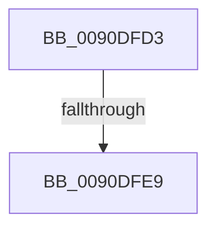

# sub_0090DFD3

- RVA: `0x0090DFD3`–`0x0090E010` (길이 `61` bytes)
- VA: `0x000000014090DFD3`
- 실행 섹션: `PAGE`
- PDB 이름 있음: `아니요`; PDB Function 태그: `아니요`
- unwind 정보 RVA: `0x00089604`
- 디코드: `17`개 명령, `61/61` bytes 표시
- 미해석 바이트: `0` (있으면 어셈블리에 `.byte`로 보존)

> 이 문서는 커널 이미지의 기계어와 PDB 기호를 분석해 생성했습니다. 4번과 5번은 함수 원형과 자료형을 바이너리 사용 방식에서 추정한 C 해석이며 원본 소스 복구 결과는 아닙니다.

## 1. Dependencies

- 직접 호출 지점: **1**; 고유 호출 대상: **1**
- 직접 호출자로 확인된 함수: **0**
- RIP 상대 이미지 참조: **0**

### Outgoing calls
- `0x0090DFF7` → [RtlUTF8ToUnicodeN](RtlUTF8ToUnicodeN_function_0090E060.md) (function, `0x0090E060`)

### Direct callers
- 이 함수 시작 RVA로 연결되는 직접 call은 확인되지 않았습니다. 간접 호출은 완전히 역산할 수 없습니다.

### Static image references
- 디코드된 RIP-relative 메모리 참조가 없습니다.

## 2. Other-region calls and transfers

- 다른 실행 섹션으로 향하는 call: **0**
- call이 아닌 외부 분기/꼬리 이동: **2**
  - `0x0090DFE7` → [sub_0090E036](Unknown_function_0090E036.md) (`tail-transfer`)
  - `0x0090E00B` → [RtlCustomCPToUnicodeN + 0x82](RtlCustomCPToUnicodeN_function_0090DEE0.md) (`tail-transfer`)

## 3. Assembly (complete function range)

```asm
0090DFD3  8B 4C 24 68                     mov ecx, dword ptr [rsp + 0x68]
0090DFD7  4C 8D 44 24 40                  lea r8, [rsp + 0x40]
0090DFDC  4D 85 D2                        test r10, r10
0090DFDF  4D 0F 45 C2                     cmovne r8, r10
0090DFE3  33 DB                           xor ebx, ebx
0090DFE5  85 C9                           test ecx, ecx
0090DFE7  74 4D                           je 0x14090e036
0090DFE9  4C 8B 4C 24 60                  mov r9, qword ptr [rsp + 0x60]
0090DFEE  8B D0                           mov edx, eax
0090DFF0  89 4C 24 20                     mov dword ptr [rsp + 0x20], ecx
0090DFF4  49 8B CB                        mov rcx, r11
0090DFF7  E8 64 00 00 00                  call 0x14090e060
0090DFFC  3D 23 00 00 C0                  cmp eax, 0xc0000023
0090E001  B9 05 00 00 80                  mov ecx, 0x80000005
0090E006  0F 44 D9                        cmove ebx, ecx
0090E009  8B C3                           mov eax, ebx
0090E00B  E9 52 FF FF FF                  jmp 0x14090df62
```

## 4. C-style interpretation (structured pseudocode)

```c
__int64 __fastcall sub_0090DFD3(__int64 a1, __int64 a2, __int64 a3, __int64 a4, __int64 a5, __int64 a6, __int64 a7, __int64 a8, __int64 a9, __int64 a10, __int64 a11, __int64 a12, unsigned int a13)
{
    __int64 result;
    __int64 v_rbx;
    unsigned int v_stack_p20;

    if (v_r10 != 0) { a8 = v_r10; }
    v_rbx = 0;
    v_stack_p20 = (unsigned int)((unsigned int)(a13));
    result = RtlUTF8ToUnicodeN(v_r11, (unsigned int)((unsigned int)(result)), a8, a12);
    if (((unsigned int)(result)) == 0xC0000023ULL) { v_rbx = (unsigned int)((unsigned int)(0x80000005ULL)); }
}
```

## 5. (Beta) C Style

```c
int64_t sub_0090DFD3(int64_t Arg1, int64_t Arg2, int64_t Arg3, int64_t Arg4, uint64_t Arg5, uint64_t Arg6, uint64_t Arg7, int64_t Arg8, uint64_t Arg9, uint64_t Arg10, uint64_t Arg11, int64_t Arg12, uint32_t Arg13)
{
    int64_t result;
    int64_t local_rbx;
    uint32_t v_stack_p20;

    if (local_r10 != 0) { Arg8 = local_r10; }
    local_rbx = 0;
    v_stack_p20 = (uint32_t)((uint32_t)(Arg13));
    result = RtlUTF8ToUnicodeN(local_r11, (uint32_t)((uint32_t)(result)), Arg8, Arg12);
    if (((uint32_t)(result)) == 0xC0000023ULL) { local_rbx = (uint32_t)((uint32_t)(0x80000005ULL)); }
}
```

## 6. Execution-region graph

[열기: 2D/3D 그래프와 함수 탐색 컨트롤 패널](../../../control-panel.html?section=page&rva=0x0090DFD3&view=graph)

- 2D 그래프는 위에서 아래로 흐르고, 3D 그래프는 빈 공간을 드래그해 회전합니다. Shift+드래그는 이동, 휠은 확대·축소, 함수 노드 선택은 대상 보고서 이동입니다.

### Static fallback


