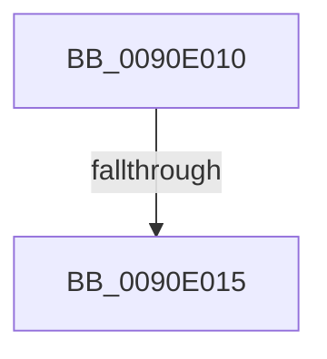

# sub_0090E010

- RVA: `0x0090E010`–`0x0090E036` (길이 `38` bytes)
- VA: `0x000000014090E010`
- 실행 섹션: `PAGE`
- PDB 이름 있음: `아니요`; PDB Function 태그: `아니요`
- unwind 정보 RVA: `0x00089614`
- 디코드: `11`개 명령, `38/38` bytes 표시
- 미해석 바이트: `0` (있으면 어셈블리에 `.byte`로 보존)

> 이 문서는 커널 이미지의 기계어와 PDB 기호를 분석해 생성했습니다. 4번과 5번은 함수 원형과 자료형을 바이너리 사용 방식에서 추정한 C 해석이며 원본 소스 복구 결과는 아닙니다.

## 1. Dependencies

- 직접 호출 지점: **0**; 고유 호출 대상: **0**
- 직접 호출자로 확인된 함수: **0**
- RIP 상대 이미지 참조: **0**

### Outgoing calls
- 직접 디코드된 call 명령이 없습니다.

### Direct callers
- 이 함수 시작 RVA로 연결되는 직접 call은 확인되지 않았습니다. 간접 호출은 완전히 역산할 수 없습니다.

### Static image references
- 디코드된 RIP-relative 메모리 참조가 없습니다.

## 2. Other-region calls and transfers

- 다른 실행 섹션으로 향하는 call: **0**
- call이 아닌 외부 분기/꼬리 이동: **2**
  - `0x0090E013` → [sub_0090DF6E + 0x44](Unknown_function_0090DF6E.md) (`tail-transfer`)
  - `0x0090E031` → [sub_0090DF6E + 0x11](Unknown_function_0090DF6E.md) (`tail-transfer`)

## 3. Assembly (complete function range)

```asm
0090E010  45 85 C9                        test r9d, r9d
0090E013  74 9D                           je 0x14090dfb2
0090E015  0F B6 53 01                     movzx edx, byte ptr [rbx + 1]
0090E019  48 FF C3                        inc rbx
0090E01C  48 03 D1                        add rdx, rcx
0090E01F  41 FF C9                        dec r9d
0090E022  0F B7 0C 56                     movzx ecx, word ptr [rsi + rdx*2]
0090E026  66 41 89 0B                     mov word ptr [r11], cx
0090E02A  49 83 C3 02                     add r11, 2
0090E02E  48 FF C3                        inc rbx
0090E031  E9 49 FF FF FF                  jmp 0x14090df7f
```

## 4. C-style interpretation (structured pseudocode)

```c
void __fastcall sub_0090E010(__int64 a1, __int64 a2, __int64 a3, int a4)
{
    __int64 v_r11;
    __int64 v_rbx;

    v_rbx = (v_rbx) + 1;
    a2 = (*(unsigned __int8 *)(v_rbx + 1)) + (a1);
    a4 = (unsigned int)((a4) - 1);
    *(unsigned __int16 *)(v_r11) = (unsigned __int16)(*(unsigned __int16 *)(v_rsi + a2 * 2));
    v_r11 = (v_r11) + (2);
    v_rbx = (v_rbx) + 1;
}
```

## 5. (Beta) C Style

```c
void sub_0090E010(int64_t Arg1, int64_t Arg2, int64_t Arg3, int32_t Arg4)
{
    int64_t local_r11;
    int64_t local_rbx;

    local_rbx = (local_rbx) + 1;
    Arg2 = (*(uint8_t *)(local_rbx + 0x1)) + (Arg1);
    Arg4 = (uint32_t)((Arg4) - 1);
    *(uint16_t *)(local_r11) = (uint16_t)(*(uint16_t *)(local_rsi + Arg2 * 2));
    local_r11 = (local_r11) + (2);
    local_rbx = (local_rbx) + 1;
}
```

## 6. Execution-region graph

[열기: 2D/3D 그래프와 함수 탐색 컨트롤 패널](../../../control-panel.html?section=page&rva=0x0090E010&view=graph)

- 2D 그래프는 위에서 아래로 흐르고, 3D 그래프는 빈 공간을 드래그해 회전합니다. Shift+드래그는 이동, 휠은 확대·축소, 함수 노드 선택은 대상 보고서 이동입니다.

### Static fallback


