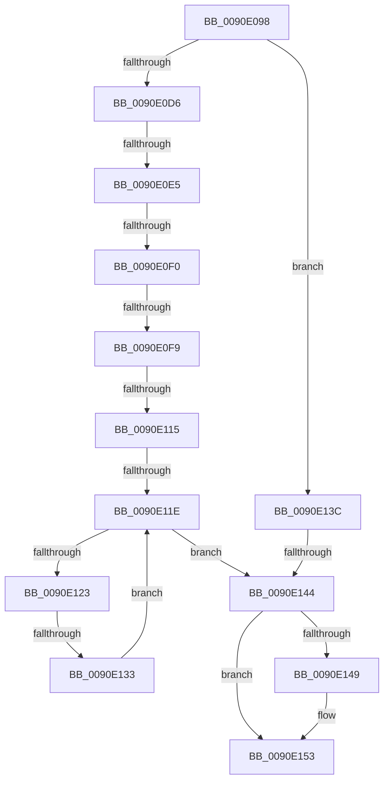

# sub_0090E098

- RVA: `0x0090E098`–`0x0090E17B` (길이 `227` bytes)
- VA: `0x000000014090E098`
- 실행 섹션: `PAGE`
- PDB 이름 있음: `아니요`; PDB Function 태그: `아니요`
- unwind 정보 RVA: `0x00089648`
- 디코드: `61`개 명령, `227/227` bytes 표시
- 미해석 바이트: `0` (있으면 어셈블리에 `.byte`로 보존)

> 이 문서는 커널 이미지의 기계어와 PDB 기호를 분석해 생성했습니다. 4번과 5번은 함수 원형과 자료형을 바이너리 사용 방식에서 추정한 C 해석이며 원본 소스 복구 결과는 아닙니다.

## 1. Dependencies

- 직접 호출 지점: **0**; 고유 호출 대상: **0**
- 직접 호출자로 확인된 함수: **0**
- RIP 상대 이미지 참조: **0**

### Outgoing calls
- 직접 디코드된 call 명령이 없습니다.

### Direct callers
- 이 함수 시작 RVA로 연결되는 직접 call은 확인되지 않았습니다. 간접 호출은 완전히 역산할 수 없습니다.

### Static image references
- 디코드된 RIP-relative 메모리 참조가 없습니다.

## 2. Other-region calls and transfers

- 다른 실행 섹션으로 향하는 call: **0**
- call이 아닌 외부 분기/꼬리 이동: **7**
  - `0x0090E0DF` → [sub_0090E2AA + 0x10D](Unknown_function_0090E2AA.md) (`tail-transfer`)
  - `0x0090E0EA` → [sub_0090E2AA + 0x1F](Unknown_function_0090E2AA.md) (`tail-transfer`)
  - `0x0090E0F3` → [sub_0090E2AA + 0x4C](Unknown_function_0090E2AA.md) (`tail-transfer`)
  - `0x0090E113` → [sub_0090E189](Unknown_function_0090E189.md) (`tail-transfer`)
  - `0x0090E118` → [sub_0090E2AA](Unknown_function_0090E2AA.md) (`tail-transfer`)
  - `0x0090E12D` → [sub_0090E2AA + 0x1F](Unknown_function_0090E2AA.md) (`tail-transfer`)
  - `0x0090E13E` → [sub_0090E406 + 0xA9](Unknown_function_0090E406.md) (`tail-transfer`)

## 3. Assembly (complete function range)

```asm
0090E098  48 89 6C 24 50                  mov qword ptr [rsp + 0x50], rbp
0090E09D  48 89 74 24 58                  mov qword ptr [rsp + 0x58], rsi
0090E0A2  4C 89 64 24 60                  mov qword ptr [rsp + 0x60], r12
0090E0A7  41 BC 40 28 00 00               mov r12d, 0x2840
0090E0AD  4C 89 6C 24 30                  mov qword ptr [rsp + 0x30], r13
0090E0B2  41 BD FF 03 00 00               mov r13d, 0x3ff
0090E0B8  4C 89 74 24 28                  mov qword ptr [rsp + 0x28], r14
0090E0BD  4C 89 7C 24 20                  mov qword ptr [rsp + 0x20], r15
0090E0C2  41 BF FF 07 00 00               mov r15d, 0x7ff
0090E0C8  41 BE FD FF 00 00               mov r14d, 0xfffd
0090E0CE  49 8B E9                        mov rbp, r9
0090E0D1  4D 3B CB                        cmp r9, r11
0090E0D4  73 66                           jae 0x14090e13c
0090E0D6  41 0F BE 31                     movsx esi, byte ptr [r9]
0090E0DA  49 FF C1                        inc r9
0090E0DD  85 D2                           test edx, edx
0090E0DF  0F 85 D2 02 00 00               jne 0x14090e3b7
0090E0E5  8B D6                           mov edx, esi
0090E0E7  83 FA 7F                        cmp edx, 0x7f
0090E0EA  0F 87 D9 01 00 00               ja 0x14090e2c9
0090E0F0  48 3B C7                        cmp rax, rdi
0090E0F3  0F 83 FD 01 00 00               jae 0x14090e2f6
0090E0F9  66 89 10                        mov word ptr [rax], dx
0090E0FC  48 8B CF                        mov rcx, rdi
0090E0FF  48 83 C0 02                     add rax, 2
0090E103  49 8B D3                        mov rdx, r11
0090E106  48 2B C8                        sub rcx, rax
0090E109  49 2B D1                        sub rdx, r9
0090E10C  48 D1 F9                        sar rcx, 1
0090E10F  48 83 FA 0D                     cmp rdx, 0xd
0090E113  77 74                           ja 0x14090e189
0090E115  48 3B CA                        cmp rcx, rdx
0090E118  0F 82 8C 01 00 00               jb 0x14090e2aa
0090E11E  4D 3B CB                        cmp r9, r11
0090E121  73 21                           jae 0x14090e144
0090E123  41 0F BE 11                     movsx edx, byte ptr [r9]
0090E127  49 FF C1                        inc r9
0090E12A  83 FA 7F                        cmp edx, 0x7f
0090E12D  0F 87 96 01 00 00               ja 0x14090e2c9
0090E133  66 89 10                        mov word ptr [rax], dx
0090E136  48 83 C0 02                     add rax, 2
0090E13A  EB E2                           jmp 0x14090e11e
0090E13C  85 D2                           test edx, edx
0090E13E  0F 85 6B 03 00 00               jne 0x14090e4af
0090E144  48 85 DB                        test rbx, rbx
0090E147  74 0A                           je 0x14090e153
0090E149  49 2B C2                        sub rax, r10
0090E14C  48 D1 F8                        sar rax, 1
0090E14F  03 C0                           add eax, eax
0090E151  89 03                           mov dword ptr [rbx], eax
0090E153  41 8B C0                        mov eax, r8d
0090E156  4C 8B 74 24 28                  mov r14, qword ptr [rsp + 0x28]
0090E15B  4C 8B 6C 24 30                  mov r13, qword ptr [rsp + 0x30]
0090E160  4C 8B 64 24 60                  mov r12, qword ptr [rsp + 0x60]
0090E165  48 8B 74 24 58                  mov rsi, qword ptr [rsp + 0x58]
0090E16A  48 8B 6C 24 50                  mov rbp, qword ptr [rsp + 0x50]
0090E16F  4C 8B 7C 24 20                  mov r15, qword ptr [rsp + 0x20]
0090E174  48 83 C4 38                     add rsp, 0x38
0090E178  5F                              pop rdi
0090E179  5B                              pop rbx
0090E17A  C3                              ret
```

## 4. C-style interpretation (structured pseudocode)

```c
__int64 __fastcall sub_0090E098(__int64 a1, int a2, int a3, __int64 a4, __int64 a5, __int64 a6, __int64 a7, __int64 a8, __int64 a9, __int64 a10, __int64 a11, __int64 a12)
{
    __int64 result;
    __int64 v_rsp;
    unsigned __int64 v_stack_p20;
    unsigned __int64 v_stack_p28;
    unsigned __int64 v_stack_p30;
    unsigned __int64 v_stack_p50;
    unsigned __int64 v_stack_p58;
    unsigned __int64 v_stack_p60;

    v_stack_p50 = v_rbp;
    v_stack_p58 = v_rsi;
    v_stack_p60 = v_r12;
    v_stack_p30 = v_r13;
    v_stack_p28 = v_r14;
    v_stack_p20 = v_r15;
    if (a4 >= v_r11) goto loc_0090E13C;
    a4 = (a4) + 1;
    *(unsigned __int16 *)(result) = (unsigned __int16)((unsigned int)((unsigned int)((__int8)(*(unsigned __int8 *)(a4)))));
    result = (result) + (2);
    a1 = (v_rdi) - (result);
    a2 = (v_r11) - (a4);
    a1 = (a1) >> (1);
loc_0090E11E:
    if (a4 >= v_r11) goto loc_0090E144;
    a4 = (a4) + 1;
    *(unsigned __int16 *)(result) = (unsigned __int16)((__int8)(*(unsigned __int8 *)(a4)));
    result = (result) + (2);
    goto loc_0090E11E;
loc_0090E13C:
loc_0090E144:
    if (v_rbx != 0) {
        result = (result) - (v_r10);
        result = (result) >> (1);
        result = (unsigned int)((result) + ((unsigned int)(result)));
        *(unsigned int *)(v_rbx) = (unsigned int)(result);
    }
    v_rsp = (v_rsp) + (56);
    return (unsigned int)(a3);
}
```

## 5. (Beta) C Style

```c
int64_t sub_0090E098(int64_t Arg1, int32_t Arg2, int32_t Arg3, int64_t Arg4, int64_t Arg5, int64_t Arg6, uint64_t Arg7, uint64_t Arg8, uint64_t Arg9, int64_t Arg10, int64_t Arg11, int64_t Arg12)
{
    int64_t result;
    int64_t local_rsp;
    uint64_t v_stack_p20;
    uint64_t v_stack_p28;
    uint64_t v_stack_p30;
    uint64_t v_stack_p50;
    uint64_t v_stack_p58;
    uint64_t v_stack_p60;

    v_stack_p50 = local_rbp;
    v_stack_p58 = local_rsi;
    v_stack_p60 = local_r12;
    v_stack_p30 = local_r13;
    v_stack_p28 = local_r14;
    v_stack_p20 = local_r15;
    if (Arg4 >= local_r11) goto loc_0090E13C;
    Arg4 = (Arg4) + 1;
    *(uint16_t *)(result) = (uint16_t)((uint32_t)((uint32_t)((int8_t)(*(uint8_t *)(Arg4)))));
    result = (result) + (2);
    Arg1 = (local_rdi) - (result);
    Arg2 = (local_r11) - (Arg4);
    Arg1 = (Arg1) >> (1);
loc_0090E11E:
    if (Arg4 >= local_r11) goto loc_0090E144;
    Arg4 = (Arg4) + 1;
    *(uint16_t *)(result) = (uint16_t)((int8_t)(*(uint8_t *)(Arg4)));
    result = (result) + (2);
    goto loc_0090E11E;
loc_0090E13C:
loc_0090E144:
    if (local_rbx != 0) {
        result = (result) - (local_r10);
        result = (result) >> (1);
        result = (uint32_t)((result) + ((uint32_t)(result)));
        *(uint32_t *)(local_rbx) = (uint32_t)(result);
    }
    local_rsp = (local_rsp) + (56);
    return (uint32_t)(Arg3);
}
```

## 6. Execution-region graph

[열기: 2D/3D 그래프와 함수 탐색 컨트롤 패널](../../../control-panel.html?section=page&rva=0x0090E098&view=graph)

- 2D 그래프는 위에서 아래로 흐르고, 3D 그래프는 빈 공간을 드래그해 회전합니다. Shift+드래그는 이동, 휠은 확대·축소, 함수 노드 선택은 대상 보고서 이동입니다.

### Static fallback


