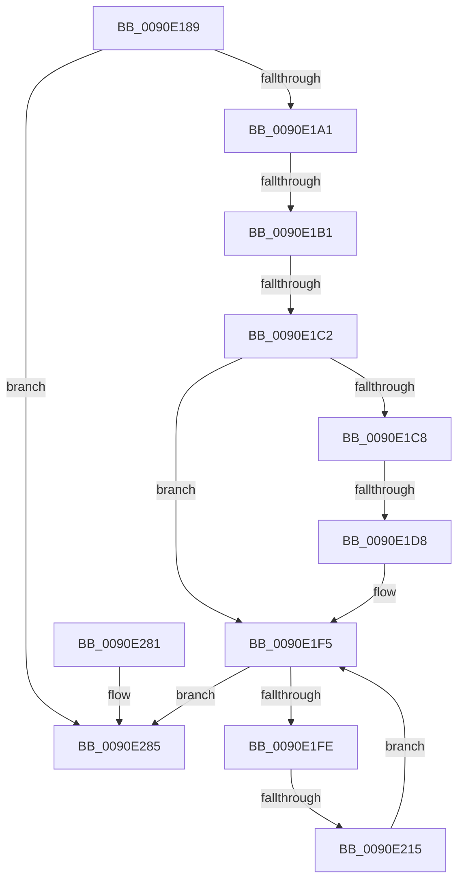

# sub_0090E189

- RVA: `0x0090E189`–`0x0090E28C` (길이 `259` bytes)
- VA: `0x000000014090E189`
- 실행 섹션: `PAGE`
- PDB 이름 있음: `아니요`; PDB Function 태그: `아니요`
- unwind 정보 RVA: `0x00089688`
- 디코드: `69`개 명령, `259/259` bytes 표시
- 미해석 바이트: `0` (있으면 어셈블리에 `.byte`로 보존)

> 이 문서는 커널 이미지의 기계어와 PDB 기호를 분석해 생성했습니다. 4번과 5번은 함수 원형과 자료형을 바이너리 사용 방식에서 추정한 C 해석이며 원본 소스 복구 결과는 아닙니다.

## 1. Dependencies

- 직접 호출 지점: **0**; 고유 호출 대상: **0**
- 직접 호출자로 확인된 함수: **0**
- RIP 상대 이미지 참조: **0**

### Outgoing calls
- 직접 디코드된 call 명령이 없습니다.

### Direct callers
- 이 함수 시작 RVA로 연결되는 직접 call은 확인되지 않았습니다. 간접 호출은 완전히 역산할 수 없습니다.

### Static image references
- 디코드된 RIP-relative 메모리 참조가 없습니다.

## 2. Other-region calls and transfers

- 다른 실행 섹션으로 향하는 call: **0**
- call이 아닌 외부 분기/꼬리 이동: **5**
  - `0x0090E1AB` → [sub_0090E2AA + 0x7C](Unknown_function_0090E2AA.md) (`tail-transfer`)
  - `0x0090E1BC` → [sub_0090E2AA + 0x7](Unknown_function_0090E2AA.md) (`tail-transfer`)
  - `0x0090E1D2` → [sub_0090E2AA + 0x65](Unknown_function_0090E2AA.md) (`tail-transfer`)
  - `0x0090E20F` → [sub_0090E2AA + 0x65](Unknown_function_0090E2AA.md) (`tail-transfer`)
  - `0x0090E287` → [sub_0090E098 + 0x30](Unknown_function_0090E098.md) (`tail-transfer`)

## 3. Assembly (complete function range)

```asm
0090E189  48 3B D1                        cmp rdx, rcx
0090E18C  48 0F 42 CA                     cmovb rcx, rdx
0090E190  48 8D 69 F9                     lea rbp, [rcx - 7]
0090E194  48 8D 2C 68                     lea rbp, [rax + rbp*2]
0090E198  48 3B C5                        cmp rax, rbp
0090E19B  0F 83 E4 00 00 00               jae 0x14090e285
0090E1A1  41 0F BE 11                     movsx edx, byte ptr [r9]
0090E1A5  49 FF C1                        inc r9
0090E1A8  83 FA 7F                        cmp edx, 0x7f
0090E1AB  0F 87 75 01 00 00               ja 0x14090e326
0090E1B1  66 89 10                        mov word ptr [rax], dx
0090E1B4  48 83 C0 02                     add rax, 2
0090E1B8  41 F6 C1 01                     test r9b, 1
0090E1BC  0F 85 EF 00 00 00               jne 0x14090e2b1
0090E1C2  41 F6 C1 02                     test r9b, 2
0090E1C6  74 2D                           je 0x14090e1f5
0090E1C8  41 0F B7 11                     movzx edx, word ptr [r9]
0090E1CC  F7 C2 80 80 00 00               test edx, 0x8080
0090E1D2  0F 85 37 01 00 00               jne 0x14090e30f
0090E1D8  0F B7 CA                        movzx ecx, dx
0090E1DB  49 83 C1 02                     add r9, 2
0090E1DF  C1 EA 08                        shr edx, 8
0090E1E2  66 83 E1 7F                     and cx, 0x7f
0090E1E6  66 83 E2 7F                     and dx, 0x7f
0090E1EA  66 89 08                        mov word ptr [rax], cx
0090E1ED  66 89 50 02                     mov word ptr [rax + 2], dx
0090E1F1  48 83 C0 04                     add rax, 4
0090E1F5  48 3B C5                        cmp rax, rbp
0090E1F8  0F 83 87 00 00 00               jae 0x14090e285
0090E1FE  41 8B 71 04                     mov esi, dword ptr [r9 + 4]
0090E202  8B CE                           mov ecx, esi
0090E204  41 8B 11                        mov edx, dword ptr [r9]
0090E207  0B CA                           or ecx, edx
0090E209  F7 C1 80 80 80 80               test ecx, 0x80808080
0090E20F  0F 85 FA 00 00 00               jne 0x14090e30f
0090E215  0F B7 CA                        movzx ecx, dx
0090E218  49 83 C1 08                     add r9, 8
0090E21C  66 83 E1 7F                     and cx, 0x7f
0090E220  66 89 08                        mov word ptr [rax], cx
0090E223  8B CA                           mov ecx, edx
0090E225  C1 E9 08                        shr ecx, 8
0090E228  66 83 E1 7F                     and cx, 0x7f
0090E22C  66 89 48 02                     mov word ptr [rax + 2], cx
0090E230  8B CA                           mov ecx, edx
0090E232  C1 E9 10                        shr ecx, 0x10
0090E235  66 83 E1 7F                     and cx, 0x7f
0090E239  C1 EA 18                        shr edx, 0x18
0090E23C  66 89 48 04                     mov word ptr [rax + 4], cx
0090E240  66 83 E2 7F                     and dx, 0x7f
0090E244  0F B7 CE                        movzx ecx, si
0090E247  66 89 50 06                     mov word ptr [rax + 6], dx
0090E24B  66 83 E1 7F                     and cx, 0x7f
0090E24F  66 89 48 08                     mov word ptr [rax + 8], cx
0090E253  8B CE                           mov ecx, esi
0090E255  C1 E9 08                        shr ecx, 8
0090E258  66 83 E1 7F                     and cx, 0x7f
0090E25C  66 89 48 0A                     mov word ptr [rax + 0xa], cx
0090E260  8B CE                           mov ecx, esi
0090E262  C1 E9 10                        shr ecx, 0x10
0090E265  C1 EE 18                        shr esi, 0x18
0090E268  66 83 E1 7F                     and cx, 0x7f
0090E26C  66 83 E6 7F                     and si, 0x7f
0090E270  66 89 48 0C                     mov word ptr [rax + 0xc], cx
0090E274  66 89 70 0E                     mov word ptr [rax + 0xe], si
0090E278  48 83 C0 10                     add rax, 0x10
0090E27C  E9 74 FF FF FF                  jmp 0x14090e1f5
0090E281  49 83 E9 02                     sub r9, 2
0090E285  33 D2                           xor edx, edx
0090E287  E9 3C FE FF FF                  jmp 0x14090e0c8
```

## 4. C-style interpretation (structured pseudocode)

```c
__int64 __fastcall sub_0090E189(__int64 a1, __int64 a2, __int64 a3, __int64 a4)
{
    __int64 result;
    __int64 v_rsi;

    if (a2 < a1) { a1 = a2; }
    if (result >= (result + a1 - 7 * 2)) goto loc_0090E285;
    a4 = (a4) + 1;
    *(unsigned __int16 *)(result) = (unsigned __int16)((__int8)(*(unsigned __int8 *)(a4)));
    result = (result) + (2);
    if ((((unsigned __int8)(a4)) & (2)) == 0) goto loc_0090E1F5;
    a4 = (a4) + (2);
    a2 = (unsigned int)((*(unsigned __int16 *)(a4)) >> (8));
    a1 = (unsigned __int16)(((unsigned __int16)(*(unsigned __int16 *)(a4))) & (127));
    a2 = (unsigned __int16)((a2) & (127));
    *(unsigned __int16 *)(result) = (unsigned __int16)(a1);
    *(unsigned __int16 *)(result + 2) = (unsigned __int16)(a2);
    result = (result) + (4);
loc_0090E1F5:
    if (result >= (result + a1 - 7 * 2)) goto loc_0090E285;
    a1 = (unsigned int)(((unsigned int)((unsigned int)((unsigned int)(*(unsigned int *)(a4 + 4))))) | ((unsigned int)((unsigned int)(*(unsigned int *)(a4)))));
    a4 = (a4) + (8);
    a1 = (unsigned __int16)(((unsigned __int16)((unsigned int)(*(unsigned int *)(a4)))) & (127));
    *(unsigned __int16 *)(result) = (unsigned __int16)(a1);
    a1 = (unsigned int)(((unsigned int)((unsigned int)((unsigned int)(*(unsigned int *)(a4))))) >> (8));
    a1 = (unsigned __int16)((a1) & (127));
    *(unsigned __int16 *)(result + 2) = (unsigned __int16)(a1);
    a1 = (unsigned int)(((unsigned int)((unsigned int)((unsigned int)(*(unsigned int *)(a4))))) >> (16));
    a1 = (unsigned __int16)((a1) & (127));
    a2 = (unsigned int)(((unsigned int)(*(unsigned int *)(a4))) >> (24));
    *(unsigned __int16 *)(result + 4) = (unsigned __int16)(a1);
    a2 = (unsigned __int16)((a2) & (127));
    *(unsigned __int16 *)(result + 6) = (unsigned __int16)(a2);
    a1 = (unsigned __int16)(((unsigned __int16)((unsigned int)(*(unsigned int *)(a4 + 4)))) & (127));
    *(unsigned __int16 *)(result + 8) = (unsigned __int16)(a1);
    a1 = (unsigned int)(((unsigned int)((unsigned int)((unsigned int)(*(unsigned int *)(a4 + 4))))) >> (8));
    a1 = (unsigned __int16)((a1) & (127));
    *(unsigned __int16 *)(result + 10) = (unsigned __int16)(a1);
    a1 = (unsigned int)(((unsigned int)((unsigned int)((unsigned int)(*(unsigned int *)(a4 + 4))))) >> (16));
    v_rsi = (unsigned int)(((unsigned int)(*(unsigned int *)(a4 + 4))) >> (24));
    a1 = (unsigned __int16)((a1) & (127));
    v_rsi = (unsigned __int16)((v_rsi) & (127));
    *(unsigned __int16 *)(result + 12) = (unsigned __int16)(a1);
    *(unsigned __int16 *)(result + 14) = (unsigned __int16)(v_rsi);
    result = (result) + (16);
    goto loc_0090E1F5;
loc_0090E285:
    a2 = 0;
}
```

## 5. (Beta) C Style

```c
int64_t sub_0090E189(int64_t Arg1, int64_t Arg2, int64_t Arg3, void *Arg4)
{
    uint8_t *arg4 = (uint8_t *)Arg4;

    int64_t result;
    int64_t local_rsi;

    if (Arg2 < Arg1) { Arg1 = Arg2; }
    if (result >= (result + Arg1 - 7 * 2)) goto loc_0090E285;
    Arg4 = (Arg4) + 1;
    *(uint16_t *)(result) = (uint16_t)((int8_t)(*(uint8_t *)(arg4)));
    result = (result) + (2);
    if ((((uint8_t)(Arg4)) & (2)) == 0) goto loc_0090E1F5;
    Arg4 = (Arg4) + (2);
    Arg2 = (uint32_t)((*(uint16_t *)(arg4)) >> (8));
    Arg1 = (uint16_t)(((uint16_t)(*(uint16_t *)(arg4))) & (127));
    Arg2 = (uint16_t)((Arg2) & (127));
    *(uint16_t *)(result) = (uint16_t)(Arg1);
    *(uint16_t *)(result + 0x2) = (uint16_t)(Arg2);
    result = (result) + (4);
loc_0090E1F5:
    if (result >= (result + Arg1 - 7 * 2)) goto loc_0090E285;
    Arg1 = (uint32_t)(((uint32_t)((uint32_t)((uint32_t)(*(uint32_t *)(arg4 + 0x4))))) | ((uint32_t)((uint32_t)(*(uint32_t *)(arg4)))));
    Arg4 = (Arg4) + (8);
    Arg1 = (uint16_t)(((uint16_t)((uint32_t)(*(uint32_t *)(arg4)))) & (127));
    *(uint16_t *)(result) = (uint16_t)(Arg1);
    Arg1 = (uint32_t)(((uint32_t)((uint32_t)((uint32_t)(*(uint32_t *)(arg4))))) >> (8));
    Arg1 = (uint16_t)((Arg1) & (127));
    *(uint16_t *)(result + 0x2) = (uint16_t)(Arg1);
    Arg1 = (uint32_t)(((uint32_t)((uint32_t)((uint32_t)(*(uint32_t *)(arg4))))) >> (16));
    Arg1 = (uint16_t)((Arg1) & (127));
    Arg2 = (uint32_t)(((uint32_t)(*(uint32_t *)(arg4))) >> (24));
    *(uint16_t *)(result + 0x4) = (uint16_t)(Arg1);
    Arg2 = (uint16_t)((Arg2) & (127));
    *(uint16_t *)(result + 0x6) = (uint16_t)(Arg2);
    Arg1 = (uint16_t)(((uint16_t)((uint32_t)(*(uint32_t *)(arg4 + 0x4)))) & (127));
    *(uint16_t *)(result + 0x8) = (uint16_t)(Arg1);
    Arg1 = (uint32_t)(((uint32_t)((uint32_t)((uint32_t)(*(uint32_t *)(arg4 + 0x4))))) >> (8));
    Arg1 = (uint16_t)((Arg1) & (127));
    *(uint16_t *)(result + 0xA) = (uint16_t)(Arg1);
    Arg1 = (uint32_t)(((uint32_t)((uint32_t)((uint32_t)(*(uint32_t *)(arg4 + 0x4))))) >> (16));
    local_rsi = (uint32_t)(((uint32_t)(*(uint32_t *)(arg4 + 0x4))) >> (24));
    Arg1 = (uint16_t)((Arg1) & (127));
    local_rsi = (uint16_t)((local_rsi) & (127));
    *(uint16_t *)(result + 0xC) = (uint16_t)(Arg1);
    *(uint16_t *)(result + 0xE) = (uint16_t)(local_rsi);
    result = (result) + (16);
    goto loc_0090E1F5;
loc_0090E285:
    Arg2 = 0;
}
```

### 관측된 메모리 오프셋

구조체 형식이 확인되지 않은 접근은 인자 기준의 오프셋으로만 기록했습니다.

| 기준 인자 | 오프셋 표현 | 폭 (bit) | 접근 |
|---|---:|---:|---|
| `Arg4` | `+ 0x0` | `8` | `R` |

## 6. Execution-region graph

[열기: 2D/3D 그래프와 함수 탐색 컨트롤 패널](../../../control-panel.html?section=page&rva=0x0090E189&view=graph)

- 2D 그래프는 위에서 아래로 흐르고, 3D 그래프는 빈 공간을 드래그해 회전합니다. Shift+드래그는 이동, 휠은 확대·축소, 함수 노드 선택은 대상 보고서 이동입니다.

### Static fallback


