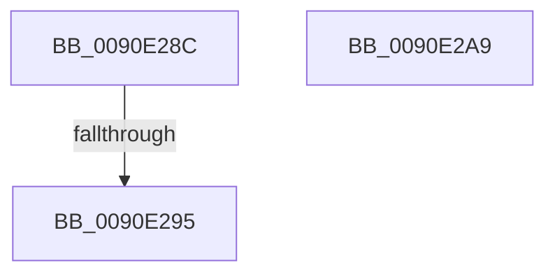

# sub_0090E28C

- RVA: `0x0090E28C`–`0x0090E2AA` (길이 `30` bytes)
- VA: `0x000000014090E28C`
- 실행 섹션: `PAGE`
- PDB 이름 있음: `아니요`; PDB Function 태그: `아니요`
- unwind 정보 RVA: `0x000896B0`
- 디코드: `11`개 명령, `30/30` bytes 표시
- 미해석 바이트: `0` (있으면 어셈블리에 `.byte`로 보존)

> 이 문서는 커널 이미지의 기계어와 PDB 기호를 분석해 생성했습니다. 4번과 5번은 함수 원형과 자료형을 바이너리 사용 방식에서 추정한 C 해석이며 원본 소스 복구 결과는 아닙니다.

## 1. Dependencies

- 직접 호출 지점: **1**; 고유 호출 대상: **1**
- 직접 호출자로 확인된 함수: **0**
- RIP 상대 이미지 참조: **0**

### Outgoing calls
- `0x0090E29D` → [CountUTF8ToUnicode](../../text/48/CountUTF8ToUnicode_function_00485D40.md) (function, `0x00485D40`)

### Direct callers
- 이 함수 시작 RVA로 연결되는 직접 call은 확인되지 않았습니다. 간접 호출은 완전히 역산할 수 없습니다.

### Static image references
- 디코드된 RIP-relative 메모리 참조가 없습니다.

## 2. Other-region calls and transfers

- 다른 실행 섹션으로 향하는 call: **1**
  - `0x0090E29D` → [CountUTF8ToUnicode](../../text/48/CountUTF8ToUnicode_function_00485D40.md) (`PAGE` → `.text`)
- call이 아닌 외부 분기/꼬리 이동: **1**
  - `0x0090E28F` → [sub_0090E3F9](Unknown_function_0090E3F9.md) (`tail-transfer`)

## 3. Assembly (complete function range)

```asm
0090E28C  48 85 DB                        test rbx, rbx
0090E28F  0F 84 64 01 00 00               je 0x14090e3f9
0090E295  8B D1                           mov edx, ecx
0090E297  4C 8B C3                        mov r8, rbx
0090E29A  49 8B C9                        mov rcx, r9
0090E29D  E8 9E 7A B7 FF                  call 0x140485d40
0090E2A2  48 83 C4 38                     add rsp, 0x38
0090E2A6  5F                              pop rdi
0090E2A7  5B                              pop rbx
0090E2A8  C3                              ret
0090E2A9  CC                              int3
```

## 4. C-style interpretation (structured pseudocode)

```c
__int64 __fastcall sub_0090E28C(int a1, __int64 a2, __int64 a3, __int64 a4)
{
    __int64 result;
    __int64 v_rsp;

    result = CountUTF8ToUnicode(a4, (unsigned int)(a1), v_rbx, a4);
    v_rsp = (v_rsp) + (56);
    return result;
}
```

## 5. (Beta) C Style

```c
int64_t sub_0090E28C(int32_t Arg1, int64_t Arg2, int64_t Arg3, int64_t Arg4)
{
    int64_t result;
    int64_t local_rsp;

    result = CountUTF8ToUnicode(Arg4, (uint32_t)(Arg1), local_rbx, Arg4);
    local_rsp = (local_rsp) + (56);
    return result;
}
```

## 6. Execution-region graph

[열기: 2D/3D 그래프와 함수 탐색 컨트롤 패널](../../../control-panel.html?section=page&rva=0x0090E28C&view=graph)

- 2D 그래프는 위에서 아래로 흐르고, 3D 그래프는 빈 공간을 드래그해 회전합니다. Shift+드래그는 이동, 휠은 확대·축소, 함수 노드 선택은 대상 보고서 이동입니다.

### Static fallback


