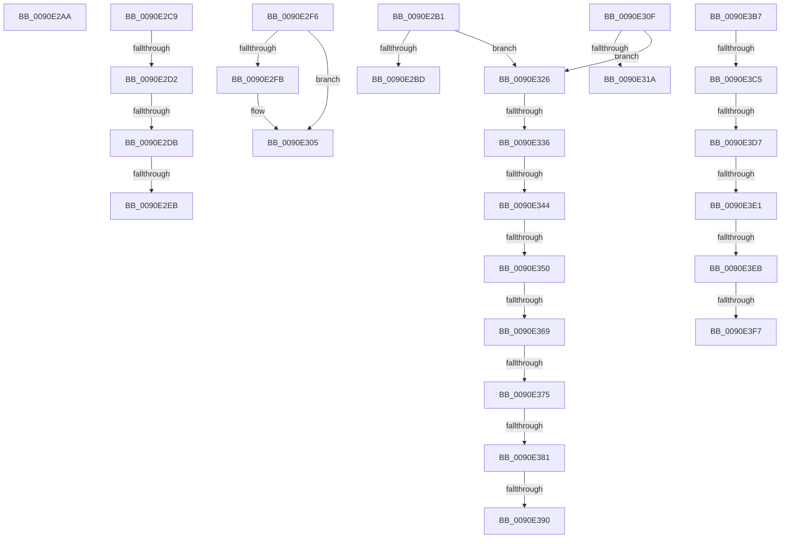

# sub_0090E2AA

- RVA: `0x0090E2AA`–`0x0090E3F9` (길이 `335` bytes)
- VA: `0x000000014090E2AA`
- 실행 섹션: `PAGE`
- PDB 이름 있음: `아니요`; PDB Function 태그: `아니요`
- unwind 정보 RVA: `0x000896C4`
- 디코드: `91`개 명령, `335/335` bytes 표시
- 미해석 바이트: `0` (있으면 어셈블리에 `.byte`로 보존)

> 이 문서는 커널 이미지의 기계어와 PDB 기호를 분석해 생성했습니다. 4번과 5번은 함수 원형과 자료형을 바이너리 사용 방식에서 추정한 C 해석이며 원본 소스 복구 결과는 아닙니다.

## 1. Dependencies

- 직접 호출 지점: **0**; 고유 호출 대상: **0**
- 직접 호출자로 확인된 함수: **0**
- RIP 상대 이미지 참조: **0**

### Outgoing calls
- 직접 디코드된 call 명령이 없습니다.

### Direct callers
- 이 함수 시작 RVA로 연결되는 직접 call은 확인되지 않았습니다. 간접 호출은 완전히 역산할 수 없습니다.

### Static image references
- 디코드된 RIP-relative 메모리 참조가 없습니다.

## 2. Other-region calls and transfers

- 다른 실행 섹션으로 향하는 call: **0**
- call이 아닌 외부 분기/꼬리 이동: **22**
  - `0x0090E2AC` → [sub_0090E098 + 0x36](Unknown_function_0090E098.md) (`tail-transfer`)
  - `0x0090E2C4` → [sub_0090E189 + 0x39](Unknown_function_0090E189.md) (`tail-transfer`)
  - `0x0090E2CC` → [sub_0090E406 + 0x53](Unknown_function_0090E406.md) (`tail-transfer`)
  - `0x0090E2D5` → [sub_0090E406 + 0x3F](Unknown_function_0090E406.md) (`tail-transfer`)
  - `0x0090E2E5` → [sub_0090E406 + 0x83](Unknown_function_0090E406.md) (`tail-transfer`)
  - `0x0090E2F1` → [sub_0090E098 + 0x36](Unknown_function_0090E098.md) (`tail-transfer`)
  - `0x0090E30A` → [sub_0090E098 + 0xBE](Unknown_function_0090E098.md) (`tail-transfer`)
  - `0x0090E321` → [sub_0090E189 + 0xF](Unknown_function_0090E189.md) (`tail-transfer`)
  - `0x0090E330` → [sub_0090E189 + 0xF8](Unknown_function_0090E189.md) (`tail-transfer`)
  - `0x0090E33E` → [sub_0090E189 + 0xF8](Unknown_function_0090E189.md) (`tail-transfer`)
  - `0x0090E34A` → [sub_0090E406 + 0x93](Unknown_function_0090E406.md) (`tail-transfer`)
  - `0x0090E363` → [sub_00B21316](../B2/Unknown_function_00B21316.md) (`tail-transfer`)
  - `0x0090E36F` → [sub_0090E189 + 0xF8](Unknown_function_0090E189.md) (`tail-transfer`)
  - `0x0090E37B` → [sub_0090E189 + 0xF8](Unknown_function_0090E189.md) (`tail-transfer`)
  - `0x0090E38A` → [sub_0090E189 + 0xF8](Unknown_function_0090E189.md) (`tail-transfer`)
  - `0x0090E3B2` → [sub_0090E189 + 0xF](Unknown_function_0090E189.md) (`tail-transfer`)
  - `0x0090E3BF` → [sub_0090E406 + 0x50](Unknown_function_0090E406.md) (`tail-transfer`)
  - `0x0090E3D5` → [sub_0090E406](Unknown_function_0090E406.md) (`tail-transfer`)
  - `0x0090E3DB` → [sub_0090E406 + 0x61](Unknown_function_0090E406.md) (`tail-transfer`)
  - `0x0090E3E9` → [sub_0090E406 + 0x53](Unknown_function_0090E406.md) (`tail-transfer`)
  - `0x0090E3F1` → [sub_0090E098 + 0x36](Unknown_function_0090E098.md) (`tail-transfer`)
  - `0x0090E3F7` → [sub_0090E406 + 0x53](Unknown_function_0090E406.md) (`tail-transfer`)

## 3. Assembly (complete function range)

```asm
0090E2AA  33 D2                           xor edx, edx
0090E2AC  E9 1D FE FF FF                  jmp 0x14090e0ce
0090E2B1  41 0F BE 11                     movsx edx, byte ptr [r9]
0090E2B5  49 FF C1                        inc r9
0090E2B8  83 FA 7F                        cmp edx, 0x7f
0090E2BB  77 69                           ja 0x14090e326
0090E2BD  66 89 10                        mov word ptr [rax], dx
0090E2C0  48 83 C0 02                     add rax, 2
0090E2C4  E9 F9 FE FF FF                  jmp 0x14090e1c2
0090E2C9  F6 C2 40                        test dl, 0x40
0090E2CC  0F 84 87 01 00 00               je 0x14090e459
0090E2D2  F6 C2 20                        test dl, 0x20
0090E2D5  0F 84 6A 01 00 00               je 0x14090e445
0090E2DB  8B CA                           mov ecx, edx
0090E2DD  83 E1 0F                        and ecx, 0xf
0090E2E0  F6 C2 10                        test dl, 0x10
0090E2E3  8B D1                           mov edx, ecx
0090E2E5  0F 85 9E 01 00 00               jne 0x14090e489
0090E2EB  81 CA 00 80 22 48               or edx, 0x48228000
0090E2F1  E9 D8 FD FF FF                  jmp 0x14090e0ce
0090E2F6  48 85 DB                        test rbx, rbx
0090E2F9  74 0A                           je 0x14090e305
0090E2FB  49 2B C2                        sub rax, r10
0090E2FE  48 D1 F8                        sar rax, 1
0090E301  03 C0                           add eax, eax
0090E303  89 03                           mov dword ptr [rbx], eax
0090E305  B8 23 00 00 C0                  mov eax, 0xc0000023
0090E30A  E9 47 FE FF FF                  jmp 0x14090e156
0090E30F  0F B6 D2                        movzx edx, dl
0090E312  49 FF C1                        inc r9
0090E315  83 FA 7F                        cmp edx, 0x7f
0090E318  77 0C                           ja 0x14090e326
0090E31A  66 89 10                        mov word ptr [rax], dx
0090E31D  48 83 C0 02                     add rax, 2
0090E321  E9 72 FE FF FF                  jmp 0x14090e198
0090E326  41 0F BE 31                     movsx esi, byte ptr [r9]
0090E32A  49 FF C1                        inc r9
0090E32D  F6 C2 40                        test dl, 0x40
0090E330  0F 84 4B FF FF FF               je 0x14090e281
0090E336  8B CE                           mov ecx, esi
0090E338  80 E1 C0                        and cl, 0xc0
0090E33B  80 F9 80                        cmp cl, 0x80
0090E33E  0F 85 3D FF FF FF               jne 0x14090e281
0090E344  83 E6 3F                        and esi, 0x3f
0090E347  F6 C2 20                        test dl, 0x20
0090E34A  0F 84 49 01 00 00               je 0x14090e499
0090E350  45 0F BE 31                     movsx r14d, byte ptr [r9]
0090E354  8B CA                           mov ecx, edx
0090E356  83 E1 0F                        and ecx, 0xf
0090E359  C1 E1 06                        shl ecx, 6
0090E35C  0B F1                           or esi, ecx
0090E35E  8B CE                           mov ecx, esi
0090E360  F6 C2 10                        test dl, 0x10
0090E363  0F 85 AD 2F 21 00               jne 0x140b21316
0090E369  81 E1 E0 03 00 00               and ecx, 0x3e0
0090E36F  0F 84 0C FF FF FF               je 0x14090e281
0090E375  81 F9 60 03 00 00               cmp ecx, 0x360
0090E37B  0F 84 00 FF FF FF               je 0x14090e281
0090E381  41 8B CE                        mov ecx, r14d
0090E384  80 E1 C0                        and cl, 0xc0
0090E387  80 F9 80                        cmp cl, 0x80
0090E38A  0F 85 F1 FE FF FF               jne 0x14090e281
0090E390  49 FF C1                        inc r9
0090E393  C1 E6 06                        shl esi, 6
0090E396  41 83 E6 3F                     and r14d, 0x3f
0090E39A  41 0B F6                        or esi, r14d
0090E39D  48 C7 C1 FE FF FF FF            mov rcx, 0xfffffffffffffffe
0090E3A4  48 03 E9                        add rbp, rcx
0090E3A7  66 89 30                        mov word ptr [rax], si
0090E3AA  48 83 C0 02                     add rax, 2
0090E3AE  48 83 ED 02                     sub rbp, 2
0090E3B2  E9 E1 FD FF FF                  jmp 0x14090e198
0090E3B7  8B CE                           mov ecx, esi
0090E3B9  80 E1 C0                        and cl, 0xc0
0090E3BC  80 F9 80                        cmp cl, 0x80
0090E3BF  0F 85 91 00 00 00               jne 0x14090e456
0090E3C5  8B CA                           mov ecx, edx
0090E3C7  83 E6 3F                        and esi, 0x3f
0090E3CA  C1 E1 06                        shl ecx, 6
0090E3CD  8B D6                           mov edx, esi
0090E3CF  0B D1                           or edx, ecx
0090E3D1  0F BA E2 1D                     bt edx, 0x1d
0090E3D5  72 2F                           jb 0x14090e406
0090E3D7  0F BA E2 1C                     bt edx, 0x1c
0090E3DB  0F 82 86 00 00 00               jb 0x14090e467
0090E3E1  8B CA                           mov ecx, edx
0090E3E3  81 E1 E0 03 00 00               and ecx, 0x3e0
0090E3E9  74 6E                           je 0x14090e459
0090E3EB  81 F9 60 03 00 00               cmp ecx, 0x360
0090E3F1  0F 85 D7 FC FF FF               jne 0x14090e0ce
0090E3F7  EB 60                           jmp 0x14090e459
```

## 4. C-style interpretation (structured pseudocode)

```c
__int64 __fastcall sub_0090E2AA(__int64 a1, int a2, __int64 a3, __int64 a4)
{
    a2 = 0;
}
```

## 5. (Beta) C Style

```c
int64_t sub_0090E2AA(int64_t Arg1, int32_t Arg2, int64_t Arg3, int64_t Arg4)
{
    Arg2 = 0;
}
```

## 6. Execution-region graph

[열기: 2D/3D 그래프와 함수 탐색 컨트롤 패널](../../../control-panel.html?section=page&rva=0x0090E2AA&view=graph)

- 2D 그래프는 위에서 아래로 흐르고, 3D 그래프는 빈 공간을 드래그해 회전합니다. Shift+드래그는 이동, 휠은 확대·축소, 함수 노드 선택은 대상 보고서 이동입니다.

### Static fallback


