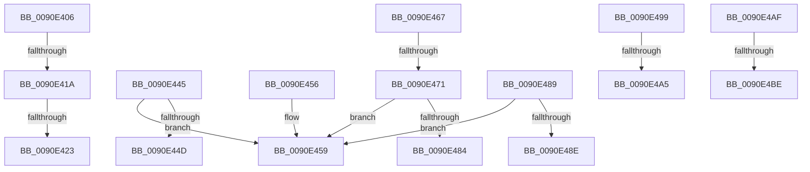

# sub_0090E406

- RVA: `0x0090E406`–`0x0090E4C9` (길이 `195` bytes)
- VA: `0x000000014090E406`
- 실행 섹션: `PAGE`
- PDB 이름 있음: `아니요`; PDB Function 태그: `아니요`
- unwind 정보 RVA: `0x00089700`
- 디코드: `47`개 명령, `195/195` bytes 표시
- 미해석 바이트: `0` (있으면 어셈블리에 `.byte`로 보존)

> 이 문서는 커널 이미지의 기계어와 PDB 기호를 분석해 생성했습니다. 4번과 5번은 함수 원형과 자료형을 바이너리 사용 방식에서 추정한 C 해석이며 원본 소스 복구 결과는 아닙니다.

## 1. Dependencies

- 직접 호출 지점: **0**; 고유 호출 대상: **0**
- 직접 호출자로 확인된 함수: **0**
- RIP 상대 이미지 참조: **0**

### Outgoing calls
- 직접 디코드된 call 명령이 없습니다.

### Direct callers
- 이 함수 시작 RVA로 연결되는 직접 call은 확인되지 않았습니다. 간접 호출은 완전히 역산할 수 없습니다.

### Static image references
- 디코드된 RIP-relative 메모리 참조가 없습니다.

## 2. Other-region calls and transfers

- 다른 실행 섹션으로 향하는 call: **0**
- call이 아닌 외부 분기/꼬리 이동: **12**
  - `0x0090E414` → [sub_0090E098 + 0x58](Unknown_function_0090E098.md) (`tail-transfer`)
  - `0x0090E41D` → [sub_0090E2AA + 0x4C](Unknown_function_0090E2AA.md) (`tail-transfer`)
  - `0x0090E440` → [sub_0090E098 + 0x58](Unknown_function_0090E098.md) (`tail-transfer`)
  - `0x0090E451` → [sub_0090E098 + 0x36](Unknown_function_0090E098.md) (`tail-transfer`)
  - `0x0090E462` → [sub_0090E098 + 0x58](Unknown_function_0090E098.md) (`tail-transfer`)
  - `0x0090E46B` → [sub_0090E098 + 0x36](Unknown_function_0090E098.md) (`tail-transfer`)
  - `0x0090E484` → [sub_0090E098 + 0x36](Unknown_function_0090E098.md) (`tail-transfer`)
  - `0x0090E494` → [sub_0090E098 + 0x36](Unknown_function_0090E098.md) (`tail-transfer`)
  - `0x0090E49F` → [sub_0090E189 + 0xF8](Unknown_function_0090E189.md) (`tail-transfer`)
  - `0x0090E4AA` → [sub_0090E2AA + 0xFD](Unknown_function_0090E2AA.md) (`tail-transfer`)
  - `0x0090E4B8` → [sub_00B21316 + 0x6E](../B2/Unknown_function_00B21316.md) (`tail-transfer`)
  - `0x0090E4C4` → [sub_0090E098 + 0xAC](Unknown_function_0090E098.md) (`tail-transfer`)

## 3. Assembly (complete function range)

```asm
0090E406  8B CA                           mov ecx, edx
0090E408  81 E1 00 00 1F 10               and ecx, 0x101f0000
0090E40E  81 F9 00 00 00 10               cmp ecx, 0x10000000
0090E414  0F 86 D6 FC FF FF               jbe 0x14090e0f0
0090E41A  48 3B C7                        cmp rax, rdi
0090E41D  0F 83 D3 FE FF FF               jae 0x14090e2f6
0090E423  8B CA                           mov ecx, edx
0090E425  41 23 D5                        and edx, r13d
0090E428  C1 E9 0A                        shr ecx, 0xa
0090E42B  66 41 23 CF                     and cx, r15w
0090E42F  66 41 2B CC                     sub cx, r12w
0090E433  66 89 08                        mov word ptr [rax], cx
0090E436  48 83 C0 02                     add rax, 2
0090E43A  81 C2 00 DC 00 00               add edx, 0xdc00
0090E440  E9 AB FC FF FF                  jmp 0x14090e0f0
0090E445  83 E2 1F                        and edx, 0x1f
0090E448  83 FA 01                        cmp edx, 1
0090E44B  76 0C                           jbe 0x14090e459
0090E44D  0F BA EA 17                     bts edx, 0x17
0090E451  E9 78 FC FF FF                  jmp 0x14090e0ce
0090E456  4C 8B CD                        mov r9, rbp
0090E459  41 B8 07 01 00 00               mov r8d, 0x107
0090E45F  41 8B D6                        mov edx, r14d
0090E462  E9 89 FC FF FF                  jmp 0x14090e0f0
0090E467  0F BA E2 17                     bt edx, 0x17
0090E46B  0F 82 5D FC FF FF               jb 0x14090e0ce
0090E471  8B CA                           mov ecx, edx
0090E473  81 E1 F0 01 00 00               and ecx, 0x1f0
0090E479  83 E9 10                        sub ecx, 0x10
0090E47C  81 F9 F0 00 00 00               cmp ecx, 0xf0
0090E482  77 D5                           ja 0x14090e459
0090E484  E9 45 FC FF FF                  jmp 0x14090e0ce
0090E489  83 F9 04                        cmp ecx, 4
0090E48C  77 CB                           ja 0x14090e459
0090E48E  81 CA 00 0C 4D 50               or edx, 0x504d0c00
0090E494  E9 35 FC FF FF                  jmp 0x14090e0ce
0090E499  83 E2 1F                        and edx, 0x1f
0090E49C  83 FA 01                        cmp edx, 1
0090E49F  0F 86 DC FD FF FF               jbe 0x14090e281
0090E4A5  C1 E2 06                        shl edx, 6
0090E4A8  0B F2                           or esi, edx
0090E4AA  E9 F8 FE FF FF                  jmp 0x14090e3a7
0090E4AF  41 B8 07 01 00 00               mov r8d, 0x107
0090E4B5  48 3B C7                        cmp rax, rdi
0090E4B8  0F 82 C6 2E 21 00               jb 0x140b21384
0090E4BE  41 B8 23 00 00 C0               mov r8d, 0xc0000023
0090E4C4  E9 7B FC FF FF                  jmp 0x14090e144
```

## 4. C-style interpretation (structured pseudocode)

```c
__int64 __fastcall sub_0090E406(__int64 a1, int a2)
{
    __int64 result;

    a1 = (unsigned int)(((unsigned int)(a2)) & (0x101F0000ULL));
    a2 = (unsigned int)((a2) & ((unsigned int)(v_r13)));
    a1 = (unsigned int)(((unsigned int)(a2)) >> (10));
    a1 = (unsigned __int16)((a1) & ((unsigned __int16)(v_r15)));
    a1 = (unsigned __int16)((a1) - ((unsigned __int16)(v_r12)));
    *(unsigned __int16 *)(result) = (unsigned __int16)(a1);
    result = (result) + (2);
    a2 = (unsigned int)((a2) + (0xDC00ULL));
}
```

## 5. (Beta) C Style

```c
int64_t sub_0090E406(int64_t Arg1, int32_t Arg2)
{
    int64_t result;

    Arg1 = (uint32_t)(((uint32_t)(Arg2)) & (0x101F0000ULL));
    Arg2 = (uint32_t)((Arg2) & ((uint32_t)(local_r13)));
    Arg1 = (uint32_t)(((uint32_t)(Arg2)) >> (10));
    Arg1 = (uint16_t)((Arg1) & ((uint16_t)(local_r15)));
    Arg1 = (uint16_t)((Arg1) - ((uint16_t)(local_r12)));
    *(uint16_t *)(result) = (uint16_t)(Arg1);
    result = (result) + (2);
    Arg2 = (uint32_t)((Arg2) + (0xDC00ULL));
}
```

## 6. Execution-region graph

[열기: 2D/3D 그래프와 함수 탐색 컨트롤 패널](../../../control-panel.html?section=page&rva=0x0090E406&view=graph)

- 2D 그래프는 위에서 아래로 흐르고, 3D 그래프는 빈 공간을 드래그해 회전합니다. Shift+드래그는 이동, 휠은 확대·축소, 함수 노드 선택은 대상 보고서 이동입니다.

### Static fallback


