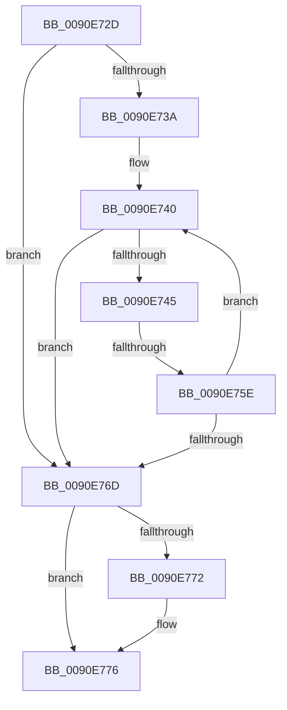

# sub_0090E72D

- RVA: `0x0090E72D`–`0x0090E77B` (길이 `78` bytes)
- VA: `0x000000014090E72D`
- 실행 섹션: `PAGE`
- PDB 이름 있음: `아니요`; PDB Function 태그: `아니요`
- unwind 정보 RVA: `0x0008979C`
- 디코드: `25`개 명령, `78/78` bytes 표시
- 미해석 바이트: `0` (있으면 어셈블리에 `.byte`로 보존)

> 이 문서는 커널 이미지의 기계어와 PDB 기호를 분석해 생성했습니다. 4번과 5번은 함수 원형과 자료형을 바이너리 사용 방식에서 추정한 C 해석이며 원본 소스 복구 결과는 아닙니다.

## 1. Dependencies

- 직접 호출 지점: **0**; 고유 호출 대상: **0**
- 직접 호출자로 확인된 함수: **0**
- RIP 상대 이미지 참조: **0**

### Outgoing calls
- 직접 디코드된 call 명령이 없습니다.

### Direct callers
- 이 함수 시작 RVA로 연결되는 직접 call은 확인되지 않았습니다. 간접 호출은 완전히 역산할 수 없습니다.

### Static image references
- 디코드된 RIP-relative 메모리 참조가 없습니다.

## 2. Other-region calls and transfers

- 다른 실행 섹션으로 향하는 call: **0**
- call이 아닌 외부 분기/꼬리 이동: **1**
  - `0x0090E75C` → [sub_0090E791](Unknown_function_0090E791.md) (`tail-transfer`)

## 3. Assembly (complete function range)

```asm
0090E72D  48 89 74 24 48                  mov qword ptr [rsp + 0x48], rsi
0090E732  48 8B F0                        mov rsi, rax
0090E735  45 85 DB                        test r11d, r11d
0090E738  74 33                           je 0x14090e76d
0090E73A  4C 8B 4C 24 60                  mov r9, qword ptr [rsp + 0x60]
0090E73F  90                              nop
0090E740  45 85 D2                        test r10d, r10d
0090E743  74 28                           je 0x14090e76d
0090E745  41 0F B7 09                     movzx ecx, word ptr [r9]
0090E749  49 83 C1 02                     add r9, 2
0090E74D  44 0F B7 04 4B                  movzx r8d, word ptr [rbx + rcx*2]
0090E752  41 0F B7 D0                     movzx edx, r8w
0090E756  66 C1 EA 08                     shr dx, 8
0090E75A  84 D2                           test dl, dl
0090E75C  75 33                           jne 0x14090e791
0090E75E  44 88 00                        mov byte ptr [rax], r8b
0090E761  41 FF CA                        dec r10d
0090E764  48 FF C0                        inc rax
0090E767  41 83 C3 FF                     add r11d, -1
0090E76B  75 D3                           jne 0x14090e740
0090E76D  48 85 FF                        test rdi, rdi
0090E770  74 04                           je 0x14090e776
0090E772  2B C6                           sub eax, esi
0090E774  89 07                           mov dword ptr [rdi], eax
0090E776  48 8B 74 24 48                  mov rsi, qword ptr [rsp + 0x48]
```

## 4. C-style interpretation (structured pseudocode)

```c
__int64 __fastcall sub_0090E72D(__int64 a1, __int64 a2, __int64 a3, __int64 a4, __int64 a5, __int64 a6, __int64 a7, __int64 a8, __int64 a9, __int64 a10, __int64 a11, __int64 a12)
{
    __int64 result;
    __int64 v_r10;
    __int64 v_r11;
    unsigned __int64 v_stack_p48;

    v_stack_p48 = v_rsi;
    if ((unsigned int)(v_r11) == 0) goto loc_0090E76D;
loc_0090E740:
    if ((unsigned int)(v_r10) == 0) goto loc_0090E76D;
    a4 = (a12) + (2);
    a2 = (unsigned __int16)(((unsigned __int16)(*(unsigned __int16 *)(v_rbx + *(unsigned __int16 *)(a12) * 2))) >> (8));
    *(unsigned __int8 *)(result) = (unsigned __int8)(*(unsigned __int16 *)(v_rbx + *(unsigned __int16 *)(a12) * 2));
    v_r10 = (unsigned int)((v_r10) - 1);
    result = (result) + 1;
    v_r11 = (unsigned int)((v_r11) + (-1));
    if (condition_is_not_equal) goto loc_0090E740;
loc_0090E76D:
    if (v_rdi != 0) {
        result = (unsigned int)((result) - ((unsigned int)(result)));
        *(unsigned int *)(v_rdi) = (unsigned int)(result);
    }
    return result;
}
```

## 5. (Beta) C Style

```c
int64_t sub_0090E72D(int64_t Arg1, int64_t Arg2, int64_t Arg3, int64_t Arg4, uint64_t Arg5, uint64_t Arg6, uint64_t Arg7, uint64_t Arg8, int64_t Arg9, uint64_t Arg10, uint64_t Arg11, void *Arg12)
{
    uint8_t *arg12 = (uint8_t *)Arg12;

    int64_t result;
    int64_t local_r10;
    int64_t local_r11;
    uint64_t v_stack_p48;

    v_stack_p48 = local_rsi;
    if ((uint32_t)(local_r11) == 0) goto loc_0090E76D;
loc_0090E740:
    if ((uint32_t)(local_r10) == 0) goto loc_0090E76D;
    Arg4 = (Arg12) + (2);
    Arg2 = (uint16_t)(((uint16_t)(*(uint16_t *)(local_rbx + *(uint16_t *)(arg12) * 2))) >> (8));
    *(uint8_t *)(result) = (uint8_t)(*(uint16_t *)(local_rbx + *(uint16_t *)(arg12) * 2));
    local_r10 = (uint32_t)((local_r10) - 1);
    result = (result) + 1;
    local_r11 = (uint32_t)((local_r11) + (-1));
    if (condition_is_not_equal) goto loc_0090E740;
loc_0090E76D:
    if (local_rdi != 0) {
        result = (uint32_t)((result) - ((uint32_t)(result)));
        *(uint32_t *)(local_rdi) = (uint32_t)(result);
    }
    return result;
}
```

### 관측된 메모리 오프셋

구조체 형식이 확인되지 않은 접근은 인자 기준의 오프셋으로만 기록했습니다.

| 기준 인자 | 오프셋 표현 | 폭 (bit) | 접근 |
|---|---:|---:|---|
| `Arg12` | `+ 0x0` | `16` | `R` |

## 6. Execution-region graph

[열기: 2D/3D 그래프와 함수 탐색 컨트롤 패널](../../../control-panel.html?section=page&rva=0x0090E72D&view=graph)

- 2D 그래프는 위에서 아래로 흐르고, 3D 그래프는 빈 공간을 드래그해 회전합니다. Shift+드래그는 이동, 휠은 확대·축소, 함수 노드 선택은 대상 보고서 이동입니다.

### Static fallback


