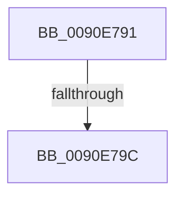

# sub_0090E791

- RVA: `0x0090E791`–`0x0090E7A3` (길이 `18` bytes)
- VA: `0x000000014090E791`
- 실행 섹션: `PAGE`
- PDB 이름 있음: `아니요`; PDB Function 태그: `아니요`
- unwind 정보 RVA: `0x000897C4`
- 디코드: `7`개 명령, `18/18` bytes 표시
- 미해석 바이트: `0` (있으면 어셈블리에 `.byte`로 보존)

> 이 문서는 커널 이미지의 기계어와 PDB 기호를 분석해 생성했습니다. 4번과 5번은 함수 원형과 자료형을 바이너리 사용 방식에서 추정한 C 해석이며 원본 소스 복구 결과는 아닙니다.

## 1. Dependencies

- 직접 호출 지점: **0**; 고유 호출 대상: **0**
- 직접 호출자로 확인된 함수: **0**
- RIP 상대 이미지 참조: **0**

### Outgoing calls
- 직접 디코드된 call 명령이 없습니다.

### Direct callers
- 이 함수 시작 RVA로 연결되는 직접 call은 확인되지 않았습니다. 간접 호출은 완전히 역산할 수 없습니다.

### Static image references
- 디코드된 RIP-relative 메모리 참조가 없습니다.

## 2. Other-region calls and transfers

- 다른 실행 섹션으로 향하는 call: **0**
- call이 아닌 외부 분기/꼬리 이동: **2**
  - `0x0090E79A` → [sub_0090E72D + 0x40](Unknown_function_0090E72D.md) (`tail-transfer`)
  - `0x0090E7A1` → [sub_0090E72D + 0x31](Unknown_function_0090E72D.md) (`tail-transfer`)

## 3. Assembly (complete function range)

```asm
0090E791  41 8B CA                        mov ecx, r10d
0090E794  41 FF CA                        dec r10d
0090E797  83 F9 02                        cmp ecx, 2
0090E79A  72 D1                           jb 0x14090e76d
0090E79C  88 10                           mov byte ptr [rax], dl
0090E79E  48 FF C0                        inc rax
0090E7A1  EB BB                           jmp 0x14090e75e
```

## 4. C-style interpretation (structured pseudocode)

```c
__int64 __fastcall sub_0090E791(__int64 a1, unsigned __int8 a2)
{
    __int64 result;
    __int64 v_r10;

    v_r10 = (unsigned int)((v_r10) - 1);
    *(unsigned __int8 *)(result) = a2;
    result = (result) + 1;
}
```

## 5. (Beta) C Style

```c
int64_t sub_0090E791(int64_t Arg1, uint8_t Arg2)
{
    int64_t result;
    int64_t local_r10;

    local_r10 = (uint32_t)((local_r10) - 1);
    *(uint8_t *)(result) = Arg2;
    result = (result) + 1;
}
```

## 6. Execution-region graph

[열기: 2D/3D 그래프와 함수 탐색 컨트롤 패널](../../../control-panel.html?section=page&rva=0x0090E791&view=graph)

- 2D 그래프는 위에서 아래로 흐르고, 3D 그래프는 빈 공간을 드래그해 회전합니다. Shift+드래그는 이동, 휠은 확대·축소, 함수 노드 선택은 대상 보고서 이동입니다.

### Static fallback


