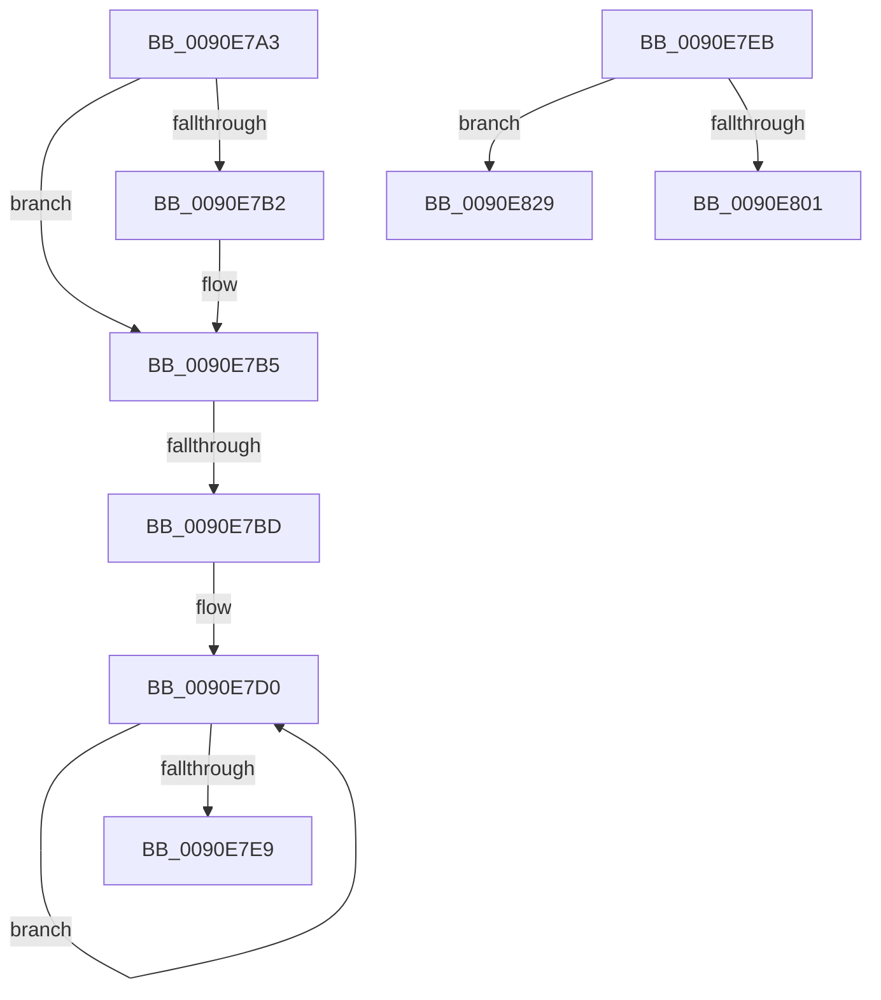

# sub_0090E7A3

- RVA: `0x0090E7A3`–`0x0090E842` (길이 `159` bytes)
- VA: `0x000000014090E7A3`
- 실행 섹션: `PAGE`
- PDB 이름 있음: `아니요`; PDB Function 태그: `아니요`
- unwind 정보 RVA: `0x000897D8`
- 디코드: `44`개 명령, `159/159` bytes 표시
- 미해석 바이트: `0` (있으면 어셈블리에 `.byte`로 보존)

> 이 문서는 커널 이미지의 기계어와 PDB 기호를 분석해 생성했습니다. 4번과 5번은 함수 원형과 자료형을 바이너리 사용 방식에서 추정한 C 해석이며 원본 소스 복구 결과는 아닙니다.

## 1. Dependencies

- 직접 호출 지점: **1**; 고유 호출 대상: **1**
- 직접 호출자로 확인된 함수: **0**
- RIP 상대 이미지 참조: **0**

### Outgoing calls
- `0x0090E810` → [RtlUnicodeToUTF8N](RtlUnicodeToUTF8N_function_0090DBF0.md) (function, `0x0090DBF0`)

### Direct callers
- 이 함수 시작 RVA로 연결되는 직접 call은 확인되지 않았습니다. 간접 호출은 완전히 역산할 수 없습니다.

### Static image references
- 디코드된 RIP-relative 메모리 참조가 없습니다.

## 2. Other-region calls and transfers

- 다른 실행 섹션으로 향하는 call: **0**
- call이 아닌 외부 분기/꼬리 이동: **4**
  - `0x0090E7BB` → [sub_0090E77B](Unknown_function_0090E77B.md) (`tail-transfer`)
  - `0x0090E7E9` → [sub_0090E77B](Unknown_function_0090E77B.md) (`tail-transfer`)
  - `0x0090E824` → [sub_0090E77B + 0xA](Unknown_function_0090E77B.md) (`tail-transfer`)
  - `0x0090E83D` → [sub_0090E77B + 0xA](Unknown_function_0090E77B.md) (`tail-transfer`)

## 3. Assembly (complete function range)

```asm
0090E7A3  45 3B DA                        cmp r11d, r10d
0090E7A6  41 8B D2                        mov edx, r10d
0090E7A9  41 0F 42 D3                     cmovb edx, r11d
0090E7AD  48 85 FF                        test rdi, rdi
0090E7B0  74 03                           je 0x14090e7b5
0090E7B2  41 89 11                        mov dword ptr [r9], edx
0090E7B5  48 8B 59 28                     mov rbx, qword ptr [rcx + 0x28]
0090E7B9  85 D2                           test edx, edx
0090E7BB  74 BE                           je 0x14090e77b
0090E7BD  4C 8B 44 24 60                  mov r8, qword ptr [rsp + 0x60]
0090E7C2  44 8B CA                        mov r9d, edx
0090E7C5  66 66 66 0F 1F 84 00 00 00 00 00  nop word ptr [rax + rax]
0090E7D0  41 0F B7 08                     movzx ecx, word ptr [r8]
0090E7D4  48 8D 40 01                     lea rax, [rax + 1]
0090E7D8  4D 8D 40 02                     lea r8, [r8 + 2]
0090E7DC  0F B6 14 19                     movzx edx, byte ptr [rcx + rbx]
0090E7E0  88 50 FF                        mov byte ptr [rax - 1], dl
0090E7E3  49 83 E9 01                     sub r9, 1
0090E7E7  75 E7                           jne 0x14090e7d0
0090E7E9  EB 90                           jmp 0x14090e77b
0090E7EB  8B 4C 24 68                     mov ecx, dword ptr [rsp + 0x68]
0090E7EF  4C 8D 44 24 40                  lea r8, [rsp + 0x40]
0090E7F4  48 85 FF                        test rdi, rdi
0090E7F7  4C 0F 45 C7                     cmovne r8, rdi
0090E7FB  33 DB                           xor ebx, ebx
0090E7FD  85 C9                           test ecx, ecx
0090E7FF  74 28                           je 0x14090e829
0090E801  4C 8B 4C 24 60                  mov r9, qword ptr [rsp + 0x60]
0090E806  41 8B D2                        mov edx, r10d
0090E809  89 4C 24 20                     mov dword ptr [rsp + 0x20], ecx
0090E80D  48 8B C8                        mov rcx, rax
0090E810  E8 DB F3 FF FF                  call 0x14090dbf0
0090E815  3D 23 00 00 C0                  cmp eax, 0xc0000023
0090E81A  B9 05 00 00 80                  mov ecx, 0x80000005
0090E81F  0F 44 D9                        cmove ebx, ecx
0090E822  8B C3                           mov eax, ebx
0090E824  E9 5C FF FF FF                  jmp 0x14090e785
0090E829  8B C3                           mov eax, ebx
0090E82B  41 89 18                        mov dword ptr [r8], ebx
0090E82E  3D 23 00 00 C0                  cmp eax, 0xc0000023
0090E833  B9 05 00 00 80                  mov ecx, 0x80000005
0090E838  0F 44 D9                        cmove ebx, ecx
0090E83B  8B C3                           mov eax, ebx
0090E83D  E9 43 FF FF FF                  jmp 0x14090e785
```

## 4. C-style interpretation (structured pseudocode)

```c
__int64 __fastcall sub_0090E7A3(__int64 a1, __int64 a2, __int64 a3, __int64 a4, __int64 a5, __int64 a6, __int64 a7, __int64 a8, __int64 a9, __int64 a10, __int64 a11, __int64 a12)
{
    unsigned int v_stack_p20;
    unsigned __int64 v_stack_p40;
    unsigned __int64 v_stack_p60;
    unsigned int v_stack_p68;

    a2 = (unsigned int)((unsigned int)(v_r10));
    if (((unsigned int)(v_r11)) < ((unsigned int)(v_r10))) { a2 = (unsigned int)(v_r11); }
    if (v_rdi != 0) {
        *(unsigned int *)(a4) = (unsigned int)(a2);
    }
loc_0090E7D0:
    *(unsigned __int8 *)(result + 1 - 1) = (unsigned __int8)(*(unsigned __int8 *)(*(unsigned __int16 *)(a12) + *(unsigned __int64 *)(a1 + 40) * 1));
    a4 = ((unsigned int)((unsigned int)(a2))) - (1);
    if (condition_is_not_equal) goto loc_0090E7D0;
}
```

## 5. (Beta) C Style

```c
int64_t sub_0090E7A3(void *Arg1, int64_t Arg2, int64_t Arg3, void *Arg4, uint64_t Arg5, uint64_t Arg6, uint64_t Arg7, uint64_t Arg8, uint64_t Arg9, uint64_t Arg10, uint64_t Arg11, void *Arg12)
{
    uint8_t *arg1 = (uint8_t *)Arg1;
    uint8_t *arg4 = (uint8_t *)Arg4;
    uint8_t *arg12 = (uint8_t *)Arg12;

    uint32_t v_stack_p20;
    uint64_t v_stack_p40;
    uint64_t v_stack_p60;
    uint32_t v_stack_p68;

    Arg2 = (uint32_t)((uint32_t)(local_r10));
    if (((uint32_t)(local_r11)) < ((uint32_t)(local_r10))) { Arg2 = (uint32_t)(local_r11); }
    if (local_rdi != 0) {
        *(uint32_t *)(arg4) = (uint32_t)(Arg2);
    }
loc_0090E7D0:
    *(uint8_t *)(result + 0x1 - 0x1) = (uint8_t)(*(uint8_t *)(*(uint16_t *)(arg12) + *(uint64_t *)(arg1 + 0x28) * 1));
    Arg4 = ((uint32_t)((uint32_t)(Arg2))) - (1);
    if (condition_is_not_equal) goto loc_0090E7D0;
}
```

### 관측된 메모리 오프셋

구조체 형식이 확인되지 않은 접근은 인자 기준의 오프셋으로만 기록했습니다.

| 기준 인자 | 오프셋 표현 | 폭 (bit) | 접근 |
|---|---:|---:|---|
| `Arg1` | `+ 0x28` | `64` | `R` |
| `Arg4` | `+ 0x0` | `32` | `W` |
| `Arg12` | `+ 0x0` | `16` | `R` |
| `Arg12` | `+ 0x2` | `64` | `R` |

## 6. Execution-region graph

[열기: 2D/3D 그래프와 함수 탐색 컨트롤 패널](../../../control-panel.html?section=page&rva=0x0090E7A3&view=graph)

- 2D 그래프는 위에서 아래로 흐르고, 3D 그래프는 빈 공간을 드래그해 회전합니다. Shift+드래그는 이동, 휠은 확대·축소, 함수 노드 선택은 대상 보고서 이동입니다.

### Static fallback


