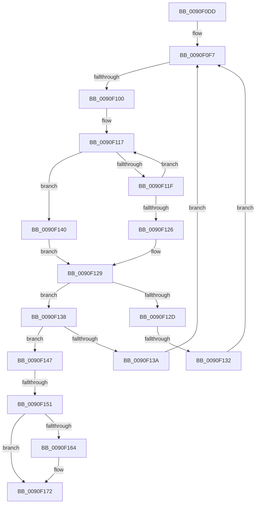

# sub_0090F0DD

- RVA: `0x0090F0DD`–`0x0090F17C` (길이 `159` bytes)
- VA: `0x000000014090F0DD`
- 실행 섹션: `PAGE`
- PDB 이름 있음: `아니요`; PDB Function 태그: `아니요`
- unwind 정보 RVA: `0x0008983C`
- 디코드: `51`개 명령, `159/159` bytes 표시
- 미해석 바이트: `0` (있으면 어셈블리에 `.byte`로 보존)

> 이 문서는 커널 이미지의 기계어와 PDB 기호를 분석해 생성했습니다. 4번과 5번은 함수 원형과 자료형을 바이너리 사용 방식에서 추정한 C 해석이며 원본 소스 복구 결과는 아닙니다.

## 1. Dependencies

- 직접 호출 지점: **0**; 고유 호출 대상: **0**
- 직접 호출자로 확인된 함수: **0**
- RIP 상대 이미지 참조: **0**

### Outgoing calls
- 직접 디코드된 call 명령이 없습니다.

### Direct callers
- 이 함수 시작 RVA로 연결되는 직접 call은 확인되지 않았습니다. 간접 호출은 완전히 역산할 수 없습니다.

### Static image references
- 디코드된 RIP-relative 메모리 참조가 없습니다.

## 2. Other-region calls and transfers

- 다른 실행 섹션으로 향하는 call: **0**
- call이 아닌 외부 분기/꼬리 이동: **3**
  - `0x0090F0FA` → [sub_0090F18B](Unknown_function_0090F18B.md) (`tail-transfer`)
  - `0x0090F130` → [sub_0090F18B](Unknown_function_0090F18B.md) (`tail-transfer`)
  - `0x0090F14F` → [sub_0090F18B](Unknown_function_0090F18B.md) (`tail-transfer`)

## 3. Assembly (complete function range)

```asm
0090F0DD  48 89 7C 24 48                  mov qword ptr [rsp + 0x48], rdi
0090F0E2  8B 78 20                        mov edi, dword ptr [rax + 0x20]
0090F0E5  4C 89 74 24 50                  mov qword ptr [rsp + 0x50], r14
0090F0EA  48 03 FB                        add rdi, rbx
0090F0ED  44 8B 70 24                     mov r14d, dword ptr [rax + 0x24]
0090F0F1  4C 03 F3                        add r14, rbx
0090F0F4  41 FF C9                        dec r9d
0090F0F7  45 3B CA                        cmp r9d, r10d
0090F0FA  0F 8C 8B 00 00 00               jl 0x14090f18b
0090F100  47 8D 04 0A                     lea r8d, [r10 + r9]
0090F104  48 8B C6                        mov rax, rsi
0090F107  41 D1 F8                        sar r8d, 1
0090F10A  4D 63 D8                        movsxd r11, r8d
0090F10D  42 8B 14 9F                     mov edx, dword ptr [rdi + r11*4]
0090F111  48 03 D3                        add rdx, rbx
0090F114  48 2B D6                        sub rdx, rsi
0090F117  0F B6 08                        movzx ecx, byte ptr [rax]
0090F11A  3A 0C 10                        cmp cl, byte ptr [rax + rdx]
0090F11D  75 21                           jne 0x14090f140
0090F11F  48 FF C0                        inc rax
0090F122  84 C9                           test cl, cl
0090F124  75 F1                           jne 0x14090f117
0090F126  41 8B C7                        mov eax, r15d
0090F129  85 C0                           test eax, eax
0090F12B  79 0B                           jns 0x14090f138
0090F12D  45 85 C0                        test r8d, r8d
0090F130  74 59                           je 0x14090f18b
0090F132  45 8D 48 FF                     lea r9d, [r8 - 1]
0090F136  EB BF                           jmp 0x14090f0f7
0090F138  7E 0D                           jle 0x14090f147
0090F13A  45 8D 50 01                     lea r10d, [r8 + 1]
0090F13E  EB B7                           jmp 0x14090f0f7
0090F140  1B C0                           sbb eax, eax
0090F142  83 C8 01                        or eax, 1
0090F145  EB E2                           jmp 0x14090f129
0090F147  43 0F B7 0C 5E                  movzx ecx, word ptr [r14 + r11*2]
0090F14C  3B 4D 14                        cmp ecx, dword ptr [rbp + 0x14]
0090F14F  73 3A                           jae 0x14090f18b
0090F151  8B D1                           mov edx, ecx
0090F153  8B 4D 1C                        mov ecx, dword ptr [rbp + 0x1c]
0090F156  48 03 CB                        add rcx, rbx
0090F159  8B 04 91                        mov eax, dword ptr [rcx + rdx*4]
0090F15C  48 03 C3                        add rax, rbx
0090F15F  48 3B C5                        cmp rax, rbp
0090F162  76 0E                           jbe 0x14090f172
0090F164  8B 4C 24 40                     mov ecx, dword ptr [rsp + 0x40]
0090F168  48 03 CD                        add rcx, rbp
0090F16B  48 3B C1                        cmp rax, rcx
0090F16E  49 0F 42 C7                     cmovb rax, r15
0090F172  48 8B 7C 24 48                  mov rdi, qword ptr [rsp + 0x48]
0090F177  4C 8B 74 24 50                  mov r14, qword ptr [rsp + 0x50]
```

## 4. C-style interpretation (structured pseudocode)

```c
__int64 __fastcall sub_0090F0DD(__int64 a1, __int64 a2, __int64 a3, int a4, __int64 a5, __int64 a6, __int64 a7, unsigned int a8, __int64 a9, __int64 a10)
{
    __int64 result;
    __int64 v_r14;
    __int64 v_rdi;
    unsigned __int64 v_stack_p48;
    unsigned __int64 v_stack_p50;

    v_stack_p48 = v_rdi;
    v_stack_p50 = v_r14;
    v_rdi = ((unsigned int)(*(unsigned int *)(result + 32))) + (v_rbx);
    v_r14 = ((unsigned int)(*(unsigned int *)(result + 36))) + (v_rbx);
    a4 = (unsigned int)((a4) - 1);
loc_0090F0F7:
    a3 = (unsigned int)((v_r10 + a4 * 1) >> (1));
    a2 = ((unsigned int)(*(unsigned int *)(v_rdi + (int)((unsigned int)(a3)) * 4))) + (v_rbx);
    a2 = (a2) - (v_rsi);
loc_0090F117:
    if (((unsigned __int8)(*(unsigned __int8 *)(v_rsi))) != (*(unsigned __int8 *)(v_rsi + a2 * 1))) goto loc_0090F140;
    result = (v_rsi) + 1;
    if ((unsigned __int8)(*(unsigned __int8 *)(v_rsi)) != 0) goto loc_0090F117;
loc_0090F129:
    if (!sign_flag) goto loc_0090F138;
    goto loc_0090F0F7;
loc_0090F138:
    if (condition_is_less_or_equal) goto loc_0090F147;
    goto loc_0090F0F7;
loc_0090F140:
    result = (unsigned int)(((unsigned int)((unsigned int)(v_r15))) | (1));
    goto loc_0090F129;
loc_0090F147:
    a1 = ((unsigned int)(*(unsigned int *)(v_rbp + 28))) + (v_rbx);
    result = ((unsigned int)(*(unsigned int *)(a1 + (unsigned int)((unsigned int)(*(unsigned __int16 *)(v_r14 + (int)((unsigned int)(a3)) * 2))) * 4))) + (v_rbx);
    if (result >= = v_rbp) {
        a1 = a8;
        a1 = (a1) + (v_rbp);
        if (result < a1) { result = v_r15; }
    }
    return result;
}
```

## 5. (Beta) C Style

```c
int64_t sub_0090F0DD(int64_t Arg1, int64_t Arg2, int64_t Arg3, int32_t Arg4, uint64_t Arg5, uint64_t Arg6, uint64_t Arg7, uint32_t Arg8, int64_t Arg9, int64_t Arg10)
{
    int64_t result;
    int64_t local_r14;
    int64_t local_rdi;
    uint64_t v_stack_p48;
    uint64_t v_stack_p50;

    v_stack_p48 = local_rdi;
    v_stack_p50 = local_r14;
    local_rdi = ((uint32_t)(*(uint32_t *)(result + 0x20))) + (local_rbx);
    local_r14 = ((uint32_t)(*(uint32_t *)(result + 0x24))) + (local_rbx);
    Arg4 = (uint32_t)((Arg4) - 1);
loc_0090F0F7:
    Arg3 = (uint32_t)((local_r10 + Arg4 * 1) >> (1));
    Arg2 = ((uint32_t)(*(uint32_t *)(local_rdi + (int32_t)((uint32_t)(Arg3)) * 4))) + (local_rbx);
    Arg2 = (Arg2) - (local_rsi);
loc_0090F117:
    if (((uint8_t)(*(uint8_t *)(local_rsi))) != (*(uint8_t *)(local_rsi + Arg2 * 1))) goto loc_0090F140;
    result = (local_rsi) + 1;
    if ((uint8_t)(*(uint8_t *)(local_rsi)) != 0) goto loc_0090F117;
loc_0090F129:
    if (!sign_flag) goto loc_0090F138;
    goto loc_0090F0F7;
loc_0090F138:
    if (condition_is_less_or_equal) goto loc_0090F147;
    goto loc_0090F0F7;
loc_0090F140:
    result = (uint32_t)(((uint32_t)((uint32_t)(local_r15))) | (1));
    goto loc_0090F129;
loc_0090F147:
    Arg1 = ((uint32_t)(*(uint32_t *)(local_rbp + 0x1C))) + (local_rbx);
    result = ((uint32_t)(*(uint32_t *)(Arg1 + (uint32_t)((uint32_t)(*(uint16_t *)(local_r14 + (int32_t)((uint32_t)(Arg3)) * 2))) * 4))) + (local_rbx);
    if (result >= = local_rbp) {
        Arg1 = Arg8;
        Arg1 = (Arg1) + (local_rbp);
        if (result < Arg1) { result = local_r15; }
    }
    return result;
}
```

## 6. Execution-region graph

[열기: 2D/3D 그래프와 함수 탐색 컨트롤 패널](../../../control-panel.html?section=page&rva=0x0090F0DD&view=graph)

- 2D 그래프는 위에서 아래로 흐르고, 3D 그래프는 빈 공간을 드래그해 회전합니다. Shift+드래그는 이동, 휠은 확대·축소, 함수 노드 선택은 대상 보고서 이동입니다.

### Static fallback


