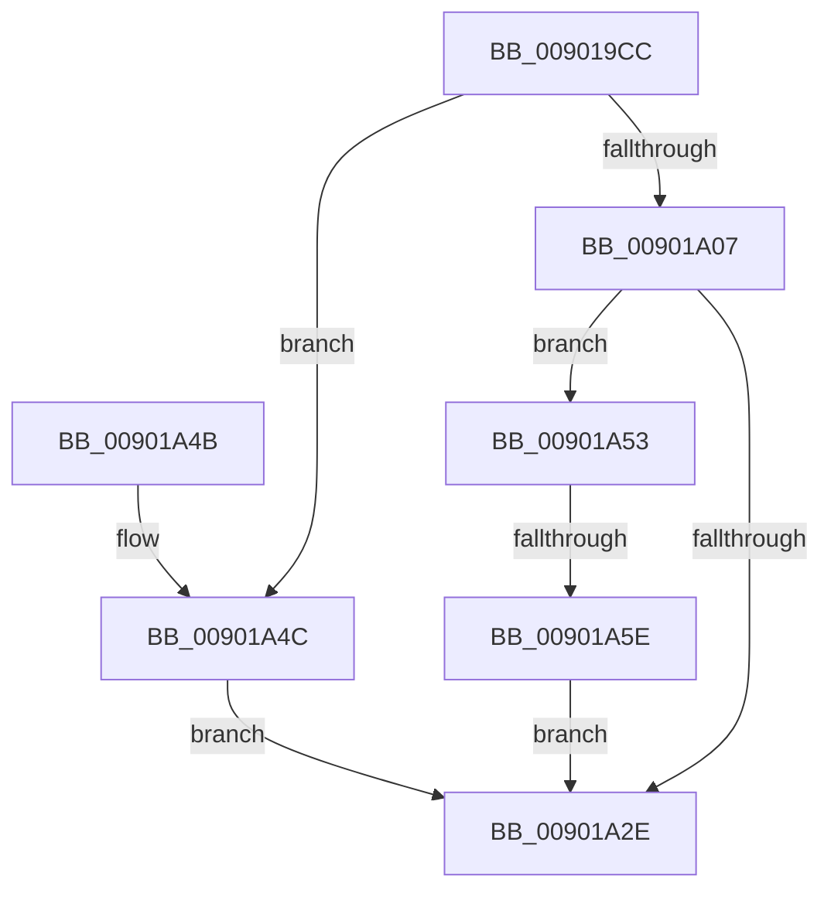

# _CmCreateInterfaceClassWorker

- RVA: `0x009019CC`–`0x00901A77` (길이 `171` bytes)
- VA: `0x00000001409019CC`
- 실행 섹션: `PAGE`
- PDB 이름 있음: `예`; PDB Function 태그: `예`
- unwind 정보 RVA: `0x00088390`
- 디코드: `46`개 명령, `171/171` bytes 표시
- 미해석 바이트: `0` (있으면 어셈블리에 `.byte`로 보존)

> 이 문서는 커널 이미지의 기계어와 PDB 기호를 분석해 생성했습니다. 4번과 5번은 함수 원형과 자료형을 바이너리 사용 방식에서 추정한 C 해석이며 원본 소스 복구 결과는 아닙니다.

## 1. Dependencies

- 직접 호출 지점: **2**; 고유 호출 대상: **2**
- 직접 호출자로 확인된 함수: **1**
- RIP 상대 이미지 참조: **0**

### Outgoing calls
- `0x00901A23` → [CmOpenCommonClassRegKey](../8E/CmOpenCommonClassRegKey_function_008EFF5C.md) (function, `0x008EFF5C`)
- `0x00901A70` → [CmRaiseCreateEvent](../8F/CmRaiseCreateEvent_function_008FF944.md) (function, `0x008FF944`)

### Direct callers
- [CmCreateInterfaceClass](CmCreateInterfaceClass_function_00901838.md) at `0x009018C0`

### Static image references
- 디코드된 RIP-relative 메모리 참조가 없습니다.

## 2. Other-region calls and transfers

- 다른 실행 섹션으로 향하는 call: **0**
- call이 아닌 외부 분기/꼬리 이동: **1**
  - `0x00901A58` → [sub_00B206F6](../B2/Unknown_function_00B206F6.md) (`tail-transfer`)

## 3. Assembly (complete function range)

```asm
009019CC  4C 8B DC                        mov r11, rsp
009019CF  49 89 5B 08                     mov qword ptr [r11 + 8], rbx
009019D3  49 89 6B 10                     mov qword ptr [r11 + 0x10], rbp
009019D7  49 89 73 18                     mov qword ptr [r11 + 0x18], rsi
009019DB  49 89 7B 20                     mov qword ptr [r11 + 0x20], rdi
009019DF  41 56                           push r14
009019E1  48 83 EC 50                     sub rsp, 0x50
009019E5  83 64 24 40 00                  and dword ptr [rsp + 0x40], 0
009019EA  49 8B F1                        mov rsi, r9
009019ED  0F B7 84 24 88 00 00 00         movzx eax, word ptr [rsp + 0x88]
009019F5  48 8B EA                        mov rbp, rdx
009019F8  48 8B BC 24 80 00 00 00         mov rdi, qword ptr [rsp + 0x80]
00901A00  4C 8B F1                        mov r14, rcx
00901A03  85 C0                           test eax, eax
00901A05  75 45                           jne 0x140901a4c
00901A07  49 8D 43 E8                     lea rax, [r11 - 0x18]
00901A0B  49 89 43 E0                     mov qword ptr [r11 - 0x20], rax
00901A0F  4D 89 4B D8                     mov qword ptr [r11 - 0x28], r9
00901A13  45 33 C9                        xor r9d, r9d
00901A16  C6 44 24 28 01                  mov byte ptr [rsp + 0x28], 1
00901A1B  45 89 43 C8                     mov dword ptr [r11 - 0x38], r8d
00901A1F  45 8D 41 40                     lea r8d, [r9 + 0x40]
00901A23  E8 34 E5 FE FF                  call 0x1408eff5c
00901A28  8B D8                           mov ebx, eax
00901A2A  85 C0                           test eax, eax
00901A2C  79 25                           jns 0x140901a53
00901A2E  48 8B 6C 24 68                  mov rbp, qword ptr [rsp + 0x68]
00901A33  8B C3                           mov eax, ebx
00901A35  48 8B 5C 24 60                  mov rbx, qword ptr [rsp + 0x60]
00901A3A  48 8B 74 24 70                  mov rsi, qword ptr [rsp + 0x70]
00901A3F  48 8B 7C 24 78                  mov rdi, qword ptr [rsp + 0x78]
00901A44  48 83 C4 50                     add rsp, 0x50
00901A48  41 5E                           pop r14
00901A4A  C3                              ret
00901A4B  CC                              int3
00901A4C  BB 0D 00 00 C0                  mov ebx, 0xc000000d
00901A51  EB DB                           jmp 0x140901a2e
00901A53  83 7C 24 40 01                  cmp dword ptr [rsp + 0x40], 1
00901A58  0F 85 98 EC 21 00               jne 0x140b206f6
00901A5E  C6 07 01                        mov byte ptr [rdi], 1
00901A61  41 B8 04 00 00 00               mov r8d, 4
00901A67  4C 8B 0E                        mov r9, qword ptr [rsi]
00901A6A  48 8B D5                        mov rdx, rbp
00901A6D  49 8B CE                        mov rcx, r14
00901A70  E8 CF DE FF FF                  call 0x1408ff944
00901A75  EB B7                           jmp 0x140901a2e
```

## 4. C-style interpretation (structured pseudocode)

```c
__int64 __fastcall _CmCreateInterfaceClassWorker(__int64 a1, __int64 a2, int a3, __int64 a4, __int64 a5, unsigned __int16 a6)
{
    __int64 result;
    __int64 v_rsp;
    unsigned int v_stack_m18;
    unsigned __int8 v_stack_m30;
    unsigned __int64 v_stack_p10;
    unsigned __int64 v_stack_p18;
    unsigned __int64 v_stack_p20;
    unsigned int v_stack_p40;
    unsigned __int64 v_stack_p8;

    *(unsigned __int64 *)(v_rsp + 8) = v_rbx;
    *(unsigned __int64 *)(v_rsp + 16) = v_rbp;
    *(unsigned __int64 *)(v_rsp + 24) = v_rsi;
    *(unsigned __int64 *)(v_rsp + 32) = v_rdi;
    v_rsp = (v_rsp) - (80);
    if (a6 != 0) goto loc_00901A4C;
    *(unsigned __int64 *)(v_rsp - 32) = v_rsp - 24;
    *(unsigned __int64 *)(v_rsp - 40) = a4;
    a4 = 0;
    v_stack_m30 = 1;
    *(unsigned int *)(v_rsp - 56) = a3;
    result = CmOpenCommonClassRegKey(a1, a2, a4 + 64, a4);
    if (!sign_flag) goto loc_00901A53;
loc_00901A2E:
    v_rsp = (v_rsp) + (80);
    return (unsigned int)((unsigned int)((unsigned int)((unsigned int)(result))));
loc_00901A4C:
    goto loc_00901A2E;
loc_00901A53:
    *(unsigned __int8 *)(v_stack_p20) = 1;
    result = CmRaiseCreateEvent(a1, v_stack_p10, 4, *(unsigned __int64 *)(v_stack_p18));
    goto loc_00901A2E;
}
```

## 5. (Beta) C Style

```c
int64_t _CmCreateInterfaceClassWorker(int64_t Arg1, int64_t Arg2, int32_t Arg3, void *Arg4, void *Arg5, uint16_t Arg6)
{
    uint8_t *arg4 = (uint8_t *)Arg4;
    uint8_t *arg5 = (uint8_t *)Arg5;

    int64_t result;
    int64_t local_rsp;
    uint32_t v_stack_m18;
    uint8_t v_stack_m30;
    uint64_t v_stack_p10;
    uint64_t v_stack_p18;
    uint64_t v_stack_p20;
    uint32_t v_stack_p40;
    uint64_t v_stack_p8;

    *(uint64_t *)(local_rsp + 0x8) = local_rbx;
    *(uint64_t *)(local_rsp + 0x10) = local_rbp;
    *(uint64_t *)(local_rsp + 0x18) = local_rsi;
    *(uint64_t *)(local_rsp + 0x20) = local_rdi;
    local_rsp = (local_rsp) - (80);
    if (Arg6 != 0) goto loc_00901A4C;
    *(uint64_t *)(local_rsp - 0x20) = local_rsp - 24;
    *(void **)(local_rsp - 0x28) = Arg4;
    Arg4 = 0;
    v_stack_m30 = 1;
    *(uint32_t *)(local_rsp - 0x38) = Arg3;
    result = CmOpenCommonClassRegKey(Arg1, Arg2, Arg4 + 64, Arg4);
    if (!sign_flag) goto loc_00901A53;
loc_00901A2E:
    local_rsp = (local_rsp) + (80);
    return (uint32_t)((uint32_t)((uint32_t)((uint32_t)(result))));
loc_00901A4C:
    goto loc_00901A2E;
loc_00901A53:
    *(uint8_t *)(v_stack_p20) = 1;
    result = CmRaiseCreateEvent(Arg1, v_stack_p10, 4, *(uint64_t *)(v_stack_p18));
    goto loc_00901A2E;
}
```

### 관측된 메모리 오프셋

구조체 형식이 확인되지 않은 접근은 인자 기준의 오프셋으로만 기록했습니다.

| 기준 인자 | 오프셋 표현 | 폭 (bit) | 접근 |
|---|---:|---:|---|
| `Arg4` | `+ 0x0` | `64` | `R` |
| `Arg5` | `+ 0x0` | `8` | `W` |

## 6. Execution-region graph

[열기: 2D/3D 그래프와 함수 탐색 컨트롤 패널](../../../control-panel.html?section=page&rva=0x009019CC&view=graph)

- 2D 그래프는 위에서 아래로 흐르고, 3D 그래프는 빈 공간을 드래그해 회전합니다. Shift+드래그는 이동, 휠은 확대·축소, 함수 노드 선택은 대상 보고서 이동입니다.

### Static fallback


