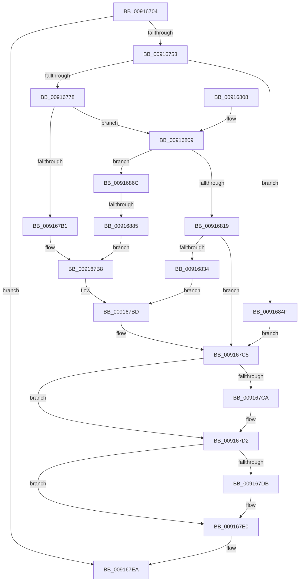

# BcdOpenObject

- RVA: `0x00916704`–`0x00916891` (길이 `397` bytes)
- VA: `0x0000000140916704`
- 실행 섹션: `PAGE`
- PDB 이름 있음: `예`; PDB Function 태그: `예`
- unwind 정보 RVA: `0x0008A830`
- 디코드: `109`개 명령, `397/397` bytes 표시
- 미해석 바이트: `0` (있으면 어셈블리에 `.byte`로 보존)

> 이 문서는 커널 이미지의 기계어와 PDB 기호를 분석해 생성했습니다. 4번과 5번은 함수 원형과 자료형을 바이너리 사용 방식에서 추정한 C 해석이며 원본 소스 복구 결과는 아닙니다.

## 1. Dependencies

- 직접 호출 지점: **13**; 고유 호출 대상: **10**
- 직접 호출자로 확인된 함수: **18**
- RIP 상대 이미지 참조: **6**

### Outgoing calls
- `0x0091673C` → [BiIsOfflineHandle](../../text/4B/BiIsOfflineHandle_function_004B4FA0.md) (function, `0x004B4FA0`)
- `0x00916746` → [BiAcquireBcdSyncMutant](BiAcquireBcdSyncMutant_function_00916898.md) (function, `0x00916898`)
- `0x00916769` → [RtlStringFromGUIDEx](RtlStringFromGUIDEx_function_00915450.md) (function, `0x00915450`)
- `0x0091678D` → [BiLogMessage](../A3/BiLogMessage_function_00A3D3A8.md) (function, `0x00A3D3A8`)
- `0x009167A6` → [BiOpenKey](../A3/BiOpenKey_function_00A3F60C.md) (function, `0x00A3F60C`)
- `0x009167C0` → [BiLogMessage](../A3/BiLogMessage_function_00A3D3A8.md) (function, `0x00A3D3A8`)
- `0x009167CD` → [ExFreePool](../../poolcode/B8/ExFreePool_function_00B82850.md) (function, `0x00B82850`)
- `0x009167DB` → [BiCloseKey](BiCloseKey_function_00916A00.md) (function, `0x00916A00`)
- `0x009167E3` → [BiReleaseBcdSyncMutant](BiReleaseBcdSyncMutant_function_0091695C.md) (function, `0x0091695C`)
- `0x00916810` → [BiIsObjectAliased](../A3/BiIsObjectAliased_function_00A3D250.md) (function, `0x00A3D250`)
- `0x00916829` → [BiOpenKey](../A3/BiOpenKey_function_00A3F60C.md) (function, `0x00A3F60C`)
- `0x0091685E` → [BiLogMessage](../A3/BiLogMessage_function_00A3D3A8.md) (function, `0x00A3D3A8`)
- `0x00916876` → [BiGetAliasedIdentifier](../82/BiGetAliasedIdentifier_function_00823900.md) (function, `0x00823900`)

### Direct callers
- [PopAdaptivePersistSystemInitatedRebootState](../../text/5D/PopAdaptivePersistSystemInitatedRebootState_function_005DC30C.md) at `0x005DC38C`
- [WheaPersistBadPageToBcd](../../text/65/WheaPersistBadPageToBcd_function_0065F3D0.md) at `0x0065F41B`
- [PopAdaptiveClearInitialSystemPowerState](../76/PopAdaptiveClearInitialSystemPowerState_function_0076B55C.md) at `0x0076B599`
- [PopAdaptiveGetSystemInitiatedRebootTargetBootEntry](../76/PopAdaptiveGetSystemInitiatedRebootTargetBootEntry_function_0076B69C.md) at `0x0076B6C1`
- [PopBcdEstablishResumeObject](../77/PopBcdEstablishResumeObject_function_007700E4.md) at `0x00770135`
- [PopBcdEstablishResumeObject](../77/PopBcdEstablishResumeObject_function_007700E4.md) at `0x00770176`
- [PopBcdGetApplicationPathFromResumeObject](../77/PopBcdGetApplicationPathFromResumeObject_function_007702AC.md) at `0x0077031F`
- [PopBcdGetApplicationPathFromResumeObject](../77/PopBcdGetApplicationPathFromResumeObject_function_007702AC.md) at `0x00770360`
- [PopBcdSetPendingResume](../77/PopBcdSetPendingResume_function_007706F8.md) at `0x0077079C`
- [SepSecureBootCorrectBcd](../7A/SepSecureBootCorrectBcd_function_007A2174.md) at `0x007A2299`
- [BiGetDefaultBootEntryIdentifier](../82/BiGetDefaultBootEntryIdentifier_function_0082397C.md) at `0x008239B2`
- [BiAddBootEntryToEfiBootManagerDisplayOrder](../82/BiAddBootEntryToEfiBootManagerDisplayOrder_function_008262D8.md) at `0x00826304`
- [BiCreateEfiEntry](../82/BiCreateEfiEntry_function_008268C4.md) at `0x008268F4`
- [BiUpdateBcdObject](../82/BiUpdateBcdObject_function_008270D0.md) at `0x00827124`
- [BiUpdateEfiEntry](../A3/BiUpdateEfiEntry_function_00A3CCC0.md) at `0x00A3CD06`
- [BiBindEfiBootManager](../A3/BiBindEfiBootManager_function_00A3DCB0.md) at `0x00A3DD11`
- [PopBcdClearPendingResume](../A3/PopBcdClearPendingResume_function_00A3E07C.md) at `0x00A3E09B`
- [BiBuildIdentifierList](../A3/BiBuildIdentifierList_function_00A3E584.md) at `0x00A3E69A`
- [BiBindEfiEntries](../AB/BiBindEfiEntries_function_00AB09C4.md) at `0x00AB0A58`
- [BiExportEfiBootManager](../AC/BiExportEfiBootManager_function_00ACB13C.md) at `0x00ACB1BD`

### Static image references
- `0x0091677C` → RVA `0x00B0B100` (` ?? ::NNGAKEGL::`string'`; read)
- `0x0091679C` → RVA `0x00B0A540` (` ?? ::NNGAKEGL::`string'`; read)
- `0x009167B1` → RVA `0x00B0B130` (` ?? ::NNGAKEGL::`string'`; read)
- `0x00916839` → RVA `0x00B0B290` (` ?? ::NNGAKEGL::`string'`; read)
- `0x0091684F` → RVA `0x00B0B0A0` (` ?? ::NNGAKEGL::`string'`; read)
- `0x00916885` → RVA `0x00B0B190` (` ?? ::NNGAKEGL::`string'`; read)

## 2. Other-region calls and transfers

- 다른 실행 섹션으로 향하는 call: **2**
  - `0x0091673C` → [BiIsOfflineHandle](../../text/4B/BiIsOfflineHandle_function_004B4FA0.md) (`PAGE` → `.text`)
  - `0x009167CD` → [ExFreePool](../../poolcode/B8/ExFreePool_function_00B82850.md) (`PAGE` → `POOLCODE`)
- call이 아닌 외부 분기/꼬리 이동: **1**
  - `0x0091687F` → [sub_00B21A3E](../B2/Unknown_function_00B21A3E.md) (`tail-transfer`)

## 3. Assembly (complete function range)

```asm
00916704  48 89 5C 24 08                  mov qword ptr [rsp + 8], rbx
00916709  48 89 74 24 10                  mov qword ptr [rsp + 0x10], rsi
0091670E  48 89 7C 24 18                  mov qword ptr [rsp + 0x18], rdi
00916713  55                              push rbp
00916714  41 54                           push r12
00916716  41 55                           push r13
00916718  41 56                           push r14
0091671A  41 57                           push r15
0091671C  48 8B EC                        mov rbp, rsp
0091671F  48 83 EC 50                     sub rsp, 0x50
00916723  33 FF                           xor edi, edi
00916725  0F 57 C0                        xorps xmm0, xmm0
00916728  48 89 7D D8                     mov qword ptr [rbp - 0x28], rdi
0091672C  4D 8B E0                        mov r12, r8
0091672F  89 7D 48                        mov dword ptr [rbp + 0x48], edi
00916732  4C 8B FA                        mov r15, rdx
00916735  0F 11 45 E8                     movups xmmword ptr [rbp - 0x18], xmm0
00916739  4C 8B F1                        mov r14, rcx
0091673C  E8 5F E8 B9 FF                  call 0x1404b4fa0
00916741  8A C8                           mov cl, al
00916743  44 8A E8                        mov r13b, al
00916746  E8 4D 01 00 00                  call 0x140916898
0091674B  85 C0                           test eax, eax
0091674D  0F 88 97 00 00 00               js 0x1409167ea
00916753  41 B0 01                        mov r8b, 1
00916756  49 89 3C 24                     mov qword ptr [r12], rdi
0091675A  48 8D 55 D8                     lea rdx, [rbp - 0x28]
0091675E  48 89 7D D0                     mov qword ptr [rbp - 0x30], rdi
00916762  49 8B CF                        mov rcx, r15
00916765  48 89 7D E0                     mov qword ptr [rbp - 0x20], rdi
00916769  E8 E2 EC FF FF                  call 0x140915450
0091676E  8B D8                           mov ebx, eax
00916770  85 C0                           test eax, eax
00916772  0F 88 D7 00 00 00               js 0x14091684f
00916778  48 8B 7D E0                     mov rdi, qword ptr [rbp - 0x20]
0091677C  48 8D 15 7D 49 1F 00            lea rdx, [rip + 0x1f497d]
00916783  BE 02 00 00 00                  mov esi, 2
00916788  4C 8B C7                        mov r8, rdi
0091678B  8B CE                           mov ecx, esi
0091678D  E8 16 6C 12 00                  call 0x140a3d3a8
00916792  4C 8D 4D D0                     lea r9, [rbp - 0x30]
00916796  41 B8 19 00 02 00               mov r8d, 0x20019
0091679C  48 8D 15 9D 3D 1F 00            lea rdx, [rip + 0x1f3d9d]
009167A3  49 8B CE                        mov rcx, r14
009167A6  E8 61 8E 12 00                  call 0x140a3f60c
009167AB  8B D8                           mov ebx, eax
009167AD  85 C0                           test eax, eax
009167AF  79 58                           jns 0x140916809
009167B1  48 8D 15 78 49 1F 00            lea rdx, [rip + 0x1f4978]
009167B8  B9 04 00 00 00                  mov ecx, 4
009167BD  44 8B C0                        mov r8d, eax
009167C0  E8 E3 6B 12 00                  call 0x140a3d3a8
009167C5  48 85 FF                        test rdi, rdi
009167C8  74 08                           je 0x1409167d2
009167CA  48 8B CF                        mov rcx, rdi
009167CD  E8 7E C0 26 00                  call 0x140b82850
009167D2  48 8B 4D D0                     mov rcx, qword ptr [rbp - 0x30]
009167D6  48 85 C9                        test rcx, rcx
009167D9  74 05                           je 0x1409167e0
009167DB  E8 20 02 00 00                  call 0x140916a00
009167E0  41 8A CD                        mov cl, r13b
009167E3  E8 74 01 00 00                  call 0x14091695c
009167E8  8B C3                           mov eax, ebx
009167EA  4C 8D 5C 24 50                  lea r11, [rsp + 0x50]
009167EF  49 8B 5B 30                     mov rbx, qword ptr [r11 + 0x30]
009167F3  49 8B 73 38                     mov rsi, qword ptr [r11 + 0x38]
009167F7  49 8B 7B 40                     mov rdi, qword ptr [r11 + 0x40]
009167FB  49 8B E3                        mov rsp, r11
009167FE  41 5F                           pop r15
00916800  41 5E                           pop r14
00916802  41 5D                           pop r13
00916804  41 5C                           pop r12
00916806  5D                              pop rbp
00916807  C3                              ret
00916808  CC                              int3
00916809  48 8D 55 48                     lea rdx, [rbp + 0x48]
0091680D  49 8B CF                        mov rcx, r15
00916810  E8 3B 6A 12 00                  call 0x140a3d250
00916815  84 C0                           test al, al
00916817  75 53                           jne 0x14091686c
00916819  48 8B 4D D0                     mov rcx, qword ptr [rbp - 0x30]
0091681D  4D 8B CC                        mov r9, r12
00916820  41 B8 3F 00 0F 00               mov r8d, 0xf003f
00916826  48 8B D7                        mov rdx, rdi
00916829  E8 DE 8D 12 00                  call 0x140a3f60c
0091682E  8B D8                           mov ebx, eax
00916830  85 C0                           test eax, eax
00916832  79 91                           jns 0x1409167c5
00916834  B9 04 00 00 00                  mov ecx, 4
00916839  48 8D 15 50 4A 1F 00            lea rdx, [rip + 0x1f4a50]
00916840  3D 34 00 00 C0                  cmp eax, 0xc0000034
00916845  0F 45 F1                        cmovne esi, ecx
00916848  8B CE                           mov ecx, esi
0091684A  E9 6E FF FF FF                  jmp 0x1409167bd
0091684F  48 8D 15 4A 48 1F 00            lea rdx, [rip + 0x1f484a]
00916856  44 8B C0                        mov r8d, eax
00916859  B9 04 00 00 00                  mov ecx, 4
0091685E  E8 45 6B 12 00                  call 0x140a3d3a8
00916863  48 8B 7D E0                     mov rdi, qword ptr [rbp - 0x20]
00916867  E9 59 FF FF FF                  jmp 0x1409167c5
0091686C  8B 55 48                        mov edx, dword ptr [rbp + 0x48]
0091686F  4C 8D 45 E8                     lea r8, [rbp - 0x18]
00916873  49 8B CE                        mov rcx, r14
00916876  E8 85 D0 F0 FF                  call 0x140823900
0091687B  8B D8                           mov ebx, eax
0091687D  85 C0                           test eax, eax
0091687F  0F 89 B9 B1 20 00               jns 0x140b21a3e
00916885  48 8D 15 04 49 1F 00            lea rdx, [rip + 0x1f4904]
0091688C  E9 27 FF FF FF                  jmp 0x1409167b8
```

## 4. C-style interpretation (structured pseudocode)

```c
__int64 __fastcall BcdOpenObject(__int64 a1, __int64 a2, __int64 a3)
{
    __int64 result;
    __int64 v_rdi;
    __int64 v_rsi;
    __int64 v_rsp;
    unsigned __int64 v_stack_m28;
    unsigned __int64 v_stack_m40;
    unsigned __int64 v_stack_m48;
    unsigned __int64 v_stack_m50;
    unsigned __int64 v_stack_m58;
    unsigned __int64 v_stack_p10;
    unsigned __int64 v_stack_p18;
    unsigned int v_stack_p20;
    unsigned __int64 v_stack_p8;

    v_stack_p8 = v_rbx;
    v_stack_p10 = v_rsi;
    v_stack_p18 = v_rdi;
    v_rsp = (v_rsp) - (80);
    v_rdi = 0;
    v_stack_m50 = 0;
    v_stack_p20 = 0;
    v_stack_m40 = v_xmm0;
    result = BiIsOfflineHandle(a1, a2, a3, a4);
    result = BiAcquireBcdSyncMutant((unsigned __int8)(result), a2, a3, a4);
    if (sign_flag) goto loc_009167EA;
    *(unsigned __int64 *)(a3) = 0;
    v_stack_m58 = 0;
    v_stack_m48 = 0;
    result = RtlStringFromGUIDEx(a2, v_stack_m50, 1, a4);
    if (sign_flag) goto loc_0091684F;
    result = BiLogMessage(2, v_rip + 2050429, v_stack_m48, a4);
    result = BiOpenKey(a1, v_rip + 2047389, (unsigned int)(0x20019ULL), v_stack_m58);
    if (!sign_flag) goto loc_00916809;
loc_009167B8:
loc_009167BD:
    result = BiLogMessage(4, v_rip + 2050424, (unsigned int)((unsigned int)(result)), v_stack_m58);
loc_009167C5:
    if (v_stack_m48 != 0) {
        a1 = v_stack_m48;
        result = ExFreePool(a1, v_rip + 2050424, (unsigned int)((unsigned int)(result)), v_stack_m58);
    }
    if (v_stack_m58 != 0) {
        result = BiCloseKey(v_stack_m58, v_rip + 2050424, (unsigned int)((unsigned int)(result)), v_stack_m58);
    }
    result = BiReleaseBcdSyncMutant((unsigned __int8)((unsigned __int8)(result)), v_rip + 2050424, (unsigned int)((unsigned int)(result)), v_stack_m58);
loc_009167EA:
    return (unsigned int)((unsigned int)((unsigned int)((unsigned int)(result))));
loc_00916809:
    result = BiIsObjectAliased(a2, v_stack_p20, (unsigned int)((unsigned int)(result)), v_stack_m58);
    if ((unsigned __int8)(result) != 0) goto loc_0091686C;
    result = BiOpenKey(v_stack_m58, *(unsigned __int64 *)(v_stack_m28 + 64), (unsigned int)(0xF003FULL), a3);
    if (!sign_flag) goto loc_009167C5;
    v_rsi = *(unsigned __int64 *)(v_stack_m28 + 56);
    if (((unsigned int)(result)) != 0xC0000034ULL) { v_rsi = 4; }
    goto loc_009167BD;
loc_0091684F:
    result = BiLogMessage(4, v_rip + 2050122, (unsigned int)((unsigned int)(result)), a3);
    goto loc_009167C5;
loc_0091686C:
    result = BiGetAliasedIdentifier(a1, (unsigned int)(v_stack_p20), v_stack_m40, a3);
    goto loc_009167B8;
}
```

## 5. (Beta) C Style

```c
int64_t BcdOpenObject(int64_t Arg1, int64_t Arg2, void *Arg3)
{
    uint8_t *arg3 = (uint8_t *)Arg3;

    int64_t result;
    int64_t local_rdi;
    int64_t local_rsi;
    int64_t local_rsp;
    uint64_t v_stack_m28;
    uint64_t v_stack_m40;
    uint64_t v_stack_m48;
    uint64_t v_stack_m50;
    uint64_t v_stack_m58;
    uint64_t v_stack_p10;
    uint64_t v_stack_p18;
    uint32_t v_stack_p20;
    uint64_t v_stack_p8;

    v_stack_p8 = local_rbx;
    v_stack_p10 = local_rsi;
    v_stack_p18 = local_rdi;
    local_rsp = (local_rsp) - (80);
    local_rdi = 0;
    v_stack_m50 = 0;
    v_stack_p20 = 0;
    v_stack_m40 = v_xmm0;
    result = BiIsOfflineHandle(Arg1, Arg2, Arg3, a4);
    result = BiAcquireBcdSyncMutant((uint8_t)(result), Arg2, Arg3, a4);
    if (sign_flag) goto loc_009167EA;
    *(uint64_t *)(arg3) = 0;
    v_stack_m58 = 0;
    v_stack_m48 = 0;
    result = RtlStringFromGUIDEx(Arg2, v_stack_m50, 1, a4);
    if (sign_flag) goto loc_0091684F;
    result = BiLogMessage(2, v_rip + 2050429, v_stack_m48, a4);
    result = BiOpenKey(Arg1, v_rip + 2047389, (uint32_t)(0x20019ULL), v_stack_m58);
    if (!sign_flag) goto loc_00916809;
loc_009167B8:
loc_009167BD:
    result = BiLogMessage(4, v_rip + 2050424, (uint32_t)((uint32_t)(result)), v_stack_m58);
loc_009167C5:
    if (v_stack_m48 != 0) {
        Arg1 = v_stack_m48;
        result = ExFreePool(Arg1, v_rip + 2050424, (uint32_t)((uint32_t)(result)), v_stack_m58);
    }
    if (v_stack_m58 != 0) {
        result = BiCloseKey(v_stack_m58, v_rip + 2050424, (uint32_t)((uint32_t)(result)), v_stack_m58);
    }
    result = BiReleaseBcdSyncMutant((uint8_t)((uint8_t)(result)), v_rip + 2050424, (uint32_t)((uint32_t)(result)), v_stack_m58);
loc_009167EA:
    return (uint32_t)((uint32_t)((uint32_t)((uint32_t)(result))));
loc_00916809:
    result = BiIsObjectAliased(Arg2, v_stack_p20, (uint32_t)((uint32_t)(result)), v_stack_m58);
    if ((uint8_t)(result) != 0) goto loc_0091686C;
    result = BiOpenKey(v_stack_m58, *(uint64_t *)(v_stack_m28 + 0x40), (uint32_t)(0xF003FULL), Arg3);
    if (!sign_flag) goto loc_009167C5;
    local_rsi = *(uint64_t *)(v_stack_m28 + 0x38);
    if (((uint32_t)(result)) != 0xC0000034ULL) { local_rsi = 4; }
    goto loc_009167BD;
loc_0091684F:
    result = BiLogMessage(4, v_rip + 2050122, (uint32_t)((uint32_t)(result)), Arg3);
    goto loc_009167C5;
loc_0091686C:
    result = BiGetAliasedIdentifier(Arg1, (uint32_t)(v_stack_p20), v_stack_m40, Arg3);
    goto loc_009167B8;
}
```

### 관측된 메모리 오프셋

구조체 형식이 확인되지 않은 접근은 인자 기준의 오프셋으로만 기록했습니다.

| 기준 인자 | 오프셋 표현 | 폭 (bit) | 접근 |
|---|---:|---:|---|
| `Arg3` | `+ 0x0` | `64` | `W` |

## 6. Execution-region graph

[열기: 2D/3D 그래프와 함수 탐색 컨트롤 패널](../../../control-panel.html?section=page&rva=0x00916704&view=graph)

- 2D 그래프는 위에서 아래로 흐르고, 3D 그래프는 빈 공간을 드래그해 회전합니다. Shift+드래그는 이동, 휠은 확대·축소, 함수 노드 선택은 대상 보고서 이동입니다.

### Static fallback


