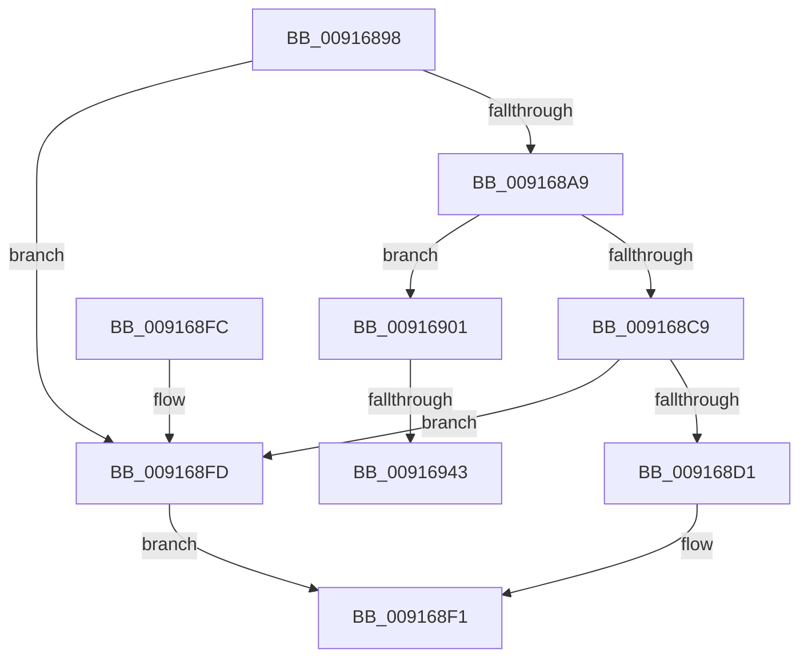

# BiAcquireBcdSyncMutant

- RVA: `0x00916898`–`0x00916953` (길이 `187` bytes)
- VA: `0x0000000140916898`
- 실행 섹션: `PAGE`
- PDB 이름 있음: `예`; PDB Function 태그: `예`
- unwind 정보 RVA: `0x0008A860`
- 디코드: `48`개 명령, `187/187` bytes 표시
- 미해석 바이트: `0` (있으면 어셈블리에 `.byte`로 보존)

> 이 문서는 커널 이미지의 기계어와 PDB 기호를 분석해 생성했습니다. 4번과 5번은 함수 원형과 자료형을 바이너리 사용 방식에서 추정한 C 해석이며 원본 소스 복구 결과는 아닙니다.

## 1. Dependencies

- 직접 호출 지점: **2**; 고유 호출 대상: **2**
- 직접 호출자로 확인된 함수: **16**
- RIP 상대 이미지 참조: **2**

### Outgoing calls
- `0x009168DF` → [ZwWaitForSingleObject](../../text/6A/ZwWaitForSingleObject_function_006AD150.md) (function, `0x006AD150`)
- `0x00916933` → [ZwOpenMutant](../../text/6A/ZwOpenMutant_function_006AF6D0.md) (function, `0x006AF6D0`)

### Direct callers
- [BcdFlushStore](../82/BcdFlushStore_function_00823294.md) at `0x008232AB`
- [BcdForciblyUnloadStore](../82/BcdForciblyUnloadStore_function_008232FC.md) at `0x00823318`
- [BcdMarkAsSystemStore](../82/BcdMarkAsSystemStore_function_008233B4.md) at `0x008233CB`
- [BcdOpenSystemStore](../82/BcdOpenSystemStore_function_00823428.md) at `0x00823433`
- [BcdEnumerateObjects](../82/BcdEnumerateObjects_function_00823594.md) at `0x008235FE`
- [BcdQueryObject](../82/BcdQueryObject_function_0082385C.md) at `0x00823892`
- [BcdOpenObject](BcdOpenObject_function_00916704.md) at `0x00916746`
- [BcdDeleteObject](../A3/BcdDeleteObject_function_00A3C578.md) at `0x00A3C58F`
- [BcdCloseStore](../A3/BcdCloseStore_function_00A3C68C.md) at `0x00A3C6A8`
- [BcdCreateObject](../A3/BcdCreateObject_function_00A3D890.md) at `0x00A3D8BF`
- [BiBindEfiBootManager](../A3/BiBindEfiBootManager_function_00A3DCB0.md) at `0x00A3DD3D`
- [BiDeleteElement](../A3/BiDeleteElement_function_00A3E0F8.md) at `0x00A3E12C`
- [BcdGetElementDataWithFlags](../A3/BcdGetElementDataWithFlags_function_00A3EBE4.md) at `0x00A3EC52`
- [BcdSetElementDataWithFlags](../A3/BcdSetElementDataWithFlags_function_00A3F080.md) at `0x00A3F0E7`
- [BcdCloseObject](../A3/BcdCloseObject_function_00A3FB08.md) at `0x00A3FB1F`
- [BcdOpenStore](../A4/BcdOpenStore_function_00A4116C.md) at `0x00A41194`

### Static image references
- `0x009168B7` → RVA `0x00EF05E0` (`.data`; read)
- `0x00916909` → RVA `0x0000C218` (`.rdata`; read)

## 2. Other-region calls and transfers

- 다른 실행 섹션으로 향하는 call: **2**
  - `0x009168DF` → [ZwWaitForSingleObject](../../text/6A/ZwWaitForSingleObject_function_006AD150.md) (`PAGE` → `.text`)
  - `0x00916933` → [ZwOpenMutant](../../text/6A/ZwOpenMutant_function_006AF6D0.md) (`PAGE` → `.text`)
- call이 아닌 외부 분기/꼬리 이동: **2**
  - `0x0091693D` → [sub_00B21A8A](../B2/Unknown_function_00B21A8A.md) (`tail-transfer`)
  - `0x0091694E` → [sub_00B21A8A + 0x22](../B2/Unknown_function_00B21A8A.md) (`tail-transfer`)

## 3. Assembly (complete function range)

```asm
00916898  48 89 7C 24 08                  mov qword ptr [rsp + 8], rdi
0091689D  55                              push rbp
0091689E  48 8B EC                        mov rbp, rsp
009168A1  48 83 EC 50                     sub rsp, 0x50
009168A5  84 C9                           test cl, cl
009168A7  75 54                           jne 0x1409168fd
009168A9  48 83 65 18 00                  and qword ptr [rbp + 0x18], 0
009168AE  33 C0                           xor eax, eax
009168B0  21 45 EC                        and dword ptr [rbp - 0x14], eax
009168B3  48 83 CF FF                     or rdi, 0xffffffffffffffff
009168B7  48 8B 0D 22 9D 5D 00            mov rcx, qword ptr [rip + 0x5d9d22]
009168BE  89 45 D4                        mov dword ptr [rbp - 0x2c], eax
009168C1  21 45 D4                        and dword ptr [rbp - 0x2c], eax
009168C4  48 85 C9                        test rcx, rcx
009168C7  74 38                           je 0x140916901
009168C9  48 8B C1                        mov rax, rcx
009168CC  48 3B C7                        cmp rax, rdi
009168CF  74 2C                           je 0x1409168fd
009168D1  4C 8D 45 20                     lea r8, [rbp + 0x20]
009168D5  48 C7 45 20 00 BA 3C DC         mov qword ptr [rbp + 0x20], 0xffffffffdc3cba00
009168DD  33 D2                           xor edx, edx
009168DF  E8 6C 68 D9 FF                  call 0x1406ad150
009168E4  3D 02 01 00 00                  cmp eax, 0x102
009168E9  B9 01 00 00 C0                  mov ecx, 0xc0000001
009168EE  0F 44 C1                        cmove eax, ecx
009168F1  48 8B 7C 24 60                  mov rdi, qword ptr [rsp + 0x60]
009168F6  48 83 C4 50                     add rsp, 0x50
009168FA  5D                              pop rbp
009168FB  C3                              ret
009168FC  CC                              int3
009168FD  33 C0                           xor eax, eax
009168FF  EB F0                           jmp 0x1409168f1
00916901  48 21 45 D8                     and qword ptr [rbp - 0x28], rax
00916905  4C 8D 45 D0                     lea r8, [rbp - 0x30]
00916909  48 8D 05 08 59 6F FF            lea rax, [rip - 0x90a6f8]
00916910  C7 45 D0 30 00 00 00            mov dword ptr [rbp - 0x30], 0x30
00916917  0F 57 C0                        xorps xmm0, xmm0
0091691A  48 89 45 E0                     mov qword ptr [rbp - 0x20], rax
0091691E  BA 00 00 10 00                  mov edx, 0x100000
00916923  C7 45 E8 40 02 00 00            mov dword ptr [rbp - 0x18], 0x240
0091692A  48 8D 4D 18                     lea rcx, [rbp + 0x18]
0091692E  F3 0F 7F 45 F0                  movdqu xmmword ptr [rbp - 0x10], xmm0
00916933  E8 98 8D D9 FF                  call 0x1406af6d0
00916938  3D 34 00 00 C0                  cmp eax, 0xc0000034
0091693D  0F 85 47 B1 20 00               jne 0x140b21a8a
00916943  33 C0                           xor eax, eax
00916945  F0 48 0F B1 3D 92 9C 5D 00      lock cmpxchg qword ptr [rip + 0x5d9c92], rdi
0091694E  E9 59 B1 20 00                  jmp 0x140b21aac
```

## 4. C-style interpretation (structured pseudocode)

```c
__int64 __fastcall BiAcquireBcdSyncMutant(unsigned __int8 a1, int a2)
{
    __int64 result;
    __int64 v_rdi;
    __int64 v_rsp;
    unsigned __int64 v_stack_m18;
    unsigned int v_stack_m1C;
    unsigned int v_stack_m20;
    unsigned __int64 v_stack_m28;
    unsigned __int64 v_stack_m30;
    unsigned int v_stack_m34;
    unsigned __int64 v_stack_m38;
    unsigned __int64 v_stack_p10;
    unsigned __int64 v_stack_p18;
    unsigned __int64 v_stack_p8;

    v_stack_p8 = v_rdi;
    v_rsp = (v_rsp) - (80);
    if (a1 != 0) goto loc_009168FD;
    result = 0;
    v_rdi = (v_rdi) | (-1);
    v_stack_m34 = 0;
    if (*(unsigned __int64 *)(v_rip + 6135074) == 0) goto loc_00916901;
    if ((*(unsigned __int64 *)(v_rip + 6135074)) == v_rdi) goto loc_009168FD;
    v_stack_p18 = 0xFFFFFFFFDC3CBA00ULL;
    a2 = 0;
    result = ZwWaitForSingleObject(*(unsigned __int64 *)(v_rip + 6135074), a2, v_stack_p18, a4);
    if (((unsigned int)(result)) == 258) { result = (unsigned int)((unsigned int)(0xC0000001ULL)); }
loc_009168F1:
    v_rsp = (v_rsp) + (80);
    return result;
loc_009168FD:
    result = 0;
    goto loc_009168F1;
loc_00916901:
    v_stack_m38 = 48;
    v_stack_m28 = v_rip - 9479928;
    v_stack_m20 = 576;
    v_stack_m18 = v_xmm0;
    result = ZwOpenMutant(v_stack_p10, (unsigned int)(0x100000ULL), v_stack_m38, a4);
    result = 0;
}
```

## 5. (Beta) C Style

```c
int64_t BiAcquireBcdSyncMutant(uint8_t Arg1, int32_t Arg2)
{
    int64_t result;
    int64_t local_rdi;
    int64_t local_rsp;
    uint64_t v_stack_m18;
    uint32_t v_stack_m1C;
    uint32_t v_stack_m20;
    uint64_t v_stack_m28;
    uint64_t v_stack_m30;
    uint32_t v_stack_m34;
    uint64_t v_stack_m38;
    uint64_t v_stack_p10;
    uint64_t v_stack_p18;
    uint64_t v_stack_p8;

    v_stack_p8 = local_rdi;
    local_rsp = (local_rsp) - (80);
    if (Arg1 != 0) goto loc_009168FD;
    result = 0;
    local_rdi = (local_rdi) | (-1);
    v_stack_m34 = 0;
    if (*(uint64_t *)(v_rip + 0x5D9D22) == 0) goto loc_00916901;
    if ((*(uint64_t *)(v_rip + 0x5D9D22)) == local_rdi) goto loc_009168FD;
    v_stack_p18 = 0xFFFFFFFFDC3CBA00ULL;
    Arg2 = 0;
    result = ZwWaitForSingleObject(*(uint64_t *)(v_rip + 0x5D9D22), Arg2, v_stack_p18, a4);
    if (((uint32_t)(result)) == 258) { result = (uint32_t)((uint32_t)(0xC0000001ULL)); }
loc_009168F1:
    local_rsp = (local_rsp) + (80);
    return result;
loc_009168FD:
    result = 0;
    goto loc_009168F1;
loc_00916901:
    v_stack_m38 = 48;
    v_stack_m28 = v_rip - 9479928;
    v_stack_m20 = 576;
    v_stack_m18 = v_xmm0;
    result = ZwOpenMutant(v_stack_p10, (uint32_t)(0x100000ULL), v_stack_m38, a4);
    result = 0;
}
```

## 6. Execution-region graph

[열기: 2D/3D 그래프와 함수 탐색 컨트롤 패널](../../../control-panel.html?section=page&rva=0x00916898&view=graph)

- 2D 그래프는 위에서 아래로 흐르고, 3D 그래프는 빈 공간을 드래그해 회전합니다. Shift+드래그는 이동, 휠은 확대·축소, 함수 노드 선택은 대상 보고서 이동입니다.

### Static fallback


