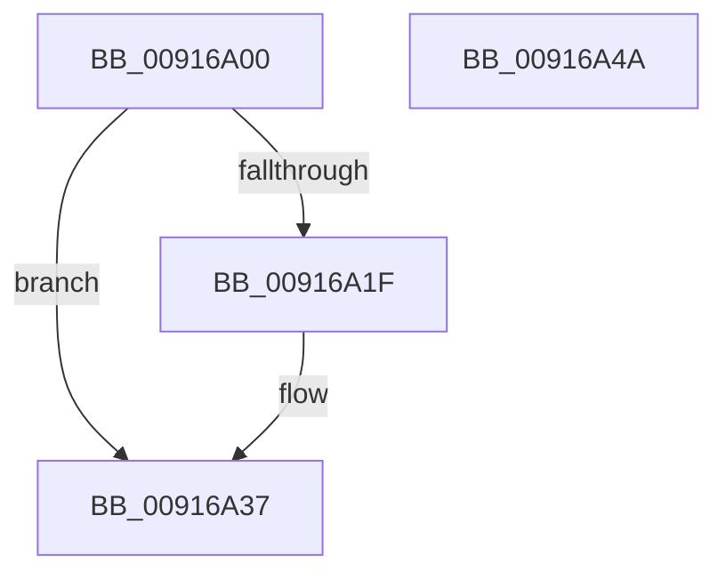

# BiCloseKey

- RVA: `0x00916A00`–`0x00916A4B` (길이 `75` bytes)
- VA: `0x0000000140916A00`
- 실행 섹션: `PAGE`
- PDB 이름 있음: `예`; PDB Function 태그: `아니요`
- unwind 정보 RVA: `0x0005CAAC`
- 디코드: `22`개 명령, `75/75` bytes 표시
- 미해석 바이트: `0` (있으면 어셈블리에 `.byte`로 보존)

> 이 문서는 커널 이미지의 기계어와 PDB 기호를 분석해 생성했습니다. 4번과 5번은 함수 원형과 자료형을 바이너리 사용 방식에서 추정한 C 해석이며 원본 소스 복구 결과는 아닙니다.

## 1. Dependencies

- 직접 호출 지점: **4**; 고유 호출 대상: **4**
- 직접 호출자로 확인된 함수: **22**
- RIP 상대 이미지 참조: **0**

### Outgoing calls
- `0x00916A12` → [BiCreateKeySecurityDescriptor](BiCreateKeySecurityDescriptor_function_00916D6C.md) (function, `0x00916D6C`)
- `0x00916A25` → [BiZwSetSecurityObject](../../text/4A/BiZwSetSecurityObject_function_004A9A84.md) (function, `0x004A9A84`)
- `0x00916A32` → [ExFreePoolWithTag](../../poolcode/B8/ExFreePoolWithTag_function_00B82870.md) (function, `0x00B82870`)
- `0x00916A3A` → [BiZwClose](../../text/4A/BiZwClose_function_004A85DC.md) (function, `0x004A85DC`)

### Direct callers
- [BiSetFirmwareModifiedFromObject](../../text/4B/BiSetFirmwareModifiedFromObject_function_004B1CC8.md) at `0x004B1CFD`
- [BiOpenStoreKeyFromObject](../../text/4B/BiOpenStoreKeyFromObject_function_004B1D14.md) at `0x004B1DE4`
- [BcdEnumerateObjects](../82/BcdEnumerateObjects_function_00823594.md) at `0x00823698`
- [BcdEnumerateObjects](../82/BcdEnumerateObjects_function_00823594.md) at `0x00823787`
- [BcdEnumerateObjects](../82/BcdEnumerateObjects_function_00823594.md) at `0x0082381C`
- [BiIsPortableWorkspaceBoot](../82/BiIsPortableWorkspaceBoot_function_008261C0.md) at `0x008261FA`
- [BcdOpenObject](BcdOpenObject_function_00916704.md) at `0x009167DB`
- [BiCloseStore](../A3/BiCloseStore_function_00A3C5D8.md) at `0x00A3C653`
- [BiCreateObject](../A3/BiCreateObject_function_00A3D92C.md) at `0x00A3D9F1`
- [BiCreateObject](../A3/BiCreateObject_function_00A3D92C.md) at `0x00A3DA5C`
- [BiDeleteElement](../A3/BiDeleteElement_function_00A3E0F8.md) at `0x00A3E1E4`
- [BiDeleteElement](../A3/BiDeleteElement_function_00A3E0F8.md) at `0x00A3E2A2`
- [BiSetRegistryValue](../A3/BiSetRegistryValue_function_00A3E3B0.md) at `0x00A3E4C3`
- [BiBuildIdentifierList](../A3/BiBuildIdentifierList_function_00A3E584.md) at `0x00A3EB84`
- [BcdGetElementDataWithFlags](../A3/BcdGetElementDataWithFlags_function_00A3EBE4.md) at `0x00A3EDB4`
- [BcdGetElementDataWithFlags](../A3/BcdGetElementDataWithFlags_function_00A3EBE4.md) at `0x00A3EDC4`
- [BcdSetElementDataWithFlags](../A3/BcdSetElementDataWithFlags_function_00A3F080.md) at `0x00A3F22D`
- [BcdSetElementDataWithFlags](../A3/BcdSetElementDataWithFlags_function_00A3F080.md) at `0x00A3F2EA`
- [BiGetObjectDescription](../A3/BiGetObjectDescription_function_00A3F2FC.md) at `0x00A3F393`
- [BcdCloseObject](../A3/BcdCloseObject_function_00A3FB08.md) at `0x00A3FB2B`
- [BiDeleteKey](../A3/BiDeleteKey_function_00A3FC58.md) at `0x00A3FD00`
- [BiAddStoreFromFile](../A4/BiAddStoreFromFile_function_00A40C54.md) at `0x00A40E5D`
- [BiAddStoreFromFile](../A4/BiAddStoreFromFile_function_00A40C54.md) at `0x00A40E67`
- [BiAddStoreFromFile](../A4/BiAddStoreFromFile_function_00A40C54.md) at `0x00A40E9C`
- [BiUnloadHiveByHandle](../A4/BiUnloadHiveByHandle_function_00A4105C.md) at `0x00A410AA`
- [BiSetObjectDescription](../A4/BiSetObjectDescription_function_00A41DE8.md) at `0x00A41E30`
- [sub_00B3A518](../B3/Unknown_function_00B3A518.md) at `0x00B3A5DF`
- [sub_00B3A892](../B3/Unknown_function_00B3A892.md) at `0x00B3A983`
- [sub_00B3A892](../B3/Unknown_function_00B3A892.md) at `0x00B3AA02`
- [sub_00B3AA4C](../B3/Unknown_function_00B3AA4C.md) at `0x00B3AAC5`
- [BcdSetBootBcdAsSystemStore](../../init/C6/BcdSetBootBcdAsSystemStore_function_00C6D214.md) at `0x00C6D2B4`
- [BcdSetBootBcdAsSystemStore](../../init/C6/BcdSetBootBcdAsSystemStore_function_00C6D214.md) at `0x00C6D2C6`

### Static image references
- 디코드된 RIP-relative 메모리 참조가 없습니다.

## 2. Other-region calls and transfers

- 다른 실행 섹션으로 향하는 call: **3**
  - `0x00916A25` → [BiZwSetSecurityObject](../../text/4A/BiZwSetSecurityObject_function_004A9A84.md) (`PAGE` → `.text`)
  - `0x00916A32` → [ExFreePoolWithTag](../../poolcode/B8/ExFreePoolWithTag_function_00B82870.md) (`PAGE` → `POOLCODE`)
  - `0x00916A3A` → [BiZwClose](../../text/4A/BiZwClose_function_004A85DC.md) (`PAGE` → `.text`)
- 별도 외부 분기/꼬리 이동을 확인하지 못했습니다.

## 3. Assembly (complete function range)

```asm
00916A00  48 89 5C 24 08                  mov qword ptr [rsp + 8], rbx
00916A05  57                              push rdi
00916A06  48 83 EC 20                     sub rsp, 0x20
00916A0A  48 8B F9                        mov rdi, rcx
00916A0D  B9 19 00 06 00                  mov ecx, 0x60019
00916A12  E8 55 03 00 00                  call 0x140916d6c
00916A17  48 8B D8                        mov rbx, rax
00916A1A  48 85 C0                        test rax, rax
00916A1D  74 18                           je 0x140916a37
00916A1F  4C 8B C0                        mov r8, rax
00916A22  48 8B CF                        mov rcx, rdi
00916A25  E8 5A 30 B9 FF                  call 0x1404a9a84
00916A2A  BA 42 43 44 4B                  mov edx, 0x4b444342
00916A2F  48 8B CB                        mov rcx, rbx
00916A32  E8 39 BE 26 00                  call 0x140b82870
00916A37  48 8B CF                        mov rcx, rdi
00916A3A  E8 9D 1B B9 FF                  call 0x1404a85dc
00916A3F  48 8B 5C 24 30                  mov rbx, qword ptr [rsp + 0x30]
00916A44  48 83 C4 20                     add rsp, 0x20
00916A48  5F                              pop rdi
00916A49  C3                              ret
00916A4A  CC                              int3
```

## 4. C-style interpretation (structured pseudocode)

```c
__int64 __fastcall BiCloseKey(__int64 a1)
{
    __int64 result;
    __int64 v_rsp;
    unsigned __int64 v_stack_p8;

    v_stack_p8 = v_rbx;
    v_rsp = (v_rsp) - (32);
    result = BiCreateKeySecurityDescriptor((unsigned int)(0x60019ULL), a2, a3, a4);
    if (result != 0) {
        a3 = result;
        a1 = a1;
        result = BiZwSetSecurityObject(a1, a2, a3, a4);
        a2 = 0x4B444342ULL;
        a1 = result;
        result = ExFreePoolWithTag(a1, a2, a3, a4);
    }
    result = BiZwClose(a1, a2, a3, a4);
    v_rsp = (v_rsp) + (32);
    return result;
}
```

## 5. (Beta) C Style

```c
int64_t BiCloseKey(int64_t Arg1)
{
    int64_t result;
    int64_t local_rsp;
    uint64_t v_stack_p8;

    v_stack_p8 = local_rbx;
    local_rsp = (local_rsp) - (32);
    result = BiCreateKeySecurityDescriptor((uint32_t)(0x60019ULL), a2, a3, a4);
    if (result != 0) {
        a3 = result;
        Arg1 = Arg1;
        result = BiZwSetSecurityObject(Arg1, a2, a3, a4);
        a2 = 0x4B444342ULL;
        Arg1 = result;
        result = ExFreePoolWithTag(Arg1, a2, a3, a4);
    }
    result = BiZwClose(Arg1, a2, a3, a4);
    local_rsp = (local_rsp) + (32);
    return result;
}
```

## 6. Execution-region graph

[열기: 2D/3D 그래프와 함수 탐색 컨트롤 패널](../../../control-panel.html?section=page&rva=0x00916A00&view=graph)

- 2D 그래프는 위에서 아래로 흐르고, 3D 그래프는 빈 공간을 드래그해 회전합니다. Shift+드래그는 이동, 휠은 확대·축소, 함수 노드 선택은 대상 보고서 이동입니다.

### Static fallback


