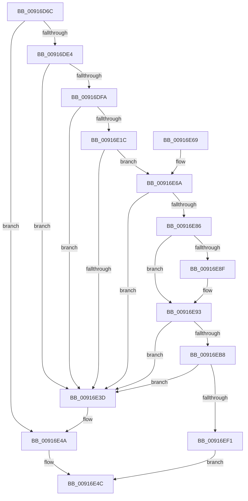

# BiCreateKeySecurityDescriptor

- RVA: `0x00916D6C`–`0x00916EF9` (길이 `397` bytes)
- VA: `0x0000000140916D6C`
- 실행 섹션: `PAGE`
- PDB 이름 있음: `예`; PDB Function 태그: `아니요`
- unwind 정보 RVA: `0x0008A900`
- 디코드: `115`개 명령, `397/397` bytes 표시
- 미해석 바이트: `0` (있으면 어셈블리에 `.byte`로 보존)

> 이 문서는 커널 이미지의 기계어와 PDB 기호를 분석해 생성했습니다. 4번과 5번은 함수 원형과 자료형을 바이너리 사용 방식에서 추정한 C 해석이며 원본 소스 복구 결과는 아닙니다.

## 1. Dependencies

- 직접 호출 지점: **14**; 고유 호출 대상: **8**
- 직접 호출자로 확인된 함수: **3**
- RIP 상대 이미지 참조: **1**

### Outgoing calls
- `0x00916DA3` → [RtlLengthSid](../../text/45/RtlLengthSid_function_0045D270.md) (function, `0x0045D270`)
- `0x00916DAD` → [RtlLengthSid](../../text/45/RtlLengthSid_function_0045D270.md) (function, `0x0045D270`)
- `0x00916DBA` → [RtlLengthSid](../../text/45/RtlLengthSid_function_0045D270.md) (function, `0x0045D270`)
- `0x00916DD4` → [ExAllocatePool2](../../poolcode/B8/ExAllocatePool2_function_00B820F0.md) (function, `0x00B820F0`)
- `0x00916DF1` → [RtlCreateAcl](RtlCreateAcl_function_00916F00.md) (function, `0x00916F00`)
- `0x00916E13` → [RtlpAddKnownAce](../92/RtlpAddKnownAce_function_00929A20.md) (function, `0x00929A20`)
- `0x00916E34` → [RtlpAddKnownAce](../92/RtlpAddKnownAce_function_00929A20.md) (function, `0x00929A20`)
- `0x00916E45` → [ExFreePoolWithTag](../../poolcode/B8/ExFreePoolWithTag_function_00B82870.md) (function, `0x00B82870`)
- `0x00916EA2` → [RtlLengthSecurityDescriptor](../8B/RtlLengthSecurityDescriptor_function_008BC870.md) (function, `0x008BC870`)
- `0x00916EAC` → [RtlLengthSid](../../text/45/RtlLengthSid_function_0045D270.md) (function, `0x0045D270`)
- `0x00916EBB` → [RtlLengthSecurityDescriptor](../8B/RtlLengthSecurityDescriptor_function_008BC870.md) (function, `0x008BC870`)
- `0x00916EC8` → [RtlLengthSid](../../text/45/RtlLengthSid_function_0045D270.md) (function, `0x0045D270`)
- `0x00916ED6` → [memcpy](../../text/6C/memcpy_function_006C6840.md) (function, `0x006C6840`)
- `0x00916EE4` → [RtlSetOwnerSecurityDescriptor](RtlSetOwnerSecurityDescriptor_function_00916F90.md) (function, `0x00916F90`)

### Direct callers
- [BiCloseKey](BiCloseKey_function_00916A00.md) at `0x00916A12`
- [BiOpenKey](../A3/BiOpenKey_function_00A3F60C.md) at `0x00A3F6EA`
- [BiCreateKey](../A4/BiCreateKey_function_00A404DC.md) at `0x00A40584`

### Static image references
- `0x00916D88` → RVA `0x00FD9AA0` (`PAGEDATA`; read)

## 2. Other-region calls and transfers

- 다른 실행 섹션으로 향하는 call: **8**
  - `0x00916DA3` → [RtlLengthSid](../../text/45/RtlLengthSid_function_0045D270.md) (`PAGE` → `.text`)
  - `0x00916DAD` → [RtlLengthSid](../../text/45/RtlLengthSid_function_0045D270.md) (`PAGE` → `.text`)
  - `0x00916DBA` → [RtlLengthSid](../../text/45/RtlLengthSid_function_0045D270.md) (`PAGE` → `.text`)
  - `0x00916DD4` → [ExAllocatePool2](../../poolcode/B8/ExAllocatePool2_function_00B820F0.md) (`PAGE` → `POOLCODE`)
  - `0x00916E45` → [ExFreePoolWithTag](../../poolcode/B8/ExFreePoolWithTag_function_00B82870.md) (`PAGE` → `POOLCODE`)
  - `0x00916EAC` → [RtlLengthSid](../../text/45/RtlLengthSid_function_0045D270.md) (`PAGE` → `.text`)
  - `0x00916EC8` → [RtlLengthSid](../../text/45/RtlLengthSid_function_0045D270.md) (`PAGE` → `.text`)
  - `0x00916ED6` → [memcpy](../../text/6C/memcpy_function_006C6840.md) (`PAGE` → `.text`)
- 별도 외부 분기/꼬리 이동을 확인하지 못했습니다.

## 3. Assembly (complete function range)

```asm
00916D6C  48 89 5C 24 08                  mov qword ptr [rsp + 8], rbx
00916D71  48 89 6C 24 10                  mov qword ptr [rsp + 0x10], rbp
00916D76  48 89 74 24 18                  mov qword ptr [rsp + 0x18], rsi
00916D7B  57                              push rdi
00916D7C  41 54                           push r12
00916D7E  41 55                           push r13
00916D80  41 56                           push r14
00916D82  41 57                           push r15
00916D84  48 83 EC 30                     sub rsp, 0x30
00916D88  48 8B 05 11 2D 6C 00            mov rax, qword ptr [rip + 0x6c2d11]
00916D8F  44 8B F9                        mov r15d, ecx
00916D92  4C 8B B0 08 01 00 00            mov r14, qword ptr [rax + 0x108]
00916D99  48 8B B0 10 01 00 00            mov rsi, qword ptr [rax + 0x110]
00916DA0  49 8B CE                        mov rcx, r14
00916DA3  E8 C8 64 B4 FF                  call 0x14045d270
00916DA8  48 8B CE                        mov rcx, rsi
00916DAB  8B D8                           mov ebx, eax
00916DAD  E8 BE 64 B4 FF                  call 0x14045d270
00916DB2  48 8B CE                        mov rcx, rsi
00916DB5  8D 68 18                        lea ebp, [rax + 0x18]
00916DB8  03 EB                           add ebp, ebx
00916DBA  E8 B1 64 B4 FF                  call 0x14045d270
00916DBF  B9 02 01 00 00                  mov ecx, 0x102
00916DC4  41 B8 42 43 44 4B               mov r8d, 0x4b444342
00916DCA  44 8D 60 28                     lea r12d, [rax + 0x28]
00916DCE  44 03 E5                        add r12d, ebp
00916DD1  41 8B D4                        mov edx, r12d
00916DD4  E8 17 B3 26 00                  call 0x140b820f0
00916DD9  45 33 ED                        xor r13d, r13d
00916DDC  48 8B F8                        mov rdi, rax
00916DDF  48 85 C0                        test rax, rax
00916DE2  74 66                           je 0x140916e4a
00916DE4  48 8D 58 28                     lea rbx, [rax + 0x28]
00916DE8  8B D5                           mov edx, ebp
00916DEA  48 8B CB                        mov rcx, rbx
00916DED  45 8D 45 02                     lea r8d, [r13 + 2]
00916DF1  E8 0A 01 00 00                  call 0x140916f00
00916DF6  85 C0                           test eax, eax
00916DF8  78 43                           js 0x140916e3d
00916DFA  41 8D 6D 02                     lea ebp, [r13 + 2]
00916DFE  44 88 6C 24 28                  mov byte ptr [rsp + 0x28], r13b
00916E03  8B D5                           mov edx, ebp
00916E05  48 89 74 24 20                  mov qword ptr [rsp + 0x20], rsi
00916E0A  45 8B CF                        mov r9d, r15d
00916E0D  45 33 C0                        xor r8d, r8d
00916E10  48 8B CB                        mov rcx, rbx
00916E13  E8 08 2C 01 00                  call 0x140929a20
00916E18  85 C0                           test eax, eax
00916E1A  78 21                           js 0x140916e3d
00916E1C  44 88 6C 24 28                  mov byte ptr [rsp + 0x28], r13b
00916E21  41 B9 3F 00 0F 00               mov r9d, 0xf003f
00916E27  45 33 C0                        xor r8d, r8d
00916E2A  4C 89 74 24 20                  mov qword ptr [rsp + 0x20], r14
00916E2F  8B D5                           mov edx, ebp
00916E31  48 8B CB                        mov rcx, rbx
00916E34  E8 E7 2B 01 00                  call 0x140929a20
00916E39  85 C0                           test eax, eax
00916E3B  79 2D                           jns 0x140916e6a
00916E3D  BA 42 43 44 4B                  mov edx, 0x4b444342
00916E42  48 8B CF                        mov rcx, rdi
00916E45  E8 26 BA 26 00                  call 0x140b82870
00916E4A  33 C0                           xor eax, eax
00916E4C  48 8B 5C 24 60                  mov rbx, qword ptr [rsp + 0x60]
00916E51  48 8B 6C 24 68                  mov rbp, qword ptr [rsp + 0x68]
00916E56  48 8B 74 24 70                  mov rsi, qword ptr [rsp + 0x70]
00916E5B  48 83 C4 30                     add rsp, 0x30
00916E5F  41 5F                           pop r15
00916E61  41 5E                           pop r14
00916E63  41 5D                           pop r13
00916E65  41 5C                           pop r12
00916E67  5F                              pop rdi
00916E68  C3                              ret
00916E69  CC                              int3
00916E6A  33 C0                           xor eax, eax
00916E6C  0F 57 C0                        xorps xmm0, xmm0
00916E6F  0F 11 07                        movups xmmword ptr [rdi], xmm0
00916E72  0F 11 47 10                     movups xmmword ptr [rdi + 0x10], xmm0
00916E76  48 89 47 20                     mov qword ptr [rdi + 0x20], rax
00916E7A  0F B7 47 02                     movzx eax, word ptr [rdi + 2]
00916E7E  C6 07 01                        mov byte ptr [rdi], 1
00916E81  66 85 C0                        test ax, ax
00916E84  78 B7                           js 0x140916e3d
00916E86  66 83 C8 04                     or ax, 4
00916E8A  48 85 DB                        test rbx, rbx
00916E8D  74 04                           je 0x140916e93
00916E8F  48 89 5F 20                     mov qword ptr [rdi + 0x20], rbx
00916E93  B9 F7 FF 00 00                  mov ecx, 0xfff7
00916E98  66 23 C1                        and ax, cx
00916E9B  48 8B CF                        mov rcx, rdi
00916E9E  66 89 47 02                     mov word ptr [rdi + 2], ax
00916EA2  E8 C9 59 FA FF                  call 0x1408bc870
00916EA7  48 8B CE                        mov rcx, rsi
00916EAA  8B D8                           mov ebx, eax
00916EAC  E8 BF 63 B4 FF                  call 0x14045d270
00916EB1  03 D8                           add ebx, eax
00916EB3  41 3B DC                        cmp ebx, r12d
00916EB6  72 85                           jb 0x140916e3d
00916EB8  48 8B CF                        mov rcx, rdi
00916EBB  E8 B0 59 FA FF                  call 0x1408bc870
00916EC0  8B D8                           mov ebx, eax
00916EC2  48 8B CE                        mov rcx, rsi
00916EC5  48 03 DF                        add rbx, rdi
00916EC8  E8 A3 63 B4 FF                  call 0x14045d270
00916ECD  44 8B C0                        mov r8d, eax
00916ED0  48 8B D6                        mov rdx, rsi
00916ED3  48 8B CB                        mov rcx, rbx
00916ED6  E8 65 F9 DA FF                  call 0x1406c6840
00916EDB  45 33 C0                        xor r8d, r8d
00916EDE  48 8B D3                        mov rdx, rbx
00916EE1  48 8B CF                        mov rcx, rdi
00916EE4  E8 A7 00 00 00                  call 0x140916f90
00916EE9  85 C0                           test eax, eax
00916EEB  0F 88 4C FF FF FF               js 0x140916e3d
00916EF1  48 8B C7                        mov rax, rdi
00916EF4  E9 53 FF FF FF                  jmp 0x140916e4c
```

## 4. C-style interpretation (structured pseudocode)

```c
__int64 __fastcall BiCreateKeySecurityDescriptor(int a1)
{
    __int64 result;
    __int64 v_r12;
    __int64 v_r13;
    __int64 v_rbp;
    __int64 v_rbx;
    __int64 v_rsp;
    unsigned __int8 v_stack_m30;
    unsigned __int64 v_stack_m38;
    unsigned __int64 v_stack_p10;
    unsigned __int64 v_stack_p18;
    unsigned __int64 v_stack_p8;

    v_stack_p8 = v_rbx;
    v_stack_p10 = v_rbp;
    v_stack_p18 = v_rsi;
    v_rsp = (v_rsp) - (48);
    result = RtlLengthSid(*(unsigned __int64 *)(*(unsigned __int64 *)(v_rip + 7089425) + 264), a2, a3, a4);
    result = RtlLengthSid(*(unsigned __int64 *)(*(unsigned __int64 *)(v_rip + 7089425) + 272), a2, a3, a4);
    v_rbp = (unsigned int)((result + 24) + ((unsigned int)((unsigned int)((unsigned int)(result)))));
    result = RtlLengthSid(*(unsigned __int64 *)(*(unsigned __int64 *)(v_rip + 7089425) + 272), a2, a3, a4);
    v_r12 = (unsigned int)((result + 40) + ((unsigned int)(v_rbp)));
    result = ExAllocatePool2(258, (unsigned int)((unsigned int)(v_r12)), (unsigned int)(0x4B444342ULL), a4);
    v_r13 = 0;
    if (result == 0) goto loc_00916E4A;
    result = RtlCreateAcl(result + 40, (unsigned int)((unsigned int)(v_rbp)), v_r13 + 2, a4);
    if (sign_flag) goto loc_00916E3D;
    v_stack_m30 = 0;
    v_stack_m38 = *(unsigned __int64 *)(*(unsigned __int64 *)(v_rip + 7089425) + 272);
    a3 = 0;
    result = RtlpAddKnownAce(result + 40, (unsigned int)((unsigned int)(v_r13 + 2)), a3, (unsigned int)((unsigned int)((unsigned int)(a1))));
    if (sign_flag) goto loc_00916E3D;
    v_stack_m30 = 0;
    a3 = 0;
    v_stack_m38 = *(unsigned __int64 *)(*(unsigned __int64 *)(v_rip + 7089425) + 264);
    result = RtlpAddKnownAce(result + 40, (unsigned int)((unsigned int)(v_r13 + 2)), a3, (unsigned int)(0xF003FULL));
    if (!sign_flag) goto loc_00916E6A;
loc_00916E3D:
    result = ExFreePoolWithTag(result, (unsigned int)(0x4B444342ULL), a3, (unsigned int)(0xF003FULL));
loc_00916E4A:
    result = 0;
loc_00916E4C:
    v_rsp = (v_rsp) + (48);
    return result;
loc_00916E6A:
    result = 0;
    *(unsigned __int64 *)(result) = v_xmm0;
    *(unsigned __int64 *)(result + 16) = v_xmm0;
    *(unsigned __int64 *)(result + 32) = 0;
    *(unsigned __int8 *)(result) = 1;
    if (sign_flag) goto loc_00916E3D;
    result = (unsigned __int16)((*(unsigned __int16 *)(result + 2)) | (4));
    if (v_stack_p8 != 0) {
        *(unsigned __int64 *)(result + 32) = v_stack_p8;
    }
    result = (unsigned __int16)((result) & ((unsigned __int16)((unsigned int)(0xFFF7ULL))));
    *(unsigned __int16 *)(result + 2) = (unsigned __int16)(result);
    result = RtlLengthSecurityDescriptor(result, (unsigned int)(0x4B444342ULL), a3, (unsigned int)(0xF003FULL));
    result = RtlLengthSid(v_stack_p18, (unsigned int)(0x4B444342ULL), a3, (unsigned int)(0xF003FULL));
    v_rbx = (unsigned int)(((unsigned int)((unsigned int)(result))) + ((unsigned int)(result)));
    if (((unsigned int)(v_rbx)) < ((unsigned int)(v_r12))) goto loc_00916E3D;
    result = RtlLengthSecurityDescriptor(result, (unsigned int)(0x4B444342ULL), a3, (unsigned int)(0xF003FULL));
    v_rbx = ((unsigned int)((unsigned int)(result))) + (result);
    result = RtlLengthSid(v_stack_p18, (unsigned int)(0x4B444342ULL), a3, (unsigned int)(0xF003FULL));
    result = memcpy(v_rbx, v_stack_p18, (unsigned int)((unsigned int)(result)), (unsigned int)(0xF003FULL));
    a3 = 0;
    result = RtlSetOwnerSecurityDescriptor(result, v_rbx, a3, (unsigned int)(0xF003FULL));
    if (sign_flag) goto loc_00916E3D;
    goto loc_00916E4C;
}
```

## 5. (Beta) C Style

```c
int64_t BiCreateKeySecurityDescriptor(int32_t Arg1)
{
    int64_t result;
    int64_t local_r12;
    int64_t local_r13;
    int64_t local_rbp;
    int64_t local_rbx;
    int64_t local_rsp;
    uint8_t v_stack_m30;
    uint64_t v_stack_m38;
    uint64_t v_stack_p10;
    uint64_t v_stack_p18;
    uint64_t v_stack_p8;

    v_stack_p8 = local_rbx;
    v_stack_p10 = local_rbp;
    v_stack_p18 = local_rsi;
    local_rsp = (local_rsp) - (48);
    result = RtlLengthSid(*(uint64_t *)(*(uint64_t *)(v_rip + 0x6C2D11) + 0x108), a2, a3, a4);
    result = RtlLengthSid(*(uint64_t *)(*(uint64_t *)(v_rip + 0x6C2D11) + 0x110), a2, a3, a4);
    local_rbp = (uint32_t)((result + 24) + ((uint32_t)((uint32_t)((uint32_t)(result)))));
    result = RtlLengthSid(*(uint64_t *)(*(uint64_t *)(v_rip + 0x6C2D11) + 0x110), a2, a3, a4);
    local_r12 = (uint32_t)((result + 40) + ((uint32_t)(local_rbp)));
    result = ExAllocatePool2(258, (uint32_t)((uint32_t)(local_r12)), (uint32_t)(0x4B444342ULL), a4);
    local_r13 = 0;
    if (result == 0) goto loc_00916E4A;
    result = RtlCreateAcl(result + 40, (uint32_t)((uint32_t)(local_rbp)), local_r13 + 2, a4);
    if (sign_flag) goto loc_00916E3D;
    v_stack_m30 = 0;
    v_stack_m38 = *(uint64_t *)(*(uint64_t *)(v_rip + 0x6C2D11) + 0x110);
    a3 = 0;
    result = RtlpAddKnownAce(result + 40, (uint32_t)((uint32_t)(local_r13 + 2)), a3, (uint32_t)((uint32_t)((uint32_t)(Arg1))));
    if (sign_flag) goto loc_00916E3D;
    v_stack_m30 = 0;
    a3 = 0;
    v_stack_m38 = *(uint64_t *)(*(uint64_t *)(v_rip + 0x6C2D11) + 0x108);
    result = RtlpAddKnownAce(result + 40, (uint32_t)((uint32_t)(local_r13 + 2)), a3, (uint32_t)(0xF003FULL));
    if (!sign_flag) goto loc_00916E6A;
loc_00916E3D:
    result = ExFreePoolWithTag(result, (uint32_t)(0x4B444342ULL), a3, (uint32_t)(0xF003FULL));
loc_00916E4A:
    result = 0;
loc_00916E4C:
    local_rsp = (local_rsp) + (48);
    return result;
loc_00916E6A:
    result = 0;
    *(uint64_t *)(result) = v_xmm0;
    *(uint64_t *)(result + 0x10) = v_xmm0;
    *(uint64_t *)(result + 0x20) = 0;
    *(uint8_t *)(result) = 1;
    if (sign_flag) goto loc_00916E3D;
    result = (uint16_t)((*(uint16_t *)(result + 0x2)) | (4));
    if (v_stack_p8 != 0) {
        *(uint64_t *)(result + 0x20) = v_stack_p8;
    }
    result = (uint16_t)((result) & ((uint16_t)((uint32_t)(0xFFF7ULL))));
    *(uint16_t *)(result + 0x2) = (uint16_t)(result);
    result = RtlLengthSecurityDescriptor(result, (uint32_t)(0x4B444342ULL), a3, (uint32_t)(0xF003FULL));
    result = RtlLengthSid(v_stack_p18, (uint32_t)(0x4B444342ULL), a3, (uint32_t)(0xF003FULL));
    local_rbx = (uint32_t)(((uint32_t)((uint32_t)(result))) + ((uint32_t)(result)));
    if (((uint32_t)(local_rbx)) < ((uint32_t)(local_r12))) goto loc_00916E3D;
    result = RtlLengthSecurityDescriptor(result, (uint32_t)(0x4B444342ULL), a3, (uint32_t)(0xF003FULL));
    local_rbx = ((uint32_t)((uint32_t)(result))) + (result);
    result = RtlLengthSid(v_stack_p18, (uint32_t)(0x4B444342ULL), a3, (uint32_t)(0xF003FULL));
    result = memcpy(local_rbx, v_stack_p18, (uint32_t)((uint32_t)(result)), (uint32_t)(0xF003FULL));
    a3 = 0;
    result = RtlSetOwnerSecurityDescriptor(result, local_rbx, a3, (uint32_t)(0xF003FULL));
    if (sign_flag) goto loc_00916E3D;
    goto loc_00916E4C;
}
```

## 6. Execution-region graph

[열기: 2D/3D 그래프와 함수 탐색 컨트롤 패널](../../../control-panel.html?section=page&rva=0x00916D6C&view=graph)

- 2D 그래프는 위에서 아래로 흐르고, 3D 그래프는 빈 공간을 드래그해 회전합니다. Shift+드래그는 이동, 휠은 확대·축소, 함수 노드 선택은 대상 보고서 이동입니다.

### Static fallback


