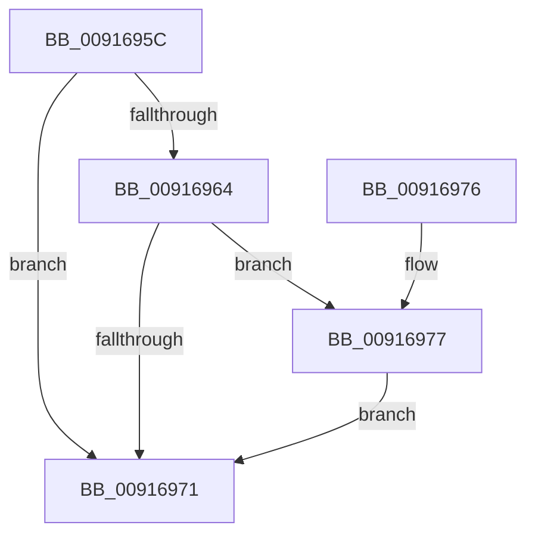

# BiReleaseBcdSyncMutant

- RVA: `0x0091695C`–`0x00916980` (길이 `36` bytes)
- VA: `0x000000014091695C`
- 실행 섹션: `PAGE`
- PDB 이름 있음: `예`; PDB Function 태그: `아니요`
- unwind 정보 RVA: `0x0006EDE0`
- 디코드: `12`개 명령, `36/36` bytes 표시
- 미해석 바이트: `0` (있으면 어셈블리에 `.byte`로 보존)

> 이 문서는 커널 이미지의 기계어와 PDB 기호를 분석해 생성했습니다. 4번과 5번은 함수 원형과 자료형을 바이너리 사용 방식에서 추정한 C 해석이며 원본 소스 복구 결과는 아닙니다.

## 1. Dependencies

- 직접 호출 지점: **1**; 고유 호출 대상: **1**
- 직접 호출자로 확인된 함수: **16**
- RIP 상대 이미지 참조: **1**

### Outgoing calls
- `0x00916979` → [ZwReleaseMutant](../../text/6A/ZwReleaseMutant_function_006AD4D0.md) (function, `0x006AD4D0`)

### Direct callers
- [BcdFlushStore](../82/BcdFlushStore_function_00823294.md) at `0x008232E2`
- [BcdForciblyUnloadStore](../82/BcdForciblyUnloadStore_function_008232FC.md) at `0x00823396`
- [BcdMarkAsSystemStore](../82/BcdMarkAsSystemStore_function_008233B4.md) at `0x0082340C`
- [BcdOpenSystemStore](../82/BcdOpenSystemStore_function_00823428.md) at `0x00823463`
- [BcdEnumerateObjects](../82/BcdEnumerateObjects_function_00823594.md) at `0x00823836`
- [BcdQueryObject](../82/BcdQueryObject_function_0082385C.md) at `0x008238C8`
- [BcdOpenObject](BcdOpenObject_function_00916704.md) at `0x009167E3`
- [BcdDeleteObject](../A3/BcdDeleteObject_function_00A3C578.md) at `0x00A3C5BF`
- [BcdCloseStore](../A3/BcdCloseStore_function_00A3C68C.md) at `0x00A3C6E7`
- [BcdCreateObject](../A3/BcdCreateObject_function_00A3D890.md) at `0x00A3D8E7`
- [BiBindEfiBootManager](../A3/BiBindEfiBootManager_function_00A3DCB0.md) at `0x00A3DD7C`
- [BiDeleteElement](../A3/BiDeleteElement_function_00A3E0F8.md) at `0x00A3E1F0`
- [BcdGetElementDataWithFlags](../A3/BcdGetElementDataWithFlags_function_00A3EBE4.md) at `0x00A3EDCC`
- [BcdSetElementDataWithFlags](../A3/BcdSetElementDataWithFlags_function_00A3F080.md) at `0x00A3F239`
- [BcdCloseObject](../A3/BcdCloseObject_function_00A3FB08.md) at `0x00A3FB33`
- [BcdOpenStore](../A4/BcdOpenStore_function_00A4116C.md) at `0x00A41223`

### Static image references
- `0x00916964` → RVA `0x00EF05E0` (`.data`; read)

## 2. Other-region calls and transfers

- 다른 실행 섹션으로 향하는 call: **1**
  - `0x00916979` → [ZwReleaseMutant](../../text/6A/ZwReleaseMutant_function_006AD4D0.md) (`PAGE` → `.text`)
- 별도 외부 분기/꼬리 이동을 확인하지 못했습니다.

## 3. Assembly (complete function range)

```asm
0091695C  48 83 EC 28                     sub rsp, 0x28
00916960  84 C9                           test cl, cl
00916962  75 0D                           jne 0x140916971
00916964  48 8B 0D 75 9C 5D 00            mov rcx, qword ptr [rip + 0x5d9c75]
0091696B  48 83 F9 FF                     cmp rcx, -1
0091696F  75 06                           jne 0x140916977
00916971  48 83 C4 28                     add rsp, 0x28
00916975  C3                              ret
00916976  CC                              int3
00916977  33 D2                           xor edx, edx
00916979  E8 52 6B D9 FF                  call 0x1406ad4d0
0091697E  EB F1                           jmp 0x140916971
```

## 4. C-style interpretation (structured pseudocode)

```c
__int64 __fastcall BiReleaseBcdSyncMutant(unsigned __int8 a1, int a2)
{
    __int64 result;
    __int64 v_rsp;

    v_rsp = (v_rsp) - (40);
    if (a1 != 0) goto loc_00916971;
    if ((*(unsigned __int64 *)(v_rip + 6134901)) != -1) goto loc_00916977;
loc_00916971:
    v_rsp = (v_rsp) + (40);
    return result;
loc_00916977:
    a2 = 0;
    result = ZwReleaseMutant(*(unsigned __int64 *)(v_rip + 6134901), a2, a3, a4);
    goto loc_00916971;
}
```

## 5. (Beta) C Style

```c
int64_t BiReleaseBcdSyncMutant(uint8_t Arg1, int32_t Arg2)
{
    int64_t result;
    int64_t local_rsp;

    local_rsp = (local_rsp) - (40);
    if (Arg1 != 0) goto loc_00916971;
    if ((*(uint64_t *)(v_rip + 0x5D9C75)) != -1) goto loc_00916977;
loc_00916971:
    local_rsp = (local_rsp) + (40);
    return result;
loc_00916977:
    Arg2 = 0;
    result = ZwReleaseMutant(*(uint64_t *)(v_rip + 0x5D9C75), Arg2, a3, a4);
    goto loc_00916971;
}
```

## 6. Execution-region graph

[열기: 2D/3D 그래프와 함수 탐색 컨트롤 패널](../../../control-panel.html?section=page&rva=0x0091695C&view=graph)

- 2D 그래프는 위에서 아래로 흐르고, 3D 그래프는 빈 공간을 드래그해 회전합니다. Shift+드래그는 이동, 휠은 확대·축소, 함수 노드 선택은 대상 보고서 이동입니다.

### Static fallback


