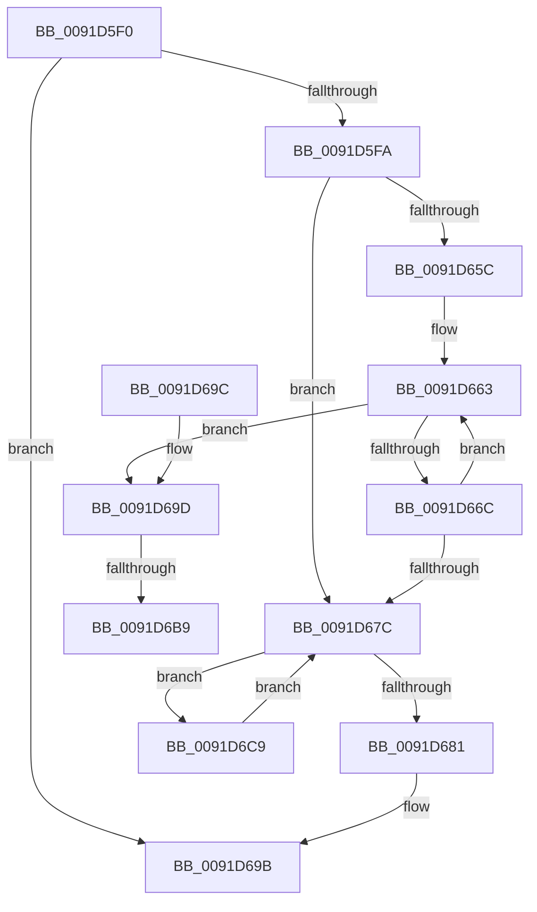

# DbgkpCloseObject

- RVA: `0x0091D5F0`–`0x0091D6DD` (길이 `237` bytes)
- VA: `0x000000014091D5F0`
- 실행 섹션: `PAGE`
- PDB 이름 있음: `예`; PDB Function 태그: `예`
- unwind 정보 RVA: `0x0008B240`
- 디코드: `63`개 명령, `237/237` bytes 표시
- 미해석 바이트: `0` (있으면 어셈블리에 `.byte`로 보존)

> 이 문서는 커널 이미지의 기계어와 PDB 기호를 분석해 생성했습니다. 4번과 5번은 함수 원형과 자료형을 바이너리 사용 방식에서 추정한 C 해석이며 원본 소스 복구 결과는 아닙니다.

## 1. Dependencies

- 직접 호출 지점: **7**; 고유 호출 대상: **5**
- 직접 호출자로 확인된 함수: **0**
- RIP 상대 이미지 참조: **1**

### Outgoing calls
- `0x0091D61A` → [ExAcquireFastMutex](../../text/20/ExAcquireFastMutex_function_0020E5A0.md) (function, `0x0020E5A0`)
- `0x0091D635` → [ExReleaseFastMutex](../../text/25/ExReleaseFastMutex_function_002519C0.md) (function, `0x002519C0`)
- `0x0091D642` → [KeSetEvent](../../text/33/KeSetEvent_function_0033F310.md) (function, `0x0033F310`)
- `0x0091D64F` → [PsGetNextProcess](PsGetNextProcess_function_0091C900.md) (function, `0x0091C900`)
- `0x0091D66F` → [PsGetNextProcess](PsGetNextProcess_function_0091C900.md) (function, `0x0091C900`)
- `0x0091D6A7` → [ExAcquireFastMutex](../../text/20/ExAcquireFastMutex_function_0020E5A0.md) (function, `0x0020E5A0`)
- `0x0091D6D6` → [DbgkpWakeTarget](../A1/DbgkpWakeTarget_function_00A106AC.md) (function, `0x00A106AC`)

### Direct callers
- 이 함수 시작 RVA로 연결되는 직접 call은 확인되지 않았습니다. 간접 호출은 완전히 역산할 수 없습니다.

### Static image references
- `0x0091D69D` → RVA `0x00F8F220` (`.data`; read)

## 2. Other-region calls and transfers

- 다른 실행 섹션으로 향하는 call: **4**
  - `0x0091D61A` → [ExAcquireFastMutex](../../text/20/ExAcquireFastMutex_function_0020E5A0.md) (`PAGE` → `.text`)
  - `0x0091D635` → [ExReleaseFastMutex](../../text/25/ExReleaseFastMutex_function_002519C0.md) (`PAGE` → `.text`)
  - `0x0091D642` → [KeSetEvent](../../text/33/KeSetEvent_function_0033F310.md) (`PAGE` → `.text`)
  - `0x0091D6A7` → [ExAcquireFastMutex](../../text/20/ExAcquireFastMutex_function_0020E5A0.md) (`PAGE` → `.text`)
- call이 아닌 외부 분기/꼬리 이동: **2**
  - `0x0091D6B3` → [sub_00B21BBC](../B2/Unknown_function_00B21BBC.md) (`tail-transfer`)
  - `0x0091D6C4` → [sub_00B21BBC](../B2/Unknown_function_00B21BBC.md) (`tail-transfer`)

## 3. Assembly (complete function range)

```asm
0091D5F0  49 83 F9 01                     cmp r9, 1
0091D5F4  0F 87 A1 00 00 00               ja 0x14091d69b
0091D5FA  48 8B C4                        mov rax, rsp
0091D5FD  48 89 58 08                     mov qword ptr [rax + 8], rbx
0091D601  48 89 68 10                     mov qword ptr [rax + 0x10], rbp
0091D605  48 89 70 18                     mov qword ptr [rax + 0x18], rsi
0091D609  48 89 78 20                     mov qword ptr [rax + 0x20], rdi
0091D60D  41 56                           push r14
0091D60F  48 83 EC 20                     sub rsp, 0x20
0091D613  48 8D 4A 18                     lea rcx, [rdx + 0x18]
0091D617  48 8B EA                        mov rbp, rdx
0091D61A  E8 81 0F 8F FF                  call 0x14020e5a0
0091D61F  83 4D 60 01                     or dword ptr [rbp + 0x60], 1
0091D623  4C 8D 75 50                     lea r14, [rbp + 0x50]
0091D627  49 8B 36                        mov rsi, qword ptr [r14]
0091D62A  48 8D 4D 18                     lea rcx, [rbp + 0x18]
0091D62E  4D 89 76 08                     mov qword ptr [r14 + 8], r14
0091D632  4D 89 36                        mov qword ptr [r14], r14
0091D635  E8 86 43 93 FF                  call 0x1402519c0
0091D63A  45 33 C0                        xor r8d, r8d
0091D63D  33 D2                           xor edx, edx
0091D63F  48 8B CD                        mov rcx, rbp
0091D642  E8 C9 1C A2 FF                  call 0x14033f310
0091D647  8B 5D 60                        mov ebx, dword ptr [rbp + 0x60]
0091D64A  33 C9                           xor ecx, ecx
0091D64C  83 E3 02                        and ebx, 2
0091D64F  E8 AC F2 FF FF                  call 0x14091c900
0091D654  48 8B F8                        mov rdi, rax
0091D657  48 85 C0                        test rax, rax
0091D65A  74 20                           je 0x14091d67c
0091D65C  F7 DB                           neg ebx
0091D65E  1A DB                           sbb bl, bl
0091D660  80 E3 02                        and bl, 2
0091D663  48 39 AF 08 03 00 00            cmp qword ptr [rdi + 0x308], rbp
0091D66A  74 31                           je 0x14091d69d
0091D66C  48 8B CF                        mov rcx, rdi
0091D66F  E8 8C F2 FF FF                  call 0x14091c900
0091D674  48 8B F8                        mov rdi, rax
0091D677  48 85 C0                        test rax, rax
0091D67A  75 E7                           jne 0x14091d663
0091D67C  49 3B F6                        cmp rsi, r14
0091D67F  75 48                           jne 0x14091d6c9
0091D681  48 8B 5C 24 30                  mov rbx, qword ptr [rsp + 0x30]
0091D686  48 8B 6C 24 38                  mov rbp, qword ptr [rsp + 0x38]
0091D68B  48 8B 74 24 40                  mov rsi, qword ptr [rsp + 0x40]
0091D690  48 8B 7C 24 48                  mov rdi, qword ptr [rsp + 0x48]
0091D695  48 83 C4 20                     add rsp, 0x20
0091D699  41 5E                           pop r14
0091D69B  C3                              ret
0091D69C  CC                              int3
0091D69D  48 8D 0D 7C 1B 67 00            lea rcx, [rip + 0x671b7c]
0091D6A4  80 E3 FE                        and bl, 0xfe
0091D6A7  E8 F4 0E 8F FF                  call 0x14020e5a0
0091D6AC  48 39 AF 08 03 00 00            cmp qword ptr [rdi + 0x308], rbp
0091D6B3  0F 85 03 45 20 00               jne 0x140b21bbc
0091D6B9  48 83 A7 08 03 00 00 00         and qword ptr [rdi + 0x308], 0
0091D6C1  80 CB 01                        or bl, 1
0091D6C4  E9 F3 44 20 00                  jmp 0x140b21bbc
0091D6C9  48 8B CE                        mov rcx, rsi
0091D6CC  48 8B 36                        mov rsi, qword ptr [rsi]
0091D6CF  C7 41 48 54 03 00 C0            mov dword ptr [rcx + 0x48], 0xc0000354
0091D6D6  E8 D1 2F 0F 00                  call 0x140a106ac
0091D6DB  EB 9F                           jmp 0x14091d67c
```

## 4. C-style interpretation (structured pseudocode)

```c
__int64 __fastcall DbgkpCloseObject(__int64 a1, __int64 a2, int a3, __int64 a4)
{
    __int64 result;
    __int64 v_rbx;
    __int64 v_rsp;
    unsigned __int64 v_stack_p10;
    unsigned __int64 v_stack_p18;
    unsigned __int64 v_stack_p20;
    unsigned __int64 v_stack_p8;

    if (a4 > 1) goto loc_0091D69B;
    *(unsigned __int64 *)(v_rsp + 8) = v_rbx;
    *(unsigned __int64 *)(v_rsp + 16) = v_rbp;
    *(unsigned __int64 *)(v_rsp + 24) = v_rsi;
    *(unsigned __int64 *)(v_rsp + 32) = v_rdi;
    v_rsp = (v_rsp) - (32);
    result = ExAcquireFastMutex(a2 + 24, a2, a3, a4);
    *(unsigned __int64 *)(a2 + 80 + 8) = a2 + 80;
    *(unsigned __int64 *)(a2 + 80) = a2 + 80;
    result = ExReleaseFastMutex(a2 + 24, a2, a3, a4);
    a3 = 0;
    a2 = 0;
    result = KeSetEvent(0, a2, a3, a4);
    a1 = 0;
    v_rbx = (unsigned int)(((unsigned int)(*(unsigned int *)(a2 + 96))) & (2));
    result = PsGetNextProcess(a1, a2, a3, a4);
    if (result == 0) goto loc_0091D67C;
    v_rbx = (unsigned int)(-(v_rbx));
    v_rbx = (unsigned __int8)((v_rbx) & (2));
loc_0091D663:
    if ((*(unsigned __int64 *)(result + 776)) == 0) goto loc_0091D69D;
    result = PsGetNextProcess(result, a2, a3, a4);
    if (result != 0) goto loc_0091D663;
loc_0091D67C:
    if ((*(unsigned __int64 *)(a2 + 80)) != (a2 + 80)) goto loc_0091D6C9;
    v_rsp = (v_rsp) + (32);
loc_0091D69B:
    return result;
loc_0091D69D:
    v_rbx = (unsigned __int8)((v_stack_p8) & (254));
    result = ExAcquireFastMutex(v_rip + 6757244, a2, a3, a4);
    v_rbx = (unsigned __int8)((v_rbx) | (1));
loc_0091D6C9:
    *(unsigned int *)(v_stack_p18 + 72) = 0xC0000354ULL;
    result = DbgkpWakeTarget(v_stack_p18, a2, a3, a4);
    goto loc_0091D67C;
}
```

## 5. (Beta) C Style

```c
int64_t DbgkpCloseObject(int64_t Arg1, void *Arg2, int32_t Arg3, int64_t Arg4)
{
    uint8_t *arg2 = (uint8_t *)Arg2;

    int64_t result;
    int64_t local_rbx;
    int64_t local_rsp;
    uint64_t v_stack_p10;
    uint64_t v_stack_p18;
    uint64_t v_stack_p20;
    uint64_t v_stack_p8;

    if (Arg4 > 1) goto loc_0091D69B;
    *(uint64_t *)(local_rsp + 0x8) = local_rbx;
    *(uint64_t *)(local_rsp + 0x10) = local_rbp;
    *(uint64_t *)(local_rsp + 0x18) = local_rsi;
    *(uint64_t *)(local_rsp + 0x20) = local_rdi;
    local_rsp = (local_rsp) - (32);
    result = ExAcquireFastMutex(Arg2 + 24, Arg2, Arg3, Arg4);
    *(void **)(arg2 + 0x50 + 0x8) = Arg2 + 80;
    *(void **)(arg2 + 0x50) = Arg2 + 80;
    result = ExReleaseFastMutex(Arg2 + 24, Arg2, Arg3, Arg4);
    Arg3 = 0;
    Arg2 = 0;
    result = KeSetEvent(0, Arg2, Arg3, Arg4);
    Arg1 = 0;
    local_rbx = (uint32_t)(((uint32_t)(*(uint32_t *)(arg2 + 0x60))) & (2));
    result = PsGetNextProcess(Arg1, Arg2, Arg3, Arg4);
    if (result == 0) goto loc_0091D67C;
    local_rbx = (uint32_t)(-(local_rbx));
    local_rbx = (uint8_t)((local_rbx) & (2));
loc_0091D663:
    if ((*(uint64_t *)(result + 0x308)) == 0) goto loc_0091D69D;
    result = PsGetNextProcess(result, Arg2, Arg3, Arg4);
    if (result != 0) goto loc_0091D663;
loc_0091D67C:
    if ((*(uint64_t *)(arg2 + 0x50)) != (Arg2 + 80)) goto loc_0091D6C9;
    local_rsp = (local_rsp) + (32);
loc_0091D69B:
    return result;
loc_0091D69D:
    local_rbx = (uint8_t)((v_stack_p8) & (254));
    result = ExAcquireFastMutex(v_rip + 6757244, Arg2, Arg3, Arg4);
    local_rbx = (uint8_t)((local_rbx) | (1));
loc_0091D6C9:
    *(uint32_t *)(v_stack_p18 + 0x48) = 0xC0000354ULL;
    result = DbgkpWakeTarget(v_stack_p18, Arg2, Arg3, Arg4);
    goto loc_0091D67C;
}
```

### 관측된 메모리 오프셋

구조체 형식이 확인되지 않은 접근은 인자 기준의 오프셋으로만 기록했습니다.

| 기준 인자 | 오프셋 표현 | 폭 (bit) | 접근 |
|---|---:|---:|---|
| `Arg2` | `+ 0x0` | `64` | `R` |
| `Arg2` | `+ 0x0` | `64` | `W` |
| `Arg2` | `+ 0x8` | `64` | `W` |
| `Arg2` | `+ 0x18` | `64` | `R` |
| `Arg2` | `+ 0x50` | `64` | `R` |
| `Arg2` | `+ 0x60` | `32` | `R` |
| `Arg2` | `+ 0x60` | `32` | `R/W` |

## 6. Execution-region graph

[열기: 2D/3D 그래프와 함수 탐색 컨트롤 패널](../../../control-panel.html?section=page&rva=0x0091D5F0&view=graph)

- 2D 그래프는 위에서 아래로 흐르고, 3D 그래프는 빈 공간을 드래그해 회전합니다. Shift+드래그는 이동, 휠은 확대·축소, 함수 노드 선택은 대상 보고서 이동입니다.

### Static fallback


