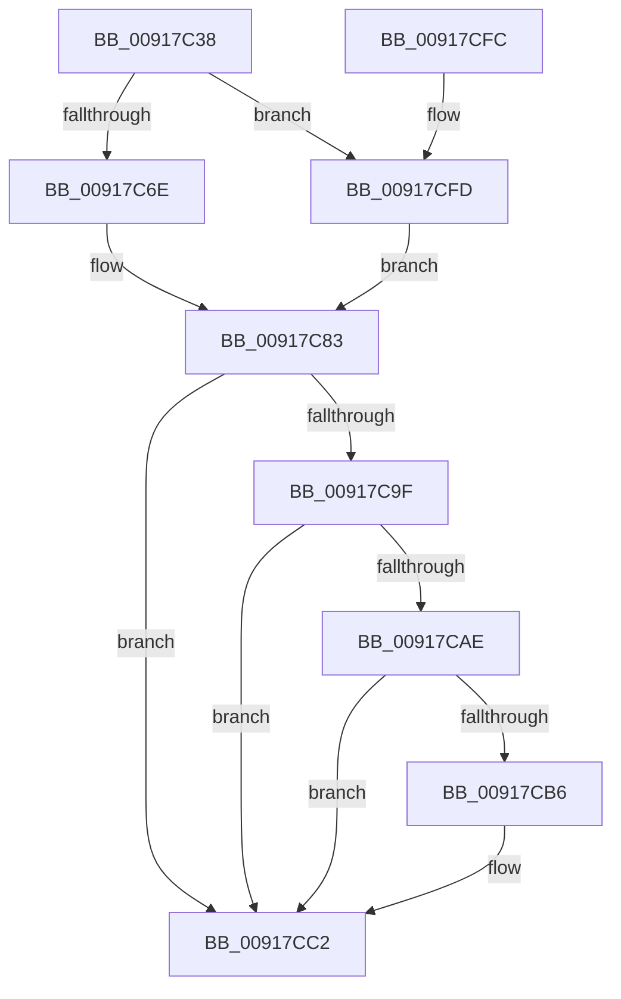

# EtwTraceJob

- RVA: `0x00917C38`–`0x00917D03` (길이 `203` bytes)
- VA: `0x0000000140917C38`
- 실행 섹션: `PAGE`
- PDB 이름 있음: `예`; PDB Function 태그: `아니요`
- unwind 정보 RVA: `0x0008AAD0`
- 디코드: `49`개 명령, `203/203` bytes 표시
- 미해석 바이트: `0` (있으면 어셈블리에 `.byte`로 보존)

> 이 문서는 커널 이미지의 기계어와 PDB 기호를 분석해 생성했습니다. 4번과 5번은 함수 원형과 자료형을 바이너리 사용 방식에서 추정한 C 해석이며 원본 소스 복구 결과는 아닙니다.

## 1. Dependencies

- 직접 호출 지점: **3**; 고유 호출 대상: **3**
- 직접 호출자로 확인된 함수: **4**
- RIP 상대 이미지 참조: **2**

### Outgoing calls
- `0x00917CBD` → [EtwpPsProvTraceJob](../A7/EtwpPsProvTraceJob_function_00A7F548.md) (function, `0x00A7F548`)
- `0x00917CDD` → [EtwTraceKernelEvent](../../text/23/EtwTraceKernelEvent_function_00235350.md) (function, `0x00235350`)
- `0x00917CE9` → [_security_check_cookie](../../text/6A/_security_check_cookie_function_006AC640.md) (function, `0x006AC640`)

### Direct callers
- [NtTerminateJobObject](NtTerminateJobObject_function_009172B0.md) at `0x00917337`
- [NtOpenJobObject](NtOpenJobObject_function_00917350.md) at `0x009173FD`
- [NtCreateJobObject](NtCreateJobObject_function_009177E0.md) at `0x00917B0C`
- [PspTerminateAllProcessesInJobHierarchy](PspTerminateAllProcessesInJobHierarchy_function_00917B7C.md) at `0x00917C0F`

### Static image references
- `0x00917C45` → RVA `0x00E0A740` (`.data`; read)
- `0x00917C9F` → RVA `0x00FC6AA8` (`ALMOSTRO`; read)

## 2. Other-region calls and transfers

- 다른 실행 섹션으로 향하는 call: **2**
  - `0x00917CDD` → [EtwTraceKernelEvent](../../text/23/EtwTraceKernelEvent_function_00235350.md) (`PAGE` → `.text`)
  - `0x00917CE9` → [_security_check_cookie](../../text/6A/_security_check_cookie_function_006AC640.md) (`PAGE` → `.text`)
- 별도 외부 분기/꼬리 이동을 확인하지 못했습니다.

## 3. Assembly (complete function range)

```asm
00917C38  48 89 5C 24 10                  mov qword ptr [rsp + 0x10], rbx
00917C3D  55                              push rbp
00917C3E  48 8B EC                        mov rbp, rsp
00917C41  48 83 EC 70                     sub rsp, 0x70
00917C45  48 8B 05 F4 2A 4F 00            mov rax, qword ptr [rip + 0x4f2af4]
00917C4C  48 33 C4                        xor rax, rsp
00917C4F  48 89 45 F0                     mov qword ptr [rbp - 0x10], rax
00917C53  41 0F B7 D9                     movzx ebx, r9w
00917C57  45 8B C8                        mov r9d, r8d
00917C5A  45 33 C0                        xor r8d, r8d
00917C5D  4C 89 45 C0                     mov qword ptr [rbp - 0x40], r8
00917C61  4C 89 45 C8                     mov qword ptr [rbp - 0x38], r8
00917C65  48 85 C9                        test rcx, rcx
00917C68  0F 84 8F 00 00 00               je 0x140917cfd
00917C6E  0F 10 81 C0 05 00 00            movups xmm0, xmmword ptr [rcx + 0x5c0]
00917C75  8B 81 BC 05 00 00               mov eax, dword ptr [rcx + 0x5bc]
00917C7B  89 45 D0                        mov dword ptr [rbp - 0x30], eax
00917C7E  F3 0F 7F 45 C0                  movdqu xmmword ptr [rbp - 0x40], xmm0
00917C83  89 55 D4                        mov dword ptr [rbp - 0x2c], edx
00917C86  48 8D 45 C0                     lea rax, [rbp - 0x40]
00917C8A  48 89 45 E0                     mov qword ptr [rbp - 0x20], rax
00917C8E  44 89 4D D8                     mov dword ptr [rbp - 0x28], r9d
00917C92  48 C7 45 E8 1C 00 00 00         mov qword ptr [rbp - 0x18], 0x1c
00917C9A  48 85 C9                        test rcx, rcx
00917C9D  74 23                           je 0x140917cc2
00917C9F  48 8B 05 02 EE 6A 00            mov rax, qword ptr [rip + 0x6aee02]
00917CA6  48 05 CC 12 00 00               add rax, 0x12cc
00917CAC  74 14                           je 0x140917cc2
00917CAE  F7 00 00 00 08 00               test dword ptr [rax], 0x80000
00917CB4  74 0C                           je 0x140917cc2
00917CB6  44 0F B7 C3                     movzx r8d, bx
00917CBA  41 8B D1                        mov edx, r9d
00917CBD  E8 86 78 16 00                  call 0x140a7f548
00917CC2  44 0F B7 CB                     movzx r9d, bx
00917CC6  C7 44 24 20 04 19 60 00         mov dword ptr [rsp + 0x20], 0x601904
00917CCE  BA 01 00 00 00                  mov edx, 1
00917CD3  48 8D 4D E0                     lea rcx, [rbp - 0x20]
00917CD7  41 B8 00 00 08 00               mov r8d, 0x80000
00917CDD  E8 6E D6 91 FF                  call 0x140235350
00917CE2  48 8B 4D F0                     mov rcx, qword ptr [rbp - 0x10]
00917CE6  48 33 CC                        xor rcx, rsp
00917CE9  E8 52 49 D9 FF                  call 0x1406ac640
00917CEE  48 8B 9C 24 88 00 00 00         mov rbx, qword ptr [rsp + 0x88]
00917CF6  48 83 C4 70                     add rsp, 0x70
00917CFA  5D                              pop rbp
00917CFB  C3                              ret
00917CFC  CC                              int3
00917CFD  44 89 45 D0                     mov dword ptr [rbp - 0x30], r8d
00917D01  EB 80                           jmp 0x140917c83
```

## 4. C-style interpretation (structured pseudocode)

```c
__int64 __fastcall EtwTraceJob(__int64 a1, int a2, int a3, unsigned __int16 a4)
{
    __int64 result;
    __int64 v_rsp;
    unsigned __int64 v_stack_m18;
    unsigned __int64 v_stack_m20;
    unsigned __int64 v_stack_m28;
    unsigned int v_stack_m30;
    unsigned int v_stack_m34;
    unsigned int v_stack_m38;
    unsigned __int64 v_stack_m40;
    unsigned __int64 v_stack_m48;
    unsigned int v_stack_m58;
    unsigned __int64 v_stack_p10;

    v_stack_p10 = v_rbx;
    v_rsp = (v_rsp) - (112);
    result = (*(unsigned __int64 *)(v_rip + 5188340)) ^ (v_rsp);
    v_stack_m18 = result;
    a3 = 0;
    v_stack_m48 = 0;
    v_stack_m40 = 0;
    if (a1 == 0) goto loc_00917CFD;
    v_stack_m38 = (unsigned int)((unsigned int)(*(unsigned int *)(a1 + 1468)));
    v_stack_m48 = v_xmm0;
loc_00917C83:
    v_stack_m34 = a2;
    v_stack_m28 = v_stack_m48;
    v_stack_m30 = (unsigned int)((unsigned int)(a3));
    v_stack_m20 = 28;
    if (a1 == 0) goto loc_00917CC2;
    result = (*(unsigned __int64 *)(v_rip + 7007746)) + (0x12CCULL);
    if (condition_is_equal) goto loc_00917CC2;
    if (((*(unsigned int *)(result)) & (0x80000ULL)) != 0) {
        a3 = a4;
        a2 = (unsigned int)((unsigned int)(a3));
        result = EtwpPsProvTraceJob(a1, a2, a3, (unsigned int)(a3));
    }
    v_stack_m58 = 0x601904ULL;
    result = EtwTraceKernelEvent(v_stack_m28, 1, (unsigned int)(0x80000ULL), a4);
    a1 = (v_stack_m18) ^ (v_rsp);
    result = _security_check_cookie(a1, 1, (unsigned int)(0x80000ULL), a4);
    v_rsp = (v_rsp) + (112);
    return result;
loc_00917CFD:
    v_stack_m38 = (unsigned int)((unsigned int)(0x80000ULL));
    goto loc_00917C83;
}
```

## 5. (Beta) C Style

```c
int64_t EtwTraceJob(int64_t Arg1, int32_t Arg2, int32_t Arg3, uint16_t Arg4)
{
    int64_t result;
    int64_t local_rsp;
    uint64_t v_stack_m18;
    uint64_t v_stack_m20;
    uint64_t v_stack_m28;
    uint32_t v_stack_m30;
    uint32_t v_stack_m34;
    uint32_t v_stack_m38;
    uint64_t v_stack_m40;
    uint64_t v_stack_m48;
    uint32_t v_stack_m58;
    uint64_t v_stack_p10;

    v_stack_p10 = local_rbx;
    local_rsp = (local_rsp) - (112);
    result = (*(uint64_t *)(v_rip + 0x4F2AF4)) ^ (local_rsp);
    v_stack_m18 = result;
    Arg3 = 0;
    v_stack_m48 = 0;
    v_stack_m40 = 0;
    if (Arg1 == 0) goto loc_00917CFD;
    v_stack_m38 = (uint32_t)((uint32_t)(*(uint32_t *)(Arg1 + 0x5BC)));
    v_stack_m48 = v_xmm0;
loc_00917C83:
    v_stack_m34 = Arg2;
    v_stack_m28 = v_stack_m48;
    v_stack_m30 = (uint32_t)((uint32_t)(Arg3));
    v_stack_m20 = 28;
    if (Arg1 == 0) goto loc_00917CC2;
    result = (*(uint64_t *)(v_rip + 0x6AEE02)) + (0x12CCULL);
    if (condition_is_equal) goto loc_00917CC2;
    if (((*(uint32_t *)(result)) & (0x80000ULL)) != 0) {
        Arg3 = Arg4;
        Arg2 = (uint32_t)((uint32_t)(Arg3));
        result = EtwpPsProvTraceJob(Arg1, Arg2, Arg3, (uint32_t)(Arg3));
    }
    v_stack_m58 = 0x601904ULL;
    result = EtwTraceKernelEvent(v_stack_m28, 1, (uint32_t)(0x80000ULL), Arg4);
    Arg1 = (v_stack_m18) ^ (local_rsp);
    result = _security_check_cookie(Arg1, 1, (uint32_t)(0x80000ULL), Arg4);
    local_rsp = (local_rsp) + (112);
    return result;
loc_00917CFD:
    v_stack_m38 = (uint32_t)((uint32_t)(0x80000ULL));
    goto loc_00917C83;
}
```

## 6. Execution-region graph

[열기: 2D/3D 그래프와 함수 탐색 컨트롤 패널](../../../control-panel.html?section=page&rva=0x00917C38&view=graph)

- 2D 그래프는 위에서 아래로 흐르고, 3D 그래프는 빈 공간을 드래그해 회전합니다. Shift+드래그는 이동, 휠은 확대·축소, 함수 노드 선택은 대상 보고서 이동입니다.

### Static fallback


