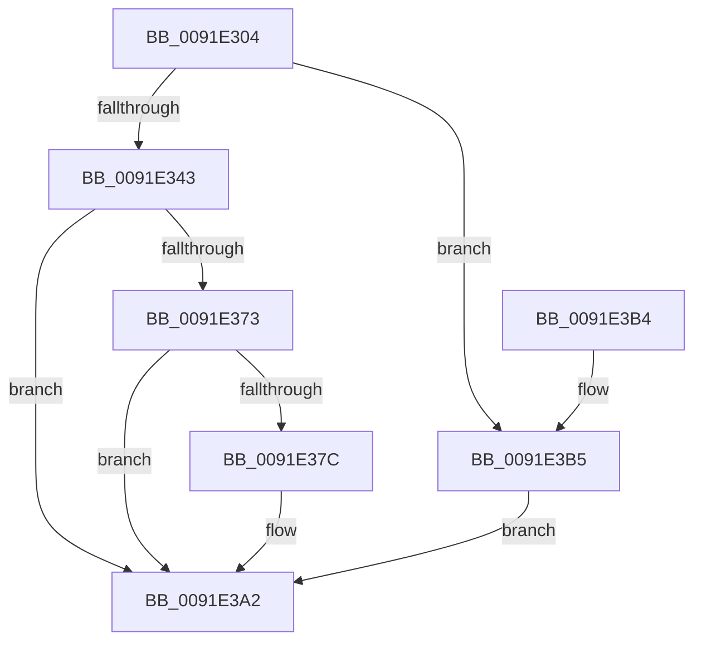

# EtwpLogMemInfoWsHelper

- RVA: `0x0091E304`–`0x0091E3E0` (길이 `220` bytes)
- VA: `0x000000014091E304`
- 실행 섹션: `PAGE`
- PDB 이름 있음: `예`; PDB Function 태그: `아니요`
- unwind 정보 RVA: `0x0008B430`
- 디코드: `46`개 명령, `220/220` bytes 표시
- 미해석 바이트: `0` (있으면 어셈블리에 `.byte`로 보존)

> 이 문서는 커널 이미지의 기계어와 PDB 기호를 분석해 생성했습니다. 4번과 5번은 함수 원형과 자료형을 바이너리 사용 방식에서 추정한 C 해석이며 원본 소스 복구 결과는 아닙니다.

## 1. Dependencies

- 직접 호출 지점: **4**; 고유 호출 대상: **4**
- 직접 호출자로 확인된 함수: **1**
- RIP 상대 이미지 참조: **4**

### Outgoing calls
- `0x0091E35F` → [EtwTraceKernelEvent](../../text/23/EtwTraceKernelEvent_function_00235350.md) (function, `0x00235350`)
- `0x0091E39D` → [EtwWrite](../../text/41/EtwWrite_function_0041C720.md) (function, `0x0041C720`)
- `0x0091E3AA` → [_security_check_cookie](../../text/6A/_security_check_cookie_function_006AC640.md) (function, `0x006AC640`)
- `0x0091E3D9` → [EtwpLogKernelEvent](../../text/25/EtwpLogKernelEvent_function_0025CC00.md) (function, `0x0025CC00`)

### Direct callers
- [EtwpLogMemInfoWs](EtwpLogMemInfoWs_function_0091C594.md) at `0x0091C7D9`
- [EtwpLogMemInfoWs](EtwpLogMemInfoWs_function_0091C594.md) at `0x0091C88E`

### Static image references
- `0x0091E308` → RVA `0x00E0A740` (`.data`; read)
- `0x0091E364` → RVA `0x00FC6AA8` (`ALMOSTRO`; read)
- `0x0091E37C` → RVA `0x00EFF848` (`.data`; read)
- `0x0091E396` → RVA `0x00011B18` (`.rdata`; read)

## 2. Other-region calls and transfers

- 다른 실행 섹션으로 향하는 call: **4**
  - `0x0091E35F` → [EtwTraceKernelEvent](../../text/23/EtwTraceKernelEvent_function_00235350.md) (`PAGE` → `.text`)
  - `0x0091E39D` → [EtwWrite](../../text/41/EtwWrite_function_0041C720.md) (`PAGE` → `.text`)
  - `0x0091E3AA` → [_security_check_cookie](../../text/6A/_security_check_cookie_function_006AC640.md) (`PAGE` → `.text`)
  - `0x0091E3D9` → [EtwpLogKernelEvent](../../text/25/EtwpLogKernelEvent_function_0025CC00.md) (`PAGE` → `.text`)
- 별도 외부 분기/꼬리 이동을 확인하지 못했습니다.

## 3. Assembly (complete function range)

```asm
0091E304  48 83 EC 68                     sub rsp, 0x68
0091E308  48 8B 05 31 C4 4E 00            mov rax, qword ptr [rip + 0x4ec431]
0091E30F  48 33 C4                        xor rax, rsp
0091E312  48 89 44 24 50                  mov qword ptr [rsp + 0x50], rax
0091E317  83 64 24 3C 00                  and dword ptr [rsp + 0x3c], 0
0091E31C  48 8D 42 04                     lea rax, [rdx + 4]
0091E320  83 64 24 4C 00                  and dword ptr [rsp + 0x4c], 0
0091E325  48 89 44 24 40                  mov qword ptr [rsp + 0x40], rax
0091E32A  6B 02 44                        imul eax, dword ptr [rdx], 0x44
0091E32D  48 89 54 24 30                  mov qword ptr [rsp + 0x30], rdx
0091E332  C7 44 24 38 04 00 00 00         mov dword ptr [rsp + 0x38], 4
0091E33A  89 44 24 48                     mov dword ptr [rsp + 0x48], eax
0091E33E  48 85 C9                        test rcx, rcx
0091E341  75 72                           jne 0x14091e3b5
0091E343  8D 51 02                        lea edx, [rcx + 2]
0091E346  C7 44 24 20 04 18 50 00         mov dword ptr [rsp + 0x20], 0x501804
0091E34E  48 8D 4C 24 30                  lea rcx, [rsp + 0x30]
0091E353  41 B9 7D 02 00 00               mov r9d, 0x27d
0091E359  41 B8 00 00 80 20               mov r8d, 0x20800000
0091E35F  E8 EC 6F 91 FF                  call 0x140235350
0091E364  48 8B 05 3D 87 6A 00            mov rax, qword ptr [rip + 0x6a873d]
0091E36B  48 05 CC 12 00 00               add rax, 0x12cc
0091E371  74 2F                           je 0x14091e3a2
0091E373  F7 40 04 00 00 80 00            test dword ptr [rax + 4], 0x800000
0091E37A  74 26                           je 0x14091e3a2
0091E37C  48 8B 0D C5 14 5E 00            mov rcx, qword ptr [rip + 0x5e14c5]
0091E383  48 8D 44 24 30                  lea rax, [rsp + 0x30]
0091E388  41 B9 02 00 00 00               mov r9d, 2
0091E38E  48 89 44 24 20                  mov qword ptr [rsp + 0x20], rax
0091E393  45 33 C0                        xor r8d, r8d
0091E396  48 8D 15 7B 37 6F FF            lea rdx, [rip - 0x90c885]
0091E39D  E8 7E E3 AF FF                  call 0x14041c720
0091E3A2  48 8B 4C 24 50                  mov rcx, qword ptr [rsp + 0x50]
0091E3A7  48 33 CC                        xor rcx, rsp
0091E3AA  E8 91 E2 D8 FF                  call 0x1406ac640
0091E3AF  48 83 C4 68                     add rsp, 0x68
0091E3B3  C3                              ret
0091E3B4  CC                              int3
0091E3B5  44 8B 01                        mov r8d, dword ptr [rcx]
0091E3B8  41 B9 02 00 00 00               mov r9d, 2
0091E3BE  48 8B 91 50 05 00 00            mov rdx, qword ptr [rcx + 0x550]
0091E3C5  48 8D 4C 24 30                  lea rcx, [rsp + 0x30]
0091E3CA  C7 44 24 28 04 18 50 00         mov dword ptr [rsp + 0x28], 0x501804
0091E3D2  66 C7 44 24 20 7D 02            mov word ptr [rsp + 0x20], 0x27d
0091E3D9  E8 22 E8 93 FF                  call 0x14025cc00
0091E3DE  EB C2                           jmp 0x14091e3a2
```

## 4. C-style interpretation (structured pseudocode)

```c
__int64 __fastcall EtwpLogMemInfoWsHelper(__int64 a1, __int64 a2)
{
    __int64 result;
    __int64 v_rsp;
    unsigned __int64 v_stack_m18;
    unsigned int v_stack_m1C;
    unsigned int v_stack_m20;
    unsigned __int64 v_stack_m28;
    unsigned int v_stack_m2C;
    unsigned int v_stack_m30;
    unsigned __int64 v_stack_m38;
    unsigned int v_stack_m48;
    unsigned __int16 v_stack_p20;
    unsigned int v_stack_p28;
    unsigned __int64 v_stack_p30;

    v_rsp = (v_rsp) - (104);
    result = (*(unsigned __int64 *)(v_rip + 5162033)) ^ (v_rsp);
    v_stack_m18 = result;
    v_stack_m28 = a2 + 4;
    result = (unsigned int)((a2 + 4) * (*(unsigned int *)(a2)));
    v_stack_m38 = a2;
    v_stack_m30 = 4;
    v_stack_m20 = (unsigned int)(result);
    if (a1 != 0) goto loc_0091E3B5;
    v_stack_m48 = 0x501804ULL;
    result = EtwTraceKernelEvent(v_stack_m38, a1 + 2, (unsigned int)(0x20800000ULL), 637);
    result = (*(unsigned __int64 *)(v_rip + 6981437)) + (0x12CCULL);
    if (condition_is_equal) goto loc_0091E3A2;
    if (((*(unsigned int *)(result + 4)) & (0x800000ULL)) != 0) {
        a1 = *(unsigned __int64 *)(v_rip + 6165701);
        result = v_stack_m38;
        a4 = 2;
        v_stack_m48 = result;
        a3 = 0;
        a2 = v_rip - 9488517;
        result = EtwWrite(a1, a2, a3, a4);
    }
    a1 = (v_stack_m18) ^ (v_rsp);
    result = _security_check_cookie(a1, a2, a3, a4);
    v_rsp = (v_rsp) + (104);
    return result;
loc_0091E3B5:
    v_stack_p28 = 0x501804ULL;
    v_stack_p20 = 637;
    result = EtwpLogKernelEvent(v_stack_p30, *(unsigned __int64 *)(a1 + 1360), (unsigned int)(*(unsigned int *)(a1)), 2);
    goto loc_0091E3A2;
}
```

## 5. (Beta) C Style

```c
int64_t EtwpLogMemInfoWsHelper(int64_t Arg1, void *Arg2)
{
    uint8_t *arg2 = (uint8_t *)Arg2;

    int64_t result;
    int64_t local_rsp;
    uint64_t v_stack_m18;
    uint32_t v_stack_m1C;
    uint32_t v_stack_m20;
    uint64_t v_stack_m28;
    uint32_t v_stack_m2C;
    uint32_t v_stack_m30;
    uint64_t v_stack_m38;
    uint32_t v_stack_m48;
    uint16_t v_stack_p20;
    uint32_t v_stack_p28;
    uint64_t v_stack_p30;

    local_rsp = (local_rsp) - (104);
    result = (*(uint64_t *)(v_rip + 0x4EC431)) ^ (local_rsp);
    v_stack_m18 = result;
    v_stack_m28 = Arg2 + 4;
    result = (uint32_t)((Arg2 + 4) * (*(uint32_t *)(arg2)));
    v_stack_m38 = Arg2;
    v_stack_m30 = 4;
    v_stack_m20 = (uint32_t)(result);
    if (Arg1 != 0) goto loc_0091E3B5;
    v_stack_m48 = 0x501804ULL;
    result = EtwTraceKernelEvent(v_stack_m38, Arg1 + 2, (uint32_t)(0x20800000ULL), 637);
    result = (*(uint64_t *)(v_rip + 0x6A873D)) + (0x12CCULL);
    if (condition_is_equal) goto loc_0091E3A2;
    if (((*(uint32_t *)(result + 0x4)) & (0x800000ULL)) != 0) {
        Arg1 = *(uint64_t *)(v_rip + 0x5E14C5);
        result = v_stack_m38;
        a4 = 2;
        v_stack_m48 = result;
        a3 = 0;
        Arg2 = v_rip - 9488517;
        result = EtwWrite(Arg1, Arg2, a3, a4);
    }
    Arg1 = (v_stack_m18) ^ (local_rsp);
    result = _security_check_cookie(Arg1, Arg2, a3, a4);
    local_rsp = (local_rsp) + (104);
    return result;
loc_0091E3B5:
    v_stack_p28 = 0x501804ULL;
    v_stack_p20 = 637;
    result = EtwpLogKernelEvent(v_stack_p30, *(uint64_t *)(Arg1 + 0x550), (uint32_t)(*(uint32_t *)(Arg1)), 2);
    goto loc_0091E3A2;
}
```

### 관측된 메모리 오프셋

구조체 형식이 확인되지 않은 접근은 인자 기준의 오프셋으로만 기록했습니다.

| 기준 인자 | 오프셋 표현 | 폭 (bit) | 접근 |
|---|---:|---:|---|
| `Arg2` | `+ 0x0` | `32` | `R` |
| `Arg2` | `+ 0x4` | `64` | `R` |

## 6. Execution-region graph

[열기: 2D/3D 그래프와 함수 탐색 컨트롤 패널](../../../control-panel.html?section=page&rva=0x0091E304&view=graph)

- 2D 그래프는 위에서 아래로 흐르고, 3D 그래프는 빈 공간을 드래그해 회전합니다. Shift+드래그는 이동, 휠은 확대·축소, 함수 노드 선택은 대상 보고서 이동입니다.

### Static fallback


