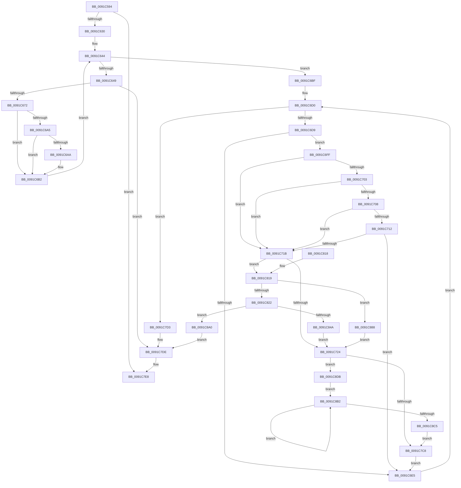

# EtwpLogMemInfoWs

- RVA: `0x0091C594`–`0x0091C8EE` (길이 `858` bytes)
- VA: `0x000000014091C594`
- 실행 섹션: `PAGE`
- PDB 이름 있음: `예`; PDB Function 태그: `아니요`
- unwind 정보 RVA: `0x0008B108`
- 디코드: `223`개 명령, `858/858` bytes 표시
- 미해석 바이트: `0` (있으면 어셈블리에 `.byte`로 보존)

> 이 문서는 커널 이미지의 기계어와 PDB 기호를 분석해 생성했습니다. 4번과 5번은 함수 원형과 자료형을 바이너리 사용 방식에서 추정한 C 해석이며 원본 소스 복구 결과는 아닙니다.

## 1. Dependencies

- 직접 호출 지점: **14**; 고유 호출 대상: **10**
- 직접 호출자로 확인된 함수: **2**
- RIP 상대 이미지 참조: **2**

### Outgoing calls
- `0x0091C600` → [memset](../../text/6C/memset_function_006C6C40.md) (function, `0x006C6C40`)
- `0x0091C61D` → [ExAllocatePool2](../../poolcode/B8/ExAllocatePool2_function_00B820F0.md) (function, `0x00B820F0`)
- `0x0091C663` → [ZwQuerySystemInformation](../../text/6A/ZwQuerySystemInformation_function_006AD790.md) (function, `0x006AD790`)
- `0x0091C6F3` → [PsGetNextProcess](PsGetNextProcess_function_0091C900.md) (function, `0x0091C900`)
- `0x0091C7AD` → [memset](../../text/6C/memset_function_006C6C40.md) (function, `0x006C6C40`)
- `0x0091C7B9` → [SmpProcessQueryStoreStats](../../text/34/SmpProcessQueryStoreStats_function_00349D6C.md) (function, `0x00349D6C`)
- `0x0091C7D9` → [EtwpLogMemInfoWsHelper](EtwpLogMemInfoWsHelper_function_0091E304.md) (function, `0x0091E304`)
- `0x0091C7E3` → [ExFreePoolWithTag](../../poolcode/B8/ExFreePoolWithTag_function_00B82870.md) (function, `0x00B82870`)
- `0x0091C7F2` → [_security_check_cookie](../../text/6A/_security_check_cookie_function_006AC640.md) (function, `0x006AC640`)
- `0x0091C83D` → [ExAllocatePool2](../../poolcode/B8/ExAllocatePool2_function_00B820F0.md) (function, `0x00B820F0`)
- `0x0091C853` → [memcpy](../../text/6C/memcpy_function_006C6840.md) (function, `0x006C6840`)
- `0x0091C85D` → [ExFreePoolWithTag](../../poolcode/B8/ExFreePoolWithTag_function_00B82870.md) (function, `0x00B82870`)
- `0x0091C88E` → [EtwpLogMemInfoWsHelper](EtwpLogMemInfoWsHelper_function_0091E304.md) (function, `0x0091E304`)
- `0x0091C8A8` → [ObfDereferenceObjectWithTag](../../text/2F/ObfDereferenceObjectWithTag_function_002F78E0.md) (function, `0x002F78E0`)

### Direct callers
- [EtwpLogMemInfoRundown](../7C/EtwpLogMemInfoRundown_function_007C0144.md) at `0x007C0188`
- [EtwpPerfMemInfoWork](EtwpPerfMemInfoWork_function_0091D5C0.md) at `0x0091D5D6`

### Static image references
- `0x0091C5BA` → RVA `0x00E0A740` (`.data`; read)
- `0x0091C6BF` → RVA `0x00FC6B70` (`ALMOSTRO`; read)

## 2. Other-region calls and transfers

- 다른 실행 섹션으로 향하는 call: **11**
  - `0x0091C600` → [memset](../../text/6C/memset_function_006C6C40.md) (`PAGE` → `.text`)
  - `0x0091C61D` → [ExAllocatePool2](../../poolcode/B8/ExAllocatePool2_function_00B820F0.md) (`PAGE` → `POOLCODE`)
  - `0x0091C663` → [ZwQuerySystemInformation](../../text/6A/ZwQuerySystemInformation_function_006AD790.md) (`PAGE` → `.text`)
  - `0x0091C7AD` → [memset](../../text/6C/memset_function_006C6C40.md) (`PAGE` → `.text`)
  - `0x0091C7B9` → [SmpProcessQueryStoreStats](../../text/34/SmpProcessQueryStoreStats_function_00349D6C.md) (`PAGE` → `.text`)
  - `0x0091C7E3` → [ExFreePoolWithTag](../../poolcode/B8/ExFreePoolWithTag_function_00B82870.md) (`PAGE` → `POOLCODE`)
  - `0x0091C7F2` → [_security_check_cookie](../../text/6A/_security_check_cookie_function_006AC640.md) (`PAGE` → `.text`)
  - `0x0091C83D` → [ExAllocatePool2](../../poolcode/B8/ExAllocatePool2_function_00B820F0.md) (`PAGE` → `POOLCODE`)
  - `0x0091C853` → [memcpy](../../text/6C/memcpy_function_006C6840.md) (`PAGE` → `.text`)
  - `0x0091C85D` → [ExFreePoolWithTag](../../poolcode/B8/ExFreePoolWithTag_function_00B82870.md) (`PAGE` → `POOLCODE`)
  - `0x0091C8A8` → [ObfDereferenceObjectWithTag](../../text/2F/ObfDereferenceObjectWithTag_function_002F78E0.md) (`PAGE` → `.text`)
- 별도 외부 분기/꼬리 이동을 확인하지 못했습니다.

## 3. Assembly (complete function range)

```asm
0091C594  48 8B C4                        mov rax, rsp
0091C597  48 89 58 10                     mov qword ptr [rax + 0x10], rbx
0091C59B  48 89 70 18                     mov qword ptr [rax + 0x18], rsi
0091C59F  48 89 78 20                     mov qword ptr [rax + 0x20], rdi
0091C5A3  55                              push rbp
0091C5A4  41 54                           push r12
0091C5A6  41 55                           push r13
0091C5A8  41 56                           push r14
0091C5AA  41 57                           push r15
0091C5AC  48 8D A8 38 FA FF FF            lea rbp, [rax - 0x5c8]
0091C5B3  48 81 EC A0 06 00 00            sub rsp, 0x6a0
0091C5BA  48 8B 05 7F E1 4E 00            mov rax, qword ptr [rip + 0x4ee17f]
0091C5C1  48 33 C4                        xor rax, rsp
0091C5C4  48 89 85 90 05 00 00            mov qword ptr [rbp + 0x590], rax
0091C5CB  4C 8B F2                        mov r14, rdx
0091C5CE  48 89 4C 24 28                  mov qword ptr [rsp + 0x28], rcx
0091C5D3  BB 40 00 00 00                  mov ebx, 0x40
0091C5D8  C7 85 80 05 00 00 51 00 00 00   mov dword ptr [rbp + 0x580], 0x51
0091C5E2  44 8B C3                        mov r8d, ebx
0091C5E5  C7 85 84 05 00 00 77 00 00 00   mov dword ptr [rbp + 0x584], 0x77
0091C5EF  33 D2                           xor edx, edx
0091C5F1  C7 85 88 05 00 00 78 00 00 00   mov dword ptr [rbp + 0x588], 0x78
0091C5FB  48 8D 4C 24 40                  lea rcx, [rsp + 0x40]
0091C600  E8 3B A6 DA FF                  call 0x1406c6c40
0091C605  41 BC 04 11 00 00               mov r12d, 0x1104
0091C60B  41 B8 45 74 77 74               mov r8d, 0x74777445
0091C611  41 8B D4                        mov edx, r12d
0091C614  8B CB                           mov ecx, ebx
0091C616  41 83 CD FF                     or r13d, 0xffffffff
0091C61A  44 8B FB                        mov r15d, ebx
0091C61D  E8 CE 5A 26 00                  call 0x140b820f0
0091C622  33 D2                           xor edx, edx
0091C624  48 8B F8                        mov rdi, rax
0091C627  48 85 C0                        test rax, rax
0091C62A  0F 84 B8 01 00 00               je 0x14091c7e8
0091C630  48 8D 58 04                     lea rbx, [rax + 4]
0091C634  89 10                           mov dword ptr [rax], edx
0091C636  48 8D 8B 00 11 00 00            lea rcx, [rbx + 0x1100]
0091C63D  8B F2                           mov esi, edx
0091C63F  48 89 4C 24 30                  mov qword ptr [rsp + 0x30], rcx
0091C644  83 FE 03                        cmp esi, 3
0091C647  73 76                           jae 0x14091c6bf
0091C649  8B C6                           mov eax, esi
0091C64B  48 8D 54 24 40                  lea rdx, [rsp + 0x40]
0091C650  45 33 C9                        xor r9d, r9d
0091C653  45 8B C7                        mov r8d, r15d
0091C656  8B 84 85 80 05 00 00            mov eax, dword ptr [rbp + rax*4 + 0x580]
0091C65D  8B C8                           mov ecx, eax
0091C65F  89 44 24 20                     mov dword ptr [rsp + 0x20], eax
0091C663  E8 28 11 D9 FF                  call 0x1406ad790
0091C668  33 D2                           xor edx, edx
0091C66A  85 C0                           test eax, eax
0091C66C  0F 85 6C 01 00 00               jne 0x14091c7de
0091C672  44 89 2B                        mov dword ptr [rbx], r13d
0091C675  48 8B 44 24 40                  mov rax, qword ptr [rsp + 0x40]
0091C67A  48 C1 E8 0C                     shr rax, 0xc
0091C67E  83 7C 24 20 77                  cmp dword ptr [rsp + 0x20], 0x77
0091C683  48 89 43 04                     mov qword ptr [rbx + 4], rax
0091C687  48 89 43 1C                     mov qword ptr [rbx + 0x1c], rax
0091C68B  48 89 43 0C                     mov qword ptr [rbx + 0xc], rax
0091C68F  48 89 53 3C                     mov qword ptr [rbx + 0x3c], rdx
0091C693  48 89 43 14                     mov qword ptr [rbx + 0x14], rax
0091C697  48 89 53 2C                     mov qword ptr [rbx + 0x2c], rdx
0091C69B  48 89 53 24                     mov qword ptr [rbx + 0x24], rdx
0091C69F  48 89 53 34                     mov qword ptr [rbx + 0x34], rdx
0091C6A3  75 0D                           jne 0x14091c6b2
0091C6A5  4C 3B F0                        cmp r14, rax
0091C6A8  76 08                           jbe 0x14091c6b2
0091C6AA  4C 89 73 0C                     mov qword ptr [rbx + 0xc], r14
0091C6AE  4C 89 73 14                     mov qword ptr [rbx + 0x14], r14
0091C6B2  FF 07                           inc dword ptr [rdi]
0091C6B4  48 83 C3 44                     add rbx, 0x44
0091C6B8  41 FF CD                        dec r13d
0091C6BB  FF C6                           inc esi
0091C6BD  EB 85                           jmp 0x14091c644
0091C6BF  48 8B 35 AA A4 6A 00            mov rsi, qword ptr [rip + 0x6aa4aa]
0091C6C6  4C 8B 6C 24 28                  mov r13, qword ptr [rsp + 0x28]
0091C6CB  4C 8B 74 24 30                  mov r14, qword ptr [rsp + 0x30]
0091C6D0  48 85 F6                        test rsi, rsi
0091C6D3  0F 84 FA 00 00 00               je 0x14091c7d3
0091C6D9  8B 86 F4 01 00 00               mov eax, dword ptr [rsi + 0x1f4]
0091C6DF  0F BA E0 1A                     bt eax, 0x1a
0091C6E3  72 1A                           jb 0x14091c6ff
0091C6E5  48 3B 35 84 A4 6A 00            cmp rsi, qword ptr [rip + 0x6aa484]
0091C6EC  48 0F 44 F2                     cmove rsi, rdx
0091C6F0  48 8B CE                        mov rcx, rsi
0091C6F3  E8 08 02 00 00                  call 0x14091c900
0091C6F8  48 8B F0                        mov rsi, rax
0091C6FB  33 D2                           xor edx, edx
0091C6FD  EB D1                           jmp 0x14091c6d0
0091C6FF  A8 04                           test al, 4
0091C701  74 18                           je 0x14091c71b
0091C703  39 56 04                        cmp dword ptr [rsi + 4], edx
0091C706  74 13                           je 0x14091c71b
0091C708  8B 86 80 03 00 00               mov eax, dword ptr [rsi + 0x380]
0091C70E  85 C0                           test eax, eax
0091C710  75 09                           jne 0x14091c71b
0091C712  48 8D 46 30                     lea rax, [rsi + 0x30]
0091C716  48 39 00                        cmp qword ptr [rax], rax
0091C719  74 CA                           je 0x14091c6e5
0091C71B  49 3B DE                        cmp rbx, r14
0091C71E  0F 84 F5 00 00 00               je 0x14091c819
0091C724  8B 86 D0 01 00 00               mov eax, dword ptr [rsi + 0x1d0]
0091C72A  41 B8 00 06 00 00               mov r8d, 0x600
0091C730  89 03                           mov dword ptr [rbx], eax
0091C732  48 8B 86 80 04 00 00            mov rax, qword ptr [rsi + 0x480]
0091C739  48 89 43 04                     mov qword ptr [rbx + 4], rax
0091C73D  48 8B 86 88 04 00 00            mov rax, qword ptr [rsi + 0x488]
0091C744  48 89 43 1C                     mov qword ptr [rbx + 0x1c], rax
0091C748  48 8B 86 D8 03 00 00            mov rax, qword ptr [rsi + 0x3d8]
0091C74F  48 89 43 0C                     mov qword ptr [rbx + 0xc], rax
0091C753  48 8B 86 A8 06 00 00            mov rax, qword ptr [rsi + 0x6a8]
0091C75A  48 89 43 3C                     mov qword ptr [rbx + 0x3c], rax
0091C75E  48 8B 86 28 02 00 00            mov rax, qword ptr [rsi + 0x228]
0091C765  48 C1 E8 0C                     shr rax, 0xc
0091C769  48 89 43 14                     mov qword ptr [rbx + 0x14], rax
0091C76D  90                              nop
0091C76E  48 8B 4B 0C                     mov rcx, qword ptr [rbx + 0xc]
0091C772  48 8B 43 14                     mov rax, qword ptr [rbx + 0x14]
0091C776  48 3B C8                        cmp rcx, rax
0091C779  48 89 53 24                     mov qword ptr [rbx + 0x24], rdx
0091C77D  48 89 53 2C                     mov qword ptr [rbx + 0x2c], rdx
0091C781  48 0F 43 C8                     cmovae rcx, rax
0091C785  48 8B 43 04                     mov rax, qword ptr [rbx + 4]
0091C789  48 89 4B 0C                     mov qword ptr [rbx + 0xc], rcx
0091C78D  48 8B 4B 1C                     mov rcx, qword ptr [rbx + 0x1c]
0091C791  48 3B C8                        cmp rcx, rax
0091C794  48 0F 43 C8                     cmovae rcx, rax
0091C798  33 D2                           xor edx, edx
0091C79A  48 89 4B 1C                     mov qword ptr [rbx + 0x1c], rcx
0091C79E  48 8D 4D 80                     lea rcx, [rbp - 0x80]
0091C7A2  48 8B 86 C8 04 00 00            mov rax, qword ptr [rsi + 0x4c8]
0091C7A9  48 89 43 34                     mov qword ptr [rbx + 0x34], rax
0091C7AD  E8 8E A4 DA FF                  call 0x1406c6c40
0091C7B2  48 8D 55 80                     lea rdx, [rbp - 0x80]
0091C7B6  48 8B CE                        mov rcx, rsi
0091C7B9  E8 AE D5 A2 FF                  call 0x140349d6c
0091C7BE  33 D2                           xor edx, edx
0091C7C0  85 C0                           test eax, eax
0091C7C2  0F 89 13 01 00 00               jns 0x14091c8db
0091C7C8  48 83 C3 44                     add rbx, 0x44
0091C7CC  FF 07                           inc dword ptr [rdi]
0091C7CE  E9 12 FF FF FF                  jmp 0x14091c6e5
0091C7D3  48 8B D7                        mov rdx, rdi
0091C7D6  49 8B CD                        mov rcx, r13
0091C7D9  E8 26 1B 00 00                  call 0x14091e304
0091C7DE  33 D2                           xor edx, edx
0091C7E0  48 8B CF                        mov rcx, rdi
0091C7E3  E8 88 60 26 00                  call 0x140b82870
0091C7E8  48 8B 8D 90 05 00 00            mov rcx, qword ptr [rbp + 0x590]
0091C7EF  48 33 CC                        xor rcx, rsp
0091C7F2  E8 49 FE D8 FF                  call 0x1406ac640
0091C7F7  4C 8D 9C 24 A0 06 00 00         lea r11, [rsp + 0x6a0]
0091C7FF  49 8B 5B 38                     mov rbx, qword ptr [r11 + 0x38]
0091C803  49 8B 73 40                     mov rsi, qword ptr [r11 + 0x40]
0091C807  49 8B 7B 48                     mov rdi, qword ptr [r11 + 0x48]
0091C80B  49 8B E3                        mov rsp, r11
0091C80E  41 5F                           pop r15
0091C810  41 5E                           pop r14
0091C812  41 5D                           pop r13
0091C814  41 5C                           pop r12
0091C816  5D                              pop rbp
0091C817  C3                              ret
0091C818  CC                              int3
0091C819  41 81 FF 00 01 00 00            cmp r15d, 0x100
0091C820  73 66                           jae 0x14091c888
0091C822  41 6B C7 44                     imul eax, r15d, 0x44
0091C826  B9 40 00 00 00                  mov ecx, 0x40
0091C82B  41 8B DC                        mov ebx, r12d
0091C82E  41 B8 45 74 77 74               mov r8d, 0x74777445
0091C834  45 03 FF                        add r15d, r15d
0091C837  44 03 E0                        add r12d, eax
0091C83A  41 8B D4                        mov edx, r12d
0091C83D  E8 AE 58 26 00                  call 0x140b820f0
0091C842  4C 8B F0                        mov r14, rax
0091C845  48 85 C0                        test rax, rax
0091C848  74 56                           je 0x14091c8a0
0091C84A  44 8B C3                        mov r8d, ebx
0091C84D  48 8B D7                        mov rdx, rdi
0091C850  48 8B C8                        mov rcx, rax
0091C853  E8 E8 9F DA FF                  call 0x1406c6840
0091C858  33 D2                           xor edx, edx
0091C85A  48 8B CF                        mov rcx, rdi
0091C85D  E8 0E 60 26 00                  call 0x140b82870
0091C862  41 8B 0E                        mov ecx, dword ptr [r14]
0091C865  49 8B FE                        mov rdi, r14
0091C868  48 6B D9 44                     imul rbx, rcx, 0x44
0091C86C  41 8B C7                        mov eax, r15d
0091C86F  48 6B C8 44                     imul rcx, rax, 0x44
0091C873  48 83 C3 04                     add rbx, 4
0091C877  49 03 DE                        add rbx, r14
0091C87A  49 83 C6 04                     add r14, 4
0091C87E  4C 03 F1                        add r14, rcx
0091C881  33 D2                           xor edx, edx
0091C883  E9 9C FE FF FF                  jmp 0x14091c724
0091C888  48 8B D7                        mov rdx, rdi
0091C88B  49 8B CD                        mov rcx, r13
0091C88E  E8 71 1A 00 00                  call 0x14091e304
0091C893  33 D2                           xor edx, edx
0091C895  48 8D 5F 04                     lea rbx, [rdi + 4]
0091C899  89 17                           mov dword ptr [rdi], edx
0091C89B  E9 84 FE FF FF                  jmp 0x14091c724
0091C8A0  BA 50 73 45 6E                  mov edx, 0x6e457350
0091C8A5  48 8B CE                        mov rcx, rsi
0091C8A8  E8 33 B0 9D FF                  call 0x1402f78e0
0091C8AD  E9 2C FF FF FF                  jmp 0x14091c7de
0091C8B2  8B 02                           mov eax, dword ptr [rdx]
0091C8B4  48 8D 52 08                     lea rdx, [rdx + 8]
0091C8B8  49 0F AF C1                     imul rax, r9
0091C8BC  48 03 C8                        add rcx, rax
0091C8BF  49 83 E8 01                     sub r8, 1
0091C8C3  75 ED                           jne 0x14091c8b2
0091C8C5  8B 45 A0                        mov eax, dword ptr [rbp - 0x60]
0091C8C8  48 C1 E9 0C                     shr rcx, 0xc
0091C8CC  48 89 4B 24                     mov qword ptr [rbx + 0x24], rcx
0091C8D0  33 D2                           xor edx, edx
0091C8D2  48 89 43 2C                     mov qword ptr [rbx + 0x2c], rax
0091C8D6  E9 ED FE FF FF                  jmp 0x14091c7c8
0091C8DB  44 8B 4D 8C                     mov r9d, dword ptr [rbp - 0x74]
0091C8DF  48 8B CA                        mov rcx, rdx
0091C8E2  48 8D 55 AC                     lea rdx, [rbp - 0x54]
0091C8E6  41 B8 08 00 00 00               mov r8d, 8
0091C8EC  EB C4                           jmp 0x14091c8b2
```

## 4. C-style interpretation (structured pseudocode)

```c
__int64 __fastcall EtwpLogMemInfoWs(__int64 a1, __int64 a2, __int64 a3, int a4)
{
    __int64 result;
    __int64 v_r12;
    __int64 v_r13;
    __int64 v_r14;
    __int64 v_r15;
    __int64 v_rbx;
    __int64 v_rsi;
    __int64 v_rsp;
    unsigned __int64 v_stack_m28;
    unsigned __int64 v_stack_m688;
    unsigned __int64 v_stack_m698;
    unsigned __int64 v_stack_m6A0;
    unsigned int v_stack_m6A8;

    *(unsigned __int64 *)(v_rsp + 16) = v_rbx;
    *(unsigned __int64 *)(v_rsp + 24) = v_rsi;
    *(unsigned __int64 *)(v_rsp + 32) = v_rdi;
    v_rsp = (v_rsp) - (0x6A0ULL);
    result = (*(unsigned __int64 *)(v_rip + 5169535)) ^ (v_rsp);
    *(unsigned __int64 *)(v_rsp - 1480 + 1424) = result;
    v_stack_m6A0 = a1;
    *(unsigned int *)(v_rsp - 1480 + 1408) = 81;
    *(unsigned int *)(v_rsp - 1480 + 1412) = 119;
    a2 = 0;
    *(unsigned int *)(v_rsp - 1480 + 1416) = 120;
    result = memset(v_stack_m688, a2, 64, a4);
    v_r13 = (unsigned int)((v_r13) | (0xFFFFFFFFULL));
    result = ExAllocatePool2(64, (unsigned int)((unsigned int)((unsigned int)(0x1104ULL))), (unsigned int)(0x74777445ULL), a4);
    a2 = 0;
    if (result == 0) goto loc_0091C7E8;
    *(unsigned int *)(result) = 0;
    v_stack_m698 = result + 4 + 4352;
loc_0091C644:
    if (0 >= 3) goto loc_0091C6BF;
    a4 = 0;
    v_stack_m6A8 = (unsigned int)((unsigned int)(*(unsigned int *)(v_rsp - 1480 + 0 * 4 + 1408)));
    result = ZwQuerySystemInformation((unsigned int)((unsigned int)((unsigned int)(*(unsigned int *)(v_rsp - 1480 + 0 * 4 + 1408)))), v_stack_m688, 64, a4);
    a2 = 0;
    if ((unsigned int)(result) != 0) goto loc_0091C7DE;
    *(unsigned int *)(result + 4) = (unsigned int)(v_r13);
    result = (v_stack_m688) >> (12);
    *(unsigned __int64 *)(result + 4 + 4) = result;
    *(unsigned __int64 *)(result + 4 + 28) = result;
    *(unsigned __int64 *)(result + 4 + 12) = result;
    *(unsigned __int64 *)(result + 4 + 60) = 0;
    *(unsigned __int64 *)(result + 4 + 20) = result;
    *(unsigned __int64 *)(result + 4 + 44) = 0;
    *(unsigned __int64 *)(result + 4 + 36) = 0;
    *(unsigned __int64 *)(result + 4 + 52) = 0;
    if (v_stack_m6A8 != 119) goto loc_0091C6B2;
    if (0 >= = result) {
        *(unsigned __int64 *)(result + 4 + 12) = 0;
        *(unsigned __int64 *)(result + 4 + 20) = 0;
    }
    v_rbx = (result + 4) + (68);
    v_r13 = (unsigned int)((v_r13) - 1);
    v_rsi = (unsigned int)((0) + 1);
    goto loc_0091C644;
loc_0091C6BF:
loc_0091C6D0:
    if (*(unsigned __int64 *)(v_rip + 6988970) == 0) goto loc_0091C7D3;
    if (condition_is_below) goto loc_0091C6FF;
loc_0091C6E5:
    v_rsi = *(unsigned __int64 *)(v_rip + 6988970);
    if ((*(unsigned __int64 *)(v_rip + 6988970)) == (*(unsigned __int64 *)(v_rip + 6988932))) { v_rsi = 0; }
    result = PsGetNextProcess(v_rsi, a2, 64, a4);
    a2 = 0;
    goto loc_0091C6D0;
loc_0091C6FF:
    if ((((unsigned __int8)(result)) & (4)) == 0) goto loc_0091C71B;
    if ((*(unsigned int *)(result + 4)) == 0) goto loc_0091C71B;
    if ((unsigned int)((unsigned int)(*(unsigned int *)(result + 896))) != 0) goto loc_0091C71B;
    if ((*(unsigned __int64 *)(result + 48)) == (result + 48)) goto loc_0091C6E5;
loc_0091C71B:
    if (v_rbx == v_stack_m698) goto loc_0091C819;
loc_0091C724:
    *(unsigned int *)(v_rbx) = (unsigned int)((unsigned int)(*(unsigned int *)(result + 464)));
    *(unsigned __int64 *)(v_rbx + 4) = *(unsigned __int64 *)(result + 1152);
    *(unsigned __int64 *)(v_rbx + 28) = *(unsigned __int64 *)(result + 1160);
    *(unsigned __int64 *)(v_rbx + 12) = *(unsigned __int64 *)(result + 984);
    *(unsigned __int64 *)(v_rbx + 60) = *(unsigned __int64 *)(result + 1704);
    result = (*(unsigned __int64 *)(result + 552)) >> (12);
    *(unsigned __int64 *)(v_rbx + 20) = result;
    *(unsigned __int64 *)(v_rbx + 36) = 0;
    *(unsigned __int64 *)(v_rbx + 44) = 0;
    a1 = *(unsigned __int64 *)(v_rbx + 12);
    if ((*(unsigned __int64 *)(v_rbx + 12)) >= (*(unsigned __int64 *)(v_rbx + 20))) { a1 = *(unsigned __int64 *)(v_rbx + 20); }
    *(unsigned __int64 *)(v_rbx + 12) = a1;
    a1 = *(unsigned __int64 *)(v_rbx + 28);
    if ((*(unsigned __int64 *)(v_rbx + 28)) >= (*(unsigned __int64 *)(v_rbx + 4))) { a1 = *(unsigned __int64 *)(v_rbx + 4); }
    a2 = 0;
    *(unsigned __int64 *)(v_rbx + 28) = a1;
    *(unsigned __int64 *)(v_rbx + 52) = *(unsigned __int64 *)(result + 1224);
    result = memset(v_rsp - 1480 - 128, a2, (unsigned int)(0x600ULL), a4);
    result = SmpProcessQueryStoreStats(result, v_rsp - 1480 - 128, (unsigned int)(0x600ULL), a4);
    a2 = 0;
    if (!sign_flag) goto loc_0091C8DB;
loc_0091C7C8:
    v_rbx = (v_rbx) + (68);
    goto loc_0091C6E5;
loc_0091C7D3:
    result = EtwpLogMemInfoWsHelper(v_stack_m6A0, result, (unsigned int)(0x600ULL), a4);
loc_0091C7DE:
    a2 = 0;
    result = ExFreePoolWithTag(result, a2, (unsigned int)(0x600ULL), a4);
loc_0091C7E8:
    a1 = (*(unsigned __int64 *)(v_rsp - 1480 + 1424)) ^ (v_rsp);
    result = _security_check_cookie(a1, a2, (unsigned int)(0x600ULL), a4);
    return result;
loc_0091C819:
    if (64 >= 256) goto loc_0091C888;
    result = (unsigned int)((result) * (64));
    v_r15 = (unsigned int)((64) + (64));
    v_r12 = (unsigned int)(((unsigned int)(0x1104ULL)) + ((unsigned int)(result)));
    result = ExAllocatePool2(64, (unsigned int)((unsigned int)(v_r12)), (unsigned int)(0x74777445ULL), a4);
    if (result == 0) goto loc_0091C8A0;
    result = memcpy(result, *(unsigned __int64 *)(v_stack_m28 + 72), (unsigned int)((unsigned int)((unsigned int)((unsigned int)((unsigned int)(0x1104ULL))))), a4);
    a2 = 0;
    result = ExFreePoolWithTag(*(unsigned __int64 *)(v_stack_m28 + 72), a2, (unsigned int)((unsigned int)((unsigned int)((unsigned int)((unsigned int)(0x1104ULL))))), a4);
    v_rbx = ((unsigned int)((unsigned int)((unsigned int)(0x1104ULL)))) * ((unsigned int)(*(unsigned int *)(result)));
    a1 = ((unsigned int)(*(unsigned int *)(result))) * ((unsigned int)((unsigned int)(v_r15)));
    v_rbx = (v_rbx) + (4);
    v_rbx = (v_rbx) + (result);
    v_r14 = (result) + (4);
    v_r14 = (v_r14) + (a1);
    a2 = 0;
    goto loc_0091C724;
loc_0091C888:
    result = EtwpLogMemInfoWsHelper(v_stack_m6A0, result, (unsigned int)((unsigned int)((unsigned int)((unsigned int)((unsigned int)(0x1104ULL))))), a4);
    a2 = 0;
    *(unsigned int *)(result) = 0;
    goto loc_0091C724;
loc_0091C8A0:
    result = ObfDereferenceObjectWithTag(*(unsigned __int64 *)(v_stack_m28 + 64), (unsigned int)(0x6E457350ULL), (unsigned int)((unsigned int)((unsigned int)((unsigned int)((unsigned int)(0x1104ULL))))), a4);
    goto loc_0091C7DE;
loc_0091C8B2:
    result = ((unsigned int)(*(unsigned int *)((unsigned int)(0x6E457350ULL)))) * (0);
    a1 = (*(unsigned __int64 *)(v_stack_m28 + 64)) + (result);
    a3 = ((unsigned int)((unsigned int)((unsigned int)((unsigned int)((unsigned int)(0x1104ULL)))))) - (1);
    if (condition_is_not_equal) goto loc_0091C8B2;
    a1 = (a1) >> (12);
    *(unsigned __int64 *)(result + 4 + 36) = a1;
    a2 = 0;
    *(unsigned __int64 *)(result + 4 + 44) = (unsigned int)(*(unsigned int *)(v_rsp - 1480 - 96));
    goto loc_0091C7C8;
loc_0091C8DB:
    goto loc_0091C8B2;
}
```

## 5. (Beta) C Style

```c
int64_t EtwpLogMemInfoWs(int64_t Arg1, int64_t Arg2, int64_t Arg3, int32_t Arg4)
{
    int64_t result;
    int64_t local_r12;
    int64_t local_r13;
    int64_t local_r14;
    int64_t local_r15;
    int64_t local_rbx;
    int64_t local_rsi;
    int64_t local_rsp;
    uint64_t v_stack_m28;
    uint64_t v_stack_m688;
    uint64_t v_stack_m698;
    uint64_t v_stack_m6A0;
    uint32_t v_stack_m6A8;

    *(uint64_t *)(local_rsp + 0x10) = local_rbx;
    *(uint64_t *)(local_rsp + 0x18) = local_rsi;
    *(uint64_t *)(local_rsp + 0x20) = local_rdi;
    local_rsp = (local_rsp) - (0x6A0ULL);
    result = (*(uint64_t *)(v_rip + 0x4EE17F)) ^ (local_rsp);
    *(uint64_t *)(local_rsp - 0x5C8 + 0x590) = result;
    v_stack_m6A0 = Arg1;
    *(uint32_t *)(local_rsp - 0x5C8 + 0x580) = 81;
    *(uint32_t *)(local_rsp - 0x5C8 + 0x584) = 119;
    Arg2 = 0;
    *(uint32_t *)(local_rsp - 0x5C8 + 0x588) = 120;
    result = memset(v_stack_m688, Arg2, 64, Arg4);
    local_r13 = (uint32_t)((local_r13) | (0xFFFFFFFFULL));
    result = ExAllocatePool2(64, (uint32_t)((uint32_t)((uint32_t)(0x1104ULL))), (uint32_t)(0x74777445ULL), Arg4);
    Arg2 = 0;
    if (result == 0) goto loc_0091C7E8;
    *(uint32_t *)(result) = 0;
    v_stack_m698 = result + 4 + 4352;
loc_0091C644:
    if (0 >= 3) goto loc_0091C6BF;
    Arg4 = 0;
    v_stack_m6A8 = (uint32_t)((uint32_t)(*(uint32_t *)(local_rsp - 0x5C8 + 0x0 * 4 + 0x580)));
    result = ZwQuerySystemInformation((uint32_t)((uint32_t)((uint32_t)(*(uint32_t *)(local_rsp - 0x5C8 + 0x0 * 4 + 0x580)))), v_stack_m688, 64, Arg4);
    Arg2 = 0;
    if ((uint32_t)(result) != 0) goto loc_0091C7DE;
    *(uint32_t *)(result + 0x4) = (uint32_t)(local_r13);
    result = (v_stack_m688) >> (12);
    *(uint64_t *)(result + 0x4 + 0x4) = result;
    *(uint64_t *)(result + 0x4 + 0x1C) = result;
    *(uint64_t *)(result + 0x4 + 0xC) = result;
    *(uint64_t *)(result + 0x4 + 0x3C) = 0;
    *(uint64_t *)(result + 0x4 + 0x14) = result;
    *(uint64_t *)(result + 0x4 + 0x2C) = 0;
    *(uint64_t *)(result + 0x4 + 0x24) = 0;
    *(uint64_t *)(result + 0x4 + 0x34) = 0;
    if (v_stack_m6A8 != 119) goto loc_0091C6B2;
    if (0 >= = result) {
        *(uint64_t *)(result + 0x4 + 0xC) = 0;
        *(uint64_t *)(result + 0x4 + 0x14) = 0;
    }
    local_rbx = (result + 4) + (68);
    local_r13 = (uint32_t)((local_r13) - 1);
    local_rsi = (uint32_t)((0) + 1);
    goto loc_0091C644;
loc_0091C6BF:
loc_0091C6D0:
    if (*(uint64_t *)(v_rip + 0x6AA4AA) == 0) goto loc_0091C7D3;
    if (condition_is_below) goto loc_0091C6FF;
loc_0091C6E5:
    local_rsi = *(uint64_t *)(v_rip + 0x6AA4AA);
    if ((*(uint64_t *)(v_rip + 0x6AA4AA)) == (*(uint64_t *)(v_rip + 0x6AA484))) { local_rsi = 0; }
    result = PsGetNextProcess(local_rsi, Arg2, 64, Arg4);
    Arg2 = 0;
    goto loc_0091C6D0;
loc_0091C6FF:
    if ((((uint8_t)(result)) & (4)) == 0) goto loc_0091C71B;
    if ((*(uint32_t *)(result + 0x4)) == 0) goto loc_0091C71B;
    if ((uint32_t)((uint32_t)(*(uint32_t *)(result + 0x380))) != 0) goto loc_0091C71B;
    if ((*(uint64_t *)(result + 0x30)) == (result + 48)) goto loc_0091C6E5;
loc_0091C71B:
    if (local_rbx == v_stack_m698) goto loc_0091C819;
loc_0091C724:
    *(uint32_t *)(local_rbx) = (uint32_t)((uint32_t)(*(uint32_t *)(result + 0x1D0)));
    *(uint64_t *)(local_rbx + 0x4) = *(uint64_t *)(result + 0x480);
    *(uint64_t *)(local_rbx + 0x1C) = *(uint64_t *)(result + 0x488);
    *(uint64_t *)(local_rbx + 0xC) = *(uint64_t *)(result + 0x3D8);
    *(uint64_t *)(local_rbx + 0x3C) = *(uint64_t *)(result + 0x6A8);
    result = (*(uint64_t *)(result + 0x228)) >> (12);
    *(uint64_t *)(local_rbx + 0x14) = result;
    *(uint64_t *)(local_rbx + 0x24) = 0;
    *(uint64_t *)(local_rbx + 0x2C) = 0;
    Arg1 = *(uint64_t *)(local_rbx + 0xC);
    if ((*(uint64_t *)(local_rbx + 0xC)) >= (*(uint64_t *)(local_rbx + 0x14))) { Arg1 = *(uint64_t *)(local_rbx + 0x14); }
    *(uint64_t *)(local_rbx + 0xC) = Arg1;
    Arg1 = *(uint64_t *)(local_rbx + 0x1C);
    if ((*(uint64_t *)(local_rbx + 0x1C)) >= (*(uint64_t *)(local_rbx + 0x4))) { Arg1 = *(uint64_t *)(local_rbx + 0x4); }
    Arg2 = 0;
    *(uint64_t *)(local_rbx + 0x1C) = Arg1;
    *(uint64_t *)(local_rbx + 0x34) = *(uint64_t *)(result + 0x4C8);
    result = memset(local_rsp - 1480 - 128, Arg2, (uint32_t)(0x600ULL), Arg4);
    result = SmpProcessQueryStoreStats(result, local_rsp - 1480 - 128, (uint32_t)(0x600ULL), Arg4);
    Arg2 = 0;
    if (!sign_flag) goto loc_0091C8DB;
loc_0091C7C8:
    local_rbx = (local_rbx) + (68);
    goto loc_0091C6E5;
loc_0091C7D3:
    result = EtwpLogMemInfoWsHelper(v_stack_m6A0, result, (uint32_t)(0x600ULL), Arg4);
loc_0091C7DE:
    Arg2 = 0;
    result = ExFreePoolWithTag(result, Arg2, (uint32_t)(0x600ULL), Arg4);
loc_0091C7E8:
    Arg1 = (*(uint64_t *)(local_rsp - 0x5C8 + 0x590)) ^ (local_rsp);
    result = _security_check_cookie(Arg1, Arg2, (uint32_t)(0x600ULL), Arg4);
    return result;
loc_0091C819:
    if (64 >= 256) goto loc_0091C888;
    result = (uint32_t)((result) * (64));
    local_r15 = (uint32_t)((64) + (64));
    local_r12 = (uint32_t)(((uint32_t)(0x1104ULL)) + ((uint32_t)(result)));
    result = ExAllocatePool2(64, (uint32_t)((uint32_t)(local_r12)), (uint32_t)(0x74777445ULL), Arg4);
    if (result == 0) goto loc_0091C8A0;
    result = memcpy(result, *(uint64_t *)(v_stack_m28 + 0x48), (uint32_t)((uint32_t)((uint32_t)((uint32_t)((uint32_t)(0x1104ULL))))), Arg4);
    Arg2 = 0;
    result = ExFreePoolWithTag(*(uint64_t *)(v_stack_m28 + 0x48), Arg2, (uint32_t)((uint32_t)((uint32_t)((uint32_t)((uint32_t)(0x1104ULL))))), Arg4);
    local_rbx = ((uint32_t)((uint32_t)((uint32_t)(0x1104ULL)))) * ((uint32_t)(*(uint32_t *)(result)));
    Arg1 = ((uint32_t)(*(uint32_t *)(result))) * ((uint32_t)((uint32_t)(local_r15)));
    local_rbx = (local_rbx) + (4);
    local_rbx = (local_rbx) + (result);
    local_r14 = (result) + (4);
    local_r14 = (local_r14) + (Arg1);
    Arg2 = 0;
    goto loc_0091C724;
loc_0091C888:
    result = EtwpLogMemInfoWsHelper(v_stack_m6A0, result, (uint32_t)((uint32_t)((uint32_t)((uint32_t)((uint32_t)(0x1104ULL))))), Arg4);
    Arg2 = 0;
    *(uint32_t *)(result) = 0;
    goto loc_0091C724;
loc_0091C8A0:
    result = ObfDereferenceObjectWithTag(*(uint64_t *)(v_stack_m28 + 0x40), (uint32_t)(0x6E457350ULL), (uint32_t)((uint32_t)((uint32_t)((uint32_t)((uint32_t)(0x1104ULL))))), Arg4);
    goto loc_0091C7DE;
loc_0091C8B2:
    result = ((uint32_t)(*(uint32_t *)((uint32_t)(0x6E457350ULL)))) * (0);
    Arg1 = (*(uint64_t *)(v_stack_m28 + 0x40)) + (result);
    Arg3 = ((uint32_t)((uint32_t)((uint32_t)((uint32_t)((uint32_t)(0x1104ULL)))))) - (1);
    if (condition_is_not_equal) goto loc_0091C8B2;
    Arg1 = (Arg1) >> (12);
    *(uint64_t *)(result + 0x4 + 0x24) = Arg1;
    Arg2 = 0;
    *(uint64_t *)(result + 0x4 + 0x2C) = (uint32_t)(*(uint32_t *)(local_rsp - 0x5C8 - 0x60));
    goto loc_0091C7C8;
loc_0091C8DB:
    goto loc_0091C8B2;
}
```

## 6. Execution-region graph

[열기: 2D/3D 그래프와 함수 탐색 컨트롤 패널](../../../control-panel.html?section=page&rva=0x0091C594&view=graph)

- 2D 그래프는 위에서 아래로 흐르고, 3D 그래프는 빈 공간을 드래그해 회전합니다. Shift+드래그는 이동, 휠은 확대·축소, 함수 노드 선택은 대상 보고서 이동입니다.

### Static fallback


