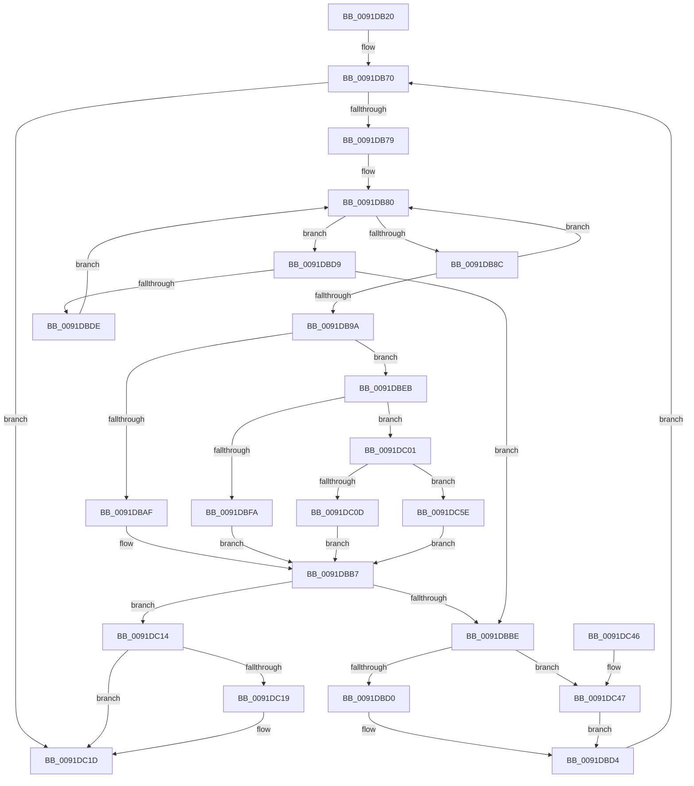

# ExEnumHandleTable

- RVA: `0x0091DB20`–`0x0091DC6B` (길이 `331` bytes)
- VA: `0x000000014091DB20`
- 실행 섹션: `PAGE`
- PDB 이름 있음: `예`; PDB Function 태그: `아니요`
- unwind 정보 RVA: `0x0008B364`
- 디코드: `95`개 명령, `331/331` bytes 표시
- 미해석 바이트: `0` (있으면 어셈블리에 `.byte`로 보존)

> 이 문서는 커널 이미지의 기계어와 PDB 기호를 분석해 생성했습니다. 4번과 5번은 함수 원형과 자료형을 바이너리 사용 방식에서 추정한 C 해석이며 원본 소스 복구 결과는 아닙니다.

## 1. Dependencies

- 직접 호출 지점: **8**; 고유 호출 대상: **7**
- 직접 호출자로 확인된 함수: **8**
- RIP 상대 이미지 참조: **3**

### Outgoing calls
- `0x0091DB64` → [ExpLookupHandleTableEntry](../86/ExpLookupHandleTableEntry_function_00869DB0.md) (function, `0x00869DB0`)
- `0x0091DBB2` → [IopIsFileOpenOrSection](IopIsFileOpenOrSection_function_0091DC80.md) (function, `0x0091DC80`)
- `0x0091DBE4` → [ExpBlockOnLockedHandleEntry](../86/ExpBlockOnLockedHandleEntry_function_00868838.md) (function, `0x00868838`)
- `0x0091DBFA` → [ObpEnumFindHandleProcedure](ObpEnumFindHandleProcedure_function_0091DD70.md) (function, `0x0091DD70`)
- `0x0091DC0D` → [PnpHandleProcessWalkWorker](PnpHandleProcessWalkWorker_function_0091DE30.md) (function, `0x0091DE30`)
- `0x0091DC20` → [KeLeaveCriticalRegionThread](../../text/25/KeLeaveCriticalRegionThread_function_0025EFF0.md) (function, `0x0025EFF0`)
- `0x0091DC51` → [ExpLookupHandleTableEntry](../86/ExpLookupHandleTableEntry_function_00869DB0.md) (function, `0x00869DB0`)
- `0x0091DC61` → [guard_dispatch_icall](../../text/6B/guard_dispatch_icall_function_006BAAD0.md) (function, `0x006BAAD0`)

### Direct callers
- [IoRevokeHandlesForProcess](../../text/59/IoRevokeHandlesForProcess_function_005981A8.md) at `0x005982CB`
- [ObShutdownSystem](../74/ObShutdownSystem_function_0074DBB0.md) at `0x0074DD80`
- [EtwpObjectHandleRundown](../7C/EtwpObjectHandleRundown_function_007C047C.md) at `0x007C04CC`
- [IopQueryProcessIdsUsingFile](IopQueryProcessIdsUsingFile_function_0091D7A0.md) at `0x0091D837`
- [ObFindHandleForObject](ObFindHandleForObject_function_0091DA70.md) at `0x0091DACD`
- [ObInitProcess](../94/ObInitProcess_function_0094C62C.md) at `0x0094C7C5`
- [NtQueryInformationProcess](../9A/NtQueryInformationProcess_function_009AA250.md) at `0x009AC5C8`
- [PnpHandleEnumerateHandlesAgainstDeviceObject](../A9/PnpHandleEnumerateHandlesAgainstDeviceObject_function_00A9D7A8.md) at `0x00A9D819`

### Static image references
- `0x0091DB9A` → RVA `0x0091DC80` (`IopIsFileOpenOrSection`; read)
- `0x0091DBEB` → RVA `0x0091DD70` (`ObpEnumFindHandleProcedure`; read)
- `0x0091DC01` → RVA `0x0091DE30` (`PnpHandleProcessWalkWorker`; read)

## 2. Other-region calls and transfers

- 다른 실행 섹션으로 향하는 call: **2**
  - `0x0091DC20` → [KeLeaveCriticalRegionThread](../../text/25/KeLeaveCriticalRegionThread_function_0025EFF0.md) (`PAGE` → `.text`)
  - `0x0091DC61` → [guard_dispatch_icall](../../text/6B/guard_dispatch_icall_function_006BAAD0.md) (`PAGE` → `.text`)
- 별도 외부 분기/꼬리 이동을 확인하지 못했습니다.

## 3. Assembly (complete function range)

```asm
0091DB20  48 89 5C 24 08                  mov qword ptr [rsp + 8], rbx
0091DB25  48 89 6C 24 10                  mov qword ptr [rsp + 0x10], rbp
0091DB2A  48 89 74 24 18                  mov qword ptr [rsp + 0x18], rsi
0091DB2F  57                              push rdi
0091DB30  41 54                           push r12
0091DB32  41 55                           push r13
0091DB34  41 56                           push r14
0091DB36  41 57                           push r15
0091DB38  48 83 EC 30                     sub rsp, 0x30
0091DB3C  65 4C 8B 2C 25 88 01 00 00      mov r13, qword ptr gs:[0x188]
0091DB45  4C 8B F2                        mov r14, rdx
0091DB48  BB 04 00 00 00                  mov ebx, 4
0091DB4D  40 32 F6                        xor sil, sil
0091DB50  8B D3                           mov edx, ebx
0091DB52  4D 8B E1                        mov r12, r9
0091DB55  4D 8B F8                        mov r15, r8
0091DB58  48 8B E9                        mov rbp, rcx
0091DB5B  66 41 FF 8D E4 01 00 00         dec word ptr [r13 + 0x1e4]
0091DB63  90                              nop
0091DB64  E8 47 C2 F4 FF                  call 0x140869db0
0091DB69  48 8B F8                        mov rdi, rax
0091DB6C  0F 1F 40 00                     nop dword ptr [rax]
0091DB70  48 85 FF                        test rdi, rdi
0091DB73  0F 84 A4 00 00 00               je 0x14091dc1d
0091DB79  0F 1F 80 00 00 00 00            nop dword ptr [rax]
0091DB80  0F 0D 0F                        prefetchw byte ptr [rdi]
0091DB83  4C 8B 07                        mov r8, qword ptr [rdi]
0091DB86  41 F6 C0 01                     test r8b, 1
0091DB8A  74 4D                           je 0x14091dbd9
0091DB8C  49 8D 48 FF                     lea rcx, [r8 - 1]
0091DB90  49 8B C0                        mov rax, r8
0091DB93  F0 48 0F B1 0F                  lock cmpxchg qword ptr [rdi], rcx
0091DB98  75 E6                           jne 0x14091db80
0091DB9A  48 8D 15 DF 00 00 00            lea rdx, [rip + 0xdf]
0091DBA1  4C 8B C3                        mov r8, rbx
0091DBA4  4C 3B F2                        cmp r14, rdx
0091DBA7  48 8B CD                        mov rcx, rbp
0091DBAA  48 8B D7                        mov rdx, rdi
0091DBAD  75 3C                           jne 0x14091dbeb
0091DBAF  4D 8B CF                        mov r9, r15
0091DBB2  E8 C9 00 00 00                  call 0x14091dc80
0091DBB7  0F B6 F0                        movzx esi, al
0091DBBA  84 C0                           test al, al
0091DBBC  75 56                           jne 0x14091dc14
0091DBBE  4C 8D 4B 04                     lea r9, [rbx + 4]
0091DBC2  49 8B C1                        mov rax, r9
0091DBC5  48 33 C3                        xor rax, rbx
0091DBC8  48 3D 00 04 00 00               cmp rax, 0x400
0091DBCE  73 77                           jae 0x14091dc47
0091DBD0  48 83 C7 10                     add rdi, 0x10
0091DBD4  49 8B D9                        mov rbx, r9
0091DBD7  EB 97                           jmp 0x14091db70
0091DBD9  4D 85 C0                        test r8, r8
0091DBDC  74 E0                           je 0x14091dbbe
0091DBDE  48 8B D7                        mov rdx, rdi
0091DBE1  48 8B CD                        mov rcx, rbp
0091DBE4  E8 4F AC F4 FF                  call 0x140868838
0091DBE9  EB 95                           jmp 0x14091db80
0091DBEB  4C 8D 0D 7E 01 00 00            lea r9, [rip + 0x17e]
0091DBF2  4D 3B F1                        cmp r14, r9
0091DBF5  4D 8B CF                        mov r9, r15
0091DBF8  75 07                           jne 0x14091dc01
0091DBFA  E8 71 01 00 00                  call 0x14091dd70
0091DBFF  EB B6                           jmp 0x14091dbb7
0091DC01  48 8D 05 28 02 00 00            lea rax, [rip + 0x228]
0091DC08  4C 3B F0                        cmp r14, rax
0091DC0B  75 51                           jne 0x14091dc5e
0091DC0D  E8 1E 02 00 00                  call 0x14091de30
0091DC12  EB A3                           jmp 0x14091dbb7
0091DC14  4D 85 E4                        test r12, r12
0091DC17  74 04                           je 0x14091dc1d
0091DC19  49 89 1C 24                     mov qword ptr [r12], rbx
0091DC1D  49 8B CD                        mov rcx, r13
0091DC20  E8 CB 13 94 FF                  call 0x14025eff0
0091DC25  48 8B 5C 24 60                  mov rbx, qword ptr [rsp + 0x60]
0091DC2A  40 0F B6 C6                     movzx eax, sil
0091DC2E  48 8B 74 24 70                  mov rsi, qword ptr [rsp + 0x70]
0091DC33  48 8B 6C 24 68                  mov rbp, qword ptr [rsp + 0x68]
0091DC38  48 83 C4 30                     add rsp, 0x30
0091DC3C  41 5F                           pop r15
0091DC3E  41 5E                           pop r14
0091DC40  41 5D                           pop r13
0091DC42  41 5C                           pop r12
0091DC44  5F                              pop rdi
0091DC45  C3                              ret
0091DC46  CC                              int3
0091DC47  49 83 C1 04                     add r9, 4
0091DC4B  48 8B CD                        mov rcx, rbp
0091DC4E  49 8B D1                        mov rdx, r9
0091DC51  E8 5A C1 F4 FF                  call 0x140869db0
0091DC56  48 8B F8                        mov rdi, rax
0091DC59  E9 76 FF FF FF                  jmp 0x14091dbd4
0091DC5E  49 8B C6                        mov rax, r14
0091DC61  E8 6A CE D9 FF                  call 0x1406baad0
0091DC66  E9 4C FF FF FF                  jmp 0x14091dbb7
```

## 4. C-style interpretation (structured pseudocode)

```c
__int64 __fastcall ExEnumHandleTable(__int64 a1, __int64 a2, __int64 a3, __int64 a4)
{
    __int64 result;
    __int64 v_rdi;
    __int64 v_rsi;
    __int64 v_rsp;
    unsigned __int64 v_stack_p10;
    unsigned __int64 v_stack_p18;
    unsigned __int64 v_stack_p8;

    v_stack_p8 = v_rbx;
    v_stack_p10 = v_rbp;
    v_stack_p18 = v_rsi;
    v_rsp = (v_rsp) - (48);
    v_rsi = 0;
    result = ExpLookupHandleTableEntry(a1, 4, a3, a4);
loc_0091DB70:
    if (result == 0) goto loc_0091DC1D;
loc_0091DB80:
    if ((((unsigned __int8)(*(unsigned __int64 *)(result))) & (1)) == 0) goto loc_0091DBD9;
    if ((((unsigned __int8)(*(unsigned __int64 *)(result))) & (1)) != 0) goto loc_0091DB80;
    if (a2 != (v_rip + 223)) goto loc_0091DBEB;
    result = IopIsFileOpenOrSection(a1, result, 4, a3);
loc_0091DBB7:
    if ((unsigned __int8)(result) != 0) goto loc_0091DC14;
loc_0091DBBE:
    result = (4 + 4) ^ (4);
    if (result >= 0x400ULL) goto loc_0091DC47;
    v_rdi = (result) + (16);
loc_0091DBD4:
    goto loc_0091DB70;
loc_0091DBD9:
    if (4 == 0) goto loc_0091DBBE;
    result = ExpBlockOnLockedHandleEntry(a1, v_rdi, 4, 4 + 4);
    goto loc_0091DB80;
loc_0091DBEB:
    if (a2 != (v_rip + 382)) goto loc_0091DC01;
    result = ObpEnumFindHandleProcedure(a1, v_rdi, 4, a3);
    goto loc_0091DBB7;
loc_0091DC01:
    if (a2 != (v_rip + 552)) goto loc_0091DC5E;
    result = PnpHandleProcessWalkWorker(a1, v_rdi, 4, a3);
    goto loc_0091DBB7;
loc_0091DC14:
    if (a4 != 0) {
        *(unsigned __int64 *)(a4) = 4 + 4;
    }
    result = KeLeaveCriticalRegionThread(*(unsigned __int64 *)(gs_base + (0 + 392)), v_rdi, 4, a3);
    v_rsp = (v_rsp) + (48);
    return (unsigned __int8)((unsigned __int8)(result));
loc_0091DC47:
    a4 = (a3) + (4);
    result = ExpLookupHandleTableEntry(v_stack_p10, a4, 4, a4);
    goto loc_0091DBD4;
loc_0091DC5E:
    result = guard_dispatch_icall(v_stack_p10, a4, 4, a4);
    goto loc_0091DBB7;
}
```

## 5. (Beta) C Style

```c
int64_t ExEnumHandleTable(int64_t Arg1, int64_t Arg2, int64_t Arg3, int64_t Arg4)
{
    int64_t result;
    int64_t local_rdi;
    int64_t local_rsi;
    int64_t local_rsp;
    uint64_t v_stack_p10;
    uint64_t v_stack_p18;
    uint64_t v_stack_p8;

    v_stack_p8 = local_rbx;
    v_stack_p10 = local_rbp;
    v_stack_p18 = local_rsi;
    local_rsp = (local_rsp) - (48);
    local_rsi = 0;
    result = ExpLookupHandleTableEntry(Arg1, 4, Arg3, Arg4);
loc_0091DB70:
    if (result == 0) goto loc_0091DC1D;
loc_0091DB80:
    if ((((uint8_t)(*(uint64_t *)(result))) & (1)) == 0) goto loc_0091DBD9;
    if ((((uint8_t)(*(uint64_t *)(result))) & (1)) != 0) goto loc_0091DB80;
    if (Arg2 != (v_rip + 223)) goto loc_0091DBEB;
    result = IopIsFileOpenOrSection(Arg1, result, 4, Arg3);
loc_0091DBB7:
    if ((uint8_t)(result) != 0) goto loc_0091DC14;
loc_0091DBBE:
    result = (4 + 4) ^ (4);
    if (result >= 0x400ULL) goto loc_0091DC47;
    local_rdi = (result) + (16);
loc_0091DBD4:
    goto loc_0091DB70;
loc_0091DBD9:
    if (4 == 0) goto loc_0091DBBE;
    result = ExpBlockOnLockedHandleEntry(Arg1, local_rdi, 4, 4 + 4);
    goto loc_0091DB80;
loc_0091DBEB:
    if (Arg2 != (v_rip + 382)) goto loc_0091DC01;
    result = ObpEnumFindHandleProcedure(Arg1, local_rdi, 4, Arg3);
    goto loc_0091DBB7;
loc_0091DC01:
    if (Arg2 != (v_rip + 552)) goto loc_0091DC5E;
    result = PnpHandleProcessWalkWorker(Arg1, local_rdi, 4, Arg3);
    goto loc_0091DBB7;
loc_0091DC14:
    if (Arg4 != 0) {
        *(uint64_t *)(Arg4) = 4 + 4;
    }
    result = KeLeaveCriticalRegionThread(*(uint64_t *)(gs_base + (0 + 0x188)), local_rdi, 4, Arg3);
    local_rsp = (local_rsp) + (48);
    return (uint8_t)((uint8_t)(result));
loc_0091DC47:
    Arg4 = (Arg3) + (4);
    result = ExpLookupHandleTableEntry(v_stack_p10, Arg4, 4, Arg4);
    goto loc_0091DBD4;
loc_0091DC5E:
    result = guard_dispatch_icall(v_stack_p10, Arg4, 4, Arg4);
    goto loc_0091DBB7;
}
```

## 6. Execution-region graph

[열기: 2D/3D 그래프와 함수 탐색 컨트롤 패널](../../../control-panel.html?section=page&rva=0x0091DB20&view=graph)

- 2D 그래프는 위에서 아래로 흐르고, 3D 그래프는 빈 공간을 드래그해 회전합니다. Shift+드래그는 이동, 휠은 확대·축소, 함수 노드 선택은 대상 보고서 이동입니다.

### Static fallback


