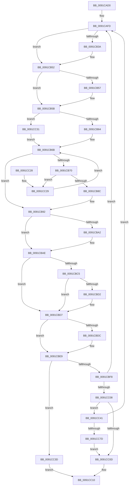

# ExGetNextProcess

- RVA: `0x0091CAD0`–`0x0091CC91` (길이 `449` bytes)
- VA: `0x000000014091CAD0`
- 실행 섹션: `PAGE`
- PDB 이름 있음: `예`; PDB Function 태그: `아니요`
- unwind 정보 RVA: `0x0008B170`
- 디코드: `111`개 명령, `449/449` bytes 표시
- 미해석 바이트: `0` (있으면 어셈블리에 `.byte`로 보존)

> 이 문서는 커널 이미지의 기계어와 PDB 기호를 분석해 생성했습니다. 4번과 5번은 함수 원형과 자료형을 바이너리 사용 방식에서 추정한 C 해석이며 원본 소스 복구 결과는 아닙니다.

## 1. Dependencies

- 직접 호출 지점: **9**; 고유 호출 대상: **9**
- 직접 호출자로 확인된 함수: **3**
- RIP 상대 이미지 참조: **3**

### Outgoing calls
- `0x0091CB20` → [KeAbPreAcquire](../../text/21/KeAbPreAcquire_function_00210230.md) (function, `0x00210230`)
- `0x0091CB4D` → [ExfAcquirePushLockSharedEx](../../text/21/ExfAcquirePushLockSharedEx_function_0021044C.md) (function, `0x0021044C`)
- `0x0091CB7F` → [ObReferenceObjectSafeWithTag](../../text/21/ObReferenceObjectSafeWithTag_function_00210EE0.md) (function, `0x00210EE0`)
- `0x0091CBA9` → [ExfReleasePushLockShared](../../text/26/ExfReleasePushLockShared_function_00263440.md) (function, `0x00263440`)
- `0x0091CBB5` → [KeAbPostRelease](../../text/2E/KeAbPostRelease_function_002E1600.md) (function, `0x002E1600`)
- `0x0091CBD2` → [KiCheckForKernelApcDelivery](../../text/2E/KiCheckForKernelApcDelivery_function_002E2C80.md) (function, `0x002E2C80`)
- `0x0091CBE4` → [ObfDereferenceObjectWithTag](../../text/2F/ObfDereferenceObjectWithTag_function_002F78E0.md) (function, `0x002F78E0`)
- `0x0091CC70` → [ObOpenObjectByPointer](../8B/ObOpenObjectByPointer_function_008B7420.md) (function, `0x008B7420`)
- `0x0091CC87` → [ObCloseHandle](../8A/ObCloseHandle_function_008A1870.md) (function, `0x008A1870`)

### Direct callers
- [ExpGetProcessInformation](ExpGetProcessInformation_function_0091A878.md) at `0x0091B177`
- [PfpPrivSourceEnum](PfpPrivSourceEnum_function_0091BF00.md) at `0x0091C039`
- [PfpPrivSourceEnum](PfpPrivSourceEnum_function_0091BF00.md) at `0x0091C1BD`
- [PfpPrivSourceEnum](PfpPrivSourceEnum_function_0091BF00.md) at `0x0091C446`
- [ExProcessCounterSetCallback](ExProcessCounterSetCallback_function_0091CDF0.md) at `0x0091D214`

### Static image references
- `0x0091CAE7` → RVA `0x00F067C0` (`.data`; read)
- `0x0091CB06` → RVA `0x00FD9AF8` (`PAGEDATA`; read)
- `0x0091CC57` → RVA `0x00FC6A98` (`ALMOSTRO`; read)

## 2. Other-region calls and transfers

- 다른 실행 섹션으로 향하는 call: **7**
  - `0x0091CB20` → [KeAbPreAcquire](../../text/21/KeAbPreAcquire_function_00210230.md) (`PAGE` → `.text`)
  - `0x0091CB4D` → [ExfAcquirePushLockSharedEx](../../text/21/ExfAcquirePushLockSharedEx_function_0021044C.md) (`PAGE` → `.text`)
  - `0x0091CB7F` → [ObReferenceObjectSafeWithTag](../../text/21/ObReferenceObjectSafeWithTag_function_00210EE0.md) (`PAGE` → `.text`)
  - `0x0091CBA9` → [ExfReleasePushLockShared](../../text/26/ExfReleasePushLockShared_function_00263440.md) (`PAGE` → `.text`)
  - `0x0091CBB5` → [KeAbPostRelease](../../text/2E/KeAbPostRelease_function_002E1600.md) (`PAGE` → `.text`)
  - `0x0091CBD2` → [KiCheckForKernelApcDelivery](../../text/2E/KiCheckForKernelApcDelivery_function_002E2C80.md) (`PAGE` → `.text`)
  - `0x0091CBE4` → [ObfDereferenceObjectWithTag](../../text/2F/ObfDereferenceObjectWithTag_function_002F78E0.md) (`PAGE` → `.text`)
- 별도 외부 분기/꼬리 이동을 확인하지 못했습니다.

## 3. Assembly (complete function range)

```asm
0091CAD0  48 89 5C 24 08                  mov qword ptr [rsp + 8], rbx
0091CAD5  55                              push rbp
0091CAD6  56                              push rsi
0091CAD7  57                              push rdi
0091CAD8  41 54                           push r12
0091CADA  41 55                           push r13
0091CADC  41 56                           push r14
0091CADE  41 57                           push r15
0091CAE0  48 83 EC 40                     sub rsp, 0x40
0091CAE4  45 33 ED                        xor r13d, r13d
0091CAE7  4C 8D 25 D2 9C 5E 00            lea r12, [rip + 0x5e9cd2]
0091CAEE  4C 89 AC 24 90 00 00 00         mov qword ptr [rsp + 0x90], r13
0091CAF6  44 0F B6 FA                     movzx r15d, dl
0091CAFA  48 8B D9                        mov rbx, rcx
0091CAFD  65 48 8B 2C 25 88 01 00 00      mov rbp, qword ptr gs:[0x188]
0091CB06  48 8D 0D EB CF 6B 00            lea rcx, [rip + 0x6bcfeb]
0091CB0D  45 33 C0                        xor r8d, r8d
0091CB10  33 D2                           xor edx, edx
0091CB12  49 8B F5                        mov rsi, r13
0091CB15  45 8B F5                        mov r14d, r13d
0091CB18  66 FF 8D E6 01 00 00            dec word ptr [rbp + 0x1e6]
0091CB1F  90                              nop
0091CB20  E8 0B 37 8F FF                  call 0x140210230
0091CB25  48 8B F8                        mov rdi, rax
0091CB28  B9 11 00 00 00                  mov ecx, 0x11
0091CB2D  33 C0                           xor eax, eax
0091CB2F  F0 48 0F B1 0D C0 CF 6B 00      lock cmpxchg qword ptr [rip + 0x6bcfc0], rcx
0091CB38  74 18                           je 0x14091cb52
0091CB3A  4C 8D 0D B7 CF 6B 00            lea r9, [rip + 0x6bcfb7]
0091CB41  4C 8B C7                        mov r8, rdi
0091CB44  33 D2                           xor edx, edx
0091CB46  48 8D 0D AB CF 6B 00            lea rcx, [rip + 0x6bcfab]
0091CB4D  E8 FA 38 8F FF                  call 0x14021044c
0091CB52  48 85 FF                        test rdi, rdi
0091CB55  74 04                           je 0x14091cb5b
0091CB57  C6 47 0A 01                     mov byte ptr [rdi + 0xa], 1
0091CB5B  48 85 DB                        test rbx, rbx
0091CB5E  0F 84 CD 00 00 00               je 0x14091cc31
0091CB64  48 8B BB D8 01 00 00            mov rdi, qword ptr [rbx + 0x1d8]
0091CB6B  49 3B FC                        cmp rdi, r12
0091CB6E  74 22                           je 0x14091cb92
0091CB70  48 8D B7 28 FE FF FF            lea rsi, [rdi - 0x1d8]
0091CB77  BA 50 73 45 6E                  mov edx, 0x6e457350
0091CB7C  48 8B CE                        mov rcx, rsi
0091CB7F  E8 5C 43 8F FF                  call 0x140210ee0
0091CB84  84 C0                           test al, al
0091CB86  0F 84 9D 00 00 00               je 0x14091cc29
0091CB8C  41 BE 01 00 00 00               mov r14d, 1
0091CB92  B8 11 00 00 00                  mov eax, 0x11
0091CB97  F0 4C 0F B1 2D 58 CF 6B 00      lock cmpxchg qword ptr [rip + 0x6bcf58], r13
0091CBA0  74 0C                           je 0x14091cbae
0091CBA2  48 8D 0D 4F CF 6B 00            lea rcx, [rip + 0x6bcf4f]
0091CBA9  E8 92 68 94 FF                  call 0x140263440
0091CBAE  48 8D 0D 43 CF 6B 00            lea rcx, [rip + 0x6bcf43]
0091CBB5  E8 46 4A 9C FF                  call 0x1402e1600
0091CBBA  90                              nop
0091CBBB  66 83 85 E6 01 00 00 01         add word ptr [rbp + 0x1e6], 1
0091CBC3  75 12                           jne 0x14091cbd7
0091CBC5  48 8D 85 98 00 00 00            lea rax, [rbp + 0x98]
0091CBCC  90                              nop
0091CBCD  48 39 00                        cmp qword ptr [rax], rax
0091CBD0  74 05                           je 0x14091cbd7
0091CBD2  E8 A9 60 9C FF                  call 0x1402e2c80
0091CBD7  48 85 DB                        test rbx, rbx
0091CBDA  74 0D                           je 0x14091cbe9
0091CBDC  BA 50 73 45 6E                  mov edx, 0x6e457350
0091CBE1  48 8B CB                        mov rcx, rbx
0091CBE4  E8 F7 AC 9D FF                  call 0x1402f78e0
0091CBE9  45 85 F6                        test r14d, r14d
0091CBEC  49 8B DD                        mov rbx, r13
0091CBEF  48 0F 45 DE                     cmovne rbx, rsi
0091CBF3  48 85 DB                        test rbx, rbx
0091CBF6  74 45                           je 0x14091cc3d
0091CBF8  F7 83 F4 01 00 00 00 00 00 04   test dword ptr [rbx + 0x1f4], 0x4000000
0091CC02  0F 84 F5 FE FF FF               je 0x14091cafd
0091CC08  45 84 FF                        test r15b, r15b
0091CC0B  75 34                           jne 0x14091cc41
0091CC0D  48 8B C3                        mov rax, rbx
0091CC10  48 8B 9C 24 80 00 00 00         mov rbx, qword ptr [rsp + 0x80]
0091CC18  48 83 C4 40                     add rsp, 0x40
0091CC1C  41 5F                           pop r15
0091CC1E  41 5E                           pop r14
0091CC20  41 5D                           pop r13
0091CC22  41 5C                           pop r12
0091CC24  5F                              pop rdi
0091CC25  5E                              pop rsi
0091CC26  5D                              pop rbp
0091CC27  C3                              ret
0091CC28  CC                              int3
0091CC29  48 8B 3F                        mov rdi, qword ptr [rdi]
0091CC2C  E9 3A FF FF FF                  jmp 0x14091cb6b
0091CC31  48 8B 3D 88 9B 5E 00            mov rdi, qword ptr [rip + 0x5e9b88]
0091CC38  E9 2E FF FF FF                  jmp 0x14091cb6b
0091CC3D  33 C0                           xor eax, eax
0091CC3F  EB CF                           jmp 0x14091cc10
0091CC41  48 8D 84 24 90 00 00 00         lea rax, [rsp + 0x90]
0091CC49  41 B9 00 04 00 00               mov r9d, 0x400
0091CC4F  48 89 44 24 30                  mov qword ptr [rsp + 0x30], rax
0091CC54  45 33 C0                        xor r8d, r8d
0091CC57  48 8B 05 3A 9E 6A 00            mov rax, qword ptr [rip + 0x6a9e3a]
0091CC5E  BA 00 02 00 00                  mov edx, 0x200
0091CC63  C6 44 24 28 01                  mov byte ptr [rsp + 0x28], 1
0091CC68  48 8B CB                        mov rcx, rbx
0091CC6B  48 89 44 24 20                  mov qword ptr [rsp + 0x20], rax
0091CC70  E8 AB A7 F9 FF                  call 0x1408b7420
0091CC75  85 C0                           test eax, eax
0091CC77  0F 88 80 FE FF FF               js 0x14091cafd
0091CC7D  48 8B 8C 24 90 00 00 00         mov rcx, qword ptr [rsp + 0x90]
0091CC85  33 D2                           xor edx, edx
0091CC87  E8 E4 4B F8 FF                  call 0x1408a1870
0091CC8C  E9 7C FF FF FF                  jmp 0x14091cc0d
```

## 4. C-style interpretation (structured pseudocode)

```c
__int64 __fastcall ExGetNextProcess(__int64 a1, int a2, int a3)
{
    __int64 result;
    __int64 v_r13;
    __int64 v_rbx;
    __int64 v_rsp;
    unsigned __int64 v_stack_p18;
    unsigned __int64 v_stack_p20;
    unsigned __int8 v_stack_p28;
    unsigned __int64 v_stack_p30;
    unsigned __int64 v_stack_p8;
    unsigned __int64 v_stack_p90;

    v_stack_p8 = v_rbx;
    v_rsp = (v_rsp) - (64);
    v_r13 = 0;
    v_stack_p18 = 0;
loc_0091CAFD:
    a3 = 0;
    a2 = 0;
    result = KeAbPreAcquire(v_rip + 7065579, a2, a3, a4);
    result = 0;
    if (!(condition_is_equal)) {
        a4 = v_rip + 7065527;
        a3 = 0;
        a2 = 0;
        a1 = v_rip + 7065515;
        result = ExfAcquirePushLockSharedEx(a1, a2, a3, a4);
    }
    if (result != 0) {
        *(unsigned __int8 *)(result + 10) = 1;
    }
    if (a1 == 0) goto loc_0091CC31;
loc_0091CB6B:
    if ((*(unsigned __int64 *)(a1 + 472)) == (v_rip + 6200530)) goto loc_0091CB92;
    result = ObReferenceObjectSafeWithTag(*(unsigned __int64 *)(a1 + 472) - 472, (unsigned int)(0x6E457350ULL), a3, a4);
    if ((unsigned __int8)(result) == 0) goto loc_0091CC29;
loc_0091CB92:
    result = 17;
    if ((unsigned __int8)(result) != 0) {
        a1 = v_rip + 7065423;
        result = ExfReleasePushLockShared(a1, (unsigned int)(0x6E457350ULL), a3, a4);
    }
    result = KeAbPostRelease(v_rip + 7065411, (unsigned int)(0x6E457350ULL), a3, a4);
    if ((unsigned __int8)(result) != 0) goto loc_0091CBD7;
    result = *(unsigned __int64 *)(gs_base + (0 + 392)) + 152;
    if ((*(unsigned __int64 *)(*(unsigned __int64 *)(gs_base + (0 + 392)) + 152)) != (*(unsigned __int64 *)(gs_base + (0 + 392)) + 152)) {
        result = KiCheckForKernelApcDelivery(v_rip + 7065411, (unsigned int)(0x6E457350ULL), a3, a4);
    }
    if (a1 != 0) {
        a2 = 0x6E457350ULL;
        a1 = a1;
        result = ObfDereferenceObjectWithTag(a1, a2, a3, a4);
    }
    v_rbx = 0;
    if (1 != 0) { v_rbx = *(unsigned __int64 *)(a1 + 472) - 472; }
    if (v_rbx == 0) goto loc_0091CC3D;
    if (((*(unsigned int *)(v_rbx + 500)) & (0x4000000ULL)) == 0) goto loc_0091CAFD;
    if ((unsigned __int8)((unsigned __int8)(a2)) != 0) goto loc_0091CC41;
loc_0091CC0D:
loc_0091CC10:
    v_rsp = (v_rsp) + (64);
    return v_rbx;
loc_0091CC29:
    goto loc_0091CB6B;
loc_0091CC31:
    goto loc_0091CB6B;
loc_0091CC3D:
    result = 0;
    goto loc_0091CC10;
loc_0091CC41:
    v_stack_p30 = v_stack_p90;
    a3 = 0;
    v_stack_p28 = 1;
    v_stack_p20 = *(unsigned __int64 *)(v_rip + 6987322);
    result = ObOpenObjectByPointer(v_stack_p8, 512, a3, (unsigned int)(0x400ULL));
    if (sign_flag) goto loc_0091CAFD;
    a2 = 0;
    result = ObCloseHandle(v_stack_p90, a2, a3, (unsigned int)(0x400ULL));
    goto loc_0091CC0D;
}
```

## 5. (Beta) C Style

```c
int64_t ExGetNextProcess(int64_t Arg1, int32_t Arg2, int32_t Arg3)
{
    int64_t result;
    int64_t local_r13;
    int64_t local_rbx;
    int64_t local_rsp;
    uint64_t v_stack_p18;
    uint64_t v_stack_p20;
    uint8_t v_stack_p28;
    uint64_t v_stack_p30;
    uint64_t v_stack_p8;
    uint64_t v_stack_p90;

    v_stack_p8 = local_rbx;
    local_rsp = (local_rsp) - (64);
    local_r13 = 0;
    v_stack_p18 = 0;
loc_0091CAFD:
    Arg3 = 0;
    Arg2 = 0;
    result = KeAbPreAcquire(v_rip + 7065579, Arg2, Arg3, a4);
    result = 0;
    if (!(condition_is_equal)) {
        a4 = v_rip + 7065527;
        Arg3 = 0;
        Arg2 = 0;
        Arg1 = v_rip + 7065515;
        result = ExfAcquirePushLockSharedEx(Arg1, Arg2, Arg3, a4);
    }
    if (result != 0) {
        *(uint8_t *)(result + 0xA) = 1;
    }
    if (Arg1 == 0) goto loc_0091CC31;
loc_0091CB6B:
    if ((*(uint64_t *)(Arg1 + 0x1D8)) == (v_rip + 6200530)) goto loc_0091CB92;
    result = ObReferenceObjectSafeWithTag(*(uint64_t *)(Arg1 + 0x1D8) - 472, (uint32_t)(0x6E457350ULL), Arg3, a4);
    if ((uint8_t)(result) == 0) goto loc_0091CC29;
loc_0091CB92:
    result = 17;
    if ((uint8_t)(result) != 0) {
        Arg1 = v_rip + 7065423;
        result = ExfReleasePushLockShared(Arg1, (uint32_t)(0x6E457350ULL), Arg3, a4);
    }
    result = KeAbPostRelease(v_rip + 7065411, (uint32_t)(0x6E457350ULL), Arg3, a4);
    if ((uint8_t)(result) != 0) goto loc_0091CBD7;
    result = *(uint64_t *)(gs_base + (0 + 0x188)) + 152;
    if ((*(uint64_t *)(*(uint64_t *)(gs_base + (0 + 0x188)) + 0x98)) != (*(uint64_t *)(gs_base + (0 + 0x188)) + 152)) {
        result = KiCheckForKernelApcDelivery(v_rip + 7065411, (uint32_t)(0x6E457350ULL), Arg3, a4);
    }
    if (Arg1 != 0) {
        Arg2 = 0x6E457350ULL;
        Arg1 = Arg1;
        result = ObfDereferenceObjectWithTag(Arg1, Arg2, Arg3, a4);
    }
    local_rbx = 0;
    if (1 != 0) { local_rbx = *(uint64_t *)(Arg1 + 0x1D8) - 472; }
    if (local_rbx == 0) goto loc_0091CC3D;
    if (((*(uint32_t *)(local_rbx + 0x1F4)) & (0x4000000ULL)) == 0) goto loc_0091CAFD;
    if ((uint8_t)((uint8_t)(Arg2)) != 0) goto loc_0091CC41;
loc_0091CC0D:
loc_0091CC10:
    local_rsp = (local_rsp) + (64);
    return local_rbx;
loc_0091CC29:
    goto loc_0091CB6B;
loc_0091CC31:
    goto loc_0091CB6B;
loc_0091CC3D:
    result = 0;
    goto loc_0091CC10;
loc_0091CC41:
    v_stack_p30 = v_stack_p90;
    Arg3 = 0;
    v_stack_p28 = 1;
    v_stack_p20 = *(uint64_t *)(v_rip + 0x6A9E3A);
    result = ObOpenObjectByPointer(v_stack_p8, 512, Arg3, (uint32_t)(0x400ULL));
    if (sign_flag) goto loc_0091CAFD;
    Arg2 = 0;
    result = ObCloseHandle(v_stack_p90, Arg2, Arg3, (uint32_t)(0x400ULL));
    goto loc_0091CC0D;
}
```

## 6. Execution-region graph

[열기: 2D/3D 그래프와 함수 탐색 컨트롤 패널](../../../control-panel.html?section=page&rva=0x0091CAD0&view=graph)

- 2D 그래프는 위에서 아래로 흐르고, 3D 그래프는 빈 공간을 드래그해 회전합니다. Shift+드래그는 이동, 휠은 확대·축소, 함수 노드 선택은 대상 보고서 이동입니다.

### Static fallback


