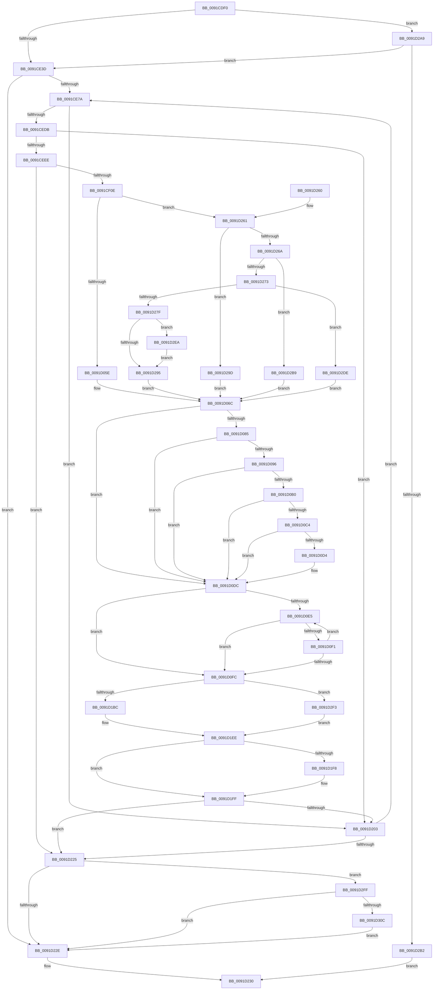

# ExProcessCounterSetCallback

- RVA: `0x0091CDF0`–`0x0091D31E` (길이 `1,326` bytes)
- VA: `0x000000014091CDF0`
- 실행 섹션: `PAGE`
- PDB 이름 있음: `예`; PDB Function 태그: `아니요`
- unwind 정보 RVA: `0x0008B1AC`
- 디코드: `289`개 명령, `1,326/1,326` bytes 표시
- 미해석 바이트: `0` (있으면 어셈블리에 `.byte`로 보존)

> 이 문서는 커널 이미지의 기계어와 PDB 기호를 분석해 생성했습니다. 4번과 5번은 함수 원형과 자료형을 바이너리 사용 방식에서 추정한 C 해석이며 원본 소스 복구 결과는 아닙니다.

## 1. Dependencies

- 직접 호출 지점: **21**; 고유 호출 대상: **19**
- 직접 호출자로 확인된 함수: **0**
- RIP 상대 이미지 참조: **11**

### Outgoing calls
- `0x0091CE2C` → [PsGetCurrentServerSilo](../../text/22/PsGetCurrentServerSilo_function_00225710.md) (function, `0x00225710`)
- `0x0091CE45` → [ExIsRestrictedCaller](../A2/ExIsRestrictedCaller_function_00A217E8.md) (function, `0x00A217E8`)
- `0x0091CE55` → [KeFlushProcessWriteBuffers](../../text/2C/KeFlushProcessWriteBuffers_function_002CE4FC.md) (function, `0x002CE4FC`)
- `0x0091CE5F` → [KeQueryInterruptTimePrecise](../../text/20/KeQueryInterruptTimePrecise_function_00209530.md) (function, `0x00209530`)
- `0x0091CE89` → [memset](../../text/6C/memset_function_006C6C40.md) (function, `0x006C6C40`)
- `0x0091CE9A` → [memset](../../text/6C/memset_function_006C6C40.md) (function, `0x006C6C40`)
- `0x0091CEAC` → [memset](../../text/6C/memset_function_006C6C40.md) (function, `0x006C6C40`)
- `0x0091CECE` → [ExpSysInfoShouldSkipProcess](ExpSysInfoShouldSkipProcess_function_0091BE50.md) (function, `0x0091BE50`)
- `0x0091CEE1` → [PsIsProcessInSilo](../../text/41/PsIsProcessInSilo_function_004185E0.md) (function, `0x004185E0`)
- `0x0091CEFF` → [ExpCopyProcessInfo](ExpCopyProcessInfo_function_00919134.md) (function, `0x00919134`)
- `0x0091D13E` → [RtlIntegerToUnicodeString](RtlIntegerToUnicodeString_function_0091D3E0.md) (function, `0x0091D3E0`)
- `0x0091D188` → [RtlUnicodeStringPrintf](../../text/48/RtlUnicodeStringPrintf_function_0048B984.md) (function, `0x0048B984`)
- `0x0091D1AE` → [ExGetExtensionTable](../../text/42/ExGetExtensionTable_function_00428814.md) (function, `0x00428814`)
- `0x0091D1DB` → [guard_dispatch_icall](../../text/6B/guard_dispatch_icall_function_006BAAD0.md) (function, `0x006BAAD0`)
- `0x0091D1E9` → [ExReleaseExtensionTable](../../text/45/ExReleaseExtensionTable_function_00456DC0.md) (function, `0x00456DC0`)
- `0x0091D1FA` → [ExFreePoolWithTag](../../poolcode/B8/ExFreePoolWithTag_function_00B82870.md) (function, `0x00B82870`)
- `0x0091D214` → [ExGetNextProcess](ExGetNextProcess_function_0091CAD0.md) (function, `0x0091CAD0`)
- `0x0091D23A` → [_security_check_cookie](../../text/6A/_security_check_cookie_function_006AC640.md) (function, `0x006AC640`)
- `0x0091D287` → [PsGetAllocatedFullProcessImageNameEx](PsGetAllocatedFullProcessImageNameEx_function_0091D6F0.md) (function, `0x0091D6F0`)
- `0x0091D2F3` → [ExpPcwDisabledStatus](../A6/ExpPcwDisabledStatus_function_00A611E0.md) (function, `0x00A611E0`)
- `0x0091D314` → [ObfDereferenceObjectWithTag](../../text/2F/ObfDereferenceObjectWithTag_function_002F78E0.md) (function, `0x002F78E0`)

### Direct callers
- 이 함수 시작 RVA로 연결되는 직접 call은 확인되지 않았습니다. 간접 호출은 완전히 역산할 수 없습니다.

### Static image references
- `0x0091CE16` → RVA `0x00E0A740` (`.data`; read)
- `0x0091CE64` → RVA `0x00FC6B70` (`ALMOSTRO`; read)
- `0x0091D05E` → RVA `0x00002008` (`.rdata`; read)
- `0x0091D167` → RVA `0x00AFF000` (` ?? ::NNGAKEGL::`string'`; read)
- `0x0091D18D` → RVA `0x00FD8080` (`PAGEDATA`; read)
- `0x0091D261` → RVA `0x00FC6AB0` (`ALMOSTRO`; read)
- `0x0091D26A` → RVA `0x00FC6CB8` (`ALMOSTRO`; read)
- `0x0091D29D` → RVA `0x00001FF8` (`.rdata`; read)
- `0x0091D2B9` → RVA `0x00E2DCE8` (`.data`; read)
- `0x0091D2C0` → RVA `0x00002048` (`.rdata`; read)
- `0x0091D2DE` → RVA `0x00002018` (`.rdata`; read)

## 2. Other-region calls and transfers

- 다른 실행 섹션으로 향하는 call: **14**
  - `0x0091CE2C` → [PsGetCurrentServerSilo](../../text/22/PsGetCurrentServerSilo_function_00225710.md) (`PAGE` → `.text`)
  - `0x0091CE55` → [KeFlushProcessWriteBuffers](../../text/2C/KeFlushProcessWriteBuffers_function_002CE4FC.md) (`PAGE` → `.text`)
  - `0x0091CE5F` → [KeQueryInterruptTimePrecise](../../text/20/KeQueryInterruptTimePrecise_function_00209530.md) (`PAGE` → `.text`)
  - `0x0091CE89` → [memset](../../text/6C/memset_function_006C6C40.md) (`PAGE` → `.text`)
  - `0x0091CE9A` → [memset](../../text/6C/memset_function_006C6C40.md) (`PAGE` → `.text`)
  - `0x0091CEAC` → [memset](../../text/6C/memset_function_006C6C40.md) (`PAGE` → `.text`)
  - `0x0091CEE1` → [PsIsProcessInSilo](../../text/41/PsIsProcessInSilo_function_004185E0.md) (`PAGE` → `.text`)
  - `0x0091D188` → [RtlUnicodeStringPrintf](../../text/48/RtlUnicodeStringPrintf_function_0048B984.md) (`PAGE` → `.text`)
  - `0x0091D1AE` → [ExGetExtensionTable](../../text/42/ExGetExtensionTable_function_00428814.md) (`PAGE` → `.text`)
  - `0x0091D1DB` → [guard_dispatch_icall](../../text/6B/guard_dispatch_icall_function_006BAAD0.md) (`PAGE` → `.text`)
  - `0x0091D1E9` → [ExReleaseExtensionTable](../../text/45/ExReleaseExtensionTable_function_00456DC0.md) (`PAGE` → `.text`)
  - `0x0091D1FA` → [ExFreePoolWithTag](../../poolcode/B8/ExFreePoolWithTag_function_00B82870.md) (`PAGE` → `POOLCODE`)
  - `0x0091D23A` → [_security_check_cookie](../../text/6A/_security_check_cookie_function_006AC640.md) (`PAGE` → `.text`)
  - `0x0091D314` → [ObfDereferenceObjectWithTag](../../text/2F/ObfDereferenceObjectWithTag_function_002F78E0.md) (`PAGE` → `.text`)
- 별도 외부 분기/꼬리 이동을 확인하지 못했습니다.

## 3. Assembly (complete function range)

```asm
0091CDF0  48 8B C4                        mov rax, rsp
0091CDF3  48 89 58 08                     mov qword ptr [rax + 8], rbx
0091CDF7  48 89 70 18                     mov qword ptr [rax + 0x18], rsi
0091CDFB  48 89 78 20                     mov qword ptr [rax + 0x20], rdi
0091CDFF  55                              push rbp
0091CE00  41 54                           push r12
0091CE02  41 55                           push r13
0091CE04  41 56                           push r14
0091CE06  41 57                           push r15
0091CE08  48 8D A8 58 FD FF FF            lea rbp, [rax - 0x2a8]
0091CE0F  48 81 EC 80 03 00 00            sub rsp, 0x380
0091CE16  48 8B 05 23 D9 4E 00            mov rax, qword ptr [rip + 0x4ed923]
0091CE1D  48 33 C4                        xor rax, rsp
0091CE20  48 89 85 70 02 00 00            mov qword ptr [rbp + 0x270], rax
0091CE27  48 8B FA                        mov rdi, rdx
0091CE2A  8B D9                           mov ebx, ecx
0091CE2C  E8 DF 88 90 FF                  call 0x140225710
0091CE31  48 8B F0                        mov rsi, rax
0091CE34  83 EB 02                        sub ebx, 2
0091CE37  0F 85 6C 04 00 00               jne 0x14091d2a9
0091CE3D  4C 8B 7F 18                     mov r15, qword ptr [rdi + 0x18]
0091CE41  33 D2                           xor edx, edx
0091CE43  B1 01                           mov cl, 1
0091CE45  E8 9E 49 10 00                  call 0x140a217e8
0091CE4A  45 33 ED                        xor r13d, r13d
0091CE4D  B1 01                           mov cl, 1
0091CE4F  85 C0                           test eax, eax
0091CE51  41 0F 95 C6                     setne r14b
0091CE55  E8 A2 16 9B FF                  call 0x1402ce4fc
0091CE5A  48 8D 4C 24 40                  lea rcx, [rsp + 0x40]
0091CE5F  E8 CC C6 8E FF                  call 0x140209530
0091CE64  48 8B 1D 05 9D 6A 00            mov rbx, qword ptr [rip + 0x6a9d05]
0091CE6B  4C 8B E0                        mov r12, rax
0091CE6E  41 8B FD                        mov edi, r13d
0091CE71  48 85 DB                        test rbx, rbx
0091CE74  0F 84 B4 03 00 00               je 0x14091d22e
0091CE7A  33 D2                           xor edx, edx
0091CE7C  48 8D 8D F0 00 00 00            lea rcx, [rbp + 0xf0]
0091CE83  41 B8 D8 00 00 00               mov r8d, 0xd8
0091CE89  E8 B2 9D DA FF                  call 0x1406c6c40
0091CE8E  33 D2                           xor edx, edx
0091CE90  48 8D 4D 80                     lea rcx, [rbp - 0x80]
0091CE94  41 B8 00 01 00 00               mov r8d, 0x100
0091CE9A  E8 A1 9D DA FF                  call 0x1406c6c40
0091CE9F  33 D2                           xor edx, edx
0091CEA1  48 8D 8D 80 00 00 00            lea rcx, [rbp + 0x80]
0091CEA8  44 8D 42 68                     lea r8d, [rdx + 0x68]
0091CEAC  E8 8F 9D DA FF                  call 0x1406c6c40
0091CEB1  0F 57 C0                        xorps xmm0, xmm0
0091CEB4  4C 89 6C 24 40                  mov qword ptr [rsp + 0x40], r13
0091CEB9  0F 57 C9                        xorps xmm1, xmm1
0091CEBC  48 8B CB                        mov rcx, rbx
0091CEBF  0F 11 44 24 30                  movups xmmword ptr [rsp + 0x30], xmm0
0091CEC4  0F 11 4C 24 48                  movups xmmword ptr [rsp + 0x48], xmm1
0091CEC9  0F 11 44 24 58                  movups xmmword ptr [rsp + 0x58], xmm0
0091CECE  E8 7D EF FF FF                  call 0x14091be50
0091CED3  84 C0                           test al, al
0091CED5  0F 85 28 03 00 00               jne 0x14091d203
0091CEDB  48 8B D6                        mov rdx, rsi
0091CEDE  48 8B CB                        mov rcx, rbx
0091CEE1  E8 FA B6 AF FF                  call 0x1404185e0
0091CEE6  84 C0                           test al, al
0091CEE8  0F 84 15 03 00 00               je 0x14091d203
0091CEEE  4C 8D 8D 80 00 00 00            lea r9, [rbp + 0x80]
0091CEF5  45 33 C0                        xor r8d, r8d
0091CEF8  48 8B D3                        mov rdx, rbx
0091CEFB  48 8D 4D 80                     lea rcx, [rbp - 0x80]
0091CEFF  E8 30 C2 FF FF                  call 0x140919134
0091CF04  8B F8                           mov edi, eax
0091CF06  85 C0                           test eax, eax
0091CF08  0F 88 17 03 00 00               js 0x14091d225
0091CF0E  48 8B 4D A8                     mov rcx, qword ptr [rbp - 0x58]
0091CF12  48 8B 55 B0                     mov rdx, qword ptr [rbp - 0x50]
0091CF16  48 89 8D F8 00 00 00            mov qword ptr [rbp + 0xf8], rcx
0091CF1D  48 89 95 00 01 00 00            mov qword ptr [rbp + 0x100], rdx
0091CF24  48 8D 04 11                     lea rax, [rcx + rdx]
0091CF28  48 89 85 F0 00 00 00            mov qword ptr [rbp + 0xf0], rax
0091CF2F  48 8B 45 F0                     mov rax, qword ptr [rbp - 0x10]
0091CF33  48 89 85 08 01 00 00            mov qword ptr [rbp + 0x108], rax
0091CF3A  48 8B 45 F8                     mov rax, qword ptr [rbp - 8]
0091CF3E  48 89 85 10 01 00 00            mov qword ptr [rbp + 0x110], rax
0091CF45  8B 45 00                        mov eax, dword ptr [rbp]
0091CF48  89 85 18 01 00 00               mov dword ptr [rbp + 0x118], eax
0091CF4E  8B 45 E0                        mov eax, dword ptr [rbp - 0x20]
0091CF51  89 85 1C 01 00 00               mov dword ptr [rbp + 0x11c], eax
0091CF57  48 8B 45 08                     mov rax, qword ptr [rbp + 8]
0091CF5B  48 89 85 20 01 00 00            mov qword ptr [rbp + 0x120], rax
0091CF62  48 8B 45 10                     mov rax, qword ptr [rbp + 0x10]
0091CF66  48 89 85 28 01 00 00            mov qword ptr [rbp + 0x128], rax
0091CF6D  48 8B 45 40                     mov rax, qword ptr [rbp + 0x40]
0091CF71  48 89 85 30 01 00 00            mov qword ptr [rbp + 0x130], rax
0091CF78  48 8B 45 38                     mov rax, qword ptr [rbp + 0x38]
0091CF7C  48 89 85 38 01 00 00            mov qword ptr [rbp + 0x138], rax
0091CF83  48 8B 45 48                     mov rax, qword ptr [rbp + 0x48]
0091CF87  48 89 85 40 01 00 00            mov qword ptr [rbp + 0x140], rax
0091CF8E  8B 83 80 03 00 00               mov eax, dword ptr [rbx + 0x380]
0091CF94  48 8B 4D 50                     mov rcx, qword ptr [rbp + 0x50]
0091CF98  89 85 48 01 00 00               mov dword ptr [rbp + 0x148], eax
0091CF9E  8B 45 C8                        mov eax, dword ptr [rbp - 0x38]
0091CFA1  89 85 4C 01 00 00               mov dword ptr [rbp + 0x14c], eax
0091CFA7  48 8B 83 80 06 00 00            mov rax, qword ptr [rbx + 0x680]
0091CFAE  48 89 85 50 01 00 00            mov qword ptr [rbp + 0x150], rax
0091CFB5  8B 45 D0                        mov eax, dword ptr [rbp - 0x30]
0091CFB8  89 85 58 01 00 00               mov dword ptr [rbp + 0x158], eax
0091CFBE  8B 45 D8                        mov eax, dword ptr [rbp - 0x28]
0091CFC1  89 85 5C 01 00 00               mov dword ptr [rbp + 0x15c], eax
0091CFC7  48 8B 45 20                     mov rax, qword ptr [rbp + 0x20]
0091CFCB  48 89 85 60 01 00 00            mov qword ptr [rbp + 0x160], rax
0091CFD2  48 8B 45 30                     mov rax, qword ptr [rbp + 0x30]
0091CFD6  48 89 85 68 01 00 00            mov qword ptr [rbp + 0x168], rax
0091CFDD  48 8B 45 58                     mov rax, qword ptr [rbp + 0x58]
0091CFE1  48 89 85 78 01 00 00            mov qword ptr [rbp + 0x178], rax
0091CFE8  48 03 C1                        add rax, rcx
0091CFEB  48 89 85 80 01 00 00            mov qword ptr [rbp + 0x180], rax
0091CFF2  48 8B 45 60                     mov rax, qword ptr [rbp + 0x60]
0091CFF6  48 89 85 88 01 00 00            mov qword ptr [rbp + 0x188], rax
0091CFFD  48 8B 45 70                     mov rax, qword ptr [rbp + 0x70]
0091D001  48 89 85 98 01 00 00            mov qword ptr [rbp + 0x198], rax
0091D008  48 89 8D 70 01 00 00            mov qword ptr [rbp + 0x170], rcx
0091D00F  48 8B 4D 68                     mov rcx, qword ptr [rbp + 0x68]
0091D013  48 03 C1                        add rax, rcx
0091D016  48 89 8D 90 01 00 00            mov qword ptr [rbp + 0x190], rcx
0091D01D  48 3B 1D 4C 9B 6A 00            cmp rbx, qword ptr [rip + 0x6a9b4c]
0091D024  48 89 85 A0 01 00 00            mov qword ptr [rbp + 0x1a0], rax
0091D02B  48 8B 45 78                     mov rax, qword ptr [rbp + 0x78]
0091D02F  48 89 85 A8 01 00 00            mov qword ptr [rbp + 0x1a8], rax
0091D036  48 8B 45 88                     mov rax, qword ptr [rbp - 0x78]
0091D03A  48 89 85 B0 01 00 00            mov qword ptr [rbp + 0x1b0], rax
0091D041  48 C7 85 B8 01 00 00 80 96 98 00  mov qword ptr [rbp + 0x1b8], 0x989680
0091D04C  4C 89 A5 C0 01 00 00            mov qword ptr [rbp + 0x1c0], r12
0091D053  4C 89 6C 24 40                  mov qword ptr [rsp + 0x40], r13
0091D058  0F 85 03 02 00 00               jne 0x14091d261
0091D05E  0F 10 05 A3 4F 6E FF            movups xmm0, xmmword ptr [rip - 0x91b05d]
0091D065  44 89 AD 1C 01 00 00            mov dword ptr [rbp + 0x11c], r13d
0091D06C  F3 0F 7F 44 24 30               movdqu xmmword ptr [rsp + 0x30], xmm0
0091D072  0F B7 4C 24 30                  movzx ecx, word ptr [rsp + 0x30]
0091D077  48 8B 54 24 38                  mov rdx, qword ptr [rsp + 0x38]
0091D07C  66 D1 E9                        shr cx, 1
0091D07F  66 83 F9 04                     cmp cx, 4
0091D083  72 57                           jb 0x14091d0dc
0091D085  0F B7 C1                        movzx eax, cx
0091D088  41 B8 2E 00 00 00               mov r8d, 0x2e
0091D08E  66 44 3B 44 42 F8               cmp r8w, word ptr [rdx + rax*2 - 8]
0091D094  75 46                           jne 0x14091d0dc
0091D096  44 0F B7 C1                     movzx r8d, cx
0091D09A  41 BA 65 00 00 00               mov r10d, 0x65
0091D0A0  42 0F B7 44 42 FA               movzx eax, word ptr [rdx + r8*2 - 6]
0091D0A6  66 83 C8 20                     or ax, 0x20
0091D0AA  66 44 3B D0                     cmp r10w, ax
0091D0AE  75 2C                           jne 0x14091d0dc
0091D0B0  42 0F B7 44 42 FC               movzx eax, word ptr [rdx + r8*2 - 4]
0091D0B6  45 8D 4A 13                     lea r9d, [r10 + 0x13]
0091D0BA  66 83 C8 20                     or ax, 0x20
0091D0BE  66 44 3B C8                     cmp r9w, ax
0091D0C2  75 18                           jne 0x14091d0dc
0091D0C4  42 0F B7 44 42 FE               movzx eax, word ptr [rdx + r8*2 - 2]
0091D0CA  66 83 C8 20                     or ax, 0x20
0091D0CE  66 44 3B D0                     cmp r10w, ax
0091D0D2  75 08                           jne 0x14091d0dc
0091D0D4  B8 FC FF 00 00                  mov eax, 0xfffc
0091D0D9  66 03 C8                        add cx, ax
0091D0DC  44 0F B7 C1                     movzx r8d, cx
0091D0E0  66 85 C9                        test cx, cx
0091D0E3  74 17                           je 0x14091d0fc
0091D0E5  41 0F B7 C0                     movzx eax, r8w
0091D0E9  66 83 7C 42 FE 5C               cmp word ptr [rdx + rax*2 - 2], 0x5c
0091D0EF  74 0B                           je 0x14091d0fc
0091D0F1  B8 FF FF 00 00                  mov eax, 0xffff
0091D0F6  66 44 03 C0                     add r8w, ax
0091D0FA  75 E9                           jne 0x14091d0e5
0091D0FC  66 41 2B C8                     sub cx, r8w
0091D100  41 0F B7 C0                     movzx eax, r8w
0091D104  66 03 C9                        add cx, cx
0091D107  C7 44 24 48 00 00 14 00         mov dword ptr [rsp + 0x48], 0x140000
0091D10F  66 89 4C 24 30                  mov word ptr [rsp + 0x30], cx
0091D114  4C 8D 44 24 48                  lea r8, [rsp + 0x48]
0091D119  66 89 4C 24 32                  mov word ptr [rsp + 0x32], cx
0091D11E  48 8D 0C 42                     lea rcx, [rdx + rax*2]
0091D122  BA 0A 00 00 00                  mov edx, 0xa
0091D127  48 89 4C 24 38                  mov qword ptr [rsp + 0x38], rcx
0091D12C  48 8D 85 D0 01 00 00            lea rax, [rbp + 0x1d0]
0091D133  8B 8D 58 01 00 00               mov ecx, dword ptr [rbp + 0x158]
0091D139  48 89 44 24 50                  mov qword ptr [rsp + 0x50], rax
0091D13E  E8 9D 02 00 00                  call 0x14091d3e0
0091D143  0F B7 44 24 30                  movzx eax, word ptr [rsp + 0x30]
0091D148  4C 8D 4C 24 48                  lea r9, [rsp + 0x48]
0091D14D  B9 7E 00 00 00                  mov ecx, 0x7e
0091D152  C7 44 24 58 00 00 80 00         mov dword ptr [rsp + 0x58], 0x800000
0091D15A  66 2B 4C 24 48                  sub cx, word ptr [rsp + 0x48]
0091D15F  4C 8D 44 24 30                  lea r8, [rsp + 0x30]
0091D164  66 3B C8                        cmp cx, ax
0091D167  48 8D 15 92 1E 1E 00            lea rdx, [rip + 0x1e1e92]
0091D16E  66 0F 42 C1                     cmovb ax, cx
0091D172  48 8D 4C 24 58                  lea rcx, [rsp + 0x58]
0091D177  66 89 44 24 30                  mov word ptr [rsp + 0x30], ax
0091D17C  48 8D 85 F0 01 00 00            lea rax, [rbp + 0x1f0]
0091D183  48 89 44 24 60                  mov qword ptr [rsp + 0x60], rax
0091D188  E8 F7 E7 B6 FF                  call 0x14048b984
0091D18D  48 8B 0D EC AE 6B 00            mov rcx, qword ptr [rip + 0x6baeec]
0091D194  48 8D 85 F0 00 00 00            lea rax, [rbp + 0xf0]
0091D19B  8B BD 58 01 00 00               mov edi, dword ptr [rbp + 0x158]
0091D1A1  48 89 44 24 68                  mov qword ptr [rsp + 0x68], rax
0091D1A6  C7 44 24 70 D8 00 00 00         mov dword ptr [rsp + 0x70], 0xd8
0091D1AE  E8 61 B6 B0 FF                  call 0x140428814
0091D1B3  48 85 C0                        test rax, rax
0091D1B6  0F 84 37 01 00 00               je 0x14091d2f3
0091D1BC  48 8B 40 20                     mov rax, qword ptr [rax + 0x20]
0091D1C0  48 8D 4C 24 68                  lea rcx, [rsp + 0x68]
0091D1C5  48 89 4C 24 20                  mov qword ptr [rsp + 0x20], rcx
0091D1CA  48 8D 54 24 58                  lea rdx, [rsp + 0x58]
0091D1CF  49 8B CF                        mov rcx, r15
0091D1D2  41 B9 01 00 00 00               mov r9d, 1
0091D1D8  44 8B C7                        mov r8d, edi
0091D1DB  E8 F0 D8 D9 FF                  call 0x1406baad0
0091D1E0  48 8B 0D 99 AE 6B 00            mov rcx, qword ptr [rip + 0x6bae99]
0091D1E7  8B F8                           mov edi, eax
0091D1E9  E8 D2 9B B3 FF                  call 0x140456dc0
0091D1EE  48 8B 4C 24 40                  mov rcx, qword ptr [rsp + 0x40]
0091D1F3  48 85 C9                        test rcx, rcx
0091D1F6  74 07                           je 0x14091d1ff
0091D1F8  33 D2                           xor edx, edx
0091D1FA  E8 71 56 26 00                  call 0x140b82870
0091D1FF  85 FF                           test edi, edi
0091D201  78 22                           js 0x14091d225
0091D203  48 3B 1D 66 99 6A 00            cmp rbx, qword ptr [rip + 0x6a9966]
0091D20A  41 8A D6                        mov dl, r14b
0091D20D  49 0F 44 DD                     cmove rbx, r13
0091D211  48 8B CB                        mov rcx, rbx
0091D214  E8 B7 F8 FF FF                  call 0x14091cad0
0091D219  48 8B D8                        mov rbx, rax
0091D21C  48 85 C0                        test rax, rax
0091D21F  0F 85 55 FC FF FF               jne 0x14091ce7a
0091D225  48 85 DB                        test rbx, rbx
0091D228  0F 85 D1 00 00 00               jne 0x14091d2ff
0091D22E  8B C7                           mov eax, edi
0091D230  48 8B 8D 70 02 00 00            mov rcx, qword ptr [rbp + 0x270]
0091D237  48 33 CC                        xor rcx, rsp
0091D23A  E8 01 F4 D8 FF                  call 0x1406ac640
0091D23F  4C 8D 9C 24 80 03 00 00         lea r11, [rsp + 0x380]
0091D247  49 8B 5B 30                     mov rbx, qword ptr [r11 + 0x30]
0091D24B  49 8B 73 40                     mov rsi, qword ptr [r11 + 0x40]
0091D24F  49 8B 7B 48                     mov rdi, qword ptr [r11 + 0x48]
0091D253  49 8B E3                        mov rsp, r11
0091D256  41 5F                           pop r15
0091D258  41 5E                           pop r14
0091D25A  41 5D                           pop r13
0091D25C  41 5C                           pop r12
0091D25E  5D                              pop rbp
0091D25F  C3                              ret
0091D260  CC                              int3
0091D261  48 3B 1D 48 98 6A 00            cmp rbx, qword ptr [rip + 0x6a9848]
0091D268  74 33                           je 0x14091d29d
0091D26A  48 3B 1D 47 9A 6A 00            cmp rbx, qword ptr [rip + 0x6a9a47]
0091D271  74 46                           je 0x14091d2b9
0091D273  F7 83 FC 05 00 00 00 00 00 40   test dword ptr [rbx + 0x5fc], 0x40000000
0091D27D  75 5F                           jne 0x14091d2de
0091D27F  48 8D 54 24 40                  lea rdx, [rsp + 0x40]
0091D284  48 8B CB                        mov rcx, rbx
0091D287  E8 64 04 00 00                  call 0x14091d6f0
0091D28C  85 C0                           test eax, eax
0091D28E  48 8B 44 24 40                  mov rax, qword ptr [rsp + 0x40]
0091D293  78 55                           js 0x14091d2ea
0091D295  0F 10 00                        movups xmm0, xmmword ptr [rax]
0091D298  E9 CF FD FF FF                  jmp 0x14091d06c
0091D29D  0F 10 05 54 4D 6E FF            movups xmm0, xmmword ptr [rip - 0x91b2ac]
0091D2A4  E9 C3 FD FF FF                  jmp 0x14091d06c
0091D2A9  83 FB 01                        cmp ebx, 1
0091D2AC  0F 84 8B FB FF FF               je 0x14091ce3d
0091D2B2  33 C0                           xor eax, eax
0091D2B4  E9 77 FF FF FF                  jmp 0x14091d230
0091D2B9  48 8B 05 28 0A 51 00            mov rax, qword ptr [rip + 0x510a28]
0091D2C0  0F 10 05 81 4D 6E FF            movups xmm0, xmmword ptr [rip - 0x91b27f]
0091D2C7  48 C1 E0 0C                     shl rax, 0xc
0091D2CB  48 89 85 28 01 00 00            mov qword ptr [rbp + 0x128], rax
0091D2D2  48 89 85 B0 01 00 00            mov qword ptr [rbp + 0x1b0], rax
0091D2D9  E9 8E FD FF FF                  jmp 0x14091d06c
0091D2DE  0F 10 05 33 4D 6E FF            movups xmm0, xmmword ptr [rip - 0x91b2cd]
0091D2E5  E9 82 FD FF FF                  jmp 0x14091d06c
0091D2EA  48 8B 83 50 03 00 00            mov rax, qword ptr [rbx + 0x350]
0091D2F1  EB A2                           jmp 0x14091d295
0091D2F3  E8 E8 3E 14 00                  call 0x140a611e0
0091D2F8  8B F8                           mov edi, eax
0091D2FA  E9 EF FE FF FF                  jmp 0x14091d1ee
0091D2FF  48 3B 1D 6A 98 6A 00            cmp rbx, qword ptr [rip + 0x6a986a]
0091D306  0F 84 22 FF FF FF               je 0x14091d22e
0091D30C  BA 50 73 45 6E                  mov edx, 0x6e457350
0091D311  48 8B CB                        mov rcx, rbx
0091D314  E8 C7 A5 9D FF                  call 0x1402f78e0
0091D319  E9 10 FF FF FF                  jmp 0x14091d22e
```

## 4. C-style interpretation (structured pseudocode)

```c
__int64 __fastcall ExProcessCounterSetCallback(int a1, __int64 a2)
{
    __int64 result;
    __int64 v_r13;
    __int64 v_r14;
    __int64 v_rbx;
    __int64 v_rsp;
    unsigned __int64 v_stack_m28;
    unsigned int v_stack_m338;
    unsigned __int64 v_stack_m340;
    unsigned __int64 v_stack_m348;
    unsigned __int64 v_stack_m350;
    unsigned __int64 v_stack_m358;
    unsigned __int64 v_stack_m360;
    unsigned __int64 v_stack_m368;
    unsigned __int64 v_stack_m370;
    unsigned __int16 v_stack_m376;
    unsigned __int64 v_stack_m378;
    unsigned __int64 v_stack_m388;

    *(unsigned __int64 *)(v_rsp + 8) = v_rbx;
    *(unsigned __int64 *)(v_rsp + 24) = v_rsi;
    *(unsigned __int64 *)(v_rsp + 32) = v_rdi;
    v_rsp = (v_rsp) - (896);
    result = (*(unsigned __int64 *)(v_rip + 5167395)) ^ (v_rsp);
    *(unsigned __int64 *)(v_rsp - 680 + 624) = result;
    result = PsGetCurrentServerSilo(a1, a2, a3, a4);
    v_rbx = (unsigned int)(((unsigned int)(a1)) - (2));
    if (condition_is_not_equal) goto loc_0091D2A9;
loc_0091CE3D:
    a2 = 0;
    result = ExIsRestrictedCaller(1, a2, a3, a4);
    v_r13 = 0;
    v_r14 = ((unsigned int)(result) != 0) ? 1 : 0;
    result = KeFlushProcessWriteBuffers(1, a2, a3, a4);
    result = KeQueryInterruptTimePrecise(v_stack_m368, a2, a3, a4);
    if (*(unsigned __int64 *)(v_rip + 6987013) == 0) goto loc_0091D22E;
loc_0091CE7A:
    a2 = 0;
    result = memset(v_rsp - 680 + 240, a2, 216, a4);
    a2 = 0;
    result = memset(v_rsp - 680 - 128, a2, 256, a4);
    a2 = 0;
    result = memset(v_rsp - 680 + 128, a2, a2 + 104, a4);
    v_stack_m368 = 0;
    v_stack_m378 = v_xmm0;
    v_stack_m360 = v_xmm1;
    v_stack_m350 = v_xmm0;
    result = ExpSysInfoShouldSkipProcess(*(unsigned __int64 *)(v_rip + 6987013), a2, a2 + 104, a4);
    if ((unsigned __int8)(result) != 0) goto loc_0091D203;
    result = PsIsProcessInSilo(*(unsigned __int64 *)(v_rip + 6987013), result, a2 + 104, a4);
    if ((unsigned __int8)(result) == 0) goto loc_0091D203;
    a3 = 0;
    result = ExpCopyProcessInfo(v_rsp - 680 - 128, *(unsigned __int64 *)(v_rip + 6987013), a3, v_rsp - 680 + 128);
    if (sign_flag) goto loc_0091D225;
    *(unsigned __int64 *)(v_rsp - 680 + 248) = *(unsigned __int64 *)(v_rsp - 680 - 88);
    *(unsigned __int64 *)(v_rsp - 680 + 256) = *(unsigned __int64 *)(v_rsp - 680 - 80);
    *(unsigned __int64 *)(v_rsp - 680 + 240) = *(unsigned __int64 *)(v_rsp - 680 - 88) + *(unsigned __int64 *)(v_rsp - 680 - 80) * 1;
    *(unsigned __int64 *)(v_rsp - 680 + 264) = *(unsigned __int64 *)(v_rsp - 680 - 16);
    *(unsigned __int64 *)(v_rsp - 680 + 272) = *(unsigned __int64 *)(v_rsp - 680 - 8);
    *(unsigned int *)(v_rsp - 680 + 280) = (unsigned int)((unsigned int)(*(unsigned int *)(v_rsp - 680)));
    *(unsigned int *)(v_rsp - 680 + 284) = (unsigned int)((unsigned int)(*(unsigned int *)(v_rsp - 680 - 32)));
    *(unsigned __int64 *)(v_rsp - 680 + 288) = *(unsigned __int64 *)(v_rsp - 680 + 8);
    *(unsigned __int64 *)(v_rsp - 680 + 296) = *(unsigned __int64 *)(v_rsp - 680 + 16);
    *(unsigned __int64 *)(v_rsp - 680 + 304) = *(unsigned __int64 *)(v_rsp - 680 + 64);
    *(unsigned __int64 *)(v_rsp - 680 + 312) = *(unsigned __int64 *)(v_rsp - 680 + 56);
    *(unsigned __int64 *)(v_rsp - 680 + 320) = *(unsigned __int64 *)(v_rsp - 680 + 72);
    *(unsigned int *)(v_rsp - 680 + 328) = (unsigned int)((unsigned int)(*(unsigned int *)(*(unsigned __int64 *)(v_rip + 6987013) + 896)));
    *(unsigned int *)(v_rsp - 680 + 332) = (unsigned int)((unsigned int)(*(unsigned int *)(v_rsp - 680 - 56)));
    *(unsigned __int64 *)(v_rsp - 680 + 336) = *(unsigned __int64 *)(*(unsigned __int64 *)(v_rip + 6987013) + 1664);
    *(unsigned int *)(v_rsp - 680 + 344) = (unsigned int)((unsigned int)(*(unsigned int *)(v_rsp - 680 - 48)));
    *(unsigned int *)(v_rsp - 680 + 348) = (unsigned int)((unsigned int)(*(unsigned int *)(v_rsp - 680 - 40)));
    *(unsigned __int64 *)(v_rsp - 680 + 352) = *(unsigned __int64 *)(v_rsp - 680 + 32);
    *(unsigned __int64 *)(v_rsp - 680 + 360) = *(unsigned __int64 *)(v_rsp - 680 + 48);
    *(unsigned __int64 *)(v_rsp - 680 + 376) = *(unsigned __int64 *)(v_rsp - 680 + 88);
    result = (*(unsigned __int64 *)(v_rsp - 680 + 88)) + (*(unsigned __int64 *)(v_rsp - 680 + 80));
    *(unsigned __int64 *)(v_rsp - 680 + 384) = result;
    *(unsigned __int64 *)(v_rsp - 680 + 392) = *(unsigned __int64 *)(v_rsp - 680 + 96);
    *(unsigned __int64 *)(v_rsp - 680 + 408) = *(unsigned __int64 *)(v_rsp - 680 + 112);
    *(unsigned __int64 *)(v_rsp - 680 + 368) = *(unsigned __int64 *)(v_rsp - 680 + 80);
    result = (*(unsigned __int64 *)(v_rsp - 680 + 112)) + (*(unsigned __int64 *)(v_rsp - 680 + 104));
    *(unsigned __int64 *)(v_rsp - 680 + 400) = *(unsigned __int64 *)(v_rsp - 680 + 104);
    *(unsigned __int64 *)(v_rsp - 680 + 416) = result;
    *(unsigned __int64 *)(v_rsp - 680 + 424) = *(unsigned __int64 *)(v_rsp - 680 + 120);
    *(unsigned __int64 *)(v_rsp - 680 + 432) = *(unsigned __int64 *)(v_rsp - 680 - 120);
    *(unsigned __int64 *)(v_rsp - 680 + 440) = 0x989680ULL;
    *(unsigned __int64 *)(v_rsp - 680 + 448) = result;
    v_stack_m368 = 0;
    if ((*(unsigned __int64 *)(v_rip + 6987013)) != (*(unsigned __int64 *)(v_rip + 6986572))) goto loc_0091D261;
    *(unsigned int *)(v_rsp - 680 + 284) = 0;
loc_0091D06C:
    v_stack_m378 = v_xmm0;
    a1 = (unsigned __int16)((v_stack_m378) >> (1));
    if (((unsigned __int16)(a1)) < 4) goto loc_0091D0DC;
    if (46 != (*(unsigned __int16 *)(v_stack_m370 + (unsigned __int16)(a1) * 2 - 8))) goto loc_0091D0DC;
    result = (unsigned __int16)((*(unsigned __int16 *)(v_stack_m370 + (unsigned __int16)(a1) * 2 - 6)) | (32));
    if (101 != ((unsigned __int16)(result))) goto loc_0091D0DC;
    result = (unsigned __int16)((*(unsigned __int16 *)(v_stack_m370 + (unsigned __int16)(a1) * 2 - 4)) | (32));
    if (((unsigned __int16)(101 + 19)) != ((unsigned __int16)(result))) goto loc_0091D0DC;
    result = (unsigned __int16)((*(unsigned __int16 *)(v_stack_m370 + (unsigned __int16)(a1) * 2 - 2)) | (32));
    if (101 == ((unsigned __int16)(result))) {
        result = 0xFFFCULL;
        a1 = (unsigned __int16)((a1) + ((unsigned __int16)(result)));
    }
    if ((unsigned __int16)(a1) == 0) goto loc_0091D0FC;
loc_0091D0E5:
    if ((*(unsigned __int16 *)(v_stack_m370 + (unsigned __int16)((unsigned __int16)(a1)) * 2 - 2)) == 92) goto loc_0091D0FC;
    a3 = (unsigned __int16)(((unsigned __int16)(a1)) + ((unsigned __int16)((unsigned int)(0xFFFFULL))));
    if (condition_is_not_equal) goto loc_0091D0E5;
loc_0091D0FC:
    a1 = (unsigned __int16)((a1) - ((unsigned __int16)(a3)));
    a1 = (unsigned __int16)((a1) + ((unsigned __int16)(a1)));
    v_stack_m360 = 0x140000ULL;
    v_stack_m378 = (unsigned __int16)(a1);
    v_stack_m376 = (unsigned __int16)(a1);
    v_stack_m370 = v_stack_m370 + (unsigned __int16)(a3) * 2;
    v_stack_m358 = v_rsp - 680 + 464;
    result = RtlIntegerToUnicodeString((unsigned int)(*(unsigned int *)(v_rsp - 680 + 344)), 10, v_stack_m360, 101 + 19);
    v_stack_m350 = 0x800000ULL;
    a1 = (unsigned __int16)((126) - (v_stack_m360));
    result = v_stack_m378;
    if (((unsigned __int16)(a1)) < ((unsigned __int16)(v_stack_m378))) { result = (unsigned __int16)(a1); }
    v_stack_m378 = (unsigned __int16)(result);
    v_stack_m348 = v_rsp - 680 + 496;
    result = RtlUnicodeStringPrintf(v_stack_m350, v_rip + 1973906, v_stack_m378, v_stack_m360);
    v_stack_m340 = v_rsp - 680 + 240;
    v_stack_m338 = 216;
    result = ExGetExtensionTable(*(unsigned __int64 *)(v_rip + 7057132), v_rip + 1973906, v_stack_m378, v_stack_m360);
    if (result == 0) goto loc_0091D2F3;
    v_stack_m388 = v_stack_m340;
    result = guard_dispatch_icall(*(unsigned __int64 *)(a2 + 24), v_stack_m350, (unsigned int)((unsigned int)((unsigned int)(*(unsigned int *)(v_rsp - 680 + 344)))), 1);
    result = ExReleaseExtensionTable(*(unsigned __int64 *)(v_rip + 7057049), v_stack_m350, (unsigned int)((unsigned int)((unsigned int)(*(unsigned int *)(v_rsp - 680 + 344)))), 1);
loc_0091D1EE:
    if (v_stack_m368 != 0) {
        a2 = 0;
        result = ExFreePoolWithTag(v_stack_m368, a2, (unsigned int)((unsigned int)((unsigned int)(*(unsigned int *)(v_rsp - 680 + 344)))), 1);
    }
    if (sign_flag) goto loc_0091D225;
loc_0091D203:
    v_rbx = *(unsigned __int64 *)(v_rip + 6987013);
    if ((*(unsigned __int64 *)(v_rip + 6987013)) == (*(unsigned __int64 *)(v_rip + 6986086))) { v_rbx = 0; }
    result = ExGetNextProcess(v_rbx, (unsigned __int8)(v_r14), (unsigned int)((unsigned int)((unsigned int)(*(unsigned int *)(v_rsp - 680 + 344)))), 1);
    if (result != 0) goto loc_0091CE7A;
loc_0091D225:
    if (result != 0) goto loc_0091D2FF;
loc_0091D22E:
loc_0091D230:
    a1 = (*(unsigned __int64 *)(v_rsp - 680 + 624)) ^ (v_rsp);
    result = _security_check_cookie(a1, (unsigned __int8)(v_r14), (unsigned int)((unsigned int)((unsigned int)(*(unsigned int *)(v_rsp - 680 + 344)))), 1);
    return result;
loc_0091D261:
    if ((*(unsigned __int64 *)(v_stack_m28 + 48)) == (*(unsigned __int64 *)(v_rip + 6985800))) goto loc_0091D29D;
    if ((*(unsigned __int64 *)(v_stack_m28 + 48)) == (*(unsigned __int64 *)(v_rip + 6986311))) goto loc_0091D2B9;
    if (((*(unsigned int *)(*(unsigned __int64 *)(v_stack_m28 + 48) + 1532)) & (0x40000000ULL)) != 0) goto loc_0091D2DE;
    result = PsGetAllocatedFullProcessImageNameEx(*(unsigned __int64 *)(v_stack_m28 + 48), v_stack_m340, (unsigned int)((unsigned int)((unsigned int)(*(unsigned int *)(v_rsp - 680 + 344)))), 1);
    if (sign_flag) goto loc_0091D2EA;
loc_0091D295:
    goto loc_0091D06C;
loc_0091D29D:
    goto loc_0091D06C;
loc_0091D2A9:
    if (((unsigned int)(*(unsigned __int64 *)(v_stack_m28 + 48))) == 1) goto loc_0091CE3D;
    result = 0;
    goto loc_0091D230;
loc_0091D2B9:
    result = (*(unsigned __int64 *)(v_rip + 5311016)) << (12);
    *(unsigned __int64 *)(v_rsp - 680 + 296) = result;
    *(unsigned __int64 *)(v_rsp - 680 + 432) = result;
    goto loc_0091D06C;
loc_0091D2DE:
    goto loc_0091D06C;
loc_0091D2EA:
    goto loc_0091D295;
loc_0091D2F3:
    result = ExpPcwDisabledStatus(*(unsigned __int64 *)(v_stack_m28 + 48), v_stack_m340, (unsigned int)((unsigned int)((unsigned int)(*(unsigned int *)(v_rsp - 680 + 344)))), 1);
    goto loc_0091D1EE;
loc_0091D2FF:
    if ((*(unsigned __int64 *)(v_stack_m28 + 48)) == (*(unsigned __int64 *)(v_rip + 6985834))) goto loc_0091D22E;
    result = ObfDereferenceObjectWithTag(*(unsigned __int64 *)(v_stack_m28 + 48), (unsigned int)(0x6E457350ULL), (unsigned int)((unsigned int)((unsigned int)(*(unsigned int *)(v_rsp - 680 + 344)))), 1);
    goto loc_0091D22E;
}
```

## 5. (Beta) C Style

```c
int64_t ExProcessCounterSetCallback(int32_t Arg1, void *Arg2)
{
    uint8_t *arg2 = (uint8_t *)Arg2;

    int64_t result;
    int64_t local_r13;
    int64_t local_r14;
    int64_t local_rbx;
    int64_t local_rsp;
    uint64_t v_stack_m28;
    uint32_t v_stack_m338;
    uint64_t v_stack_m340;
    uint64_t v_stack_m348;
    uint64_t v_stack_m350;
    uint64_t v_stack_m358;
    uint64_t v_stack_m360;
    uint64_t v_stack_m368;
    uint64_t v_stack_m370;
    uint16_t v_stack_m376;
    uint64_t v_stack_m378;
    uint64_t v_stack_m388;

    *(uint64_t *)(local_rsp + 0x8) = local_rbx;
    *(uint64_t *)(local_rsp + 0x18) = local_rsi;
    *(uint64_t *)(local_rsp + 0x20) = local_rdi;
    local_rsp = (local_rsp) - (896);
    result = (*(uint64_t *)(v_rip + 0x4ED923)) ^ (local_rsp);
    *(uint64_t *)(local_rsp - 0x2A8 + 0x270) = result;
    result = PsGetCurrentServerSilo(Arg1, Arg2, a3, a4);
    local_rbx = (uint32_t)(((uint32_t)(Arg1)) - (2));
    if (condition_is_not_equal) goto loc_0091D2A9;
loc_0091CE3D:
    Arg2 = 0;
    result = ExIsRestrictedCaller(1, Arg2, a3, a4);
    local_r13 = 0;
    local_r14 = ((uint32_t)(result) != 0) ? 1 : 0;
    result = KeFlushProcessWriteBuffers(1, Arg2, a3, a4);
    result = KeQueryInterruptTimePrecise(v_stack_m368, Arg2, a3, a4);
    if (*(uint64_t *)(v_rip + 0x6A9D05) == 0) goto loc_0091D22E;
loc_0091CE7A:
    Arg2 = 0;
    result = memset(local_rsp - 680 + 240, Arg2, 216, a4);
    Arg2 = 0;
    result = memset(local_rsp - 680 - 128, Arg2, 256, a4);
    Arg2 = 0;
    result = memset(local_rsp - 680 + 128, Arg2, Arg2 + 104, a4);
    v_stack_m368 = 0;
    v_stack_m378 = v_xmm0;
    v_stack_m360 = v_xmm1;
    v_stack_m350 = v_xmm0;
    result = ExpSysInfoShouldSkipProcess(*(uint64_t *)(v_rip + 0x6A9D05), Arg2, Arg2 + 104, a4);
    if ((uint8_t)(result) != 0) goto loc_0091D203;
    result = PsIsProcessInSilo(*(uint64_t *)(v_rip + 0x6A9D05), result, Arg2 + 104, a4);
    if ((uint8_t)(result) == 0) goto loc_0091D203;
    a3 = 0;
    result = ExpCopyProcessInfo(local_rsp - 680 - 128, *(uint64_t *)(v_rip + 0x6A9D05), a3, local_rsp - 680 + 128);
    if (sign_flag) goto loc_0091D225;
    *(uint64_t *)(local_rsp - 0x2A8 + 0xF8) = *(uint64_t *)(local_rsp - 0x2A8 - 0x58);
    *(uint64_t *)(local_rsp - 0x2A8 + 0x100) = *(uint64_t *)(local_rsp - 0x2A8 - 0x50);
    *(uint64_t *)(local_rsp - 0x2A8 + 0xF0) = *(uint64_t *)(local_rsp - 0x2A8 - 0x58) + *(uint64_t *)(local_rsp - 0x2A8 - 0x50) * 1;
    *(uint64_t *)(local_rsp - 0x2A8 + 0x108) = *(uint64_t *)(local_rsp - 0x2A8 - 0x10);
    *(uint64_t *)(local_rsp - 0x2A8 + 0x110) = *(uint64_t *)(local_rsp - 0x2A8 - 0x8);
    *(uint32_t *)(local_rsp - 0x2A8 + 0x118) = (uint32_t)((uint32_t)(*(uint32_t *)(local_rsp - 0x2A8)));
    *(uint32_t *)(local_rsp - 0x2A8 + 0x11C) = (uint32_t)((uint32_t)(*(uint32_t *)(local_rsp - 0x2A8 - 0x20)));
    *(uint64_t *)(local_rsp - 0x2A8 + 0x120) = *(uint64_t *)(local_rsp - 0x2A8 + 0x8);
    *(uint64_t *)(local_rsp - 0x2A8 + 0x128) = *(uint64_t *)(local_rsp - 0x2A8 + 0x10);
    *(uint64_t *)(local_rsp - 0x2A8 + 0x130) = *(uint64_t *)(local_rsp - 0x2A8 + 0x40);
    *(uint64_t *)(local_rsp - 0x2A8 + 0x138) = *(uint64_t *)(local_rsp - 0x2A8 + 0x38);
    *(uint64_t *)(local_rsp - 0x2A8 + 0x140) = *(uint64_t *)(local_rsp - 0x2A8 + 0x48);
    *(uint32_t *)(local_rsp - 0x2A8 + 0x148) = (uint32_t)((uint32_t)(*(uint32_t *)(*(uint64_t *)(v_rip + 0x6A9D05) + 0x380)));
    *(uint32_t *)(local_rsp - 0x2A8 + 0x14C) = (uint32_t)((uint32_t)(*(uint32_t *)(local_rsp - 0x2A8 - 0x38)));
    *(uint64_t *)(local_rsp - 0x2A8 + 0x150) = *(uint64_t *)(*(uint64_t *)(v_rip + 0x6A9D05) + 0x680);
    *(uint32_t *)(local_rsp - 0x2A8 + 0x158) = (uint32_t)((uint32_t)(*(uint32_t *)(local_rsp - 0x2A8 - 0x30)));
    *(uint32_t *)(local_rsp - 0x2A8 + 0x15C) = (uint32_t)((uint32_t)(*(uint32_t *)(local_rsp - 0x2A8 - 0x28)));
    *(uint64_t *)(local_rsp - 0x2A8 + 0x160) = *(uint64_t *)(local_rsp - 0x2A8 + 0x20);
    *(uint64_t *)(local_rsp - 0x2A8 + 0x168) = *(uint64_t *)(local_rsp - 0x2A8 + 0x30);
    *(uint64_t *)(local_rsp - 0x2A8 + 0x178) = *(uint64_t *)(local_rsp - 0x2A8 + 0x58);
    result = (*(uint64_t *)(local_rsp - 0x2A8 + 0x58)) + (*(uint64_t *)(local_rsp - 0x2A8 + 0x50));
    *(uint64_t *)(local_rsp - 0x2A8 + 0x180) = result;
    *(uint64_t *)(local_rsp - 0x2A8 + 0x188) = *(uint64_t *)(local_rsp - 0x2A8 + 0x60);
    *(uint64_t *)(local_rsp - 0x2A8 + 0x198) = *(uint64_t *)(local_rsp - 0x2A8 + 0x70);
    *(uint64_t *)(local_rsp - 0x2A8 + 0x170) = *(uint64_t *)(local_rsp - 0x2A8 + 0x50);
    result = (*(uint64_t *)(local_rsp - 0x2A8 + 0x70)) + (*(uint64_t *)(local_rsp - 0x2A8 + 0x68));
    *(uint64_t *)(local_rsp - 0x2A8 + 0x190) = *(uint64_t *)(local_rsp - 0x2A8 + 0x68);
    *(uint64_t *)(local_rsp - 0x2A8 + 0x1A0) = result;
    *(uint64_t *)(local_rsp - 0x2A8 + 0x1A8) = *(uint64_t *)(local_rsp - 0x2A8 + 0x78);
    *(uint64_t *)(local_rsp - 0x2A8 + 0x1B0) = *(uint64_t *)(local_rsp - 0x2A8 - 0x78);
    *(uint64_t *)(local_rsp - 0x2A8 + 0x1B8) = 0x989680ULL;
    *(uint64_t *)(local_rsp - 0x2A8 + 0x1C0) = result;
    v_stack_m368 = 0;
    if ((*(uint64_t *)(v_rip + 0x6A9D05)) != (*(uint64_t *)(v_rip + 0x6A9B4C))) goto loc_0091D261;
    *(uint32_t *)(local_rsp - 0x2A8 + 0x11C) = 0;
loc_0091D06C:
    v_stack_m378 = v_xmm0;
    Arg1 = (uint16_t)((v_stack_m378) >> (1));
    if (((uint16_t)(Arg1)) < 4) goto loc_0091D0DC;
    if (46 != (*(uint16_t *)(v_stack_m370 + (uint16_t)(Arg1) * 2 - 0x8))) goto loc_0091D0DC;
    result = (uint16_t)((*(uint16_t *)(v_stack_m370 + (uint16_t)(Arg1) * 2 - 0x6)) | (32));
    if (101 != ((uint16_t)(result))) goto loc_0091D0DC;
    result = (uint16_t)((*(uint16_t *)(v_stack_m370 + (uint16_t)(Arg1) * 2 - 0x4)) | (32));
    if (((uint16_t)(101 + 19)) != ((uint16_t)(result))) goto loc_0091D0DC;
    result = (uint16_t)((*(uint16_t *)(v_stack_m370 + (uint16_t)(Arg1) * 2 - 0x2)) | (32));
    if (101 == ((uint16_t)(result))) {
        result = 0xFFFCULL;
        Arg1 = (uint16_t)((Arg1) + ((uint16_t)(result)));
    }
    if ((uint16_t)(Arg1) == 0) goto loc_0091D0FC;
loc_0091D0E5:
    if ((*(uint16_t *)(v_stack_m370 + (uint16_t)((uint16_t)(Arg1)) * 2 - 0x2)) == 92) goto loc_0091D0FC;
    a3 = (uint16_t)(((uint16_t)(Arg1)) + ((uint16_t)((uint32_t)(0xFFFFULL))));
    if (condition_is_not_equal) goto loc_0091D0E5;
loc_0091D0FC:
    Arg1 = (uint16_t)((Arg1) - ((uint16_t)(a3)));
    Arg1 = (uint16_t)((Arg1) + ((uint16_t)(Arg1)));
    v_stack_m360 = 0x140000ULL;
    v_stack_m378 = (uint16_t)(Arg1);
    v_stack_m376 = (uint16_t)(Arg1);
    v_stack_m370 = v_stack_m370 + (uint16_t)(a3) * 2;
    v_stack_m358 = local_rsp - 680 + 464;
    result = RtlIntegerToUnicodeString((uint32_t)(*(uint32_t *)(local_rsp - 0x2A8 + 0x158)), 10, v_stack_m360, 101 + 19);
    v_stack_m350 = 0x800000ULL;
    Arg1 = (uint16_t)((126) - (v_stack_m360));
    result = v_stack_m378;
    if (((uint16_t)(Arg1)) < ((uint16_t)(v_stack_m378))) { result = (uint16_t)(Arg1); }
    v_stack_m378 = (uint16_t)(result);
    v_stack_m348 = local_rsp - 680 + 496;
    result = RtlUnicodeStringPrintf(v_stack_m350, v_rip + 1973906, v_stack_m378, v_stack_m360);
    v_stack_m340 = local_rsp - 680 + 240;
    v_stack_m338 = 216;
    result = ExGetExtensionTable(*(uint64_t *)(v_rip + 0x6BAEEC), v_rip + 1973906, v_stack_m378, v_stack_m360);
    if (result == 0) goto loc_0091D2F3;
    v_stack_m388 = v_stack_m340;
    result = guard_dispatch_icall(*(uint64_t *)(arg2 + 0x18), v_stack_m350, (uint32_t)((uint32_t)((uint32_t)(*(uint32_t *)(local_rsp - 0x2A8 + 0x158)))), 1);
    result = ExReleaseExtensionTable(*(uint64_t *)(v_rip + 0x6BAE99), v_stack_m350, (uint32_t)((uint32_t)((uint32_t)(*(uint32_t *)(local_rsp - 0x2A8 + 0x158)))), 1);
loc_0091D1EE:
    if (v_stack_m368 != 0) {
        Arg2 = 0;
        result = ExFreePoolWithTag(v_stack_m368, Arg2, (uint32_t)((uint32_t)((uint32_t)(*(uint32_t *)(local_rsp - 0x2A8 + 0x158)))), 1);
    }
    if (sign_flag) goto loc_0091D225;
loc_0091D203:
    local_rbx = *(uint64_t *)(v_rip + 0x6A9D05);
    if ((*(uint64_t *)(v_rip + 0x6A9D05)) == (*(uint64_t *)(v_rip + 0x6A9966))) { local_rbx = 0; }
    result = ExGetNextProcess(local_rbx, (uint8_t)(local_r14), (uint32_t)((uint32_t)((uint32_t)(*(uint32_t *)(local_rsp - 0x2A8 + 0x158)))), 1);
    if (result != 0) goto loc_0091CE7A;
loc_0091D225:
    if (result != 0) goto loc_0091D2FF;
loc_0091D22E:
loc_0091D230:
    Arg1 = (*(uint64_t *)(local_rsp - 0x2A8 + 0x270)) ^ (local_rsp);
    result = _security_check_cookie(Arg1, (uint8_t)(local_r14), (uint32_t)((uint32_t)((uint32_t)(*(uint32_t *)(local_rsp - 0x2A8 + 0x158)))), 1);
    return result;
loc_0091D261:
    if ((*(uint64_t *)(v_stack_m28 + 0x30)) == (*(uint64_t *)(v_rip + 0x6A9848))) goto loc_0091D29D;
    if ((*(uint64_t *)(v_stack_m28 + 0x30)) == (*(uint64_t *)(v_rip + 0x6A9A47))) goto loc_0091D2B9;
    if (((*(uint32_t *)(*(uint64_t *)(v_stack_m28 + 0x30) + 0x5FC)) & (0x40000000ULL)) != 0) goto loc_0091D2DE;
    result = PsGetAllocatedFullProcessImageNameEx(*(uint64_t *)(v_stack_m28 + 0x30), v_stack_m340, (uint32_t)((uint32_t)((uint32_t)(*(uint32_t *)(local_rsp - 0x2A8 + 0x158)))), 1);
    if (sign_flag) goto loc_0091D2EA;
loc_0091D295:
    goto loc_0091D06C;
loc_0091D29D:
    goto loc_0091D06C;
loc_0091D2A9:
    if (((uint32_t)(*(uint64_t *)(v_stack_m28 + 0x30))) == 1) goto loc_0091CE3D;
    result = 0;
    goto loc_0091D230;
loc_0091D2B9:
    result = (*(uint64_t *)(v_rip + 0x510A28)) << (12);
    *(uint64_t *)(local_rsp - 0x2A8 + 0x128) = result;
    *(uint64_t *)(local_rsp - 0x2A8 + 0x1B0) = result;
    goto loc_0091D06C;
loc_0091D2DE:
    goto loc_0091D06C;
loc_0091D2EA:
    goto loc_0091D295;
loc_0091D2F3:
    result = ExpPcwDisabledStatus(*(uint64_t *)(v_stack_m28 + 0x30), v_stack_m340, (uint32_t)((uint32_t)((uint32_t)(*(uint32_t *)(local_rsp - 0x2A8 + 0x158)))), 1);
    goto loc_0091D1EE;
loc_0091D2FF:
    if ((*(uint64_t *)(v_stack_m28 + 0x30)) == (*(uint64_t *)(v_rip + 0x6A986A))) goto loc_0091D22E;
    result = ObfDereferenceObjectWithTag(*(uint64_t *)(v_stack_m28 + 0x30), (uint32_t)(0x6E457350ULL), (uint32_t)((uint32_t)((uint32_t)(*(uint32_t *)(local_rsp - 0x2A8 + 0x158)))), 1);
    goto loc_0091D22E;
}
```

### 관측된 메모리 오프셋

구조체 형식이 확인되지 않은 접근은 인자 기준의 오프셋으로만 기록했습니다.

| 기준 인자 | 오프셋 표현 | 폭 (bit) | 접근 |
|---|---:|---:|---|
| `Arg2` | `+ 0x18` | `64` | `R` |

## 6. Execution-region graph

[열기: 2D/3D 그래프와 함수 탐색 컨트롤 패널](../../../control-panel.html?section=page&rva=0x0091CDF0&view=graph)

- 2D 그래프는 위에서 아래로 흐르고, 3D 그래프는 빈 공간을 드래그해 회전합니다. Shift+드래그는 이동, 휠은 확대·축소, 함수 노드 선택은 대상 보고서 이동입니다.

### Static fallback


