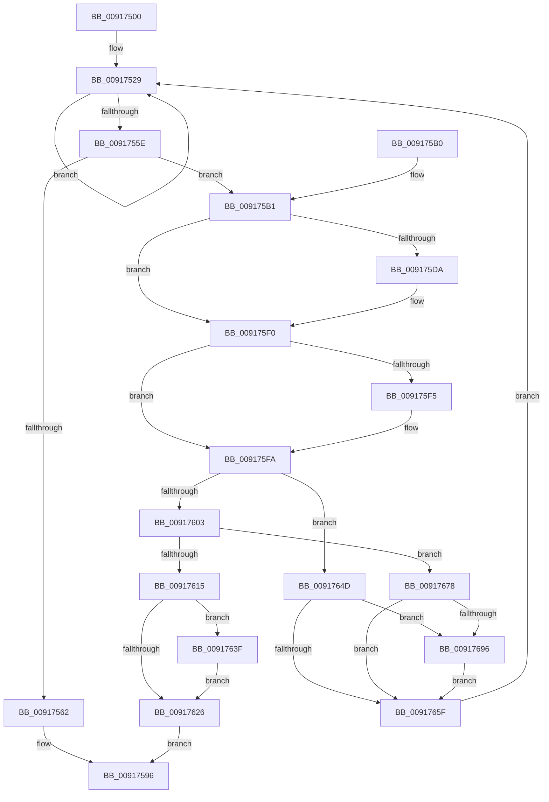

# ExUuidCreate

- RVA: `0x00917500`–`0x009176A4` (길이 `420` bytes)
- VA: `0x0000000140917500`
- 실행 섹션: `PAGE`
- PDB 이름 있음: `예`; PDB Function 태그: `아니요`
- unwind 정보 RVA: `0x0008AA34`
- 디코드: `104`개 명령, `420/420` bytes 표시
- 미해석 바이트: `0` (있으면 어셈블리에 `.byte`로 보존)

> 이 문서는 커널 이미지의 기계어와 PDB 기호를 분석해 생성했습니다. 4번과 5번은 함수 원형과 자료형을 바이너리 사용 방식에서 추정한 C 해석이며 원본 소스 복구 결과는 아닙니다.

## 1. Dependencies

- 직접 호출 지점: **10**; 고유 호출 대상: **7**
- 직접 호출자로 확인된 함수: **12**
- RIP 상대 이미지 참조: **7**

### Outgoing calls
- `0x009175C6` → [KeAbPreAcquire](../../text/21/KeAbPreAcquire_function_00210230.md) (function, `0x00210230`)
- `0x009175EB` → [ExfAcquirePushLockExclusiveEx](../../text/20/ExfAcquirePushLockExclusiveEx_function_0020FC90.md) (function, `0x0020FC90`)
- `0x0091760A` → [ExpUuidGetValues](ExpUuidGetValues_function_009176AC.md) (function, `0x009176AC`)
- `0x0091762D` → [KeAbPostRelease](../../text/2E/KeAbPostRelease_function_002E1600.md) (function, `0x002E1600`)
- `0x00917635` → [KeLeaveCriticalRegionThread](../../text/25/KeLeaveCriticalRegionThread_function_0025EFF0.md) (function, `0x0025EFF0`)
- `0x00917646` → [ExfTryToWakePushLock](../../text/26/ExfTryToWakePushLock_function_00265DD0.md) (function, `0x00265DD0`)
- `0x00917666` → [KeAbPostRelease](../../text/2E/KeAbPostRelease_function_002E1600.md) (function, `0x002E1600`)
- `0x0091766E` → [KeLeaveCriticalRegionThread](../../text/25/KeLeaveCriticalRegionThread_function_0025EFF0.md) (function, `0x0025EFF0`)
- `0x00917678` → [ExpUuidSaveSequenceNumberIf](../A9/ExpUuidSaveSequenceNumberIf_function_00A9672C.md) (function, `0x00A9672C`)
- `0x0091769D` → [ExfTryToWakePushLock](../../text/26/ExfTryToWakePushLock_function_00265DD0.md) (function, `0x00265DD0`)

### Direct callers
- [PopPowerButtonWorkCallback](../../text/5D/PopPowerButtonWorkCallback_function_005D9A70.md) at `0x005D9B83`
- [DifExUuidCreateWrapper](../../text/62/DifExUuidCreateWrapper_function_00623800.md) at `0x006238CD`
- [SC_ENV::CreateGuid](../71/SC_ENV_CreateGuid_function_007170B0.md) at `0x007170B4`
- [IoGetDeviceDirectory](../72/IoGetDeviceDirectory_function_00728370.md) at `0x007285F7`
- [PiDevCfgResolveVariableGenerateGuid](../73/PiDevCfgResolveVariableGenerateGuid_function_00735FD0.md) at `0x00736010`
- [CmpCloneHwProfile](../7E/CmpCloneHwProfile_function_007E303C.md) at `0x007E35D9`
- [CmpInitCmRM](../87/CmpInitCmRM_function_0087C700.md) at `0x0087C7FE`
- [CmpInitCmRM](../87/CmpInitCmRM_function_0087C700.md) at `0x0087C84A`
- [NtCreateJobObject](NtCreateJobObject_function_009177E0.md) at `0x00917A29`
- [BiCreateObject](../A3/BiCreateObject_function_00A3D92C.md) at `0x00A3DA2C`
- [PipGenerateContainerID](../A8/PipGenerateContainerID_function_00A87694.md) at `0x00A877FA`
- [EtwpStartLogger](../A9/EtwpStartLogger_function_00A99D80.md) at `0x00A9A1C6`
- [CmpUuidCreate](../AB/CmpUuidCreate_function_00AB81F8.md) at `0x00AB8204`

### Static image references
- `0x00917529` → RVA `0x00FD825C` (`PAGEDATA`; read)
- `0x0091752F` → RVA `0x00FD8250` (`PAGEDATA`; read)
- `0x00917536` → RVA `0x00FD8007` (`PAGEDATA`; read)
- `0x00917540` → RVA `0x00FD8260` (`PAGEDATA`; read)
- `0x0091754B` → RVA `0x00FD8258` (`PAGEDATA`; read/write)
- `0x009175B9` → RVA `0x00E685D8` (`.data`; read)
- `0x009175CB` → RVA `0x00E685D8` (`.data`; read/write)

## 2. Other-region calls and transfers

- 다른 실행 섹션으로 향하는 call: **8**
  - `0x009175C6` → [KeAbPreAcquire](../../text/21/KeAbPreAcquire_function_00210230.md) (`PAGE` → `.text`)
  - `0x009175EB` → [ExfAcquirePushLockExclusiveEx](../../text/20/ExfAcquirePushLockExclusiveEx_function_0020FC90.md) (`PAGE` → `.text`)
  - `0x0091762D` → [KeAbPostRelease](../../text/2E/KeAbPostRelease_function_002E1600.md) (`PAGE` → `.text`)
  - `0x00917635` → [KeLeaveCriticalRegionThread](../../text/25/KeLeaveCriticalRegionThread_function_0025EFF0.md) (`PAGE` → `.text`)
  - `0x00917646` → [ExfTryToWakePushLock](../../text/26/ExfTryToWakePushLock_function_00265DD0.md) (`PAGE` → `.text`)
  - `0x00917666` → [KeAbPostRelease](../../text/2E/KeAbPostRelease_function_002E1600.md) (`PAGE` → `.text`)
  - `0x0091766E` → [KeLeaveCriticalRegionThread](../../text/25/KeLeaveCriticalRegionThread_function_0025EFF0.md) (`PAGE` → `.text`)
  - `0x0091769D` → [ExfTryToWakePushLock](../../text/26/ExfTryToWakePushLock_function_00265DD0.md) (`PAGE` → `.text`)
- 별도 외부 분기/꼬리 이동을 확인하지 못했습니다.

## 3. Assembly (complete function range)

```asm
00917500  48 89 5C 24 10                  mov qword ptr [rsp + 0x10], rbx
00917505  48 89 6C 24 18                  mov qword ptr [rsp + 0x18], rbp
0091750A  56                              push rsi
0091750B  57                              push rdi
0091750C  41 56                           push r14
0091750E  48 83 EC 20                     sub rsp, 0x20
00917512  65 4C 8B 34 25 88 01 00 00      mov r14, qword ptr gs:[0x188]
0091751B  33 ED                           xor ebp, ebp
0091751D  48 8B F1                        mov rsi, rcx
00917520  4C 89 7C 24 40                  mov qword ptr [rsp + 0x40], r15
00917525  48 8D 5D FF                     lea rbx, [rbp - 1]
00917529  8B 05 2D 0D 6C 00               mov eax, dword ptr [rip + 0x6c0d2d]
0091752F  48 8B 3D 1A 0D 6C 00            mov rdi, qword ptr [rip + 0x6c0d1a]
00917536  0F B6 0D CA 0A 6C 00            movzx ecx, byte ptr [rip + 0x6c0aca]
0091753D  89 46 08                        mov dword ptr [rsi + 8], eax
00917540  8B 05 1A 0D 6C 00               mov eax, dword ptr [rip + 0x6c0d1a]
00917546  89 46 0C                        mov dword ptr [rsi + 0xc], eax
00917549  8B C3                           mov eax, ebx
0091754B  F0 0F C1 05 05 0D 6C 00         lock xadd dword ptr [rip + 0x6c0d05], eax
00917553  FF C8                           dec eax
00917555  48 3B 3D F4 0C 6C 00            cmp rdi, qword ptr [rip + 0x6c0cf4]
0091755C  75 CB                           jne 0x140917529
0091755E  85 C0                           test eax, eax
00917560  78 4F                           js 0x1409175b1
00917562  48 98                           cdqe
00917564  48 2B F8                        sub rdi, rax
00917567  48 8B C7                        mov rax, rdi
0091756A  89 3E                           mov dword ptr [rsi], edi
0091756C  48 C1 E8 20                     shr rax, 0x20
00917570  66 89 46 04                     mov word ptr [rsi + 4], ax
00917574  B8 FF 0F 00 00                  mov eax, 0xfff
00917579  48 C1 EF 30                     shr rdi, 0x30
0091757D  66 23 F8                        and di, ax
00917580  B8 00 10 00 00                  mov eax, 0x1000
00917585  66 0B F8                        or di, ax
00917588  B8 56 00 02 40                  mov eax, 0x40020056
0091758D  84 C9                           test cl, cl
0091758F  66 89 7E 06                     mov word ptr [rsi + 6], di
00917593  0F 44 E8                        cmove ebp, eax
00917596  4C 8B 7C 24 40                  mov r15, qword ptr [rsp + 0x40]
0091759B  8B C5                           mov eax, ebp
0091759D  48 8B 6C 24 50                  mov rbp, qword ptr [rsp + 0x50]
009175A2  48 8B 5C 24 48                  mov rbx, qword ptr [rsp + 0x48]
009175A7  48 83 C4 20                     add rsp, 0x20
009175AB  41 5E                           pop r14
009175AD  5F                              pop rdi
009175AE  5E                              pop rsi
009175AF  C3                              ret
009175B0  CC                              int3
009175B1  66 41 FF 8E E4 01 00 00         dec word ptr [r14 + 0x1e4]
009175B9  48 8D 0D 18 10 55 00            lea rcx, [rip + 0x551018]
009175C0  45 33 C0                        xor r8d, r8d
009175C3  33 D2                           xor edx, edx
009175C5  90                              nop
009175C6  E8 65 8C 8F FF                  call 0x140210230
009175CB  F0 48 0F BA 2D 03 10 55 00 00   lock bts qword ptr [rip + 0x551003], 0
009175D5  4C 8B F8                        mov r15, rax
009175D8  73 16                           jae 0x1409175f0
009175DA  4C 8D 05 F7 0F 55 00            lea r8, [rip + 0x550ff7]
009175E1  48 8B D0                        mov rdx, rax
009175E4  48 8D 0D ED 0F 55 00            lea rcx, [rip + 0x550fed]
009175EB  E8 A0 86 8F FF                  call 0x14020fc90
009175F0  4D 85 FF                        test r15, r15
009175F3  74 05                           je 0x1409175fa
009175F5  41 C6 47 0A 01                  mov byte ptr [r15 + 0xa], 1
009175FA  48 3B 3D 4F 0C 6C 00            cmp rdi, qword ptr [rip + 0x6c0c4f]
00917601  75 4A                           jne 0x14091764d
00917603  48 8D 0D 46 0C 6C 00            lea rcx, [rip + 0x6c0c46]
0091760A  E8 9D 00 00 00                  call 0x1409176ac
0091760F  8B E8                           mov ebp, eax
00917611  85 C0                           test eax, eax
00917613  74 63                           je 0x140917678
00917615  F0 48 0F C1 1D BA 0F 55 00      lock xadd qword ptr [rip + 0x550fba], rbx
0091761E  80 E3 06                        and bl, 6
00917621  80 FB 02                        cmp bl, 2
00917624  74 19                           je 0x14091763f
00917626  48 8D 0D AB 0F 55 00            lea rcx, [rip + 0x550fab]
0091762D  E8 CE 9F 9C FF                  call 0x1402e1600
00917632  49 8B CE                        mov rcx, r14
00917635  E8 B6 79 94 FF                  call 0x14025eff0
0091763A  E9 57 FF FF FF                  jmp 0x140917596
0091763F  48 8D 0D 92 0F 55 00            lea rcx, [rip + 0x550f92]
00917646  E8 85 E7 94 FF                  call 0x140265dd0
0091764B  EB D9                           jmp 0x140917626
0091764D  48 8B C3                        mov rax, rbx
00917650  F0 48 0F C1 05 7F 0F 55 00      lock xadd qword ptr [rip + 0x550f7f], rax
00917659  24 06                           and al, 6
0091765B  3C 02                           cmp al, 2
0091765D  74 37                           je 0x140917696
0091765F  48 8D 0D 72 0F 55 00            lea rcx, [rip + 0x550f72]
00917666  E8 95 9F 9C FF                  call 0x1402e1600
0091766B  49 8B CE                        mov rcx, r14
0091766E  E8 7D 79 94 FF                  call 0x14025eff0
00917673  E9 B1 FE FF FF                  jmp 0x140917529
00917678  E8 AF F0 17 00                  call 0x140a9672c
0091767D  0F B6 05 83 09 6C 00            movzx eax, byte ptr [rip + 0x6c0983]
00917684  48 8B C3                        mov rax, rbx
00917687  F0 48 0F C1 05 48 0F 55 00      lock xadd qword ptr [rip + 0x550f48], rax
00917690  24 06                           and al, 6
00917692  3C 02                           cmp al, 2
00917694  75 C9                           jne 0x14091765f
00917696  48 8D 0D 3B 0F 55 00            lea rcx, [rip + 0x550f3b]
0091769D  E8 2E E7 94 FF                  call 0x140265dd0
009176A2  EB BB                           jmp 0x14091765f
```

## 4. C-style interpretation (structured pseudocode)

```c
__int64 __fastcall ExUuidCreate(__int64 a1, int a2, int a3)
{
    __int64 result;
    __int64 v_rbp;
    __int64 v_rbx;
    __int64 v_rdi;
    __int64 v_rsp;
    unsigned __int64 v_stack_p10;
    unsigned __int64 v_stack_p18;
    unsigned __int64 v_stack_p8;

    v_stack_p10 = v_rbx;
    v_stack_p18 = v_rbp;
    v_rsp = (v_rsp) - (32);
    v_rbp = 0;
    v_stack_p8 = v_r15;
loc_00917529:
    *(unsigned int *)(a1 + 8) = (unsigned int)((unsigned int)(*(unsigned int *)(v_rip + 7081261)));
    *(unsigned int *)(a1 + 12) = (unsigned int)((unsigned int)(*(unsigned int *)(v_rip + 7081242)));
    result = (unsigned int)(((unsigned int)((unsigned int)(v_rbp - 1))) - 1);
    if ((*(unsigned __int64 *)(v_rip + 7081242)) != (*(unsigned __int64 *)(v_rip + 7081204))) goto loc_00917529;
    if (sign_flag) goto loc_009175B1;
    v_rdi = (*(unsigned __int64 *)(v_rip + 7081242)) - (result);
    *(unsigned int *)(a1) = (unsigned int)(v_rdi);
    result = (v_rdi) >> (32);
    *(unsigned __int16 *)(a1 + 4) = (unsigned __int16)(result);
    v_rdi = (v_rdi) >> (48);
    v_rdi = (unsigned __int16)((v_rdi) & ((unsigned __int16)((unsigned int)(0xFFFULL))));
    v_rdi = (unsigned __int16)((v_rdi) | ((unsigned __int16)((unsigned int)(0x1000ULL))));
    *(unsigned __int16 *)(a1 + 6) = (unsigned __int16)(v_rdi);
    if ((unsigned __int8)(*(unsigned __int8 *)(v_rip + 7080650)) == 0) { v_rbp = (unsigned int)((unsigned int)(0x40020056ULL)); }
loc_00917596:
    v_rsp = (v_rsp) + (32);
    return (unsigned int)((unsigned int)(v_rbp));
loc_009175B1:
    a3 = 0;
    a2 = 0;
    result = KeAbPreAcquire(v_rip + 5574680, a2, a3, a4);
    if (!(condition_is_above_or_equal)) {
        a3 = v_rip + 5574647;
        a2 = result;
        a1 = v_rip + 5574637;
        result = ExfAcquirePushLockExclusiveEx(a1, a2, a3, a4);
    }
    if (result != 0) {
        *(unsigned __int8 *)(result + 10) = 1;
    }
    if (v_rdi != (*(unsigned __int64 *)(v_rip + 7081039))) goto loc_0091764D;
    result = ExpUuidGetValues(v_rip + 7081030, a2, a3, a4);
    if ((unsigned int)(result) == 0) goto loc_00917678;
    v_rbx = (unsigned __int8)((v_stack_p10) & (6));
    if (((unsigned __int8)(v_rbx)) == 2) goto loc_0091763F;
loc_00917626:
    result = KeAbPostRelease(v_rip + 5574571, a2, a3, a4);
    result = KeLeaveCriticalRegionThread(*(unsigned __int64 *)(gs_base + (0 + 392)), a2, a3, a4);
    goto loc_00917596;
loc_0091763F:
    result = ExfTryToWakePushLock(v_rip + 5574546, a2, a3, a4);
    goto loc_00917626;
loc_0091764D:
    result = (unsigned __int8)((v_rbx) & (6));
    if (((unsigned __int8)(result)) == 2) goto loc_00917696;
loc_0091765F:
    result = KeAbPostRelease(v_rip + 5574514, a2, a3, a4);
    result = KeLeaveCriticalRegionThread(*(unsigned __int64 *)(gs_base + (0 + 392)), a2, a3, a4);
    goto loc_00917529;
loc_00917678:
    result = ExpUuidSaveSequenceNumberIf(*(unsigned __int64 *)(gs_base + (0 + 392)), a2, a3, a4);
    result = (unsigned __int8)((v_rbx) & (6));
    if (((unsigned __int8)(result)) != 2) goto loc_0091765F;
loc_00917696:
    result = ExfTryToWakePushLock(v_rip + 5574459, a2, a3, a4);
    goto loc_0091765F;
}
```

## 5. (Beta) C Style

```c
int64_t ExUuidCreate(void *Arg1, int32_t Arg2, int32_t Arg3)
{
    uint8_t *arg1 = (uint8_t *)Arg1;

    int64_t result;
    int64_t local_rbp;
    int64_t local_rbx;
    int64_t local_rdi;
    int64_t local_rsp;
    uint64_t v_stack_p10;
    uint64_t v_stack_p18;
    uint64_t v_stack_p8;

    v_stack_p10 = local_rbx;
    v_stack_p18 = local_rbp;
    local_rsp = (local_rsp) - (32);
    local_rbp = 0;
    v_stack_p8 = local_r15;
loc_00917529:
    *(uint32_t *)(arg1 + 0x8) = (uint32_t)((uint32_t)(*(uint32_t *)(v_rip + 0x6C0D2D)));
    *(uint32_t *)(arg1 + 0xC) = (uint32_t)((uint32_t)(*(uint32_t *)(v_rip + 0x6C0D1A)));
    result = (uint32_t)(((uint32_t)((uint32_t)(local_rbp - 1))) - 1);
    if ((*(uint64_t *)(v_rip + 0x6C0D1A)) != (*(uint64_t *)(v_rip + 0x6C0CF4))) goto loc_00917529;
    if (sign_flag) goto loc_009175B1;
    local_rdi = (*(uint64_t *)(v_rip + 0x6C0D1A)) - (result);
    *(uint32_t *)(arg1) = (uint32_t)(local_rdi);
    result = (local_rdi) >> (32);
    *(uint16_t *)(arg1 + 0x4) = (uint16_t)(result);
    local_rdi = (local_rdi) >> (48);
    local_rdi = (uint16_t)((local_rdi) & ((uint16_t)((uint32_t)(0xFFFULL))));
    local_rdi = (uint16_t)((local_rdi) | ((uint16_t)((uint32_t)(0x1000ULL))));
    *(uint16_t *)(arg1 + 0x6) = (uint16_t)(local_rdi);
    if ((uint8_t)(*(uint8_t *)(v_rip + 0x6C0ACA)) == 0) { local_rbp = (uint32_t)((uint32_t)(0x40020056ULL)); }
loc_00917596:
    local_rsp = (local_rsp) + (32);
    return (uint32_t)((uint32_t)(local_rbp));
loc_009175B1:
    Arg3 = 0;
    Arg2 = 0;
    result = KeAbPreAcquire(v_rip + 5574680, Arg2, Arg3, a4);
    if (!(condition_is_above_or_equal)) {
        Arg3 = v_rip + 5574647;
        Arg2 = result;
        Arg1 = v_rip + 5574637;
        result = ExfAcquirePushLockExclusiveEx(Arg1, Arg2, Arg3, a4);
    }
    if (result != 0) {
        *(uint8_t *)(result + 0xA) = 1;
    }
    if (local_rdi != (*(uint64_t *)(v_rip + 0x6C0C4F))) goto loc_0091764D;
    result = ExpUuidGetValues(v_rip + 7081030, Arg2, Arg3, a4);
    if ((uint32_t)(result) == 0) goto loc_00917678;
    local_rbx = (uint8_t)((v_stack_p10) & (6));
    if (((uint8_t)(local_rbx)) == 2) goto loc_0091763F;
loc_00917626:
    result = KeAbPostRelease(v_rip + 5574571, Arg2, Arg3, a4);
    result = KeLeaveCriticalRegionThread(*(uint64_t *)(gs_base + (0 + 0x188)), Arg2, Arg3, a4);
    goto loc_00917596;
loc_0091763F:
    result = ExfTryToWakePushLock(v_rip + 5574546, Arg2, Arg3, a4);
    goto loc_00917626;
loc_0091764D:
    result = (uint8_t)((local_rbx) & (6));
    if (((uint8_t)(result)) == 2) goto loc_00917696;
loc_0091765F:
    result = KeAbPostRelease(v_rip + 5574514, Arg2, Arg3, a4);
    result = KeLeaveCriticalRegionThread(*(uint64_t *)(gs_base + (0 + 0x188)), Arg2, Arg3, a4);
    goto loc_00917529;
loc_00917678:
    result = ExpUuidSaveSequenceNumberIf(*(uint64_t *)(gs_base + (0 + 0x188)), Arg2, Arg3, a4);
    result = (uint8_t)((local_rbx) & (6));
    if (((uint8_t)(result)) != 2) goto loc_0091765F;
loc_00917696:
    result = ExfTryToWakePushLock(v_rip + 5574459, Arg2, Arg3, a4);
    goto loc_0091765F;
}
```

### 관측된 메모리 오프셋

구조체 형식이 확인되지 않은 접근은 인자 기준의 오프셋으로만 기록했습니다.

| 기준 인자 | 오프셋 표현 | 폭 (bit) | 접근 |
|---|---:|---:|---|
| `Arg1` | `+ 0x0` | `32` | `W` |
| `Arg1` | `+ 0x4` | `16` | `W` |
| `Arg1` | `+ 0x6` | `16` | `W` |
| `Arg1` | `+ 0x8` | `32` | `W` |
| `Arg1` | `+ 0xC` | `32` | `W` |

## 6. Execution-region graph

[열기: 2D/3D 그래프와 함수 탐색 컨트롤 패널](../../../control-panel.html?section=page&rva=0x00917500&view=graph)

- 2D 그래프는 위에서 아래로 흐르고, 3D 그래프는 빈 공간을 드래그해 회전합니다. Shift+드래그는 이동, 휠은 확대·축소, 함수 노드 선택은 대상 보고서 이동입니다.

### Static fallback


