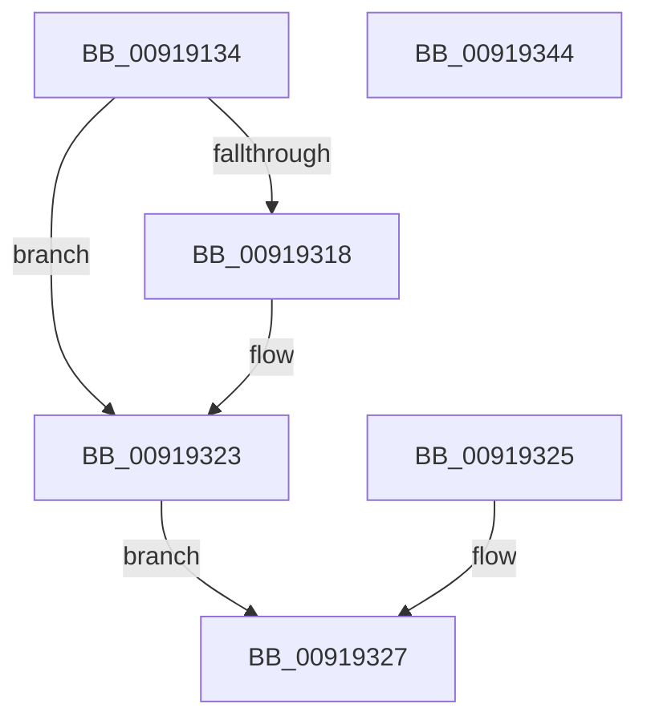

# ExpCopyProcessInfo

- RVA: `0x00919134`–`0x00919345` (길이 `529` bytes)
- VA: `0x0000000140919134`
- 실행 섹션: `PAGE`
- PDB 이름 있음: `예`; PDB Function 태그: `아니요`
- unwind 정보 RVA: `0x0008AC94`
- 디코드: `114`개 명령, `529/529` bytes 표시
- 미해석 바이트: `0` (있으면 어셈블리에 `.byte`로 보존)

> 이 문서는 커널 이미지의 기계어와 PDB 기호를 분석해 생성했습니다. 4번과 5번은 함수 원형과 자료형을 바이너리 사용 방식에서 추정한 C 해석이며 원본 소스 복구 결과는 아닙니다.

## 1. Dependencies

- 직접 호출 지점: **2**; 고유 호출 대상: **2**
- 직접 호출자로 확인된 함수: **2**
- RIP 상대 이미지 참조: **0**

### Outgoing calls
- `0x00919169` → [PsQueryStatisticsProcess](PsQueryStatisticsProcess_function_00919350.md) (function, `0x00919350`)
- `0x00919174` → [ObGetProcessHandleCount](ObGetProcessHandleCount_function_009195D0.md) (function, `0x009195D0`)

### Direct callers
- [ExpGetProcessInformation](ExpGetProcessInformation_function_0091A878.md) at `0x0091B404`
- [ExProcessCounterSetCallback](ExProcessCounterSetCallback_function_0091CDF0.md) at `0x0091CEFF`

### Static image references
- 디코드된 RIP-relative 메모리 참조가 없습니다.

## 2. Other-region calls and transfers

- 다른 실행 섹션으로 향하는 call: **0**
- 별도 외부 분기/꼬리 이동을 확인하지 못했습니다.

## 3. Assembly (complete function range)

```asm
00919134  48 8B C4                        mov rax, rsp
00919137  48 89 58 08                     mov qword ptr [rax + 8], rbx
0091913B  48 89 70 10                     mov qword ptr [rax + 0x10], rsi
0091913F  48 89 78 18                     mov qword ptr [rax + 0x18], rdi
00919143  4C 89 70 20                     mov qword ptr [rax + 0x20], r14
00919147  41 57                           push r15
00919149  48 83 EC 60                     sub rsp, 0x60
0091914D  4D 8B F1                        mov r14, r9
00919150  45 8A F8                        mov r15b, r8b
00919153  48 8B FA                        mov rdi, rdx
00919156  48 8B F1                        mov rsi, rcx
00919159  33 DB                           xor ebx, ebx
0091915B  48 89 58 C8                     mov qword ptr [rax - 0x38], rbx
0091915F  48 89 58 C0                     mov qword ptr [rax - 0x40], rbx
00919163  49 8B D1                        mov rdx, r9
00919166  48 8B CF                        mov rcx, rdi
00919169  E8 E2 01 00 00                  call 0x140919350
0091916E  90                              nop
0091916F  33 D2                           xor edx, edx
00919171  48 8B CF                        mov rcx, rdi
00919174  E8 57 04 00 00                  call 0x1409195d0
00919179  89 46 60                        mov dword ptr [rsi + 0x60], eax
0091917C  48 8B 87 F8 01 00 00            mov rax, qword ptr [rdi + 0x1f8]
00919183  48 89 46 20                     mov qword ptr [rsi + 0x20], rax
00919187  0F BE 87 90 00 00 00            movsx eax, byte ptr [rdi + 0x90]
0091918E  89 46 48                        mov dword ptr [rsi + 0x48], eax
00919191  48 8B 87 D0 01 00 00            mov rax, qword ptr [rdi + 0x1d0]
00919198  48 89 46 50                     mov qword ptr [rsi + 0x50], rax
0091919C  48 8B 87 D0 02 00 00            mov rax, qword ptr [rdi + 0x2d0]
009191A3  48 89 46 58                     mov qword ptr [rsi + 0x58], rax
009191A7  8B 87 D8 05 00 00               mov eax, dword ptr [rdi + 0x5d8]
009191AD  89 46 14                        mov dword ptr [rsi + 0x14], eax
009191B0  48 8B 87 20 02 00 00            mov rax, qword ptr [rdi + 0x220]
009191B7  48 89 46 70                     mov qword ptr [rsi + 0x70], rax
009191BB  48 8B 87 28 02 00 00            mov rax, qword ptr [rdi + 0x228]
009191C2  48 89 46 78                     mov qword ptr [rsi + 0x78], rax
009191C6  8B 87 04 04 00 00               mov eax, dword ptr [rdi + 0x404]
009191CC  89 86 80 00 00 00               mov dword ptr [rsi + 0x80], eax
009191D2  8B 87 A8 04 00 00               mov eax, dword ptr [rdi + 0x4a8]
009191D8  89 46 10                        mov dword ptr [rsi + 0x10], eax
009191DB  48 8B 87 A0 04 00 00            mov rax, qword ptr [rdi + 0x4a0]
009191E2  48 C1 E0 0C                     shl rax, 0xc
009191E6  48 89 86 88 00 00 00            mov qword ptr [rsi + 0x88], rax
009191ED  48 8B 97 80 04 00 00            mov rdx, qword ptr [rdi + 0x480]
009191F4  48 C1 E2 0C                     shl rdx, 0xc
009191F8  48 89 54 24 38                  mov qword ptr [rsp + 0x38], rdx
009191FD  48 8B 8F 88 04 00 00            mov rcx, qword ptr [rdi + 0x488]
00919204  48 C1 E1 0C                     shl rcx, 0xc
00919208  48 89 4C 24 50                  mov qword ptr [rsp + 0x50], rcx
0091920D  90                              nop
0091920E  48 8B 44 24 38                  mov rax, qword ptr [rsp + 0x38]
00919213  48 89 86 90 00 00 00            mov qword ptr [rsi + 0x90], rax
0091921A  48 3B C8                        cmp rcx, rax
0091921D  48 0F 43 CA                     cmovae rcx, rdx
00919221  48 89 4E 08                     mov qword ptr [rsi + 8], rcx
00919225  48 8B 87 08 02 00 00            mov rax, qword ptr [rdi + 0x208]
0091922C  48 89 44 24 28                  mov qword ptr [rsp + 0x28], rax
00919231  48 8B 87 18 02 00 00            mov rax, qword ptr [rdi + 0x218]
00919238  48 89 44 24 30                  mov qword ptr [rsp + 0x30], rax
0091923D  48 8B 44 24 28                  mov rax, qword ptr [rsp + 0x28]
00919242  48 89 86 A0 00 00 00            mov qword ptr [rsi + 0xa0], rax
00919249  48 8B 44 24 30                  mov rax, qword ptr [rsp + 0x30]
0091924E  48 89 86 98 00 00 00            mov qword ptr [rsi + 0x98], rax
00919255  48 8B 87 00 02 00 00            mov rax, qword ptr [rdi + 0x200]
0091925C  48 89 44 24 28                  mov qword ptr [rsp + 0x28], rax
00919261  48 8B 87 10 02 00 00            mov rax, qword ptr [rdi + 0x210]
00919268  48 89 44 24 30                  mov qword ptr [rsp + 0x30], rax
0091926D  48 8B 44 24 28                  mov rax, qword ptr [rsp + 0x28]
00919272  48 89 86 B0 00 00 00            mov qword ptr [rsi + 0xb0], rax
00919279  48 8B 44 24 30                  mov rax, qword ptr [rsp + 0x30]
0091927E  48 89 86 A8 00 00 00            mov qword ptr [rsi + 0xa8], rax
00919285  48 8B 87 D8 03 00 00            mov rax, qword ptr [rdi + 0x3d8]
0091928C  48 C1 E0 0C                     shl rax, 0xc
00919290  48 89 44 24 40                  mov qword ptr [rsp + 0x40], rax
00919295  48 89 86 B8 00 00 00            mov qword ptr [rsi + 0xb8], rax
0091929C  48 8B 87 E0 03 00 00            mov rax, qword ptr [rdi + 0x3e0]
009192A3  48 C1 E0 0C                     shl rax, 0xc
009192A7  48 89 86 C0 00 00 00            mov qword ptr [rsi + 0xc0], rax
009192AE  48 8B 44 24 40                  mov rax, qword ptr [rsp + 0x40]
009192B3  48 89 86 C8 00 00 00            mov qword ptr [rsi + 0xc8], rax
009192BA  49 8B 46 18                     mov rax, qword ptr [r14 + 0x18]
009192BE  48 89 46 18                     mov qword ptr [rsi + 0x18], rax
009192C2  49 8B 46 08                     mov rax, qword ptr [r14 + 8]
009192C6  48 89 46 28                     mov qword ptr [rsi + 0x28], rax
009192CA  49 8B 06                        mov rax, qword ptr [r14]
009192CD  48 89 46 30                     mov qword ptr [rsi + 0x30], rax
009192D1  49 8B 46 28                     mov rax, qword ptr [r14 + 0x28]
009192D5  48 89 86 D0 00 00 00            mov qword ptr [rsi + 0xd0], rax
009192DC  49 8B 46 30                     mov rax, qword ptr [r14 + 0x30]
009192E0  48 89 86 D8 00 00 00            mov qword ptr [rsi + 0xd8], rax
009192E7  49 8B 46 38                     mov rax, qword ptr [r14 + 0x38]
009192EB  48 89 86 E0 00 00 00            mov qword ptr [rsi + 0xe0], rax
009192F2  49 8B 46 40                     mov rax, qword ptr [r14 + 0x40]
009192F6  48 89 86 E8 00 00 00            mov qword ptr [rsi + 0xe8], rax
009192FD  49 8B 46 48                     mov rax, qword ptr [r14 + 0x48]
00919301  48 89 86 F0 00 00 00            mov qword ptr [rsi + 0xf0], rax
00919308  49 8B 46 50                     mov rax, qword ptr [r14 + 0x50]
0091930C  48 89 86 F8 00 00 00            mov qword ptr [rsi + 0xf8], rax
00919313  45 84 FF                        test r15b, r15b
00919316  74 0B                           je 0x140919323
00919318  48 8B 87 D0 01 00 00            mov rax, qword ptr [rdi + 0x1d0]
0091931F  48 89 46 68                     mov qword ptr [rsi + 0x68], rax
00919323  EB 02                           jmp 0x140919327
00919325  8B D8                           mov ebx, eax
00919327  8B C3                           mov eax, ebx
00919329  4C 8D 5C 24 60                  lea r11, [rsp + 0x60]
0091932E  49 8B 5B 10                     mov rbx, qword ptr [r11 + 0x10]
00919332  49 8B 73 18                     mov rsi, qword ptr [r11 + 0x18]
00919336  49 8B 7B 20                     mov rdi, qword ptr [r11 + 0x20]
0091933A  4D 8B 73 28                     mov r14, qword ptr [r11 + 0x28]
0091933E  49 8B E3                        mov rsp, r11
00919341  41 5F                           pop r15
00919343  C3                              ret
00919344  CC                              int3
```

## 4. C-style interpretation (structured pseudocode)

```c
__int64 __fastcall ExpCopyProcessInfo(__int64 a1, __int64 a2, unsigned __int8 a3, __int64 a4)
{
    __int64 result;
    __int64 v_rbx;
    __int64 v_rsp;
    unsigned __int64 v_stack_m18;
    unsigned __int64 v_stack_m28;
    unsigned __int64 v_stack_m30;
    unsigned __int64 v_stack_m38;
    unsigned __int64 v_stack_m40;
    unsigned __int64 v_stack_m8;

    *(unsigned __int64 *)(v_rsp + 8) = v_rbx;
    *(unsigned __int64 *)(v_rsp + 16) = v_rsi;
    *(unsigned __int64 *)(v_rsp + 24) = v_rdi;
    *(unsigned __int64 *)(v_rsp + 32) = v_r14;
    v_rsp = (v_rsp) - (96);
    v_rbx = 0;
    *(unsigned __int64 *)(v_rsp - 56) = 0;
    *(unsigned __int64 *)(v_rsp - 64) = 0;
    result = PsQueryStatisticsProcess(a2, a4, a3, a4);
    a2 = 0;
    result = ObGetProcessHandleCount(0, a2, a3, a4);
    *(unsigned int *)(a1 + 96) = (unsigned int)(result);
    *(unsigned __int64 *)(a1 + 32) = *(unsigned __int64 *)(a2 + 504);
    *(unsigned int *)(a1 + 72) = (unsigned int)((__int8)(*(unsigned __int8 *)(a2 + 144)));
    *(unsigned __int64 *)(a1 + 80) = *(unsigned __int64 *)(a2 + 464);
    *(unsigned __int64 *)(a1 + 88) = *(unsigned __int64 *)(a2 + 720);
    *(unsigned int *)(a1 + 20) = (unsigned int)((unsigned int)(*(unsigned int *)(a2 + 1496)));
    *(unsigned __int64 *)(a1 + 112) = *(unsigned __int64 *)(a2 + 544);
    *(unsigned __int64 *)(a1 + 120) = *(unsigned __int64 *)(a2 + 552);
    *(unsigned int *)(a1 + 128) = (unsigned int)((unsigned int)(*(unsigned int *)(a2 + 1028)));
    *(unsigned int *)(a1 + 16) = (unsigned int)((unsigned int)(*(unsigned int *)(a2 + 1192)));
    result = (*(unsigned __int64 *)(a2 + 1184)) << (12);
    *(unsigned __int64 *)(a1 + 136) = result;
    a2 = (*(unsigned __int64 *)(a2 + 1152)) << (12);
    v_stack_m30 = a2;
    a1 = (*(unsigned __int64 *)(a2 + 1160)) << (12);
    v_stack_m18 = a1;
    *(unsigned __int64 *)(a1 + 144) = v_stack_m30;
    if (a1 >= v_stack_m30) { a1 = a2; }
    *(unsigned __int64 *)(a1 + 8) = a1;
    v_stack_m40 = *(unsigned __int64 *)(a2 + 520);
    v_stack_m38 = *(unsigned __int64 *)(a2 + 536);
    *(unsigned __int64 *)(a1 + 160) = v_stack_m40;
    *(unsigned __int64 *)(a1 + 152) = v_stack_m38;
    v_stack_m40 = *(unsigned __int64 *)(a2 + 512);
    v_stack_m38 = *(unsigned __int64 *)(a2 + 528);
    *(unsigned __int64 *)(a1 + 176) = v_stack_m40;
    *(unsigned __int64 *)(a1 + 168) = v_stack_m38;
    result = (*(unsigned __int64 *)(a2 + 984)) << (12);
    v_stack_m28 = result;
    *(unsigned __int64 *)(a1 + 184) = result;
    result = (*(unsigned __int64 *)(a2 + 992)) << (12);
    *(unsigned __int64 *)(a1 + 192) = result;
    *(unsigned __int64 *)(a1 + 200) = v_stack_m28;
    *(unsigned __int64 *)(a1 + 24) = *(unsigned __int64 *)(a4 + 24);
    *(unsigned __int64 *)(a1 + 40) = *(unsigned __int64 *)(a4 + 8);
    *(unsigned __int64 *)(a1 + 48) = *(unsigned __int64 *)(a4);
    *(unsigned __int64 *)(a1 + 208) = *(unsigned __int64 *)(a4 + 40);
    *(unsigned __int64 *)(a1 + 216) = *(unsigned __int64 *)(a4 + 48);
    *(unsigned __int64 *)(a1 + 224) = *(unsigned __int64 *)(a4 + 56);
    *(unsigned __int64 *)(a1 + 232) = *(unsigned __int64 *)(a4 + 64);
    *(unsigned __int64 *)(a1 + 240) = *(unsigned __int64 *)(a4 + 72);
    *(unsigned __int64 *)(a1 + 248) = *(unsigned __int64 *)(a4 + 80);
    result = *(unsigned __int64 *)(a4 + 80);
    if (a3 != 0) {
        result = *(unsigned __int64 *)(a2 + 464);
        *(unsigned __int64 *)(a1 + 104) = result;
    }
    goto loc_00919327;
loc_00919327:
    return 0;
}
```

## 5. (Beta) C Style

```c
int64_t ExpCopyProcessInfo(void *Arg1, void *Arg2, uint8_t Arg3, void *Arg4)
{
    uint8_t *arg1 = (uint8_t *)Arg1;
    uint8_t *arg2 = (uint8_t *)Arg2;
    uint8_t *arg4 = (uint8_t *)Arg4;

    int64_t result;
    int64_t local_rbx;
    int64_t local_rsp;
    uint64_t v_stack_m18;
    uint64_t v_stack_m28;
    uint64_t v_stack_m30;
    uint64_t v_stack_m38;
    uint64_t v_stack_m40;
    uint64_t v_stack_m8;

    *(uint64_t *)(local_rsp + 0x8) = local_rbx;
    *(uint64_t *)(local_rsp + 0x10) = local_rsi;
    *(uint64_t *)(local_rsp + 0x18) = local_rdi;
    *(uint64_t *)(local_rsp + 0x20) = local_r14;
    local_rsp = (local_rsp) - (96);
    local_rbx = 0;
    *(uint64_t *)(local_rsp - 0x38) = 0;
    *(uint64_t *)(local_rsp - 0x40) = 0;
    result = PsQueryStatisticsProcess(Arg2, Arg4, Arg3, Arg4);
    Arg2 = 0;
    result = ObGetProcessHandleCount(0, Arg2, Arg3, Arg4);
    *(uint32_t *)(arg1 + 0x60) = (uint32_t)(result);
    *(uint64_t *)(arg1 + 0x20) = *(uint64_t *)(arg2 + 0x1F8);
    *(uint32_t *)(arg1 + 0x48) = (uint32_t)((int8_t)(*(uint8_t *)(arg2 + 0x90)));
    *(uint64_t *)(arg1 + 0x50) = *(uint64_t *)(arg2 + 0x1D0);
    *(uint64_t *)(arg1 + 0x58) = *(uint64_t *)(arg2 + 0x2D0);
    *(uint32_t *)(arg1 + 0x14) = (uint32_t)((uint32_t)(*(uint32_t *)(arg2 + 0x5D8)));
    *(uint64_t *)(arg1 + 0x70) = *(uint64_t *)(arg2 + 0x220);
    *(uint64_t *)(arg1 + 0x78) = *(uint64_t *)(arg2 + 0x228);
    *(uint32_t *)(arg1 + 0x80) = (uint32_t)((uint32_t)(*(uint32_t *)(arg2 + 0x404)));
    *(uint32_t *)(arg1 + 0x10) = (uint32_t)((uint32_t)(*(uint32_t *)(arg2 + 0x4A8)));
    result = (*(uint64_t *)(arg2 + 0x4A0)) << (12);
    *(uint64_t *)(arg1 + 0x88) = result;
    Arg2 = (*(uint64_t *)(arg2 + 0x480)) << (12);
    v_stack_m30 = Arg2;
    Arg1 = (*(uint64_t *)(arg2 + 0x488)) << (12);
    v_stack_m18 = Arg1;
    *(uint64_t *)(arg1 + 0x90) = v_stack_m30;
    if (Arg1 >= v_stack_m30) { Arg1 = Arg2; }
    *(void **)(arg1 + 0x8) = Arg1;
    v_stack_m40 = *(uint64_t *)(arg2 + 0x208);
    v_stack_m38 = *(uint64_t *)(arg2 + 0x218);
    *(uint64_t *)(arg1 + 0xA0) = v_stack_m40;
    *(uint64_t *)(arg1 + 0x98) = v_stack_m38;
    v_stack_m40 = *(uint64_t *)(arg2 + 0x200);
    v_stack_m38 = *(uint64_t *)(arg2 + 0x210);
    *(uint64_t *)(arg1 + 0xB0) = v_stack_m40;
    *(uint64_t *)(arg1 + 0xA8) = v_stack_m38;
    result = (*(uint64_t *)(arg2 + 0x3D8)) << (12);
    v_stack_m28 = result;
    *(uint64_t *)(arg1 + 0xB8) = result;
    result = (*(uint64_t *)(arg2 + 0x3E0)) << (12);
    *(uint64_t *)(arg1 + 0xC0) = result;
    *(uint64_t *)(arg1 + 0xC8) = v_stack_m28;
    *(uint64_t *)(arg1 + 0x18) = *(uint64_t *)(arg4 + 0x18);
    *(uint64_t *)(arg1 + 0x28) = *(uint64_t *)(arg4 + 0x8);
    *(uint64_t *)(arg1 + 0x30) = *(uint64_t *)(arg4);
    *(uint64_t *)(arg1 + 0xD0) = *(uint64_t *)(arg4 + 0x28);
    *(uint64_t *)(arg1 + 0xD8) = *(uint64_t *)(arg4 + 0x30);
    *(uint64_t *)(arg1 + 0xE0) = *(uint64_t *)(arg4 + 0x38);
    *(uint64_t *)(arg1 + 0xE8) = *(uint64_t *)(arg4 + 0x40);
    *(uint64_t *)(arg1 + 0xF0) = *(uint64_t *)(arg4 + 0x48);
    *(uint64_t *)(arg1 + 0xF8) = *(uint64_t *)(arg4 + 0x50);
    result = *(uint64_t *)(arg4 + 0x50);
    if (Arg3 != 0) {
        result = *(uint64_t *)(arg2 + 0x1D0);
        *(uint64_t *)(arg1 + 0x68) = result;
    }
    goto loc_00919327;
loc_00919327:
    return 0;
}
```

### 관측된 메모리 오프셋

구조체 형식이 확인되지 않은 접근은 인자 기준의 오프셋으로만 기록했습니다.

| 기준 인자 | 오프셋 표현 | 폭 (bit) | 접근 |
|---|---:|---:|---|
| `Arg1` | `+ 0x8` | `64` | `W` |
| `Arg1` | `+ 0x10` | `32` | `W` |
| `Arg1` | `+ 0x14` | `32` | `W` |
| `Arg1` | `+ 0x18` | `64` | `W` |
| `Arg1` | `+ 0x20` | `64` | `W` |
| `Arg1` | `+ 0x28` | `64` | `W` |
| `Arg1` | `+ 0x30` | `64` | `W` |
| `Arg1` | `+ 0x48` | `32` | `W` |
| `Arg1` | `+ 0x50` | `64` | `W` |
| `Arg1` | `+ 0x58` | `64` | `W` |
| `Arg1` | `+ 0x60` | `32` | `W` |
| `Arg1` | `+ 0x68` | `64` | `W` |
| `Arg1` | `+ 0x70` | `64` | `W` |
| `Arg1` | `+ 0x78` | `64` | `W` |
| `Arg1` | `+ 0x80` | `32` | `W` |
| `Arg1` | `+ 0x88` | `64` | `W` |
| `Arg1` | `+ 0x90` | `64` | `W` |
| `Arg1` | `+ 0x98` | `64` | `W` |
| `Arg1` | `+ 0xA0` | `64` | `W` |
| `Arg1` | `+ 0xA8` | `64` | `W` |
| `Arg1` | `+ 0xB0` | `64` | `W` |
| `Arg1` | `+ 0xB8` | `64` | `W` |
| `Arg1` | `+ 0xC0` | `64` | `W` |
| `Arg1` | `+ 0xC8` | `64` | `W` |
| `Arg1` | `+ 0xD0` | `64` | `W` |
| `Arg1` | `+ 0xD8` | `64` | `W` |
| `Arg1` | `+ 0xE0` | `64` | `W` |
| `Arg1` | `+ 0xE8` | `64` | `W` |
| `Arg1` | `+ 0xF0` | `64` | `W` |
| `Arg1` | `+ 0xF8` | `64` | `W` |
| `Arg2` | `+ 0x90` | `8` | `R` |
| `Arg2` | `+ 0x1D0` | `64` | `R` |

추가 오프셋 25개는 표에서 생략했습니다.

## 6. Execution-region graph

[열기: 2D/3D 그래프와 함수 탐색 컨트롤 패널](../../../control-panel.html?section=page&rva=0x00919134&view=graph)

- 2D 그래프는 위에서 아래로 흐르고, 3D 그래프는 빈 공간을 드래그해 회전합니다. Shift+드래그는 이동, 휠은 확대·축소, 함수 노드 선택은 대상 보고서 이동입니다.

### Static fallback


