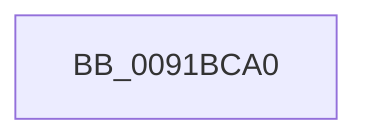

# ExpGetNextProcessThread

- RVA: `0x0091BCA0`–`0x0091BCB8` (길이 `24` bytes)
- VA: `0x000000014091BCA0`
- 실행 섹션: `PAGE`
- PDB 이름 있음: `예`; PDB Function 태그: `아니요`
- unwind 정보 RVA: `0x0008AFE0`
- 디코드: `7`개 명령, `24/24` bytes 표시
- 미해석 바이트: `0` (있으면 어셈블리에 `.byte`로 보존)

> 이 문서는 커널 이미지의 기계어와 PDB 기호를 분석해 생성했습니다. 4번과 5번은 함수 원형과 자료형을 바이너리 사용 방식에서 추정한 C 해석이며 원본 소스 복구 결과는 아닙니다.

## 1. Dependencies

- 직접 호출 지점: **0**; 고유 호출 대상: **0**
- 직접 호출자로 확인된 함수: **1**
- RIP 상대 이미지 참조: **1**

### Outgoing calls
- 직접 디코드된 call 명령이 없습니다.

### Direct callers
- [ExpGetProcessInformation](ExpGetProcessInformation_function_0091A878.md) at `0x0091AAB8`

### Static image references
- `0x0091BCA8` → RVA `0x00FC6B70` (`ALMOSTRO`; read)

## 2. Other-region calls and transfers

- 다른 실행 섹션으로 향하는 call: **0**
- call이 아닌 외부 분기/꼬리 이동: **1**
  - `0x0091BCB2` → [sub_0091BDCE](Unknown_function_0091BDCE.md) (`tail-transfer`)

## 3. Assembly (complete function range)

```asm
0091BCA0  40 53                           push rbx
0091BCA2  55                              push rbp
0091BCA3  56                              push rsi
0091BCA4  48 83 EC 30                     sub rsp, 0x30
0091BCA8  48 3B 0D C1 AE 6A 00            cmp rcx, qword ptr [rip + 0x6aaec1]
0091BCAF  48 8B F2                        mov rsi, rdx
0091BCB2  0F 84 16 01 00 00               je 0x14091bdce
```

## 4. C-style interpretation (structured pseudocode)

```c
void __fastcall ExpGetNextProcessThread(__int64 a1, __int64 a2)
{
    __int64 v_rsp;

    v_rsp = (v_rsp) - (48);
}
```

## 5. (Beta) C Style

```c
void ExpGetNextProcessThread(int64_t Arg1, int64_t Arg2)
{
    int64_t local_rsp;

    local_rsp = (local_rsp) - (48);
}
```

## 6. Execution-region graph

[열기: 2D/3D 그래프와 함수 탐색 컨트롤 패널](../../../control-panel.html?section=page&rva=0x0091BCA0&view=graph)

- 2D 그래프는 위에서 아래로 흐르고, 3D 그래프는 빈 공간을 드래그해 회전합니다. Shift+드래그는 이동, 휠은 확대·축소, 함수 노드 선택은 대상 보고서 이동입니다.

### Static fallback


