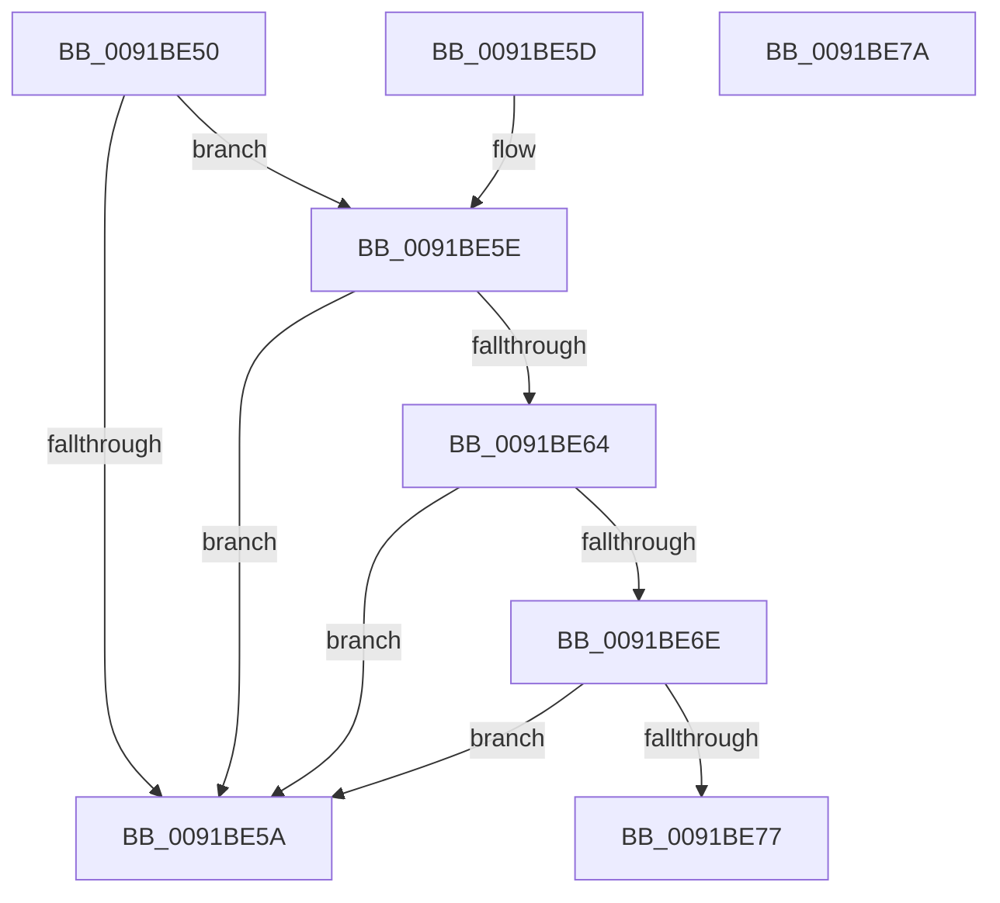

# ExpSysInfoShouldSkipProcess

- RVA: `0x0091BE50`–`0x0091BE7B` (길이 `43` bytes)
- VA: `0x000000014091BE50`
- 실행 섹션: `PAGE`
- PDB 이름 있음: `예`; PDB Function 태그: `아니요`
- unwind 정보 RVA: `0x000DB714`
- 디코드: `17`개 명령, `43/43` bytes 표시
- 미해석 바이트: `0` (있으면 어셈블리에 `.byte`로 보존)

> 이 문서는 커널 이미지의 기계어와 PDB 기호를 분석해 생성했습니다. 4번과 5번은 함수 원형과 자료형을 바이너리 사용 방식에서 추정한 C 해석이며 원본 소스 복구 결과는 아닙니다.

## 1. Dependencies

- 직접 호출 지점: **0**; 고유 호출 대상: **0**
- 직접 호출자로 확인된 함수: **2**
- RIP 상대 이미지 참조: **0**

### Outgoing calls
- 직접 디코드된 call 명령이 없습니다.

### Direct callers
- [ExpGetProcessInformation](ExpGetProcessInformation_function_0091A878.md) at `0x0091B190`
- [ExProcessCounterSetCallback](ExProcessCounterSetCallback_function_0091CDF0.md) at `0x0091CECE`

### Static image references
- 디코드된 RIP-relative 메모리 참조가 없습니다.

## 2. Other-region calls and transfers

- 다른 실행 섹션으로 향하는 call: **0**
- 별도 외부 분기/꼬리 이동을 확인하지 못했습니다.

## 3. Assembly (complete function range)

```asm
0091BE50  8B 81 F4 01 00 00               mov eax, dword ptr [rcx + 0x1f4]
0091BE56  A8 04                           test al, 4
0091BE58  75 04                           jne 0x14091be5e
0091BE5A  32 C0                           xor al, al
0091BE5C  C3                              ret
0091BE5D  CC                              int3
0091BE5E  83 79 04 00                     cmp dword ptr [rcx + 4], 0
0091BE62  74 F6                           je 0x14091be5a
0091BE64  8B 81 80 03 00 00               mov eax, dword ptr [rcx + 0x380]
0091BE6A  85 C0                           test eax, eax
0091BE6C  75 EC                           jne 0x14091be5a
0091BE6E  48 83 C1 30                     add rcx, 0x30
0091BE72  48 39 09                        cmp qword ptr [rcx], rcx
0091BE75  75 E3                           jne 0x14091be5a
0091BE77  B0 01                           mov al, 1
0091BE79  C3                              ret
0091BE7A  CC                              int3
```

## 4. C-style interpretation (structured pseudocode)

```c
__int64 __fastcall ExpSysInfoShouldSkipProcess(__int64 a1)
{
    __int64 result;

    if ((((unsigned __int8)((unsigned int)(*(unsigned int *)(a1 + 500)))) & (4)) != 0) goto loc_0091BE5E;
loc_0091BE5A:
    result = 0;
    return result;
loc_0091BE5E:
    if ((*(unsigned int *)(a1 + 4)) == 0) goto loc_0091BE5A;
    if ((unsigned int)((unsigned int)(*(unsigned int *)(a1 + 896))) != 0) goto loc_0091BE5A;
    a1 = (a1) + (48);
    if ((*(unsigned __int64 *)(a1)) != a1) goto loc_0091BE5A;
    return 1;
}
```

## 5. (Beta) C Style

```c
int64_t ExpSysInfoShouldSkipProcess(void *Arg1)
{
    uint8_t *arg1 = (uint8_t *)Arg1;

    int64_t result;

    if ((((uint8_t)((uint32_t)(*(uint32_t *)(arg1 + 0x1F4)))) & (4)) != 0) goto loc_0091BE5E;
loc_0091BE5A:
    result = 0;
    return result;
loc_0091BE5E:
    if ((*(uint32_t *)(arg1 + 0x4)) == 0) goto loc_0091BE5A;
    if ((uint32_t)((uint32_t)(*(uint32_t *)(arg1 + 0x380))) != 0) goto loc_0091BE5A;
    Arg1 = (Arg1) + (48);
    if ((*(uint64_t *)(arg1)) != Arg1) goto loc_0091BE5A;
    return 1;
}
```

### 관측된 메모리 오프셋

구조체 형식이 확인되지 않은 접근은 인자 기준의 오프셋으로만 기록했습니다.

| 기준 인자 | 오프셋 표현 | 폭 (bit) | 접근 |
|---|---:|---:|---|
| `Arg1` | `+ 0x0` | `64` | `R` |
| `Arg1` | `+ 0x4` | `32` | `R` |
| `Arg1` | `+ 0x1F4` | `32` | `R` |
| `Arg1` | `+ 0x380` | `32` | `R` |

## 6. Execution-region graph

[열기: 2D/3D 그래프와 함수 탐색 컨트롤 패널](../../../control-panel.html?section=page&rva=0x0091BE50&view=graph)

- 2D 그래프는 위에서 아래로 흐르고, 3D 그래프는 빈 공간을 드래그해 회전합니다. Shift+드래그는 이동, 휠은 확대·축소, 함수 노드 선택은 대상 보고서 이동입니다.

### Static fallback


