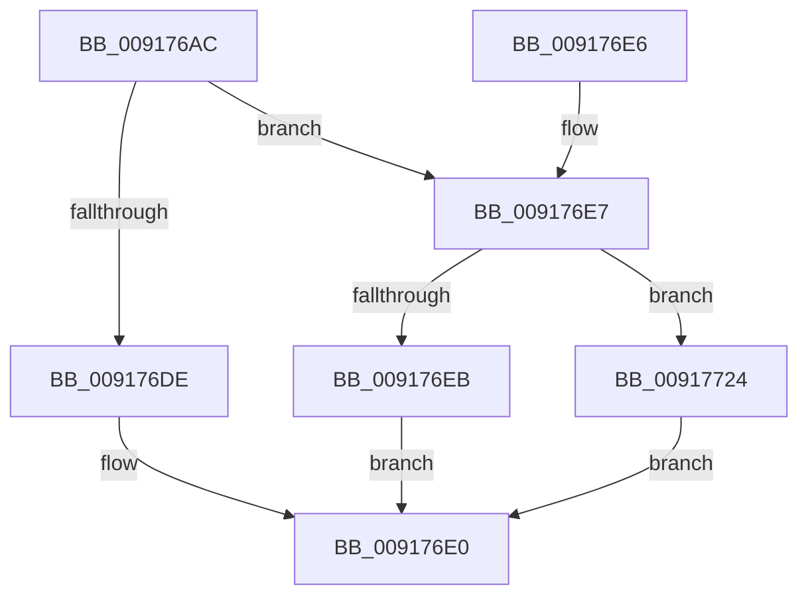

# ExpUuidGetValues

- RVA: `0x009176AC`–`0x0091772B` (길이 `127` bytes)
- VA: `0x00000001409176AC`
- 실행 섹션: `PAGE`
- PDB 이름 있음: `예`; PDB Function 태그: `아니요`
- unwind 정보 RVA: `0x0008AA50`
- 디코드: `39`개 명령, `127/127` bytes 표시
- 미해석 바이트: `0` (있으면 어셈블리에 `.byte`로 보존)

> 이 문서는 커널 이미지의 기계어와 PDB 기호를 분석해 생성했습니다. 4번과 5번은 함수 원형과 자료형을 바이너리 사용 방식에서 추정한 C 해석이며 원본 소스 복구 결과는 아닙니다.

## 1. Dependencies

- 직접 호출 지점: **1**; 고유 호출 대상: **1**
- 직접 호출자로 확인된 함수: **1**
- RIP 상대 이미지 참조: **0**

### Outgoing calls
- `0x009176D0` → [ExpAllocateUuids](../A9/ExpAllocateUuids_function_00A965F4.md) (function, `0x00A965F4`)

### Direct callers
- [ExUuidCreate](ExUuidCreate_function_00917500.md) at `0x0091760A`

### Static image references
- 디코드된 RIP-relative 메모리 참조가 없습니다.

## 2. Other-region calls and transfers

- 다른 실행 섹션으로 향하는 call: **0**
- 별도 외부 분기/꼬리 이동을 확인하지 못했습니다.

## 3. Assembly (complete function range)

```asm
009176AC  48 8B C4                        mov rax, rsp
009176AF  53                              push rbx
009176B0  48 83 EC 20                     sub rsp, 0x20
009176B4  48 83 60 20 00                  and qword ptr [rax + 0x20], 0
009176B9  4C 8D 40 10                     lea r8, [rax + 0x10]
009176BD  83 60 18 00                     and dword ptr [rax + 0x18], 0
009176C1  48 8D 50 18                     lea rdx, [rax + 0x18]
009176C5  83 60 10 00                     and dword ptr [rax + 0x10], 0
009176C9  48 8B D9                        mov rbx, rcx
009176CC  48 8D 48 20                     lea rcx, [rax + 0x20]
009176D0  E8 1F EF 17 00                  call 0x140a965f4
009176D5  B9 2D 02 00 C0                  mov ecx, 0xc000022d
009176DA  3B C1                           cmp eax, ecx
009176DC  75 09                           jne 0x1409176e7
009176DE  8B C1                           mov eax, ecx
009176E0  48 83 C4 20                     add rsp, 0x20
009176E4  5B                              pop rbx
009176E5  C3                              ret
009176E6  CC                              int3
009176E7  85 C0                           test eax, eax
009176E9  78 39                           js 0x140917724
009176EB  8B 4C 24 38                     mov ecx, dword ptr [rsp + 0x38]
009176EF  8B C1                           mov eax, ecx
009176F1  44 8B 44 24 40                  mov r8d, dword ptr [rsp + 0x40]
009176F6  C1 E8 08                        shr eax, 8
009176F9  88 4B 0D                        mov byte ptr [rbx + 0xd], cl
009176FC  24 3F                           and al, 0x3f
009176FE  0C 80                           or al, 0x80
00917700  88 43 0C                        mov byte ptr [rbx + 0xc], al
00917703  41 8D 48 FF                     lea ecx, [r8 - 1]
00917707  48 B8 00 C0 42 3E F3 6B 14 00   movabs rax, 0x146bf33e42c000
00917711  48 03 C8                        add rcx, rax
00917714  48 03 4C 24 48                  add rcx, qword ptr [rsp + 0x48]
00917719  48 89 0B                        mov qword ptr [rbx], rcx
0091771C  33 C0                           xor eax, eax
0091771E  44 87 43 08                     xchg dword ptr [rbx + 8], r8d
00917722  EB BC                           jmp 0x1409176e0
00917724  B8 17 00 00 C0                  mov eax, 0xc0000017
00917729  EB B5                           jmp 0x1409176e0
```

## 4. C-style interpretation (structured pseudocode)

```c
__int64 __fastcall ExpUuidGetValues(__int64 a1)
{
    __int64 result;
    __int64 v_rsp;
    unsigned int v_stack_p38;
    unsigned int v_stack_p40;
    unsigned __int64 v_stack_p48;

    v_rsp = (v_rsp) - (32);
    result = ExpAllocateUuids(v_rsp + 32, v_rsp + 24, v_rsp + 16, a4);
    if (((unsigned int)(result)) != ((unsigned int)((unsigned int)(0xC000022DULL)))) goto loc_009176E7;
loc_009176E0:
    v_rsp = (v_rsp) + (32);
    return (unsigned int)((unsigned int)((unsigned int)(0xC000022DULL)));
loc_009176E7:
    if (sign_flag) goto loc_00917724;
    result = (unsigned int)(((unsigned int)((unsigned int)((unsigned int)(v_stack_p38)))) >> (8));
    *(unsigned __int8 *)(a1 + 13) = (unsigned __int8)((unsigned int)(v_stack_p38));
    result = (unsigned __int8)((result) & (63));
    result = (unsigned __int8)((result) | (128));
    *(unsigned __int8 *)(a1 + 12) = (unsigned __int8)(result);
    a1 = ((unsigned int)(v_stack_p40) - 1) + (result);
    a1 = (a1) + (v_stack_p48);
    *(unsigned __int64 *)(a1) = a1;
    result = 0;
    goto loc_009176E0;
loc_00917724:
    goto loc_009176E0;
}
```

## 5. (Beta) C Style

```c
int64_t ExpUuidGetValues(void *Arg1)
{
    uint8_t *arg1 = (uint8_t *)Arg1;

    int64_t result;
    int64_t local_rsp;
    uint32_t v_stack_p38;
    uint32_t v_stack_p40;
    uint64_t v_stack_p48;

    local_rsp = (local_rsp) - (32);
    result = ExpAllocateUuids(local_rsp + 32, local_rsp + 24, local_rsp + 16, a4);
    if (((uint32_t)(result)) != ((uint32_t)((uint32_t)(0xC000022DULL)))) goto loc_009176E7;
loc_009176E0:
    local_rsp = (local_rsp) + (32);
    return (uint32_t)((uint32_t)((uint32_t)(0xC000022DULL)));
loc_009176E7:
    if (sign_flag) goto loc_00917724;
    result = (uint32_t)(((uint32_t)((uint32_t)((uint32_t)(v_stack_p38)))) >> (8));
    *(uint8_t *)(arg1 + 0xD) = (uint8_t)((uint32_t)(v_stack_p38));
    result = (uint8_t)((result) & (63));
    result = (uint8_t)((result) | (128));
    *(uint8_t *)(arg1 + 0xC) = (uint8_t)(result);
    Arg1 = ((uint32_t)(v_stack_p40) - 1) + (result);
    Arg1 = (Arg1) + (v_stack_p48);
    *(void **)(arg1) = Arg1;
    result = 0;
    goto loc_009176E0;
loc_00917724:
    goto loc_009176E0;
}
```

### 관측된 메모리 오프셋

구조체 형식이 확인되지 않은 접근은 인자 기준의 오프셋으로만 기록했습니다.

| 기준 인자 | 오프셋 표현 | 폭 (bit) | 접근 |
|---|---:|---:|---|
| `Arg1` | `+ 0x0` | `64` | `W` |
| `Arg1` | `+ 0x8` | `32` | `R/W` |
| `Arg1` | `+ 0xC` | `8` | `W` |
| `Arg1` | `+ 0xD` | `8` | `W` |

## 6. Execution-region graph

[열기: 2D/3D 그래프와 함수 탐색 컨트롤 패널](../../../control-panel.html?section=page&rva=0x009176AC&view=graph)

- 2D 그래프는 위에서 아래로 흐르고, 3D 그래프는 빈 공간을 드래그해 회전합니다. Shift+드래그는 이동, 휠은 확대·축소, 함수 노드 선택은 대상 보고서 이동입니다.

### Static fallback


