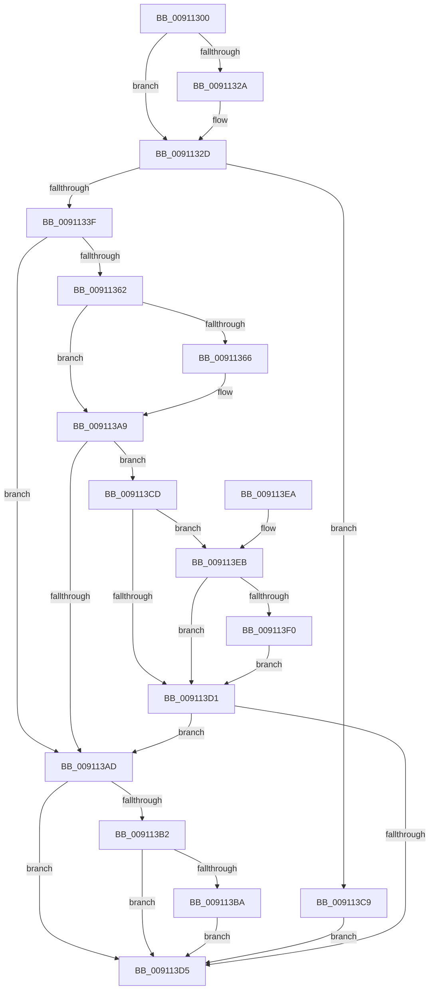

# IoGetLegacyVetoList

- RVA: `0x00911300`–`0x00911414` (길이 `276` bytes)
- VA: `0x0000000140911300`
- 실행 섹션: `PAGE`
- PDB 이름 있음: `예`; PDB Function 태그: `아니요`
- unwind 정보 RVA: `0x0008A1B4`
- 디코드: `78`개 명령, `276/276` bytes 표시
- 미해석 바이트: `0` (있으면 어셈블리에 `.byte`로 보존)

> 이 문서는 커널 이미지의 기계어와 PDB 기호를 분석해 생성했습니다. 4번과 5번은 함수 원형과 자료형을 바이너리 사용 방식에서 추정한 C 해석이며 원본 소스 복구 결과는 아닙니다.

## 1. Dependencies

- 직접 호출 지점: **7**; 고유 호출 대상: **7**
- 직접 호출자로 확인된 함수: **3**
- RIP 상대 이미지 참조: **4**

### Outgoing calls
- `0x00911356` → [IopGetLegacyVetoListDrivers](IopGetLegacyVetoListDrivers_function_00911814.md) (function, `0x00911814`)
- `0x00911380` → [ExAcquireResourceSharedLite](../../text/21/ExAcquireResourceSharedLite_function_00211BC0.md) (function, `0x00211BC0`)
- `0x00911390` → [IopGetLegacyVetoListDeviceNode](IopGetLegacyVetoListDeviceNode_function_00911ABC.md) (function, `0x00911ABC`)
- `0x0091139C` → [ExReleaseResourceLite](../../text/25/ExReleaseResourceLite_function_0025FA10.md) (function, `0x0025FA10`)
- `0x009113A1` → [KeLeaveCriticalRegion](../../text/25/KeLeaveCriticalRegion_function_0025D8B0.md) (function, `0x0025D8B0`)
- `0x009113BC` → [ExFreePoolWithTag](../../poolcode/B8/ExFreePoolWithTag_function_00B82870.md) (function, `0x00B82870`)
- `0x0091140A` → [IopAppendLegacyVeto](../73/IopAppendLegacyVeto_function_0073D310.md) (function, `0x0073D310`)

### Direct callers
- [PnpReplacePartitionUnit](../73/PnpReplacePartitionUnit_function_00738550.md) at `0x00738A6F`
- [ExpQueryLegacyDriverInformation](../7C/ExpQueryLegacyDriverInformation_function_007C4948.md) at `0x007C4979`
- [sub_00B33FE8](../B3/Unknown_function_00B33FE8.md) at `0x00B34080`

### Static image references
- `0x0091132D` → RVA `0x00F8C380` (`.data`; read)
- `0x0091136F` → RVA `0x00F8C560` (`.data`; read)
- `0x00911385` → RVA `0x00F8C438` (`.data`; read)
- `0x009113F0` → RVA `0x00AFCAD0` (` ?? ::NNGAKEGL::`string'`; read)

## 2. Other-region calls and transfers

- 다른 실행 섹션으로 향하는 call: **4**
  - `0x00911380` → [ExAcquireResourceSharedLite](../../text/21/ExAcquireResourceSharedLite_function_00211BC0.md) (`PAGE` → `.text`)
  - `0x0091139C` → [ExReleaseResourceLite](../../text/25/ExReleaseResourceLite_function_0025FA10.md) (`PAGE` → `.text`)
  - `0x009113A1` → [KeLeaveCriticalRegion](../../text/25/KeLeaveCriticalRegion_function_0025D8B0.md) (`PAGE` → `.text`)
  - `0x009113BC` → [ExFreePoolWithTag](../../poolcode/B8/ExFreePoolWithTag_function_00B82870.md) (`PAGE` → `POOLCODE`)
- 별도 외부 분기/꼬리 이동을 확인하지 못했습니다.

## 3. Assembly (complete function range)

```asm
00911300  48 89 5C 24 10                  mov qword ptr [rsp + 0x10], rbx
00911305  48 89 74 24 18                  mov qword ptr [rsp + 0x18], rsi
0091130A  48 89 7C 24 20                  mov qword ptr [rsp + 0x20], rdi
0091130F  55                              push rbp
00911310  48 8B EC                        mov rbp, rsp
00911313  48 83 EC 50                     sub rsp, 0x50
00911317  33 F6                           xor esi, esi
00911319  48 8B FA                        mov rdi, rdx
0091131C  89 75 EC                        mov dword ptr [rbp - 0x14], esi
0091131F  48 8B D9                        mov rbx, rcx
00911322  89 75 D4                        mov dword ptr [rbp - 0x2c], esi
00911325  48 85 C9                        test rcx, rcx
00911328  74 03                           je 0x14091132d
0091132A  48 89 31                        mov qword ptr [rcx], rsi
0091132D  40 38 35 4C B0 67 00            cmp byte ptr [rip + 0x67b04c], sil
00911334  89 32                           mov dword ptr [rdx], esi
00911336  89 75 10                        mov dword ptr [rbp + 0x10], esi
00911339  0F 84 8A 00 00 00               je 0x1409113c9
0091133F  48 8D 45 10                     lea rax, [rbp + 0x10]
00911343  48 89 5D E0                     mov qword ptr [rbp - 0x20], rbx
00911347  48 8D 4D E0                     lea rcx, [rbp - 0x20]
0091134B  48 89 45 F8                     mov qword ptr [rbp - 8], rax
0091134F  89 75 E8                        mov dword ptr [rbp - 0x18], esi
00911352  48 89 7D F0                     mov qword ptr [rbp - 0x10], rdi
00911356  E8 B9 04 00 00                  call 0x140911814
0091135B  8B 45 10                        mov eax, dword ptr [rbp + 0x10]
0091135E  85 C0                           test eax, eax
00911360  78 4B                           js 0x1409113ad
00911362  39 37                           cmp dword ptr [rdi], esi
00911364  75 43                           jne 0x1409113a9
00911366  65 48 8B 04 25 88 01 00 00      mov rax, qword ptr gs:[0x188]
0091136F  48 8D 0D EA B1 67 00            lea rcx, [rip + 0x67b1ea]
00911376  B2 01                           mov dl, 1
00911378  66 FF 88 E4 01 00 00            dec word ptr [rax + 0x1e4]
0091137F  90                              nop
00911380  E8 3B 08 90 FF                  call 0x140211bc0
00911385  48 8B 0D AC B0 67 00            mov rcx, qword ptr [rip + 0x67b0ac]
0091138C  48 8D 55 E0                     lea rdx, [rbp - 0x20]
00911390  E8 27 07 00 00                  call 0x140911abc
00911395  48 8D 0D C4 B1 67 00            lea rcx, [rip + 0x67b1c4]
0091139C  E8 6F E6 94 FF                  call 0x14025fa10
009113A1  E8 0A C5 94 FF                  call 0x14025d8b0
009113A6  8B 45 10                        mov eax, dword ptr [rbp + 0x10]
009113A9  85 C0                           test eax, eax
009113AB  79 20                           jns 0x1409113cd
009113AD  48 85 DB                        test rbx, rbx
009113B0  74 23                           je 0x1409113d5
009113B2  48 8B 0B                        mov rcx, qword ptr [rbx]
009113B5  48 85 C9                        test rcx, rcx
009113B8  74 1B                           je 0x1409113d5
009113BA  33 D2                           xor edx, edx
009113BC  E8 AF 14 27 00                  call 0x140b82870
009113C1  8B 45 10                        mov eax, dword ptr [rbp + 0x10]
009113C4  48 89 33                        mov qword ptr [rbx], rsi
009113C7  EB 0C                           jmp 0x1409113d5
009113C9  33 C0                           xor eax, eax
009113CB  EB 08                           jmp 0x1409113d5
009113CD  39 37                           cmp dword ptr [rdi], esi
009113CF  75 1A                           jne 0x1409113eb
009113D1  85 C0                           test eax, eax
009113D3  78 D8                           js 0x1409113ad
009113D5  48 8B 5C 24 68                  mov rbx, qword ptr [rsp + 0x68]
009113DA  48 8B 74 24 70                  mov rsi, qword ptr [rsp + 0x70]
009113DF  48 8B 7C 24 78                  mov rdi, qword ptr [rsp + 0x78]
009113E4  48 83 C4 50                     add rsp, 0x50
009113E8  5D                              pop rbp
009113E9  C3                              ret
009113EA  CC                              int3
009113EB  48 85 DB                        test rbx, rbx
009113EE  74 E1                           je 0x1409113d1
009113F0  48 8D 05 D9 B6 1E 00            lea rax, [rip + 0x1eb6d9]
009113F7  C7 45 D0 00 00 02 00            mov dword ptr [rbp - 0x30], 0x20000
009113FE  48 8D 55 D0                     lea rdx, [rbp - 0x30]
00911402  48 89 45 D8                     mov qword ptr [rbp - 0x28], rax
00911406  48 8D 4D E0                     lea rcx, [rbp - 0x20]
0091140A  E8 01 BF E2 FF                  call 0x14073d310
0091140F  8B 45 10                        mov eax, dword ptr [rbp + 0x10]
00911412  EB BD                           jmp 0x1409113d1
```

## 4. C-style interpretation (structured pseudocode)

```c
__int64 __fastcall IoGetLegacyVetoList(__int64 a1, __int64 a2)
{
    __int64 result;
    __int64 v_rsi;
    __int64 v_rsp;
    unsigned __int64 v_stack_m10;
    unsigned __int64 v_stack_m18;
    unsigned int v_stack_m1C;
    unsigned int v_stack_m20;
    unsigned __int64 v_stack_m28;
    unsigned __int64 v_stack_m30;
    unsigned int v_stack_m34;
    unsigned int v_stack_m38;
    unsigned __int64 v_stack_p10;
    unsigned __int64 v_stack_p18;
    unsigned __int64 v_stack_p20;
    unsigned int v_stack_p8;

    v_stack_p10 = v_rbx;
    v_stack_p18 = v_rsi;
    v_stack_p20 = v_rdi;
    v_rsp = (v_rsp) - (80);
    v_rsi = 0;
    v_stack_m1C = 0;
    v_stack_m34 = 0;
    if (a1 != 0) {
        *(unsigned __int64 *)(a1) = 0;
    }
    *(unsigned int *)(a2) = 0;
    v_stack_p8 = 0;
    if ((*(unsigned __int8 *)(v_rip + 6795340)) == 0) goto loc_009113C9;
    v_stack_m28 = a1;
    v_stack_m10 = v_stack_p8;
    v_stack_m20 = 0;
    v_stack_m18 = a2;
    result = IopGetLegacyVetoListDrivers(v_stack_m28, a2, a3, a4);
    if (sign_flag) goto loc_009113AD;
    result = (unsigned int)(v_stack_p8);
    if ((*(unsigned int *)(a2)) == 0) {
        result = *(unsigned __int64 *)(gs_base + (0 + 392));
        a1 = v_rip + 6795754;
        a2 = 1;
        result = ExAcquireResourceSharedLite(a1, a2, a3, a4);
        a1 = *(unsigned __int64 *)(v_rip + 6795436);
        a2 = v_stack_m28;
        result = IopGetLegacyVetoListDeviceNode(a1, a2, a3, a4);
        a1 = v_rip + 6795716;
        result = ExReleaseResourceLite(a1, a2, a3, a4);
        result = KeLeaveCriticalRegion(a1, a2, a3, a4);
        result = v_stack_p8;
    }
    if (!sign_flag) goto loc_009113CD;
loc_009113AD:
    if (a1 == 0) goto loc_009113D5;
    if (*(unsigned __int64 *)(a1) == 0) goto loc_009113D5;
    a2 = 0;
    result = ExFreePoolWithTag(*(unsigned __int64 *)(a1), a2, a3, a4);
    *(unsigned __int64 *)(a1) = 0;
    goto loc_009113D5;
loc_009113C9:
    result = 0;
    goto loc_009113D5;
loc_009113CD:
    if ((*(unsigned int *)(a2)) != 0) goto loc_009113EB;
loc_009113D1:
    if (sign_flag) goto loc_009113AD;
loc_009113D5:
    v_rsp = (v_rsp) + (80);
    return result;
loc_009113EB:
    if (v_stack_p10 == 0) goto loc_009113D1;
    v_stack_m38 = 0x20000ULL;
    v_stack_m30 = v_rip + 2012889;
    result = IopAppendLegacyVeto(v_stack_m28, v_stack_m38, a3, a4);
    goto loc_009113D1;
}
```

## 5. (Beta) C Style

```c
int64_t IoGetLegacyVetoList(int64_t Arg1, void *Arg2)
{
    uint8_t *arg2 = (uint8_t *)Arg2;

    int64_t result;
    int64_t local_rsi;
    int64_t local_rsp;
    uint64_t v_stack_m10;
    uint64_t v_stack_m18;
    uint32_t v_stack_m1C;
    uint32_t v_stack_m20;
    uint64_t v_stack_m28;
    uint64_t v_stack_m30;
    uint32_t v_stack_m34;
    uint32_t v_stack_m38;
    uint64_t v_stack_p10;
    uint64_t v_stack_p18;
    uint64_t v_stack_p20;
    uint32_t v_stack_p8;

    v_stack_p10 = local_rbx;
    v_stack_p18 = local_rsi;
    v_stack_p20 = local_rdi;
    local_rsp = (local_rsp) - (80);
    local_rsi = 0;
    v_stack_m1C = 0;
    v_stack_m34 = 0;
    if (Arg1 != 0) {
        *(uint64_t *)(Arg1) = 0;
    }
    *(uint32_t *)(arg2) = 0;
    v_stack_p8 = 0;
    if ((*(uint8_t *)(v_rip + 0x67B04C)) == 0) goto loc_009113C9;
    v_stack_m28 = Arg1;
    v_stack_m10 = v_stack_p8;
    v_stack_m20 = 0;
    v_stack_m18 = Arg2;
    result = IopGetLegacyVetoListDrivers(v_stack_m28, Arg2, a3, a4);
    if (sign_flag) goto loc_009113AD;
    result = (uint32_t)(v_stack_p8);
    if ((*(uint32_t *)(arg2)) == 0) {
        result = *(uint64_t *)(gs_base + (0 + 0x188));
        Arg1 = v_rip + 6795754;
        Arg2 = 1;
        result = ExAcquireResourceSharedLite(Arg1, Arg2, a3, a4);
        Arg1 = *(uint64_t *)(v_rip + 0x67B0AC);
        Arg2 = v_stack_m28;
        result = IopGetLegacyVetoListDeviceNode(Arg1, Arg2, a3, a4);
        Arg1 = v_rip + 6795716;
        result = ExReleaseResourceLite(Arg1, Arg2, a3, a4);
        result = KeLeaveCriticalRegion(Arg1, Arg2, a3, a4);
        result = v_stack_p8;
    }
    if (!sign_flag) goto loc_009113CD;
loc_009113AD:
    if (Arg1 == 0) goto loc_009113D5;
    if (*(uint64_t *)(Arg1) == 0) goto loc_009113D5;
    Arg2 = 0;
    result = ExFreePoolWithTag(*(uint64_t *)(Arg1), Arg2, a3, a4);
    *(uint64_t *)(Arg1) = 0;
    goto loc_009113D5;
loc_009113C9:
    result = 0;
    goto loc_009113D5;
loc_009113CD:
    if ((*(uint32_t *)(arg2)) != 0) goto loc_009113EB;
loc_009113D1:
    if (sign_flag) goto loc_009113AD;
loc_009113D5:
    local_rsp = (local_rsp) + (80);
    return result;
loc_009113EB:
    if (v_stack_p10 == 0) goto loc_009113D1;
    v_stack_m38 = 0x20000ULL;
    v_stack_m30 = v_rip + 2012889;
    result = IopAppendLegacyVeto(v_stack_m28, v_stack_m38, a3, a4);
    goto loc_009113D1;
}
```

### 관측된 메모리 오프셋

구조체 형식이 확인되지 않은 접근은 인자 기준의 오프셋으로만 기록했습니다.

| 기준 인자 | 오프셋 표현 | 폭 (bit) | 접근 |
|---|---:|---:|---|
| `Arg2` | `+ 0x0` | `32` | `R` |
| `Arg2` | `+ 0x0` | `32` | `W` |

## 6. Execution-region graph

[열기: 2D/3D 그래프와 함수 탐색 컨트롤 패널](../../../control-panel.html?section=page&rva=0x00911300&view=graph)

- 2D 그래프는 위에서 아래로 흐르고, 3D 그래프는 빈 공간을 드래그해 회전합니다. Shift+드래그는 이동, 휠은 확대·축소, 함수 노드 선택은 대상 보고서 이동입니다.

### Static fallback


