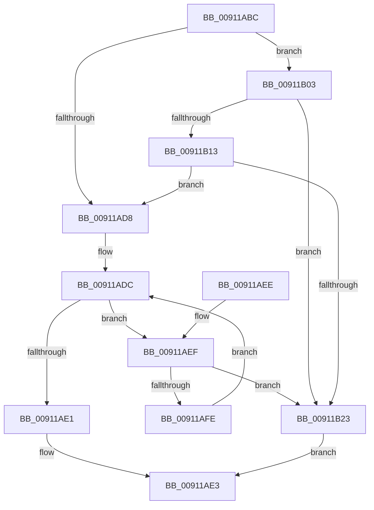

# IopGetLegacyVetoListDeviceNode

- RVA: `0x00911ABC`–`0x00911B27` (길이 `107` bytes)
- VA: `0x0000000140911ABC`
- 실행 섹션: `PAGE`
- PDB 이름 있음: `예`; PDB Function 태그: `아니요`
- unwind 정보 RVA: `0x00088A30`
- 디코드: `34`개 명령, `107/107` bytes 표시
- 미해석 바이트: `0` (있으면 어셈블리에 `.byte`로 보존)

> 이 문서는 커널 이미지의 기계어와 PDB 기호를 분석해 생성했습니다. 4번과 5번은 함수 원형과 자료형을 바이너리 사용 방식에서 추정한 C 해석이며 원본 소스 복구 결과는 아닙니다.

## 1. Dependencies

- 직접 호출 지점: **2**; 고유 호출 대상: **2**
- 직접 호출자로 확인된 함수: **3**
- RIP 상대 이미지 참조: **0**

### Outgoing calls
- `0x00911AF5` → [IopGetLegacyVetoListDeviceNode](IopGetLegacyVetoListDeviceNode_function_00911ABC.md) (function, `0x00911ABC`)
- `0x00911B1A` → [IopAppendLegacyVeto](../73/IopAppendLegacyVeto_function_0073D310.md) (function, `0x0073D310`)

### Direct callers
- [IoGetLegacyVetoList](IoGetLegacyVetoList_function_00911300.md) at `0x00911390`
- [PopFilterCapabilities](PopFilterCapabilities_function_0091141C.md) at `0x009114E5`
- [IopGetLegacyVetoListDeviceNode](IopGetLegacyVetoListDeviceNode_function_00911ABC.md) at `0x00911AF5`

### Static image references
- 디코드된 RIP-relative 메모리 참조가 없습니다.

## 2. Other-region calls and transfers

- 다른 실행 섹션으로 향하는 call: **0**
- 별도 외부 분기/꼬리 이동을 확인하지 못했습니다.

## 3. Assembly (complete function range)

```asm
00911ABC  48 89 5C 24 08                  mov qword ptr [rsp + 8], rbx
00911AC1  57                              push rdi
00911AC2  48 83 EC 20                     sub rsp, 0x20
00911AC6  F7 81 30 02 00 00 00 80 00 00   test dword ptr [rcx + 0x230], 0x8000
00911AD0  48 8B FA                        mov rdi, rdx
00911AD3  48 8B D9                        mov rbx, rcx
00911AD6  75 2B                           jne 0x140911b03
00911AD8  48 8B 5B 08                     mov rbx, qword ptr [rbx + 8]
00911ADC  48 85 DB                        test rbx, rbx
00911ADF  75 0E                           jne 0x140911aef
00911AE1  B0 01                           mov al, 1
00911AE3  48 8B 5C 24 30                  mov rbx, qword ptr [rsp + 0x30]
00911AE8  48 83 C4 20                     add rsp, 0x20
00911AEC  5F                              pop rdi
00911AED  C3                              ret
00911AEE  CC                              int3
00911AEF  48 8B D7                        mov rdx, rdi
00911AF2  48 8B CB                        mov rcx, rbx
00911AF5  E8 C2 FF FF FF                  call 0x140911abc
00911AFA  84 C0                           test al, al
00911AFC  74 25                           je 0x140911b23
00911AFE  48 8B 1B                        mov rbx, qword ptr [rbx]
00911B01  EB D9                           jmp 0x140911adc
00911B03  48 83 3A 00                     cmp qword ptr [rdx], 0
00911B07  48 8B 42 10                     mov rax, qword ptr [rdx + 0x10]
00911B0B  C7 00 01 00 00 00               mov dword ptr [rax], 1
00911B11  74 10                           je 0x140911b23
00911B13  48 8D 51 28                     lea rdx, [rcx + 0x28]
00911B17  48 8B CF                        mov rcx, rdi
00911B1A  E8 F1 B7 E2 FF                  call 0x14073d310
00911B1F  84 C0                           test al, al
00911B21  75 B5                           jne 0x140911ad8
00911B23  32 C0                           xor al, al
00911B25  EB BC                           jmp 0x140911ae3
```

## 4. C-style interpretation (structured pseudocode)

```c
__int64 __fastcall IopGetLegacyVetoListDeviceNode(__int64 a1, __int64 a2)
{
    __int64 result;
    __int64 v_rsp;
    unsigned __int64 v_stack_p8;

    v_stack_p8 = v_rbx;
    v_rsp = (v_rsp) - (32);
    if (((*(unsigned int *)(a1 + 560)) & (0x8000ULL)) != 0) goto loc_00911B03;
loc_00911AD8:
loc_00911ADC:
    if (*(unsigned __int64 *)(a1 + 8) != 0) goto loc_00911AEF;
loc_00911AE3:
    v_rsp = (v_rsp) + (32);
    return 1;
loc_00911AEF:
    result = IopGetLegacyVetoListDeviceNode(v_stack_p8, a2, a3, a4);
    if ((unsigned __int8)(result) == 0) goto loc_00911B23;
    goto loc_00911ADC;
loc_00911B03:
    *(unsigned int *)(*(unsigned __int64 *)(a2 + 16)) = 1;
    if ((*(unsigned __int64 *)(a2)) == 0) goto loc_00911B23;
    result = IopAppendLegacyVeto(a2, v_stack_p8 + 40, a3, a4);
    if ((unsigned __int8)(result) != 0) goto loc_00911AD8;
loc_00911B23:
    result = 0;
    goto loc_00911AE3;
}
```

## 5. (Beta) C Style

```c
int64_t IopGetLegacyVetoListDeviceNode(void *Arg1, void *Arg2)
{
    uint8_t *arg1 = (uint8_t *)Arg1;
    uint8_t *arg2 = (uint8_t *)Arg2;

    int64_t result;
    int64_t local_rsp;
    uint64_t v_stack_p8;

    v_stack_p8 = local_rbx;
    local_rsp = (local_rsp) - (32);
    if (((*(uint32_t *)(arg1 + 0x230)) & (0x8000ULL)) != 0) goto loc_00911B03;
loc_00911AD8:
loc_00911ADC:
    if (*(uint64_t *)(arg1 + 0x8) != 0) goto loc_00911AEF;
loc_00911AE3:
    local_rsp = (local_rsp) + (32);
    return 1;
loc_00911AEF:
    result = IopGetLegacyVetoListDeviceNode(v_stack_p8, Arg2, a3, a4);
    if ((uint8_t)(result) == 0) goto loc_00911B23;
    goto loc_00911ADC;
loc_00911B03:
    *(uint32_t *)(*(uint64_t *)(arg2 + 0x10)) = 1;
    if ((*(uint64_t *)(arg2)) == 0) goto loc_00911B23;
    result = IopAppendLegacyVeto(Arg2, v_stack_p8 + 40, a3, a4);
    if ((uint8_t)(result) != 0) goto loc_00911AD8;
loc_00911B23:
    result = 0;
    goto loc_00911AE3;
}
```

### 관측된 메모리 오프셋

구조체 형식이 확인되지 않은 접근은 인자 기준의 오프셋으로만 기록했습니다.

| 기준 인자 | 오프셋 표현 | 폭 (bit) | 접근 |
|---|---:|---:|---|
| `Arg1` | `+ 0x8` | `64` | `R` |
| `Arg1` | `+ 0x28` | `64` | `R` |
| `Arg1` | `+ 0x230` | `32` | `R` |
| `Arg2` | `+ 0x0` | `64` | `R` |
| `Arg2` | `+ 0x10` | `64` | `R` |

## 6. Execution-region graph

[열기: 2D/3D 그래프와 함수 탐색 컨트롤 패널](../../../control-panel.html?section=page&rva=0x00911ABC&view=graph)

- 2D 그래프는 위에서 아래로 흐르고, 3D 그래프는 빈 공간을 드래그해 회전합니다. Shift+드래그는 이동, 휠은 확대·축소, 함수 노드 선택은 대상 보고서 이동입니다.

### Static fallback


