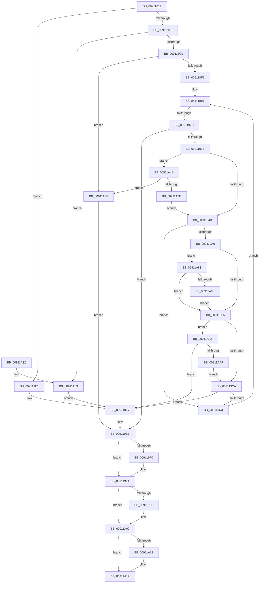

# IopGetLegacyVetoListDrivers

- RVA: `0x00911814`–`0x00911AB4` (길이 `672` bytes)
- VA: `0x0000000140911814`
- 실행 섹션: `PAGE`
- PDB 이름 있음: `예`; PDB Function 태그: `예`
- unwind 정보 RVA: `0x0008A220`
- 디코드: `170`개 명령, `672/672` bytes 표시
- 미해석 바이트: `0` (있으면 어셈블리에 `.byte`로 보존)

> 이 문서는 커널 이미지의 기계어와 PDB 기호를 분석해 생성했습니다. 4번과 5번은 함수 원형과 자료형을 바이너리 사용 방식에서 추정한 C 해석이며 원본 소스 복구 결과는 아닙니다.

## 1. Dependencies

- 직접 호출 지점: **13**; 고유 호출 대상: **9**
- 직접 호출자로 확인된 함수: **2**
- RIP 상대 이미지 참조: **3**

### Outgoing calls
- `0x00911893` → [ZwOpenDirectoryObject](../../text/6A/ZwOpenDirectoryObject_function_006ADBD0.md) (function, `0x006ADBD0`)
- `0x009118B8` → [ExAllocatePool2](../../poolcode/B8/ExAllocatePool2_function_00B820F0.md) (function, `0x00B820F0`)
- `0x009118E0` → [ExAllocatePool2](../../poolcode/B8/ExAllocatePool2_function_00B820F0.md) (function, `0x00B820F0`)
- `0x0091191D` → [ZwQueryDirectoryObject](../../text/6A/ZwQueryDirectoryObject_function_006AFAB0.md) (function, `0x006AFAB0`)
- `0x00911967` → [RtlStringCbPrintfW](../../text/40/RtlStringCbPrintfW_function_0040FB40.md) (function, `0x0040FB40`)
- `0x0091199D` → [ObReferenceObjectByName](../8C/ObReferenceObjectByName_function_008C4A00.md) (function, `0x008C4A00`)
- `0x009119B8` → [ObfDereferenceObject](../../text/2F/ObfDereferenceObject_function_002F9350.md) (function, `0x002F9350`)
- `0x009119F5` → [ExFreePoolWithTag](../../poolcode/B8/ExFreePoolWithTag_function_00B82870.md) (function, `0x00B82870`)
- `0x00911A04` → [ExFreePoolWithTag](../../poolcode/B8/ExFreePoolWithTag_function_00B82870.md) (function, `0x00B82870`)
- `0x00911A12` → [ZwClose](../../text/6A/ZwClose_function_006AD2B0.md) (function, `0x006AD2B0`)
- `0x00911A50` → [ExFreePoolWithTag](../../poolcode/B8/ExFreePoolWithTag_function_00B82870.md) (function, `0x00B82870`)
- `0x00911A6D` → [ExAllocatePool2](../../poolcode/B8/ExAllocatePool2_function_00B820F0.md) (function, `0x00B820F0`)
- `0x00911A9C` → [IopAppendLegacyVeto](../73/IopAppendLegacyVeto_function_0073D310.md) (function, `0x0073D310`)

### Direct callers
- [IoGetLegacyVetoList](IoGetLegacyVetoList_function_00911300.md) at `0x00911356`
- [PopFilterCapabilities](PopFilterCapabilities_function_0091141C.md) at `0x009114A1`

### Static image references
- `0x00911842` → RVA `0x00AFFFF0` (` ?? ::NNGAKEGL::`string'`; read)
- `0x0091194F` → RVA `0x00B00000` (` ?? ::NNGAKEGL::`string'`; read)
- `0x0091197C` → RVA `0x00FC6C78` (`ALMOSTRO`; read)

## 2. Other-region calls and transfers

- 다른 실행 섹션으로 향하는 call: **11**
  - `0x00911893` → [ZwOpenDirectoryObject](../../text/6A/ZwOpenDirectoryObject_function_006ADBD0.md) (`PAGE` → `.text`)
  - `0x009118B8` → [ExAllocatePool2](../../poolcode/B8/ExAllocatePool2_function_00B820F0.md) (`PAGE` → `POOLCODE`)
  - `0x009118E0` → [ExAllocatePool2](../../poolcode/B8/ExAllocatePool2_function_00B820F0.md) (`PAGE` → `POOLCODE`)
  - `0x0091191D` → [ZwQueryDirectoryObject](../../text/6A/ZwQueryDirectoryObject_function_006AFAB0.md) (`PAGE` → `.text`)
  - `0x00911967` → [RtlStringCbPrintfW](../../text/40/RtlStringCbPrintfW_function_0040FB40.md) (`PAGE` → `.text`)
  - `0x009119B8` → [ObfDereferenceObject](../../text/2F/ObfDereferenceObject_function_002F9350.md) (`PAGE` → `.text`)
  - `0x009119F5` → [ExFreePoolWithTag](../../poolcode/B8/ExFreePoolWithTag_function_00B82870.md) (`PAGE` → `POOLCODE`)
  - `0x00911A04` → [ExFreePoolWithTag](../../poolcode/B8/ExFreePoolWithTag_function_00B82870.md) (`PAGE` → `POOLCODE`)
  - `0x00911A12` → [ZwClose](../../text/6A/ZwClose_function_006AD2B0.md) (`PAGE` → `.text`)
  - `0x00911A50` → [ExFreePoolWithTag](../../poolcode/B8/ExFreePoolWithTag_function_00B82870.md) (`PAGE` → `POOLCODE`)
  - `0x00911A6D` → [ExAllocatePool2](../../poolcode/B8/ExAllocatePool2_function_00B820F0.md) (`PAGE` → `POOLCODE`)
- call이 아닌 외부 분기/꼬리 이동: **1**
  - `0x00911927` → [sub_00B2173C](../B2/Unknown_function_00B2173C.md) (`tail-transfer`)

## 3. Assembly (complete function range)

```asm
00911814  48 89 5C 24 08                  mov qword ptr [rsp + 8], rbx
00911819  55                              push rbp
0091181A  56                              push rsi
0091181B  57                              push rdi
0091181C  41 54                           push r12
0091181E  41 55                           push r13
00911820  41 56                           push r14
00911822  41 57                           push r15
00911824  48 8D 6C 24 D9                  lea rbp, [rsp - 0x27]
00911829  48 81 EC A0 00 00 00            sub rsp, 0xa0
00911830  45 33 F6                        xor r14d, r14d
00911833  48 C7 45 EF 30 00 00 00         mov qword ptr [rbp - 0x11], 0x30
0091183B  0F 57 C0                        xorps xmm0, xmm0
0091183E  4C 89 75 C7                     mov qword ptr [rbp - 0x39], r14
00911842  48 8D 05 A7 E7 1E 00            lea rax, [rip + 0x1ee7a7]
00911849  48 C7 45 07 40 02 00 00         mov qword ptr [rbp + 7], 0x240
00911851  48 89 45 E7                     mov qword ptr [rbp - 0x19], rax
00911855  4C 8D 45 EF                     lea r8, [rbp - 0x11]
00911859  48 8B F9                        mov rdi, rcx
0091185C  48 C7 45 DF 0E 00 10 00         mov qword ptr [rbp - 0x21], 0x10000e
00911864  48 8D 45 DF                     lea rax, [rbp - 0x21]
00911868  44 89 75 6F                     mov dword ptr [rbp + 0x6f], r14d
0091186C  41 8D 56 01                     lea edx, [r14 + 1]
00911870  44 89 75 77                     mov dword ptr [rbp + 0x77], r14d
00911874  48 8D 4D 7F                     lea rcx, [rbp + 0x7f]
00911878  4C 89 75 7F                     mov qword ptr [rbp + 0x7f], r14
0091187C  41 8B F6                        mov esi, r14d
0091187F  4C 89 75 F7                     mov qword ptr [rbp - 9], r14
00911883  41 B5 01                        mov r13b, 1
00911886  48 89 45 FF                     mov qword ptr [rbp - 1], rax
0091188A  0F 11 45 CF                     movups xmmword ptr [rbp - 0x31], xmm0
0091188E  F3 0F 7F 45 0F                  movdqu xmmword ptr [rbp + 0xf], xmm0
00911893  E8 38 C3 D9 FF                  call 0x1406adbd0
00911898  8B C8                           mov ecx, eax
0091189A  85 C0                           test eax, eax
0091189C  0F 88 3F 01 00 00               js 0x1409119e1
009118A2  41 BC CA 00 00 00               mov r12d, 0xca
009118A8  BB 50 70 69 6F                  mov ebx, 0x6f697050
009118AD  44 8B C3                        mov r8d, ebx
009118B0  41 8B D4                        mov edx, r12d
009118B3  41 8D 4C 24 36                  lea ecx, [r12 + 0x36]
009118B8  E8 33 08 27 00                  call 0x140b820f0
009118BD  48 8B F0                        mov rsi, rax
009118C0  48 85 C0                        test rax, rax
009118C3  0F 84 6A 01 00 00               je 0x140911a33
009118C9  45 8D 7C 24 F2                  lea r15d, [r12 - 0xe]
009118CE  C7 45 CF 00 00 BC 00            mov dword ptr [rbp - 0x31], 0xbc0000
009118D5  41 8B D7                        mov edx, r15d
009118D8  41 8D 4C 24 36                  lea ecx, [r12 + 0x36]
009118DD  44 8B C3                        mov r8d, ebx
009118E0  E8 0B 08 27 00                  call 0x140b820f0
009118E5  48 89 45 D7                     mov qword ptr [rbp - 0x29], rax
009118E9  48 8B D8                        mov rbx, rax
009118EC  48 85 C0                        test rax, rax
009118EF  0F 84 4A 01 00 00               je 0x140911a3f
009118F5  66 44 89 30                     mov word ptr [rax], r14w
009118F9  48 8B 4D 7F                     mov rcx, qword ptr [rbp + 0x7f]
009118FD  48 8D 45 6F                     lea rax, [rbp + 0x6f]
00911901  48 89 44 24 30                  mov qword ptr [rsp + 0x30], rax
00911906  41 B1 01                        mov r9b, 1
00911909  48 8D 45 77                     lea rax, [rbp + 0x77]
0091190D  45 8B C4                        mov r8d, r12d
00911910  48 89 44 24 28                  mov qword ptr [rsp + 0x28], rax
00911915  48 8B D6                        mov rdx, rsi
00911918  44 88 6C 24 20                  mov byte ptr [rsp + 0x20], r13b
0091191D  E8 8E E1 D9 FF                  call 0x1406afab0
00911922  3D 23 00 00 C0                  cmp eax, 0xc0000023
00911927  0F 84 0F FE 20 00               je 0x140b2173c
0091192D  45 8A EE                        mov r13b, r14b
00911930  85 C0                           test eax, eax
00911932  0F 88 B3 00 00 00               js 0x1409119eb
00911938  44 0F B7 36                     movzx r14d, word ptr [rsi]
0091193C  66 41 83 C6 12                  add r14w, 0x12
00911941  66 45 3B F7                     cmp r14w, r15w
00911945  0F 87 00 01 00 00               ja 0x140911a4b
0091194B  4C 8B 4E 08                     mov r9, qword ptr [rsi + 8]
0091194F  4C 8D 05 AA E6 1E 00            lea r8, [rip + 0x1ee6aa]
00911956  66 41 83 EE 02                  sub r14w, 2
0091195B  41 0F B7 D7                     movzx edx, r15w
0091195F  48 8B CB                        mov rcx, rbx
00911962  66 44 89 75 CF                  mov word ptr [rbp - 0x31], r14w
00911967  E8 D4 E1 AF FF                  call 0x14040fb40
0091196C  48 8D 45 C7                     lea rax, [rbp - 0x39]
00911970  45 33 F6                        xor r14d, r14d
00911973  48 89 44 24 38                  mov qword ptr [rsp + 0x38], rax
00911978  48 8D 4D CF                     lea rcx, [rbp - 0x31]
0091197C  48 8B 05 F5 52 6B 00            mov rax, qword ptr [rip + 0x6b52f5]
00911983  45 33 C9                        xor r9d, r9d
00911986  4C 89 74 24 30                  mov qword ptr [rsp + 0x30], r14
0091198B  45 33 C0                        xor r8d, r8d
0091198E  44 88 74 24 28                  mov byte ptr [rsp + 0x28], r14b
00911993  BA 40 02 00 00                  mov edx, 0x240
00911998  48 89 44 24 20                  mov qword ptr [rsp + 0x20], rax
0091199D  E8 5E 30 FB FF                  call 0x1408c4a00
009119A2  85 C0                           test eax, eax
009119A4  78 2D                           js 0x1409119d3
009119A6  48 8B 5D C7                     mov rbx, qword ptr [rbp - 0x39]
009119AA  8B 43 10                        mov eax, dword ptr [rbx + 0x10]
009119AD  A8 40                           test al, 0x40
009119AF  0F 85 CE 00 00 00               jne 0x140911a83
009119B5  48 8B CB                        mov rcx, rbx
009119B8  E8 93 79 9E FF                  call 0x1402f9350
009119BD  48 8B 47 10                     mov rax, qword ptr [rdi + 0x10]
009119C1  83 38 0B                        cmp dword ptr [rax], 0xb
009119C4  0F 84 DC 00 00 00               je 0x140911aa6
009119CA  48 8B 47 18                     mov rax, qword ptr [rdi + 0x18]
009119CE  44 39 30                        cmp dword ptr [rax], r14d
009119D1  7C 14                           jl 0x1409119e7
009119D3  48 8B 5D D7                     mov rbx, qword ptr [rbp - 0x29]
009119D7  44 0F B7 7D D1                  movzx r15d, word ptr [rbp - 0x2f]
009119DC  E9 18 FF FF FF                  jmp 0x1409118f9
009119E1  48 8B 47 18                     mov rax, qword ptr [rdi + 0x18]
009119E5  89 08                           mov dword ptr [rax], ecx
009119E7  48 8B 5D D7                     mov rbx, qword ptr [rbp - 0x29]
009119EB  48 85 DB                        test rbx, rbx
009119EE  74 0A                           je 0x1409119fa
009119F0  33 D2                           xor edx, edx
009119F2  48 8B CB                        mov rcx, rbx
009119F5  E8 76 0E 27 00                  call 0x140b82870
009119FA  48 85 F6                        test rsi, rsi
009119FD  74 0A                           je 0x140911a09
009119FF  33 D2                           xor edx, edx
00911A01  48 8B CE                        mov rcx, rsi
00911A04  E8 67 0E 27 00                  call 0x140b82870
00911A09  48 8B 4D 7F                     mov rcx, qword ptr [rbp + 0x7f]
00911A0D  48 85 C9                        test rcx, rcx
00911A10  74 05                           je 0x140911a17
00911A12  E8 99 B8 D9 FF                  call 0x1406ad2b0
00911A17  48 8B 9C 24 E0 00 00 00         mov rbx, qword ptr [rsp + 0xe0]
00911A1F  48 81 C4 A0 00 00 00            add rsp, 0xa0
00911A26  41 5F                           pop r15
00911A28  41 5E                           pop r14
00911A2A  41 5D                           pop r13
00911A2C  41 5C                           pop r12
00911A2E  5F                              pop rdi
00911A2F  5E                              pop rsi
00911A30  5D                              pop rbp
00911A31  C3                              ret
00911A32  CC                              int3
00911A33  48 8B 4F 18                     mov rcx, qword ptr [rdi + 0x18]
00911A37  C7 01 9A 00 00 C0               mov dword ptr [rcx], 0xc000009a
00911A3D  EB A8                           jmp 0x1409119e7
00911A3F  48 8B 47 18                     mov rax, qword ptr [rdi + 0x18]
00911A43  C7 00 9A 00 00 C0               mov dword ptr [rax], 0xc000009a
00911A49  EB A0                           jmp 0x1409119eb
00911A4B  33 D2                           xor edx, edx
00911A4D  48 8B CB                        mov rcx, rbx
00911A50  E8 1B 0E 27 00                  call 0x140b82870
00911A55  41 0F B7 D6                     movzx edx, r14w
00911A59  B9 00 01 00 00                  mov ecx, 0x100
00911A5E  41 B8 50 70 69 6F               mov r8d, 0x6f697050
00911A64  66 44 89 75 D1                  mov word ptr [rbp - 0x2f], r14w
00911A69  45 0F B7 FE                     movzx r15d, r14w
00911A6D  E8 7E 06 27 00                  call 0x140b820f0
00911A72  48 89 45 D7                     mov qword ptr [rbp - 0x29], rax
00911A76  48 8B D8                        mov rbx, rax
00911A79  48 85 C0                        test rax, rax
00911A7C  74 C1                           je 0x140911a3f
00911A7E  E9 C8 FE FF FF                  jmp 0x14091194b
00911A83  48 8B 47 10                     mov rax, qword ptr [rdi + 0x10]
00911A87  C7 00 0B 00 00 00               mov dword ptr [rax], 0xb
00911A8D  4C 39 37                        cmp qword ptr [rdi], r14
00911A90  0F 84 1F FF FF FF               je 0x1409119b5
00911A96  48 8B D6                        mov rdx, rsi
00911A99  48 8B CF                        mov rcx, rdi
00911A9C  E8 6F B8 E2 FF                  call 0x14073d310
00911AA1  E9 0F FF FF FF                  jmp 0x1409119b5
00911AA6  4C 39 37                        cmp qword ptr [rdi], r14
00911AA9  0F 84 38 FF FF FF               je 0x1409119e7
00911AAF  E9 16 FF FF FF                  jmp 0x1409119ca
```

## 4. C-style interpretation (structured pseudocode)

```c
__int64 __fastcall IopGetLegacyVetoListDrivers(__int64 a1)
{
    __int64 result;
    __int64 v_r14;
    __int64 v_rsp;
    unsigned __int64 v_stack_m50;
    unsigned __int64 v_stack_m58;
    unsigned __int64 v_stack_m5F;
    unsigned __int64 v_stack_m60;
    unsigned __int64 v_stack_m68;
    unsigned __int64 v_stack_m70;
    unsigned __int64 v_stack_m78;
    unsigned __int64 v_stack_m80;
    unsigned __int64 v_stack_m88;
    unsigned __int16 v_stack_m8E;
    unsigned __int64 v_stack_m90;
    unsigned __int64 v_stack_m98;
    unsigned __int64 v_stack_mA0;
    unsigned __int64 v_stack_mA8;
    unsigned __int64 v_stack_mB0;
    unsigned __int8 v_stack_mB8;
    unsigned int v_stack_p10;
    unsigned int v_stack_p18;
    unsigned __int64 v_stack_p20;
    unsigned __int64 v_stack_p8;

    v_stack_p8 = v_rbx;
    v_rsp = (v_rsp) - (160);
    v_r14 = 0;
    v_stack_m70 = 48;
    v_stack_m98 = 0;
    v_stack_m58 = 576;
    v_stack_m78 = v_rip + 2025383;
    v_stack_m80 = 0x10000EULL;
    v_stack_p10 = 0;
    v_stack_p18 = 0;
    v_stack_p20 = 0;
    v_stack_m68 = 0;
    v_stack_m60 = v_stack_m80;
    v_stack_m90 = v_xmm0;
    v_stack_m50 = v_xmm0;
    result = ZwOpenDirectoryObject(v_stack_p20, v_r14 + 1, v_stack_m70, a4);
    if (sign_flag) goto loc_009119E1;
    result = ExAllocatePool2(202 + 54, 202, (unsigned int)((unsigned int)((unsigned int)(0x6F697050ULL))), a4);
    if (result == 0) goto loc_00911A33;
    v_stack_m90 = 0xBC0000ULL;
    result = ExAllocatePool2(202 + 54, (unsigned int)((unsigned int)(202 - 14)), (unsigned int)((unsigned int)((unsigned int)(0x6F697050ULL))), a4);
    v_stack_m88 = result;
    if (result == 0) goto loc_00911A3F;
    *(unsigned __int16 *)(result) = 0;
loc_009118F9:
    v_stack_mA8 = v_stack_p10;
    v_stack_mB0 = v_stack_p18;
    v_stack_mB8 = 1;
    result = ZwQueryDirectoryObject(v_stack_p20, result, 202, 1);
    if (sign_flag) goto loc_009119EB;
    v_r14 = (unsigned __int16)((*(unsigned __int16 *)(result)) + (18));
    if (((unsigned __int16)(v_r14)) > ((unsigned __int16)(202 - 14))) goto loc_00911A4B;
loc_0091194B:
    v_r14 = (unsigned __int16)((v_r14) - (2));
    v_stack_m90 = (unsigned __int16)(v_r14);
    result = RtlStringCbPrintfW(result, (unsigned __int16)(202 - 14), v_rip + 2025130, *(unsigned __int64 *)(result + 8));
    v_r14 = 0;
    v_stack_mA0 = v_stack_m98;
    a4 = 0;
    v_stack_mA8 = 0;
    a3 = 0;
    v_stack_mB0 = 0;
    v_stack_mB8 = *(unsigned __int64 *)(v_rip + 7033589);
    result = ObReferenceObjectByName(v_stack_m90, 576, a3, a4);
    if (sign_flag) goto loc_009119D3;
    if ((((unsigned __int8)((unsigned int)(*(unsigned int *)(v_stack_m98 + 16)))) & (64)) != 0) goto loc_00911A83;
loc_009119B5:
    result = ObfDereferenceObject(v_stack_m98, 576, a3, a4);
    if ((*(unsigned int *)(*(unsigned __int64 *)(a1 + 16))) == 11) goto loc_00911AA6;
loc_009119CA:
    if ((*(unsigned int *)(*(unsigned __int64 *)(a1 + 24))) < 0) goto loc_009119E7;
loc_009119D3:
    goto loc_009118F9;
loc_009119E1:
    *(unsigned int *)(*(unsigned __int64 *)(a1 + 24)) = (unsigned int)(v_stack_m98);
loc_009119E7:
loc_009119EB:
    result = *(unsigned __int64 *)(a1 + 24);
    if (v_stack_m88 != 0) {
        a2 = 0;
        a1 = v_stack_m88;
        result = ExFreePoolWithTag(a1, a2, a3, a4);
    }
    if (result != 0) {
        a2 = 0;
        a1 = result;
        result = ExFreePoolWithTag(a1, a2, a3, a4);
    }
    if (v_stack_p20 != 0) {
        result = ZwClose(v_stack_p20, a2, a3, a4);
    }
    v_rsp = (v_rsp) + (160);
    return result;
loc_00911A33:
    *(unsigned int *)(*(unsigned __int64 *)(a1 + 24)) = 0xC000009AULL;
    goto loc_009119E7;
loc_00911A3F:
    *(unsigned int *)(*(unsigned __int64 *)(a1 + 24)) = 0xC000009AULL;
    goto loc_009119EB;
loc_00911A4B:
    a2 = 0;
    result = ExFreePoolWithTag(v_stack_p8, a2, a3, a4);
    v_stack_m8E = 0;
    result = ExAllocatePool2(256, 0, (unsigned int)(0x6F697050ULL), a4);
    v_stack_m88 = result;
    if (result == 0) goto loc_00911A3F;
    goto loc_0091194B;
loc_00911A83:
    *(unsigned int *)(*(unsigned __int64 *)(a1 + 16)) = 11;
    if ((*(unsigned __int64 *)(a1)) == 0) goto loc_009119B5;
    result = IopAppendLegacyVeto(a1, result, (unsigned int)(0x6F697050ULL), a4);
    goto loc_009119B5;
loc_00911AA6:
    if ((*(unsigned __int64 *)(a1)) == 0) goto loc_009119E7;
    goto loc_009119CA;
}
```

## 5. (Beta) C Style

```c
int64_t IopGetLegacyVetoListDrivers(void *Arg1)
{
    uint8_t *arg1 = (uint8_t *)Arg1;

    int64_t result;
    int64_t local_r14;
    int64_t local_rsp;
    uint64_t v_stack_m50;
    uint64_t v_stack_m58;
    uint64_t v_stack_m5F;
    uint64_t v_stack_m60;
    uint64_t v_stack_m68;
    uint64_t v_stack_m70;
    uint64_t v_stack_m78;
    uint64_t v_stack_m80;
    uint64_t v_stack_m88;
    uint16_t v_stack_m8E;
    uint64_t v_stack_m90;
    uint64_t v_stack_m98;
    uint64_t v_stack_mA0;
    uint64_t v_stack_mA8;
    uint64_t v_stack_mB0;
    uint8_t v_stack_mB8;
    uint32_t v_stack_p10;
    uint32_t v_stack_p18;
    uint64_t v_stack_p20;
    uint64_t v_stack_p8;

    v_stack_p8 = local_rbx;
    local_rsp = (local_rsp) - (160);
    local_r14 = 0;
    v_stack_m70 = 48;
    v_stack_m98 = 0;
    v_stack_m58 = 576;
    v_stack_m78 = v_rip + 2025383;
    v_stack_m80 = 0x10000EULL;
    v_stack_p10 = 0;
    v_stack_p18 = 0;
    v_stack_p20 = 0;
    v_stack_m68 = 0;
    v_stack_m60 = v_stack_m80;
    v_stack_m90 = v_xmm0;
    v_stack_m50 = v_xmm0;
    result = ZwOpenDirectoryObject(v_stack_p20, local_r14 + 1, v_stack_m70, a4);
    if (sign_flag) goto loc_009119E1;
    result = ExAllocatePool2(202 + 54, 202, (uint32_t)((uint32_t)((uint32_t)(0x6F697050ULL))), a4);
    if (result == 0) goto loc_00911A33;
    v_stack_m90 = 0xBC0000ULL;
    result = ExAllocatePool2(202 + 54, (uint32_t)((uint32_t)(202 - 14)), (uint32_t)((uint32_t)((uint32_t)(0x6F697050ULL))), a4);
    v_stack_m88 = result;
    if (result == 0) goto loc_00911A3F;
    *(uint16_t *)(result) = 0;
loc_009118F9:
    v_stack_mA8 = v_stack_p10;
    v_stack_mB0 = v_stack_p18;
    v_stack_mB8 = 1;
    result = ZwQueryDirectoryObject(v_stack_p20, result, 202, 1);
    if (sign_flag) goto loc_009119EB;
    local_r14 = (uint16_t)((*(uint16_t *)(result)) + (18));
    if (((uint16_t)(local_r14)) > ((uint16_t)(202 - 14))) goto loc_00911A4B;
loc_0091194B:
    local_r14 = (uint16_t)((local_r14) - (2));
    v_stack_m90 = (uint16_t)(local_r14);
    result = RtlStringCbPrintfW(result, (uint16_t)(202 - 14), v_rip + 2025130, *(uint64_t *)(result + 0x8));
    local_r14 = 0;
    v_stack_mA0 = v_stack_m98;
    a4 = 0;
    v_stack_mA8 = 0;
    a3 = 0;
    v_stack_mB0 = 0;
    v_stack_mB8 = *(uint64_t *)(v_rip + 0x6B52F5);
    result = ObReferenceObjectByName(v_stack_m90, 576, a3, a4);
    if (sign_flag) goto loc_009119D3;
    if ((((uint8_t)((uint32_t)(*(uint32_t *)(v_stack_m98 + 0x10)))) & (64)) != 0) goto loc_00911A83;
loc_009119B5:
    result = ObfDereferenceObject(v_stack_m98, 576, a3, a4);
    if ((*(uint32_t *)(*(uint64_t *)(arg1 + 0x10))) == 11) goto loc_00911AA6;
loc_009119CA:
    if ((*(uint32_t *)(*(uint64_t *)(arg1 + 0x18))) < 0) goto loc_009119E7;
loc_009119D3:
    goto loc_009118F9;
loc_009119E1:
    *(uint32_t *)(*(uint64_t *)(arg1 + 0x18)) = (uint32_t)(v_stack_m98);
loc_009119E7:
loc_009119EB:
    result = *(uint64_t *)(arg1 + 0x18);
    if (v_stack_m88 != 0) {
        a2 = 0;
        Arg1 = v_stack_m88;
        result = ExFreePoolWithTag(Arg1, a2, a3, a4);
    }
    if (result != 0) {
        a2 = 0;
        Arg1 = result;
        result = ExFreePoolWithTag(Arg1, a2, a3, a4);
    }
    if (v_stack_p20 != 0) {
        result = ZwClose(v_stack_p20, a2, a3, a4);
    }
    local_rsp = (local_rsp) + (160);
    return result;
loc_00911A33:
    *(uint32_t *)(*(uint64_t *)(arg1 + 0x18)) = 0xC000009AULL;
    goto loc_009119E7;
loc_00911A3F:
    *(uint32_t *)(*(uint64_t *)(arg1 + 0x18)) = 0xC000009AULL;
    goto loc_009119EB;
loc_00911A4B:
    a2 = 0;
    result = ExFreePoolWithTag(v_stack_p8, a2, a3, a4);
    v_stack_m8E = 0;
    result = ExAllocatePool2(256, 0, (uint32_t)(0x6F697050ULL), a4);
    v_stack_m88 = result;
    if (result == 0) goto loc_00911A3F;
    goto loc_0091194B;
loc_00911A83:
    *(uint32_t *)(*(uint64_t *)(arg1 + 0x10)) = 11;
    if ((*(uint64_t *)(arg1)) == 0) goto loc_009119B5;
    result = IopAppendLegacyVeto(Arg1, result, (uint32_t)(0x6F697050ULL), a4);
    goto loc_009119B5;
loc_00911AA6:
    if ((*(uint64_t *)(arg1)) == 0) goto loc_009119E7;
    goto loc_009119CA;
}
```

### 관측된 메모리 오프셋

구조체 형식이 확인되지 않은 접근은 인자 기준의 오프셋으로만 기록했습니다.

| 기준 인자 | 오프셋 표현 | 폭 (bit) | 접근 |
|---|---:|---:|---|
| `Arg1` | `+ 0x0` | `64` | `R` |
| `Arg1` | `+ 0x10` | `64` | `R` |
| `Arg1` | `+ 0x18` | `64` | `R` |

## 6. Execution-region graph

[열기: 2D/3D 그래프와 함수 탐색 컨트롤 패널](../../../control-panel.html?section=page&rva=0x00911814&view=graph)

- 2D 그래프는 위에서 아래로 흐르고, 3D 그래프는 빈 공간을 드래그해 회전합니다. Shift+드래그는 이동, 휠은 확대·축소, 함수 노드 선택은 대상 보고서 이동입니다.

### Static fallback


