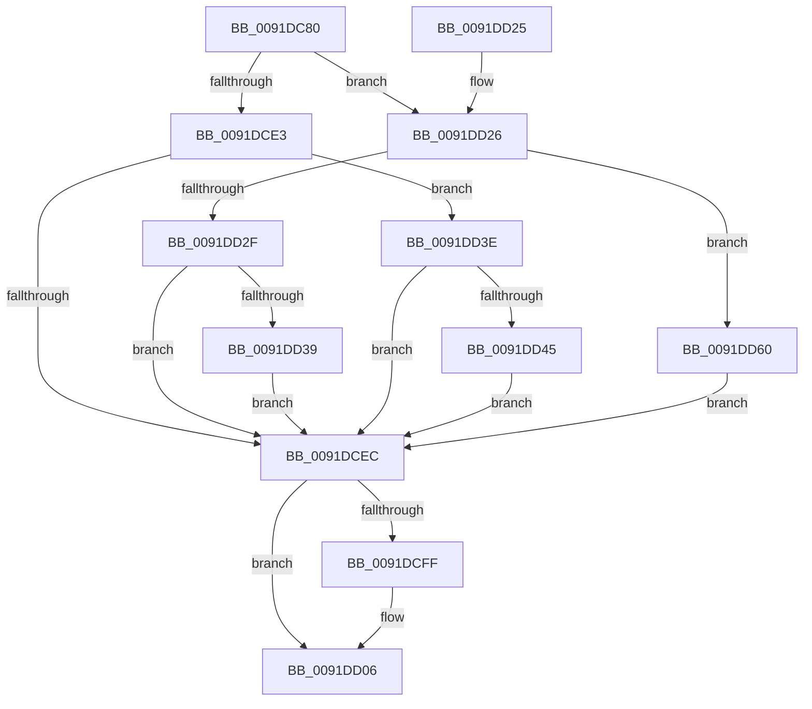

# IopIsFileOpenOrSection

- RVA: `0x0091DC80`–`0x0091DD6A` (길이 `234` bytes)
- VA: `0x000000014091DC80`
- 실행 섹션: `PAGE`
- PDB 이름 있음: `예`; PDB Function 태그: `아니요`
- unwind 정보 RVA: `0x0008B384`
- 디코드: `62`개 명령, `234/234` bytes 표시
- 미해석 바이트: `0` (있으면 어셈블리에 `.byte`로 보존)

> 이 문서는 커널 이미지의 기계어와 PDB 기호를 분석해 생성했습니다. 4번과 5번은 함수 원형과 자료형을 바이너리 사용 방식에서 추정한 C 해석이며 원본 소스 복구 결과는 아닙니다.

## 1. Dependencies

- 직접 호출 지점: **3**; 고유 호출 대상: **3**
- 직접 호출자로 확인된 함수: **1**
- RIP 상대 이미지 참조: **4**

### Outgoing calls
- `0x0091DCA6` → [ExGetHandlePointer](../../text/43/ExGetHandlePointer_function_00430C90.md) (function, `0x00430C90`)
- `0x0091DD01` → [ExfUnblockPushLock](../../text/2A/ExfUnblockPushLock_function_002A3FE0.md) (function, `0x002A3FE0`)
- `0x0091DD49` → [MmSectionToSectionObjectPointers](MmSectionToSectionObjectPointers_function_0091DF04.md) (function, `0x0091DF04`)

### Direct callers
- [ExEnumHandleTable](ExEnumHandleTable_function_0091DB20.md) at `0x0091DBB2`

### Static image references
- `0x0091DCAE` → RVA `0x00FC7800` (`ALMOSTRO`; read)
- `0x0091DCCB` → RVA `0x00FC6E4C` (`ALMOSTRO`; read)
- `0x0091DCDA` → RVA `0x00FC6AE0` (`ALMOSTRO`; read)
- `0x0091DCE3` → RVA `0x00FC6BD8` (`ALMOSTRO`; read)

## 2. Other-region calls and transfers

- 다른 실행 섹션으로 향하는 call: **2**
  - `0x0091DCA6` → [ExGetHandlePointer](../../text/43/ExGetHandlePointer_function_00430C90.md) (`PAGE` → `.text`)
  - `0x0091DD01` → [ExfUnblockPushLock](../../text/2A/ExfUnblockPushLock_function_002A3FE0.md) (`PAGE` → `.text`)
- 별도 외부 분기/꼬리 이동을 확인하지 못했습니다.

## 3. Assembly (complete function range)

```asm
0091DC80  48 89 5C 24 08                  mov qword ptr [rsp + 8], rbx
0091DC85  48 89 6C 24 10                  mov qword ptr [rsp + 0x10], rbp
0091DC8A  48 89 74 24 18                  mov qword ptr [rsp + 0x18], rsi
0091DC8F  48 89 7C 24 20                  mov qword ptr [rsp + 0x20], rdi
0091DC94  41 56                           push r14
0091DC96  48 83 EC 20                     sub rsp, 0x20
0091DC9A  48 8B F1                        mov rsi, rcx
0091DC9D  4D 8B F1                        mov r14, r9
0091DCA0  48 8B CA                        mov rcx, rdx
0091DCA3  48 8B DA                        mov rbx, rdx
0091DCA6  E8 E5 2F B1 FF                  call 0x140430c90
0091DCAB  49 8B 2E                        mov rbp, qword ptr [r14]
0091DCAE  48 8D 0D 4B 9B 6A 00            lea rcx, [rip + 0x6a9b4b]
0091DCB5  4C 8B C0                        mov r8, rax
0091DCB8  40 32 FF                        xor dil, dil
0091DCBB  49 C1 E8 08                     shr r8, 8
0091DCBF  45 0F B6 D0                     movzx r10d, r8b
0091DCC3  44 0F B6 40 18                  movzx r8d, byte ptr [rax + 0x18]
0091DCC8  4D 33 D0                        xor r10, r8
0091DCCB  44 0F B6 05 79 91 6A 00         movzx r8d, byte ptr [rip + 0x6a9179]
0091DCD3  4D 33 D0                        xor r10, r8
0091DCD6  4A 8B 0C D1                     mov rcx, qword ptr [rcx + r10*8]
0091DCDA  48 3B 0D FF 8D 6A 00            cmp rcx, qword ptr [rip + 0x6a8dff]
0091DCE1  74 43                           je 0x14091dd26
0091DCE3  48 3B 0D EE 8E 6A 00            cmp rcx, qword ptr [rip + 0x6a8eee]
0091DCEA  74 52                           je 0x14091dd3e
0091DCEC  F0 48 FF 03                     lock inc qword ptr [rbx]
0091DCF0  48 8D 4E 30                     lea rcx, [rsi + 0x30]
0091DCF4  F0 83 0C 24 00                  lock or dword ptr [rsp], 0
0091DCF9  48 83 39 00                     cmp qword ptr [rcx], 0
0091DCFD  74 07                           je 0x14091dd06
0091DCFF  33 D2                           xor edx, edx
0091DD01  E8 DA 62 98 FF                  call 0x1402a3fe0
0091DD06  48 8B 5C 24 30                  mov rbx, qword ptr [rsp + 0x30]
0091DD0B  40 0F B6 C7                     movzx eax, dil
0091DD0F  48 8B 7C 24 48                  mov rdi, qword ptr [rsp + 0x48]
0091DD14  48 8B 6C 24 38                  mov rbp, qword ptr [rsp + 0x38]
0091DD19  48 8B 74 24 40                  mov rsi, qword ptr [rsp + 0x40]
0091DD1E  48 83 C4 20                     add rsp, 0x20
0091DD22  41 5E                           pop r14
0091DD24  C3                              ret
0091DD25  CC                              int3
0091DD26  48 83 C0 30                     add rax, 0x30
0091DD2A  48 3B E8                        cmp rbp, rax
0091DD2D  74 31                           je 0x14091dd60
0091DD2F  48 8B 40 18                     mov rax, qword ptr [rax + 0x18]
0091DD33  48 39 45 18                     cmp qword ptr [rbp + 0x18], rax
0091DD37  75 B3                           jne 0x14091dcec
0091DD39  40 B7 01                        mov dil, 1
0091DD3C  EB AE                           jmp 0x14091dcec
0091DD3E  48 83 7D 28 00                  cmp qword ptr [rbp + 0x28], 0
0091DD43  74 A7                           je 0x14091dcec
0091DD45  48 8D 48 30                     lea rcx, [rax + 0x30]
0091DD49  E8 B6 01 00 00                  call 0x14091df04
0091DD4E  48 3B 45 28                     cmp rax, qword ptr [rbp + 0x28]
0091DD52  B9 01 00 00 00                  mov ecx, 1
0091DD57  40 0F B6 FF                     movzx edi, dil
0091DD5B  0F 44 F9                        cmove edi, ecx
0091DD5E  EB 8C                           jmp 0x14091dcec
0091DD60  41 38 7E 08                     cmp byte ptr [r14 + 8], dil
0091DD64  40 0F 94 C7                     sete dil
0091DD68  EB 82                           jmp 0x14091dcec
```

## 4. C-style interpretation (structured pseudocode)

```c
__int64 __fastcall IopIsFileOpenOrSection(__int64 a1, __int64 a2, __int64 a3, __int64 a4)
{
    __int64 result;
    __int64 v_r10;
    __int64 v_rdi;
    __int64 v_rsp;
    unsigned int v_stack_m28;
    unsigned __int64 v_stack_p10;
    unsigned __int64 v_stack_p18;
    unsigned __int64 v_stack_p20;
    unsigned __int64 v_stack_p8;

    v_stack_p8 = v_rbx;
    v_stack_p10 = v_rbp;
    v_stack_p18 = v_rsi;
    v_stack_p20 = v_rdi;
    v_rsp = (v_rsp) - (32);
    result = ExGetHandlePointer(a2, a2, a3, a4);
    v_rdi = 0;
    a3 = (result) >> (8);
    v_r10 = ((unsigned __int8)(a3)) ^ (*(unsigned __int8 *)(result + 24));
    v_r10 = (v_r10) ^ (*(unsigned __int8 *)(v_rip + 6984057));
    if ((*(unsigned __int64 *)(v_rip + 6986571 + v_r10 * 8)) == (*(unsigned __int64 *)(v_rip + 6983167))) goto loc_0091DD26;
    if ((*(unsigned __int64 *)(v_rip + 6986571 + v_r10 * 8)) == (*(unsigned __int64 *)(v_rip + 6983406))) goto loc_0091DD3E;
loc_0091DCEC:
    if ((*(unsigned __int64 *)(a1 + 48)) != 0) {
        a2 = 0;
        result = ExfUnblockPushLock(a1 + 48, a2, *(unsigned __int8 *)(v_rip + 6984057), a4);
    }
    v_rsp = (v_rsp) + (32);
    return 0;
loc_0091DD26:
    result = (0) + (48);
    if (v_stack_p10 == result) goto loc_0091DD60;
    if ((*(unsigned __int64 *)(v_stack_p10 + 24)) != (*(unsigned __int64 *)(result + 24))) goto loc_0091DCEC;
    goto loc_0091DCEC;
loc_0091DD3E:
    if ((*(unsigned __int64 *)(v_stack_p10 + 40)) == 0) goto loc_0091DCEC;
    result = MmSectionToSectionObjectPointers(*(unsigned __int64 *)(result + 24) + 48, a2, *(unsigned __int8 *)(v_rip + 6984057), a4);
    v_rdi = 1;
    if (result == (*(unsigned __int64 *)(v_stack_p10 + 40))) { v_rdi = 1; }
    goto loc_0091DCEC;
loc_0091DD60:
    v_rdi = ((*(unsigned __int8 *)(a4 + 8)) == ((unsigned __int8)(v_rdi))) ? 1 : 0;
    goto loc_0091DCEC;
}
```

## 5. (Beta) C Style

```c
int64_t IopIsFileOpenOrSection(void *Arg1, void *Arg2, int64_t Arg3, void *Arg4)
{
    uint8_t *arg1 = (uint8_t *)Arg1;
    uint8_t *arg2 = (uint8_t *)Arg2;
    uint8_t *arg4 = (uint8_t *)Arg4;

    int64_t result;
    int64_t local_r10;
    int64_t local_rdi;
    int64_t local_rsp;
    uint32_t v_stack_m28;
    uint64_t v_stack_p10;
    uint64_t v_stack_p18;
    uint64_t v_stack_p20;
    uint64_t v_stack_p8;

    v_stack_p8 = local_rbx;
    v_stack_p10 = local_rbp;
    v_stack_p18 = local_rsi;
    v_stack_p20 = local_rdi;
    local_rsp = (local_rsp) - (32);
    result = ExGetHandlePointer(Arg2, Arg2, Arg3, Arg4);
    local_rdi = 0;
    Arg3 = (result) >> (8);
    local_r10 = ((uint8_t)(Arg3)) ^ (*(uint8_t *)(result + 0x18));
    local_r10 = (local_r10) ^ (*(uint8_t *)(v_rip + 0x6A9179));
    if ((*(uint64_t *)(v_rip + 0x6A9B4B + local_r10 * 8)) == (*(uint64_t *)(v_rip + 0x6A8DFF))) goto loc_0091DD26;
    if ((*(uint64_t *)(v_rip + 0x6A9B4B + local_r10 * 8)) == (*(uint64_t *)(v_rip + 0x6A8EEE))) goto loc_0091DD3E;
loc_0091DCEC:
    if ((*(uint64_t *)(arg1 + 0x30)) != 0) {
        Arg2 = 0;
        result = ExfUnblockPushLock(Arg1 + 48, Arg2, *(uint8_t *)(v_rip + 0x6A9179), Arg4);
    }
    local_rsp = (local_rsp) + (32);
    return 0;
loc_0091DD26:
    result = (0) + (48);
    if (v_stack_p10 == result) goto loc_0091DD60;
    if ((*(uint64_t *)(v_stack_p10 + 0x18)) != (*(uint64_t *)(result + 0x18))) goto loc_0091DCEC;
    goto loc_0091DCEC;
loc_0091DD3E:
    if ((*(uint64_t *)(v_stack_p10 + 0x28)) == 0) goto loc_0091DCEC;
    result = MmSectionToSectionObjectPointers(*(uint64_t *)(result + 0x18) + 48, Arg2, *(uint8_t *)(v_rip + 0x6A9179), Arg4);
    local_rdi = 1;
    if (result == (*(uint64_t *)(v_stack_p10 + 0x28))) { local_rdi = 1; }
    goto loc_0091DCEC;
loc_0091DD60:
    local_rdi = ((*(uint8_t *)(arg4 + 0x8)) == ((uint8_t)(local_rdi))) ? 1 : 0;
    goto loc_0091DCEC;
}
```

### 관측된 메모리 오프셋

구조체 형식이 확인되지 않은 접근은 인자 기준의 오프셋으로만 기록했습니다.

| 기준 인자 | 오프셋 표현 | 폭 (bit) | 접근 |
|---|---:|---:|---|
| `Arg1` | `+ 0x0` | `64` | `R` |
| `Arg1` | `+ 0x30` | `64` | `R` |
| `Arg2` | `+ 0x0` | `64` | `R/W` |
| `Arg4` | `+ 0x0` | `64` | `R` |
| `Arg4` | `+ 0x8` | `8` | `R` |

## 6. Execution-region graph

[열기: 2D/3D 그래프와 함수 탐색 컨트롤 패널](../../../control-panel.html?section=page&rva=0x0091DC80&view=graph)

- 2D 그래프는 위에서 아래로 흐르고, 3D 그래프는 빈 공간을 드래그해 회전합니다. Shift+드래그는 이동, 휠은 확대·축소, 함수 노드 선택은 대상 보고서 이동입니다.

### Static fallback


