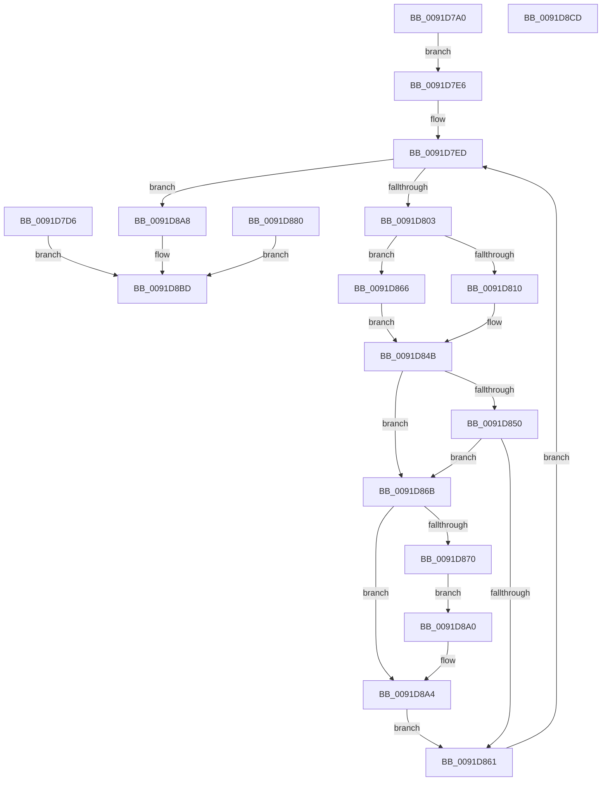

# IopQueryProcessIdsUsingFile

- RVA: `0x0091D7A0`–`0x0091D8CE` (길이 `302` bytes)
- VA: `0x000000014091D7A0`
- 실행 섹션: `PAGE`
- PDB 이름 있음: `예`; PDB Function 태그: `아니요`
- unwind 정보 RVA: `0x0008B300`
- 디코드: `87`개 명령, `302/302` bytes 표시
- 미해석 바이트: `0` (있으면 어셈블리에 `.byte`로 보존)

> 이 문서는 커널 이미지의 기계어와 PDB 기호를 분석해 생성했습니다. 4번과 5번은 함수 원형과 자료형을 바이너리 사용 방식에서 추정한 C 해석이며 원본 소스 복구 결과는 아닙니다.

## 1. Dependencies

- 직접 호출 지점: **6**; 고유 호출 대상: **6**
- 직접 호출자로 확인된 함수: **1**
- RIP 상대 이미지 참조: **1**

### Outgoing calls
- `0x0091D7ED` → [PsGetNextProcess](PsGetNextProcess_function_0091C900.md) (function, `0x0091C900`)
- `0x0091D806` → [ObReferenceProcessHandleTable](../89/ObReferenceProcessHandleTable_function_00893B70.md) (function, `0x00893B70`)
- `0x0091D837` → [ExEnumHandleTable](ExEnumHandleTable_function_0091DB20.md) (function, `0x0091DB20`)
- `0x0091D846` → [ExReleaseRundownProtection](../../text/34/ExReleaseRundownProtection_function_00349E80.md) (function, `0x00349E80`)
- `0x0091D858` → [MmIsFileMapped](MmIsFileMapped_function_0091D8D4.md) (function, `0x0091D8D4`)
- `0x0091D897` → [ObfDereferenceObjectWithTag](../../text/2F/ObfDereferenceObjectWithTag_function_002F78E0.md) (function, `0x002F78E0`)

### Direct callers
- [NtQueryInformationFile](../8A/NtQueryInformationFile_function_008AD630.md) at `0x008AE2C1`

### Static image references
- `0x0091D82D` → RVA `0x0091DC80` (`IopIsFileOpenOrSection`; read)

## 2. Other-region calls and transfers

- 다른 실행 섹션으로 향하는 call: **2**
  - `0x0091D846` → [ExReleaseRundownProtection](../../text/34/ExReleaseRundownProtection_function_00349E80.md) (`PAGE` → `.text`)
  - `0x0091D897` → [ObfDereferenceObjectWithTag](../../text/2F/ObfDereferenceObjectWithTag_function_002F78E0.md) (`PAGE` → `.text`)
- 별도 외부 분기/꼬리 이동을 확인하지 못했습니다.

## 3. Assembly (complete function range)

```asm
0091D7A0  4C 89 4C 24 20                  mov qword ptr [rsp + 0x20], r9
0091D7A5  48 89 4C 24 08                  mov qword ptr [rsp + 8], rcx
0091D7AA  53                              push rbx
0091D7AB  56                              push rsi
0091D7AC  57                              push rdi
0091D7AD  41 54                           push r12
0091D7AF  41 55                           push r13
0091D7B1  41 56                           push r14
0091D7B3  41 57                           push r15
0091D7B5  48 83 EC 30                     sub rsp, 0x30
0091D7B9  4D 8B E9                        mov r13, r9
0091D7BC  4C 8B F2                        mov r14, rdx
0091D7BF  4C 8D 62 08                     lea r12, [rdx + 8]
0091D7C3  45 8D 78 F8                     lea r15d, [r8 - 8]
0091D7C7  41 C1 EF 03                     shr r15d, 3
0091D7CB  33 FF                           xor edi, edi
0091D7CD  48 21 7C 24 28                  and qword ptr [rsp + 0x28], rdi
0091D7D2  21 3A                           and dword ptr [rdx], edi
0091D7D4  EB 10                           jmp 0x14091d7e6
0091D7D6  48 8B 8C 24 88 00 00 00         mov rcx, qword ptr [rsp + 0x88]
0091D7DE  83 21 00                        and dword ptr [rcx], 0
0091D7E1  E9 D7 00 00 00                  jmp 0x14091d8bd
0091D7E6  48 89 4C 24 20                  mov qword ptr [rsp + 0x20], rcx
0091D7EB  33 C9                           xor ecx, ecx
0091D7ED  E8 0E F1 FF FF                  call 0x14091c900
0091D7F2  48 8B D8                        mov rbx, rax
0091D7F5  48 89 44 24 78                  mov qword ptr [rsp + 0x78], rax
0091D7FA  48 85 C0                        test rax, rax
0091D7FD  0F 84 A5 00 00 00               je 0x14091d8a8
0091D803  48 8B C8                        mov rcx, rax
0091D806  E8 65 63 F7 FF                  call 0x140893b70
0091D80B  48 85 C0                        test rax, rax
0091D80E  74 56                           je 0x14091d866
0091D810  65 48 8B 0C 25 88 01 00 00      mov rcx, qword ptr gs:[0x188]
0091D819  48 3B 99 B8 00 00 00            cmp rbx, qword ptr [rcx + 0xb8]
0091D820  0F 94 44 24 28                  sete byte ptr [rsp + 0x28]
0091D825  45 33 C9                        xor r9d, r9d
0091D828  4C 8D 44 24 20                  lea r8, [rsp + 0x20]
0091D82D  48 8D 15 4C 04 00 00            lea rdx, [rip + 0x44c]
0091D834  48 8B C8                        mov rcx, rax
0091D837  E8 E4 02 00 00                  call 0x14091db20
0091D83C  40 8A F0                        mov sil, al
0091D83F  48 8D 8B E8 01 00 00            lea rcx, [rbx + 0x1e8]
0091D846  E8 35 C6 A2 FF                  call 0x140349e80
0091D84B  40 84 F6                        test sil, sil
0091D84E  75 1B                           jne 0x14091d86b
0091D850  48 8B 54 24 70                  mov rdx, qword ptr [rsp + 0x70]
0091D855  48 8B CB                        mov rcx, rbx
0091D858  E8 77 00 00 00                  call 0x14091d8d4
0091D85D  85 C0                           test eax, eax
0091D85F  75 0A                           jne 0x14091d86b
0091D861  48 8B CB                        mov rcx, rbx
0091D864  EB 87                           jmp 0x14091d7ed
0091D866  40 32 F6                        xor sil, sil
0091D869  EB E0                           jmp 0x14091d84b
0091D86B  41 3B FF                        cmp edi, r15d
0091D86E  73 34                           jae 0x14091d8a4
0091D870  48 8B 83 D0 01 00 00            mov rax, qword ptr [rbx + 0x1d0]
0091D877  49 89 04 24                     mov qword ptr [r12], rax
0091D87B  41 FF 06                        inc dword ptr [r14]
0091D87E  EB 20                           jmp 0x14091d8a0
0091D880  8B D8                           mov ebx, eax
0091D882  48 8B 8C 24 88 00 00 00         mov rcx, qword ptr [rsp + 0x88]
0091D88A  83 21 00                        and dword ptr [rcx], 0
0091D88D  BA 50 73 45 6E                  mov edx, 0x6e457350
0091D892  48 8B 4C 24 78                  mov rcx, qword ptr [rsp + 0x78]
0091D897  E8 44 A0 9D FF                  call 0x1402f78e0
0091D89C  8B C3                           mov eax, ebx
0091D89E  EB 1D                           jmp 0x14091d8bd
0091D8A0  49 83 C4 08                     add r12, 8
0091D8A4  FF C7                           inc edi
0091D8A6  EB B9                           jmp 0x14091d861
0091D8A8  8D 04 FD 08 00 00 00            lea eax, [rdi*8 + 8]
0091D8AF  41 89 45 00                     mov dword ptr [r13], eax
0091D8B3  44 3B FF                        cmp r15d, edi
0091D8B6  1B C0                           sbb eax, eax
0091D8B8  25 04 00 00 C0                  and eax, 0xc0000004
0091D8BD  48 83 C4 30                     add rsp, 0x30
0091D8C1  41 5F                           pop r15
0091D8C3  41 5E                           pop r14
0091D8C5  41 5D                           pop r13
0091D8C7  41 5C                           pop r12
0091D8C9  5F                              pop rdi
0091D8CA  5E                              pop rsi
0091D8CB  5B                              pop rbx
0091D8CC  C3                              ret
0091D8CD  CC                              int3
```

## 4. C-style interpretation (structured pseudocode)

```c
__int64 __fastcall IopQueryProcessIdsUsingFile(__int64 a1, __int64 a2, __int64 a3, __int64 a4)
{
    __int64 result;
    __int64 v_r12;
    __int64 v_r15;
    __int64 v_rdi;
    __int64 v_rsi;
    __int64 v_rsp;
    unsigned __int64 v_stack_m40;
    unsigned __int64 v_stack_m48;
    unsigned __int64 v_stack_p10;
    unsigned __int64 v_stack_p20;
    unsigned __int64 v_stack_p8;

    v_stack_p20 = a4;
    v_stack_p8 = a1;
    v_rsp = (v_rsp) - (48);
    v_r15 = (unsigned int)((a3 - 8) >> (3));
    v_rdi = 0;
    goto loc_0091D7E6;
loc_0091D7E6:
    v_stack_m48 = a1;
    a1 = 0;
loc_0091D7ED:
    result = PsGetNextProcess(a1, a2, a3, a4);
    v_stack_p10 = result;
    if (result == 0) goto loc_0091D8A8;
    result = ObReferenceProcessHandleTable(result, a2, a3, a4);
    if (result == 0) goto loc_0091D866;
    a4 = 0;
    result = ExEnumHandleTable(result, v_rip + 1100, v_stack_m48, a4);
    result = ExReleaseRundownProtection(result + 488, v_rip + 1100, v_stack_m48, a4);
loc_0091D84B:
    if ((unsigned __int8)((unsigned __int8)(result)) != 0) goto loc_0091D86B;
    result = MmIsFileMapped(result, v_stack_p8, v_stack_m48, a4);
    if ((unsigned int)(result) != 0) goto loc_0091D86B;
loc_0091D861:
    goto loc_0091D7ED;
loc_0091D866:
    v_rsi = 0;
    goto loc_0091D84B;
loc_0091D86B:
    if (0 >= ((unsigned int)(v_r15))) goto loc_0091D8A4;
    *(unsigned __int64 *)(a2 + 8) = *(unsigned __int64 *)(result + 464);
    goto loc_0091D8A0;
loc_0091D8A0:
    v_r12 = (a2 + 8) + (8);
loc_0091D8A4:
    v_rdi = (unsigned int)((v_rdi) + 1);
    goto loc_0091D861;
loc_0091D8A8:
    *(unsigned int *)(a4) = (unsigned int)(v_rdi * 8 + 8);
    result = (unsigned int)((v_rdi * 8 + 8) & (0xC0000004ULL));
loc_0091D8BD:
    v_rsp = (v_rsp) + (48);
    return result;
}
```

## 5. (Beta) C Style

```c
int64_t IopQueryProcessIdsUsingFile(int64_t Arg1, void *Arg2, void *Arg3, void *Arg4)
{
    uint8_t *arg2 = (uint8_t *)Arg2;
    uint8_t *arg3 = (uint8_t *)Arg3;
    uint8_t *arg4 = (uint8_t *)Arg4;

    int64_t result;
    int64_t local_r12;
    int64_t local_r15;
    int64_t local_rdi;
    int64_t local_rsi;
    int64_t local_rsp;
    uint64_t v_stack_m40;
    uint64_t v_stack_m48;
    uint64_t v_stack_p10;
    uint64_t v_stack_p20;
    uint64_t v_stack_p8;

    v_stack_p20 = Arg4;
    v_stack_p8 = Arg1;
    local_rsp = (local_rsp) - (48);
    local_r15 = (uint32_t)((Arg3 - 8) >> (3));
    local_rdi = 0;
    goto loc_0091D7E6;
loc_0091D7E6:
    v_stack_m48 = Arg1;
    Arg1 = 0;
loc_0091D7ED:
    result = PsGetNextProcess(Arg1, Arg2, Arg3, Arg4);
    v_stack_p10 = result;
    if (result == 0) goto loc_0091D8A8;
    result = ObReferenceProcessHandleTable(result, Arg2, Arg3, Arg4);
    if (result == 0) goto loc_0091D866;
    Arg4 = 0;
    result = ExEnumHandleTable(result, v_rip + 1100, v_stack_m48, Arg4);
    result = ExReleaseRundownProtection(result + 488, v_rip + 1100, v_stack_m48, Arg4);
loc_0091D84B:
    if ((uint8_t)((uint8_t)(result)) != 0) goto loc_0091D86B;
    result = MmIsFileMapped(result, v_stack_p8, v_stack_m48, Arg4);
    if ((uint32_t)(result) != 0) goto loc_0091D86B;
loc_0091D861:
    goto loc_0091D7ED;
loc_0091D866:
    local_rsi = 0;
    goto loc_0091D84B;
loc_0091D86B:
    if (0 >= ((uint32_t)(local_r15))) goto loc_0091D8A4;
    *(uint64_t *)(arg2 + 0x8) = *(uint64_t *)(result + 0x1D0);
    goto loc_0091D8A0;
loc_0091D8A0:
    local_r12 = (Arg2 + 8) + (8);
loc_0091D8A4:
    local_rdi = (uint32_t)((local_rdi) + 1);
    goto loc_0091D861;
loc_0091D8A8:
    *(uint32_t *)(arg4) = (uint32_t)(local_rdi * 8 + 8);
    result = (uint32_t)((local_rdi * 8 + 8) & (0xC0000004ULL));
loc_0091D8BD:
    local_rsp = (local_rsp) + (48);
    return result;
}
```

### 관측된 메모리 오프셋

구조체 형식이 확인되지 않은 접근은 인자 기준의 오프셋으로만 기록했습니다.

| 기준 인자 | 오프셋 표현 | 폭 (bit) | 접근 |
|---|---:|---:|---|
| `Arg2` | `+ 0x0` | `32` | `R/W` |
| `Arg2` | `+ 0x0` | `64` | `W` |
| `Arg2` | `+ 0x8` | `64` | `R` |
| `Arg3` | `- 0x8` | `32` | `R` |
| `Arg4` | `+ 0x0` | `32` | `W` |

## 6. Execution-region graph

[열기: 2D/3D 그래프와 함수 탐색 컨트롤 패널](../../../control-panel.html?section=page&rva=0x0091D7A0&view=graph)

- 2D 그래프는 위에서 아래로 흐르고, 3D 그래프는 빈 공간을 드래그해 회전합니다. Shift+드래그는 이동, 휠은 확대·축소, 함수 노드 선택은 대상 보고서 이동입니다.

### Static fallback


