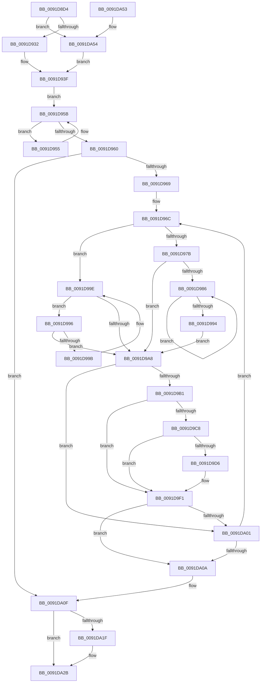

# MmIsFileMapped

- RVA: `0x0091D8D4`–`0x0091DA5C` (길이 `392` bytes)
- VA: `0x000000014091D8D4`
- 실행 섹션: `PAGE`
- PDB 이름 있음: `예`; PDB Function 태그: `아니요`
- unwind 정보 RVA: `0x0008B340`
- 디코드: `114`개 명령, `392/392` bytes 표시
- 미해석 바이트: `0` (있으면 어셈블리에 `.byte`로 보존)

> 이 문서는 커널 이미지의 기계어와 PDB 기호를 분석해 생성했습니다. 4번과 5번은 함수 원형과 자료형을 바이너리 사용 방식에서 추정한 C 해석이며 원본 소스 복구 결과는 아닙니다.

## 1. Dependencies

- 직접 호출 지점: **10**; 고유 호출 대상: **10**
- 직접 호출자로 확인된 함수: **1**
- RIP 상대 이미지 참조: **1**

### Outgoing calls
- `0x0091D937` → [KeStackAttachProcess](../../text/21/KeStackAttachProcess_function_00216800.md) (function, `0x00216800`)
- `0x0091D945` → [LOCK_ADDRESS_SPACE_SHARED](../../text/2A/LOCK_ADDRESS_SPACE_SHARED_function_002A8B3C.md) (function, `0x002A8B3C`)
- `0x0091D9B7` → [MiLockVadShared](../../text/31/MiLockVadShared_function_00316DE0.md) (function, `0x00316DE0`)
- `0x0091D9BF` → [MiVadDeleted](../../text/43/MiVadDeleted_function_00431350.md) (function, `0x00431350`)
- `0x0091D9D9` → [MiReferenceControlAreaFile](../../text/43/MiReferenceControlAreaFile_function_00431554.md) (function, `0x00431554`)
- `0x0091D9EC` → [MiDereferenceControlAreaFile](../../text/43/MiDereferenceControlAreaFile_function_004345E0.md) (function, `0x004345E0`)
- `0x0091D9F7` → [MiUnlockVadShared](../../text/2E/MiUnlockVadShared_function_002E2420.md) (function, `0x002E2420`)
- `0x0091DA15` → [UNLOCK_ADDRESS_SPACE_SHARED](../../text/2A/UNLOCK_ADDRESS_SPACE_SHARED_function_002A8ACC.md) (function, `0x002A8ACC`)
- `0x0091DA26` → [KiUnstackDetachProcess](../../text/21/KiUnstackDetachProcess_function_00217D30.md) (function, `0x00217D30`)
- `0x0091DA36` → [_security_check_cookie](../../text/6A/_security_check_cookie_function_006AC640.md) (function, `0x006AC640`)

### Direct callers
- [IopQueryProcessIdsUsingFile](IopQueryProcessIdsUsingFile_function_0091D7A0.md) at `0x0091D858`

### Static image references
- `0x0091D8E8` → RVA `0x00E0A740` (`.data`; read)

## 2. Other-region calls and transfers

- 다른 실행 섹션으로 향하는 call: **10**
  - `0x0091D937` → [KeStackAttachProcess](../../text/21/KeStackAttachProcess_function_00216800.md) (`PAGE` → `.text`)
  - `0x0091D945` → [LOCK_ADDRESS_SPACE_SHARED](../../text/2A/LOCK_ADDRESS_SPACE_SHARED_function_002A8B3C.md) (`PAGE` → `.text`)
  - `0x0091D9B7` → [MiLockVadShared](../../text/31/MiLockVadShared_function_00316DE0.md) (`PAGE` → `.text`)
  - `0x0091D9BF` → [MiVadDeleted](../../text/43/MiVadDeleted_function_00431350.md) (`PAGE` → `.text`)
  - `0x0091D9D9` → [MiReferenceControlAreaFile](../../text/43/MiReferenceControlAreaFile_function_00431554.md) (`PAGE` → `.text`)
  - `0x0091D9EC` → [MiDereferenceControlAreaFile](../../text/43/MiDereferenceControlAreaFile_function_004345E0.md) (`PAGE` → `.text`)
  - `0x0091D9F7` → [MiUnlockVadShared](../../text/2E/MiUnlockVadShared_function_002E2420.md) (`PAGE` → `.text`)
  - `0x0091DA15` → [UNLOCK_ADDRESS_SPACE_SHARED](../../text/2A/UNLOCK_ADDRESS_SPACE_SHARED_function_002A8ACC.md) (`PAGE` → `.text`)
  - `0x0091DA26` → [KiUnstackDetachProcess](../../text/21/KiUnstackDetachProcess_function_00217D30.md) (`PAGE` → `.text`)
  - `0x0091DA36` → [_security_check_cookie](../../text/6A/_security_check_cookie_function_006AC640.md) (`PAGE` → `.text`)
- 별도 외부 분기/꼬리 이동을 확인하지 못했습니다.

## 3. Assembly (complete function range)

```asm
0091D8D4  48 89 5C 24 18                  mov qword ptr [rsp + 0x18], rbx
0091D8D9  55                              push rbp
0091D8DA  56                              push rsi
0091D8DB  57                              push rdi
0091D8DC  41 54                           push r12
0091D8DE  41 55                           push r13
0091D8E0  41 56                           push r14
0091D8E2  41 57                           push r15
0091D8E4  48 83 EC 60                     sub rsp, 0x60
0091D8E8  48 8B 05 51 CE 4E 00            mov rax, qword ptr [rip + 0x4ece51]
0091D8EF  48 33 C4                        xor rax, rsp
0091D8F2  48 89 44 24 58                  mov qword ptr [rsp + 0x58], rax
0091D8F7  4C 8B 6A 28                     mov r13, qword ptr [rdx + 0x28]
0091D8FB  0F 57 C0                        xorps xmm0, xmm0
0091D8FE  0F 11 44 24 28                  movups xmmword ptr [rsp + 0x28], xmm0
0091D903  45 33 FF                        xor r15d, r15d
0091D906  48 8B F1                        mov rsi, rcx
0091D909  0F 11 44 24 38                  movups xmmword ptr [rsp + 0x38], xmm0
0091D90E  48 89 4C 24 20                  mov qword ptr [rsp + 0x20], rcx
0091D913  0F 11 44 24 48                  movups xmmword ptr [rsp + 0x48], xmm0
0091D918  65 48 8B 2C 25 88 01 00 00      mov rbp, qword ptr gs:[0x188]
0091D921  41 8D 5F 01                     lea ebx, [r15 + 1]
0091D925  48 39 8D B8 00 00 00            cmp qword ptr [rbp + 0xb8], rcx
0091D92C  0F 84 22 01 00 00               je 0x14091da54
0091D932  48 8D 54 24 28                  lea rdx, [rsp + 0x28]
0091D937  E8 C4 8E 8F FF                  call 0x140216800
0091D93C  44 8B E3                        mov r12d, ebx
0091D93F  48 8B D6                        mov rdx, rsi
0091D942  48 8B CD                        mov rcx, rbp
0091D945  E8 F2 B1 98 FF                  call 0x1402a8b3c
0091D94A  48 8B 86 58 05 00 00            mov rax, qword ptr [rsi + 0x558]
0091D951  33 DB                           xor ebx, ebx
0091D953  EB 06                           jmp 0x14091d95b
0091D955  48 8B D8                        mov rbx, rax
0091D958  48 8B 00                        mov rax, qword ptr [rax]
0091D95B  48 85 C0                        test rax, rax
0091D95E  75 F5                           jne 0x14091d955
0091D960  48 85 DB                        test rbx, rbx
0091D963  0F 84 A6 00 00 00               je 0x14091da0f
0091D969  8D 70 01                        lea esi, [rax + 1]
0091D96C  48 8B 43 08                     mov rax, qword ptr [rbx + 8]
0091D970  48 8B FB                        mov rdi, rbx
0091D973  48 8B CB                        mov rcx, rbx
0091D976  48 85 C0                        test rax, rax
0091D979  74 23                           je 0x14091d99e
0091D97B  48 8B 08                        mov rcx, qword ptr [rax]
0091D97E  48 8B D8                        mov rbx, rax
0091D981  48 85 C9                        test rcx, rcx
0091D984  74 22                           je 0x14091d9a8
0091D986  48 8B 01                        mov rax, qword ptr [rcx]
0091D989  48 8B D9                        mov rbx, rcx
0091D98C  48 8B C8                        mov rcx, rax
0091D98F  48 85 C0                        test rax, rax
0091D992  75 F2                           jne 0x14091d986
0091D994  EB 12                           jmp 0x14091d9a8
0091D996  48 39 0B                        cmp qword ptr [rbx], rcx
0091D999  74 0D                           je 0x14091d9a8
0091D99B  48 8B CB                        mov rcx, rbx
0091D99E  48 8B 5B 10                     mov rbx, qword ptr [rbx + 0x10]
0091D9A2  48 83 E3 FC                     and rbx, 0xfffffffffffffffc
0091D9A6  75 EE                           jne 0x14091d996
0091D9A8  F7 47 30 00 00 20 00            test dword ptr [rdi + 0x30], 0x200000
0091D9AF  75 50                           jne 0x14091da01
0091D9B1  48 8B D7                        mov rdx, rdi
0091D9B4  48 8B CD                        mov rcx, rbp
0091D9B7  E8 24 94 9F FF                  call 0x140316de0
0091D9BC  48 8B CF                        mov rcx, rdi
0091D9BF  E8 8C 39 B1 FF                  call 0x140431350
0091D9C4  85 C0                           test eax, eax
0091D9C6  75 29                           jne 0x14091d9f1
0091D9C8  48 8B 47 48                     mov rax, qword ptr [rdi + 0x48]
0091D9CC  4C 8B 30                        mov r14, qword ptr [rax]
0091D9CF  49 83 7E 40 00                  cmp qword ptr [r14 + 0x40], 0
0091D9D4  74 1B                           je 0x14091d9f1
0091D9D6  49 8B CE                        mov rcx, r14
0091D9D9  E8 76 3B B1 FF                  call 0x140431554
0091D9DE  48 8B D0                        mov rdx, rax
0091D9E1  49 8B CE                        mov rcx, r14
0091D9E4  4C 39 68 28                     cmp qword ptr [rax + 0x28], r13
0091D9E8  44 0F 44 FE                     cmove r15d, esi
0091D9EC  E8 EF 6B B1 FF                  call 0x1404345e0
0091D9F1  48 8B D7                        mov rdx, rdi
0091D9F4  48 8B CD                        mov rcx, rbp
0091D9F7  E8 24 4A 9C FF                  call 0x1402e2420
0091D9FC  45 85 FF                        test r15d, r15d
0091D9FF  75 09                           jne 0x14091da0a
0091DA01  48 85 DB                        test rbx, rbx
0091DA04  0F 85 62 FF FF FF               jne 0x14091d96c
0091DA0A  48 8B 74 24 20                  mov rsi, qword ptr [rsp + 0x20]
0091DA0F  48 8B D6                        mov rdx, rsi
0091DA12  48 8B CD                        mov rcx, rbp
0091DA15  E8 B2 B0 98 FF                  call 0x1402a8acc
0091DA1A  45 85 E4                        test r12d, r12d
0091DA1D  74 0C                           je 0x14091da2b
0091DA1F  33 D2                           xor edx, edx
0091DA21  48 8D 4C 24 28                  lea rcx, [rsp + 0x28]
0091DA26  E8 05 A3 8F FF                  call 0x140217d30
0091DA2B  41 8B C7                        mov eax, r15d
0091DA2E  48 8B 4C 24 58                  mov rcx, qword ptr [rsp + 0x58]
0091DA33  48 33 CC                        xor rcx, rsp
0091DA36  E8 05 EC D8 FF                  call 0x1406ac640
0091DA3B  48 8B 9C 24 B0 00 00 00         mov rbx, qword ptr [rsp + 0xb0]
0091DA43  48 83 C4 60                     add rsp, 0x60
0091DA47  41 5F                           pop r15
0091DA49  41 5E                           pop r14
0091DA4B  41 5D                           pop r13
0091DA4D  41 5C                           pop r12
0091DA4F  5F                              pop rdi
0091DA50  5E                              pop rsi
0091DA51  5D                              pop rbp
0091DA52  C3                              ret
0091DA53  CC                              int3
0091DA54  45 33 E4                        xor r12d, r12d
0091DA57  E9 E3 FE FF FF                  jmp 0x14091d93f
```

## 4. C-style interpretation (structured pseudocode)

```c
__int64 __fastcall MmIsFileMapped(__int64 a1, __int64 a2)
{
    __int64 result;
    __int64 v_r12;
    __int64 v_r15;
    __int64 v_rbx;
    __int64 v_rsp;
    unsigned __int64 v_stack_m40;
    unsigned __int64 v_stack_m50;
    unsigned __int64 v_stack_m60;
    unsigned __int64 v_stack_m70;
    unsigned __int64 v_stack_m78;
    unsigned __int64 v_stack_p18;

    v_stack_p18 = v_rbx;
    v_rsp = (v_rsp) - (96);
    result = (*(unsigned __int64 *)(v_rip + 5164625)) ^ (v_rsp);
    v_stack_m40 = result;
    v_stack_m70 = v_xmm0;
    v_r15 = 0;
    v_stack_m60 = v_xmm0;
    v_stack_m78 = a1;
    v_stack_m50 = v_xmm0;
    if ((*(unsigned __int64 *)(*(unsigned __int64 *)(gs_base + (0 + 392)) + 184)) == a1) goto loc_0091DA54;
    result = KeStackAttachProcess(a1, v_stack_m70, a3, a4);
loc_0091D93F:
    result = LOCK_ADDRESS_SPACE_SHARED(*(unsigned __int64 *)(gs_base + (0 + 392)), a1, a3, a4);
    v_rbx = 0;
    goto loc_0091D95B;
loc_0091D955:
loc_0091D95B:
    if (*(unsigned __int64 *)(*(unsigned __int64 *)(a1 + 1368)) != 0) goto loc_0091D955;
    if (*(unsigned __int64 *)(a1 + 1368) == 0) goto loc_0091DA0F;
loc_0091D96C:
    if (*(unsigned __int64 *)(*(unsigned __int64 *)(a1 + 1368) + 8) == 0) goto loc_0091D99E;
    if (*(unsigned __int64 *)(*(unsigned __int64 *)(*(unsigned __int64 *)(a1 + 1368) + 8)) == 0) goto loc_0091D9A8;
loc_0091D986:
    if (*(unsigned __int64 *)(*(unsigned __int64 *)(*(unsigned __int64 *)(*(unsigned __int64 *)(a1 + 1368) + 8))) != 0) goto loc_0091D986;
    goto loc_0091D9A8;
loc_0091D996:
    if ((*(unsigned __int64 *)(*(unsigned __int64 *)(*(unsigned __int64 *)(*(unsigned __int64 *)(a1 + 1368) + 8)))) == (*(unsigned __int64 *)(*(unsigned __int64 *)(*(unsigned __int64 *)(*(unsigned __int64 *)(a1 + 1368) + 8))))) goto loc_0091D9A8;
loc_0091D99E:
    v_rbx = (*(unsigned __int64 *)(*(unsigned __int64 *)(*(unsigned __int64 *)(*(unsigned __int64 *)(a1 + 1368) + 8)) + 16)) & (-4);
    if (condition_is_not_equal) goto loc_0091D996;
loc_0091D9A8:
    if (((*(unsigned int *)(*(unsigned __int64 *)(a1 + 1368) + 48)) & (0x200000ULL)) != 0) goto loc_0091DA01;
    result = MiLockVadShared(*(unsigned __int64 *)(gs_base + (0 + 392)), *(unsigned __int64 *)(a1 + 1368), a3, a4);
    result = MiVadDeleted(*(unsigned __int64 *)(a1 + 1368), *(unsigned __int64 *)(a1 + 1368), a3, a4);
    if ((unsigned int)(result) != 0) goto loc_0091D9F1;
    result = *(unsigned __int64 *)(*(unsigned __int64 *)(a1 + 1368) + 72);
    if ((*(unsigned __int64 *)(*(unsigned __int64 *)(*(unsigned __int64 *)(*(unsigned __int64 *)(a1 + 1368) + 72)) + 64)) != 0) {
        a1 = *(unsigned __int64 *)(*(unsigned __int64 *)(*(unsigned __int64 *)(a1 + 1368) + 72));
        result = MiReferenceControlAreaFile(a1, *(unsigned __int64 *)(a1 + 1368), a3, a4);
        a2 = result;
        a1 = *(unsigned __int64 *)(*(unsigned __int64 *)(*(unsigned __int64 *)(a1 + 1368) + 72));
        if ((*(unsigned __int64 *)(result + 40)) == (*(unsigned __int64 *)(a2 + 40))) { v_r15 = (unsigned int)(*(unsigned __int64 *)(*(unsigned __int64 *)(a1 + 1368)) + 1); }
        result = MiDereferenceControlAreaFile(a1, a2, a3, a4);
    }
    result = MiUnlockVadShared(*(unsigned __int64 *)(gs_base + (0 + 392)), *(unsigned __int64 *)(a1 + 1368), a3, a4);
    if ((unsigned int)(v_r15) != 0) goto loc_0091DA0A;
loc_0091DA01:
    if (v_rbx != 0) goto loc_0091D96C;
loc_0091DA0A:
loc_0091DA0F:
    result = UNLOCK_ADDRESS_SPACE_SHARED(*(unsigned __int64 *)(gs_base + (0 + 392)), v_stack_m78, a3, a4);
    if ((unsigned int)((unsigned int)((unsigned int)(v_r15 + 1))) != 0) {
        a2 = 0;
        a1 = v_stack_m70;
        result = KiUnstackDetachProcess(a1, a2, a3, a4);
    }
    a1 = (v_stack_m40) ^ (v_rsp);
    result = _security_check_cookie(a1, a2, a3, a4);
    v_rsp = (v_rsp) + (96);
    return result;
loc_0091DA54:
    v_r12 = 0;
    goto loc_0091D93F;
}
```

## 5. (Beta) C Style

```c
int64_t MmIsFileMapped(void *Arg1, void *Arg2)
{
    uint8_t *arg1 = (uint8_t *)Arg1;
    uint8_t *arg2 = (uint8_t *)Arg2;

    int64_t result;
    int64_t local_r12;
    int64_t local_r15;
    int64_t local_rbx;
    int64_t local_rsp;
    uint64_t v_stack_m40;
    uint64_t v_stack_m50;
    uint64_t v_stack_m60;
    uint64_t v_stack_m70;
    uint64_t v_stack_m78;
    uint64_t v_stack_p18;

    v_stack_p18 = local_rbx;
    local_rsp = (local_rsp) - (96);
    result = (*(uint64_t *)(v_rip + 0x4ECE51)) ^ (local_rsp);
    v_stack_m40 = result;
    v_stack_m70 = v_xmm0;
    local_r15 = 0;
    v_stack_m60 = v_xmm0;
    v_stack_m78 = Arg1;
    v_stack_m50 = v_xmm0;
    if ((*(uint64_t *)(*(uint64_t *)(gs_base + (0 + 0x188)) + 0xB8)) == Arg1) goto loc_0091DA54;
    result = KeStackAttachProcess(Arg1, v_stack_m70, a3, a4);
loc_0091D93F:
    result = LOCK_ADDRESS_SPACE_SHARED(*(uint64_t *)(gs_base + (0 + 0x188)), Arg1, a3, a4);
    local_rbx = 0;
    goto loc_0091D95B;
loc_0091D955:
loc_0091D95B:
    if (*(uint64_t *)(*(uint64_t *)(arg1 + 0x558)) != 0) goto loc_0091D955;
    if (*(uint64_t *)(arg1 + 0x558) == 0) goto loc_0091DA0F;
loc_0091D96C:
    if (*(uint64_t *)(*(uint64_t *)(arg1 + 0x558) + 0x8) == 0) goto loc_0091D99E;
    if (*(uint64_t *)(*(uint64_t *)(*(uint64_t *)(arg1 + 0x558) + 0x8)) == 0) goto loc_0091D9A8;
loc_0091D986:
    if (*(uint64_t *)(*(uint64_t *)(*(uint64_t *)(*(uint64_t *)(arg1 + 0x558) + 0x8))) != 0) goto loc_0091D986;
    goto loc_0091D9A8;
loc_0091D996:
    if ((*(uint64_t *)(*(uint64_t *)(*(uint64_t *)(*(uint64_t *)(arg1 + 0x558) + 0x8)))) == (*(uint64_t *)(*(uint64_t *)(*(uint64_t *)(*(uint64_t *)(arg1 + 0x558) + 0x8))))) goto loc_0091D9A8;
loc_0091D99E:
    local_rbx = (*(uint64_t *)(*(uint64_t *)(*(uint64_t *)(*(uint64_t *)(arg1 + 0x558) + 0x8)) + 0x10)) & (-4);
    if (condition_is_not_equal) goto loc_0091D996;
loc_0091D9A8:
    if (((*(uint32_t *)(*(uint64_t *)(arg1 + 0x558) + 0x30)) & (0x200000ULL)) != 0) goto loc_0091DA01;
    result = MiLockVadShared(*(uint64_t *)(gs_base + (0 + 0x188)), *(uint64_t *)(arg1 + 0x558), a3, a4);
    result = MiVadDeleted(*(uint64_t *)(arg1 + 0x558), *(uint64_t *)(arg1 + 0x558), a3, a4);
    if ((uint32_t)(result) != 0) goto loc_0091D9F1;
    result = *(uint64_t *)(*(uint64_t *)(arg1 + 0x558) + 0x48);
    if ((*(uint64_t *)(*(uint64_t *)(*(uint64_t *)(*(uint64_t *)(arg1 + 0x558) + 0x48)) + 0x40)) != 0) {
        Arg1 = *(uint64_t *)(*(uint64_t *)(*(uint64_t *)(arg1 + 0x558) + 0x48));
        result = MiReferenceControlAreaFile(Arg1, *(uint64_t *)(arg1 + 0x558), a3, a4);
        Arg2 = result;
        Arg1 = *(uint64_t *)(*(uint64_t *)(*(uint64_t *)(arg1 + 0x558) + 0x48));
        if ((*(uint64_t *)(result + 0x28)) == (*(uint64_t *)(arg2 + 0x28))) { local_r15 = (uint32_t)(*(uint64_t *)(*(uint64_t *)(arg1 + 0x558)) + 1); }
        result = MiDereferenceControlAreaFile(Arg1, Arg2, a3, a4);
    }
    result = MiUnlockVadShared(*(uint64_t *)(gs_base + (0 + 0x188)), *(uint64_t *)(arg1 + 0x558), a3, a4);
    if ((uint32_t)(local_r15) != 0) goto loc_0091DA0A;
loc_0091DA01:
    if (local_rbx != 0) goto loc_0091D96C;
loc_0091DA0A:
loc_0091DA0F:
    result = UNLOCK_ADDRESS_SPACE_SHARED(*(uint64_t *)(gs_base + (0 + 0x188)), v_stack_m78, a3, a4);
    if ((uint32_t)((uint32_t)((uint32_t)(local_r15 + 1))) != 0) {
        Arg2 = 0;
        Arg1 = v_stack_m70;
        result = KiUnstackDetachProcess(Arg1, Arg2, a3, a4);
    }
    Arg1 = (v_stack_m40) ^ (local_rsp);
    result = _security_check_cookie(Arg1, Arg2, a3, a4);
    local_rsp = (local_rsp) + (96);
    return result;
loc_0091DA54:
    local_r12 = 0;
    goto loc_0091D93F;
}
```

### 관측된 메모리 오프셋

구조체 형식이 확인되지 않은 접근은 인자 기준의 오프셋으로만 기록했습니다.

| 기준 인자 | 오프셋 표현 | 폭 (bit) | 접근 |
|---|---:|---:|---|
| `Arg1` | `+ 0x558` | `64` | `R` |
| `Arg2` | `+ 0x28` | `64` | `R` |

## 6. Execution-region graph

[열기: 2D/3D 그래프와 함수 탐색 컨트롤 패널](../../../control-panel.html?section=page&rva=0x0091D8D4&view=graph)

- 2D 그래프는 위에서 아래로 흐르고, 3D 그래프는 빈 공간을 드래그해 회전합니다. Shift+드래그는 이동, 휠은 확대·축소, 함수 노드 선택은 대상 보고서 이동입니다.

### Static fallback


