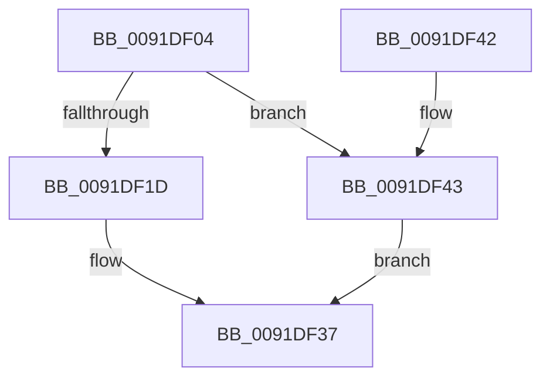

# MmSectionToSectionObjectPointers

- RVA: `0x0091DF04`–`0x0091DF47` (길이 `67` bytes)
- VA: `0x000000014091DF04`
- 실행 섹션: `PAGE`
- PDB 이름 있음: `예`; PDB Function 태그: `아니요`
- unwind 정보 RVA: `0x00065BB8`
- 디코드: `21`개 명령, `67/67` bytes 표시
- 미해석 바이트: `0` (있으면 어셈블리에 `.byte`로 보존)

> 이 문서는 커널 이미지의 기계어와 PDB 기호를 분석해 생성했습니다. 4번과 5번은 함수 원형과 자료형을 바이너리 사용 방식에서 추정한 C 해석이며 원본 소스 복구 결과는 아닙니다.

## 1. Dependencies

- 직접 호출 지점: **3**; 고유 호출 대상: **3**
- 직접 호출자로 확인된 함수: **1**
- RIP 상대 이미지 참조: **0**

### Outgoing calls
- `0x0091DF0E` → [MiSectionControlArea](../../text/29/MiSectionControlArea_function_00294CB0.md) (function, `0x00294CB0`)
- `0x0091DF20` → [MiReferenceControlAreaFile](../../text/43/MiReferenceControlAreaFile_function_00431554.md) (function, `0x00431554`)
- `0x0091DF2F` → [MiDereferenceControlAreaFile](../../text/43/MiDereferenceControlAreaFile_function_004345E0.md) (function, `0x004345E0`)

### Direct callers
- [IopIsFileOpenOrSection](IopIsFileOpenOrSection_function_0091DC80.md) at `0x0091DD49`

### Static image references
- 디코드된 RIP-relative 메모리 참조가 없습니다.

## 2. Other-region calls and transfers

- 다른 실행 섹션으로 향하는 call: **3**
  - `0x0091DF0E` → [MiSectionControlArea](../../text/29/MiSectionControlArea_function_00294CB0.md) (`PAGE` → `.text`)
  - `0x0091DF20` → [MiReferenceControlAreaFile](../../text/43/MiReferenceControlAreaFile_function_00431554.md) (`PAGE` → `.text`)
  - `0x0091DF2F` → [MiDereferenceControlAreaFile](../../text/43/MiDereferenceControlAreaFile_function_004345E0.md) (`PAGE` → `.text`)
- 별도 외부 분기/꼬리 이동을 확인하지 못했습니다.

## 3. Assembly (complete function range)

```asm
0091DF04  48 89 5C 24 08                  mov qword ptr [rsp + 8], rbx
0091DF09  57                              push rdi
0091DF0A  48 83 EC 20                     sub rsp, 0x20
0091DF0E  E8 9D 6D 97 FF                  call 0x140294cb0
0091DF13  48 8B F8                        mov rdi, rax
0091DF16  48 83 78 40 00                  cmp qword ptr [rax + 0x40], 0
0091DF1B  74 26                           je 0x14091df43
0091DF1D  48 8B C8                        mov rcx, rax
0091DF20  E8 2F 36 B1 FF                  call 0x140431554
0091DF25  48 8B D0                        mov rdx, rax
0091DF28  48 8B CF                        mov rcx, rdi
0091DF2B  48 8B 58 28                     mov rbx, qword ptr [rax + 0x28]
0091DF2F  E8 AC 66 B1 FF                  call 0x1404345e0
0091DF34  48 8B C3                        mov rax, rbx
0091DF37  48 8B 5C 24 30                  mov rbx, qword ptr [rsp + 0x30]
0091DF3C  48 83 C4 20                     add rsp, 0x20
0091DF40  5F                              pop rdi
0091DF41  C3                              ret
0091DF42  CC                              int3
0091DF43  33 C0                           xor eax, eax
0091DF45  EB F0                           jmp 0x14091df37
```

## 4. C-style interpretation (structured pseudocode)

```c
__int64 __fastcall MmSectionToSectionObjectPointers(void)
{
    __int64 result;
    __int64 v_rsp;
    unsigned __int64 v_stack_p8;

    v_stack_p8 = v_rbx;
    v_rsp = (v_rsp) - (32);
    result = MiSectionControlArea(a1, a2, a3, a4);
    if ((*(unsigned __int64 *)(result + 64)) == 0) goto loc_0091DF43;
    result = MiReferenceControlAreaFile(result, a2, a3, a4);
    result = MiDereferenceControlAreaFile(result, result, a3, a4);
loc_0091DF37:
    v_rsp = (v_rsp) + (32);
    return *(unsigned __int64 *)(result + 40);
loc_0091DF43:
    result = 0;
    goto loc_0091DF37;
}
```

## 5. (Beta) C Style

```c
void MmSectionToSectionObjectPointers(void)
{
    int64_t result;
    int64_t local_rsp;
    uint64_t v_stack_p8;

    v_stack_p8 = local_rbx;
    local_rsp = (local_rsp) - (32);
    result = MiSectionControlArea(a1, a2, a3, a4);
    if ((*(uint64_t *)(result + 0x40)) == 0) goto loc_0091DF43;
    result = MiReferenceControlAreaFile(result, a2, a3, a4);
    result = MiDereferenceControlAreaFile(result, result, a3, a4);
loc_0091DF37:
    local_rsp = (local_rsp) + (32);
    return *(uint64_t *)(result + 0x28);
loc_0091DF43:
    result = 0;
    goto loc_0091DF37;
}
```

## 6. Execution-region graph

[열기: 2D/3D 그래프와 함수 탐색 컨트롤 패널](../../../control-panel.html?section=page&rva=0x0091DF04&view=graph)

- 2D 그래프는 위에서 아래로 흐르고, 3D 그래프는 빈 공간을 드래그해 회전합니다. Shift+드래그는 이동, 휠은 확대·축소, 함수 노드 선택은 대상 보고서 이동입니다.

### Static fallback


