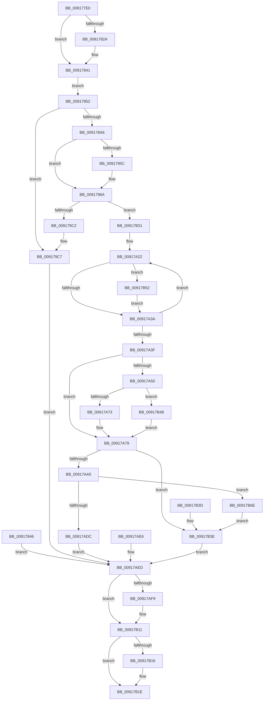

# NtCreateJobObject

- RVA: `0x009177E0`–`0x00917B73` (길이 `915` bytes)
- VA: `0x00000001409177E0`
- 실행 섹션: `PAGE`
- PDB 이름 있음: `예`; PDB Function 태그: `아니요`
- unwind 정보 RVA: `0x0008AA5C`
- 디코드: `211`개 명령, `915/915` bytes 표시
- 미해석 바이트: `0` (있으면 어셈블리에 `.byte`로 보존)

> 이 문서는 커널 이미지의 기계어와 PDB 기호를 분석해 생성했습니다. 4번과 5번은 함수 원형과 자료형을 바이너리 사용 방식에서 추정한 C 해석이며 원본 소스 복구 결과는 아닙니다.

## 1. Dependencies

- 직접 호출 지점: **18**; 고유 호출 대상: **15**
- 직접 호출자로 확인된 함수: **0**
- RIP 상대 이미지 참조: **6**

### Outgoing calls
- `0x00917852` → [PoEnergyEstimationEnabled](../../text/45/PoEnergyEstimationEnabled_function_00450000.md) (function, `0x00450000`)
- `0x00917897` → [ObCreateObjectEx](../89/ObCreateObjectEx_function_0089B1E0.md) (function, `0x0089B1E0`)
- `0x009178B3` → [memset](../../text/6C/memset_function_006C6C40.md) (function, `0x006C6C40`)
- `0x009178FC` → [KeInitializeEvent](../../text/40/KeInitializeEvent_function_0040DD10.md) (function, `0x0040DD10`)
- `0x00917924` → [memset](../../text/6C/memset_function_006C6C40.md) (function, `0x006C6C40`)
- `0x00917940` → [memset](../../text/6C/memset_function_006C6C40.md) (function, `0x006C6C40`)
- `0x0091799E` → [ExInitializeResourceLite](../../text/41/ExInitializeResourceLite_function_0041F9A0.md) (function, `0x0041F9A0`)
- `0x009179A6` → [PspLockJobListExclusive](PspLockJobListExclusive_function_00917780.md) (function, `0x00917780`)
- `0x009179E5` → [PspUnlockJobListExclusive](../A6/PspUnlockJobListExclusive_function_00A6E354.md) (function, `0x00A6E354`)
- `0x00917A29` → [ExUuidCreate](ExUuidCreate_function_00917500.md) (function, `0x00917500`)
- `0x00917A65` → [ExCreateHandleEx](../86/ExCreateHandleEx_function_0086ACB0.md) (function, `0x0086ACB0`)
- `0x00917A80` → [PspIoRateEntryInitialize](PspIoRateEntryInitialize_function_00917734.md) (function, `0x00917734`)
- `0x00917AA5` → [ObfReferenceObject](../../text/20/ObfReferenceObject_function_0020FA20.md) (function, `0x0020FA20`)
- `0x00917ACD` → [ObInsertObjectEx](../8B/ObInsertObjectEx_function_008B97A0.md) (function, `0x008B97A0`)
- `0x00917B0C` → [EtwTraceJob](EtwTraceJob_function_00917C38.md) (function, `0x00917C38`)
- `0x00917B19` → [ObfDereferenceObject](../../text/2F/ObfDereferenceObject_function_002F9350.md) (function, `0x002F9350`)
- `0x00917B3E` → [ObfDereferenceObject](../../text/2F/ObfDereferenceObject_function_002F9350.md) (function, `0x002F9350`)
- `0x00917B64` → [KeDelayExecutionThread](../../text/20/KeDelayExecutionThread_function_00209550.md) (function, `0x00209550`)

### Direct callers
- 이 함수 시작 RVA로 연결되는 직접 call은 확인되지 않았습니다. 간접 호출은 완전히 역산할 수 없습니다.

### Static image references
- `0x0091786C` → RVA `0x00FC6C58` (`ALMOSTRO`; read)
- `0x009179AF` → RVA `0x00FDA080` (`PAGEDATA`; read)
- `0x009179B6` → RVA `0x00FDA078` (`PAGEDATA`; read)
- `0x009179DB` → RVA `0x00FDA080` (`PAGEDATA`; write)
- `0x00917A50` → RVA `0x00FD9D00` (`PAGEDATA`; read)
- `0x00917AED` → RVA `0x00FC6B00` (`ALMOSTRO`; read)

## 2. Other-region calls and transfers

- 다른 실행 섹션으로 향하는 call: **10**
  - `0x00917852` → [PoEnergyEstimationEnabled](../../text/45/PoEnergyEstimationEnabled_function_00450000.md) (`PAGE` → `.text`)
  - `0x009178B3` → [memset](../../text/6C/memset_function_006C6C40.md) (`PAGE` → `.text`)
  - `0x009178FC` → [KeInitializeEvent](../../text/40/KeInitializeEvent_function_0040DD10.md) (`PAGE` → `.text`)
  - `0x00917924` → [memset](../../text/6C/memset_function_006C6C40.md) (`PAGE` → `.text`)
  - `0x00917940` → [memset](../../text/6C/memset_function_006C6C40.md) (`PAGE` → `.text`)
  - `0x0091799E` → [ExInitializeResourceLite](../../text/41/ExInitializeResourceLite_function_0041F9A0.md) (`PAGE` → `.text`)
  - `0x00917AA5` → [ObfReferenceObject](../../text/20/ObfReferenceObject_function_0020FA20.md) (`PAGE` → `.text`)
  - `0x00917B19` → [ObfDereferenceObject](../../text/2F/ObfDereferenceObject_function_002F9350.md) (`PAGE` → `.text`)
  - `0x00917B3E` → [ObfDereferenceObject](../../text/2F/ObfDereferenceObject_function_002F9350.md) (`PAGE` → `.text`)
  - `0x00917B64` → [KeDelayExecutionThread](../../text/20/KeDelayExecutionThread_function_00209550.md) (`PAGE` → `.text`)
- 별도 외부 분기/꼬리 이동을 확인하지 못했습니다.

## 3. Assembly (complete function range)

```asm
009177E0  48 8B C4                        mov rax, rsp
009177E3  48 89 58 08                     mov qword ptr [rax + 8], rbx
009177E7  48 89 70 18                     mov qword ptr [rax + 0x18], rsi
009177EB  89 50 10                        mov dword ptr [rax + 0x10], edx
009177EE  57                              push rdi
009177EF  41 54                           push r12
009177F1  41 55                           push r13
009177F3  41 56                           push r14
009177F5  41 57                           push r15
009177F7  48 81 EC 80 00 00 00            sub rsp, 0x80
009177FE  4D 8B E8                        mov r13, r8
00917801  4C 8B F9                        mov r15, rcx
00917804  33 FF                           xor edi, edi
00917806  48 89 78 B0                     mov qword ptr [rax - 0x50], rdi
0091780A  48 89 78 B8                     mov qword ptr [rax - 0x48], rdi
0091780E  89 BC 24 C8 00 00 00            mov dword ptr [rsp + 0xc8], edi
00917815  65 4C 8B 34 25 88 01 00 00      mov r14, qword ptr gs:[0x188]
0091781E  41 8A B6 32 02 00 00            mov sil, byte ptr [r14 + 0x232]
00917825  40 84 F6                        test sil, sil
00917828  74 17                           je 0x140917841
0091782A  48 B9 00 00 FF FF FF 7F 00 00   movabs rcx, 0x7fffffff0000
00917834  4C 3B F9                        cmp r15, rcx
00917837  49 0F 42 CF                     cmovb rcx, r15
0091783B  48 8B 01                        mov rax, qword ptr [rcx]
0091783E  48 89 01                        mov qword ptr [rcx], rax
00917841  49 89 3F                        mov qword ptr [r15], rdi
00917844  EB 0C                           jmp 0x140917852
00917846  8B F0                           mov esi, eax
00917848  48 8B 5C 24 58                  mov rbx, qword ptr [rsp + 0x58]
0091784D  E9 9B 02 00 00                  jmp 0x140917aed
00917852  E8 A9 87 B3 FF                  call 0x140450000
00917857  44 8A E0                        mov r12b, al
0091785A  8A C8                           mov cl, al
0091785C  F6 D9                           neg cl
0091785E  1B DB                           sbb ebx, ebx
00917860  81 E3 B8 01 00 00               and ebx, 0x1b8
00917866  81 C3 28 07 00 00               add ebx, 0x728
0091786C  48 8B 15 E5 F3 6A 00            mov rdx, qword ptr [rip + 0x6af3e5]
00917873  48 89 7C 24 48                  mov qword ptr [rsp + 0x48], rdi
00917878  48 8D 44 24 58                  lea rax, [rsp + 0x58]
0091787D  48 89 44 24 40                  mov qword ptr [rsp + 0x40], rax
00917882  89 5C 24 38                     mov dword ptr [rsp + 0x38], ebx
00917886  89 7C 24 30                     mov dword ptr [rsp + 0x30], edi
0091788A  89 5C 24 28                     mov dword ptr [rsp + 0x28], ebx
0091788E  44 8A CE                        mov r9b, sil
00917891  4D 8B C5                        mov r8, r13
00917894  40 8A CE                        mov cl, sil
00917897  E8 44 39 F8 FF                  call 0x14089b1e0
0091789C  8B F0                           mov esi, eax
0091789E  85 C0                           test eax, eax
009178A0  0F 88 21 01 00 00               js 0x1409179c7
009178A6  44 8B C3                        mov r8d, ebx
009178A9  33 D2                           xor edx, edx
009178AB  48 8B 5C 24 58                  mov rbx, qword ptr [rsp + 0x58]
009178B0  48 8B CB                        mov rcx, rbx
009178B3  E8 88 F3 DA FF                  call 0x1406c6c40
009178B8  48 89 9B 20 05 00 00            mov qword ptr [rbx + 0x520], rbx
009178BF  48 8D 43 28                     lea rax, [rbx + 0x28]
009178C3  48 89 40 08                     mov qword ptr [rax + 8], rax
009178C7  48 89 00                        mov qword ptr [rax], rax
009178CA  48 8D 83 08 05 00 00            lea rax, [rbx + 0x508]
009178D1  48 89 40 08                     mov qword ptr [rax + 8], rax
009178D5  48 89 00                        mov qword ptr [rax], rax
009178D8  48 8D 83 F8 04 00 00            lea rax, [rbx + 0x4f8]
009178DF  48 89 40 08                     mov qword ptr [rax + 8], rax
009178E3  48 89 00                        mov qword ptr [rax], rax
009178E6  48 8D 83 28 05 00 00            lea rax, [rbx + 0x528]
009178ED  48 89 40 08                     mov qword ptr [rax + 8], rax
009178F1  48 89 00                        mov qword ptr [rax], rax
009178F4  45 33 C0                        xor r8d, r8d
009178F7  33 D2                           xor edx, edx
009178F9  48 8B CB                        mov rcx, rbx
009178FC  E8 0F 64 AF FF                  call 0x14040dd10
00917901  48 89 BB F0 04 00 00            mov qword ptr [rbx + 0x4f0], rdi
00917908  48 C7 83 08 01 00 00 01 00 20 00  mov qword ptr [rbx + 0x108], 0x200001
00917913  48 8D 8B 10 01 00 00            lea rcx, [rbx + 0x110]
0091791A  BE 00 01 00 00                  mov esi, 0x100
0091791F  44 8B C6                        mov r8d, esi
00917922  33 D2                           xor edx, edx
00917924  E8 17 F3 DA FF                  call 0x1406c6c40
00917929  48 C7 83 D8 02 00 00 01 00 20 00  mov qword ptr [rbx + 0x2d8], 0x200001
00917934  48 8D 8B E0 02 00 00            lea rcx, [rbx + 0x2e0]
0091793B  44 8B C6                        mov r8d, esi
0091793E  33 D2                           xor edx, edx
00917940  E8 FB F2 DA FF                  call 0x1406c6c40
00917945  48 8D 83 E8 05 00 00            lea rax, [rbx + 0x5e8]
0091794C  48 89 40 08                     mov qword ptr [rax + 8], rax
00917950  48 89 00                        mov qword ptr [rax], rax
00917953  48 89 78 10                     mov qword ptr [rax + 0x10], rdi
00917957  45 84 E4                        test r12b, r12b
0091795A  74 0E                           je 0x14091796a
0091795C  48 8D 83 28 07 00 00            lea rax, [rbx + 0x728]
00917963  48 89 83 18 06 00 00            mov qword ptr [rbx + 0x618], rax
0091796A  83 8B 40 02 00 00 FF            or dword ptr [rbx + 0x240], 0xffffffff
00917971  C7 83 50 04 00 00 FE 3F 00 00   mov dword ptr [rbx + 0x450], 0x3ffe
0091797B  B8 01 00 00 00                  mov eax, 1
00917980  48 89 83 D8 06 00 00            mov qword ptr [rbx + 0x6d8], rax
00917987  C7 83 24 04 00 00 0A 00 00 00   mov dword ptr [rbx + 0x424], 0xa
00917991  8D 70 04                        lea esi, [rax + 4]
00917994  89 B3 44 02 00 00               mov dword ptr [rbx + 0x244], esi
0091799A  48 8D 4B 38                     lea rcx, [rbx + 0x38]
0091799E  E8 FD 7F B0 FF                  call 0x14041f9a0
009179A3  49 8B CE                        mov rcx, r14
009179A6  E8 D5 FD FF FF                  call 0x140917780
009179AB  48 8D 43 18                     lea rax, [rbx + 0x18]
009179AF  48 8B 0D CA 26 6C 00            mov rcx, qword ptr [rip + 0x6c26ca]
009179B6  48 8D 15 BB 26 6C 00            lea rdx, [rip + 0x6c26bb]
009179BD  48 39 11                        cmp qword ptr [rcx], rdx
009179C0  74 0F                           je 0x1409179d1
009179C2  8D 4E FE                        lea ecx, [rsi - 2]
009179C5  CD 29                           int 0x29
009179C7  48 8B 5C 24 58                  mov rbx, qword ptr [rsp + 0x58]
009179CC  E9 1C 01 00 00                  jmp 0x140917aed
009179D1  48 89 10                        mov qword ptr [rax], rdx
009179D4  48 89 48 08                     mov qword ptr [rax + 8], rcx
009179D8  48 89 01                        mov qword ptr [rcx], rax
009179DB  48 89 05 9E 26 6C 00            mov qword ptr [rip + 0x6c269e], rax
009179E2  49 8B CE                        mov rcx, r14
009179E5  E8 6A 69 15 00                  call 0x140a6e354
009179EA  89 B3 3C 04 00 00               mov dword ptr [rbx + 0x43c], esi
009179F0  89 B3 40 04 00 00               mov dword ptr [rbx + 0x440], esi
009179F6  B8 08 00 00 00                  mov eax, 8
009179FB  89 83 44 04 00 00               mov dword ptr [rbx + 0x444], eax
00917A01  89 83 48 04 00 00               mov dword ptr [rbx + 0x448], eax
00917A07  0F BA AB 10 06 00 00 15         bts dword ptr [rbx + 0x610], 0x15
00917A0F  8B 83 10 06 00 00               mov eax, dword ptr [rbx + 0x610]
00917A15  89 84 24 C8 00 00 00            mov dword ptr [rsp + 0xc8], eax
00917A1C  41 BC 2D 02 00 C0               mov r12d, 0xc000022d
00917A22  48 8D 8B C0 05 00 00            lea rcx, [rbx + 0x5c0]
00917A29  E8 D2 FA FF FF                  call 0x140917500
00917A2E  44 8B F0                        mov r14d, eax
00917A31  41 3B C4                        cmp eax, r12d
00917A34  0F 84 18 01 00 00               je 0x140917b52
00917A3A  45 3B F4                        cmp r14d, r12d
00917A3D  74 E3                           je 0x140917a22
00917A3F  8B F7                           mov esi, edi
00917A41  41 81 FE 56 00 02 40            cmp r14d, 0x40020056
00917A48  41 0F 45 F6                     cmovne esi, r14d
00917A4C  85 F6                           test esi, esi
00917A4E  78 29                           js 0x140917a79
00917A50  48 8B 0D A9 22 6C 00            mov rcx, qword ptr [rip + 0x6c22a9]
00917A57  48 89 7C 24 20                  mov qword ptr [rsp + 0x20], rdi
00917A5C  45 33 C9                        xor r9d, r9d
00917A5F  45 33 C0                        xor r8d, r8d
00917A62  48 8B D3                        mov rdx, rbx
00917A65  E8 46 32 F5 FF                  call 0x14086acb0
00917A6A  48 85 C0                        test rax, rax
00917A6D  0F 84 D5 00 00 00               je 0x140917b48
00917A73  89 83 BC 05 00 00               mov dword ptr [rbx + 0x5bc], eax
00917A79  48 8D 8B 60 06 00 00            lea rcx, [rbx + 0x660]
00917A80  E8 AF FC FF FF                  call 0x140917734
00917A85  48 89 BB A0 06 00 00            mov qword ptr [rbx + 0x6a0], rdi
00917A8C  48 89 BB A8 06 00 00            mov qword ptr [rbx + 0x6a8], rdi
00917A93  48 89 BB D0 06 00 00            mov qword ptr [rbx + 0x6d0], rdi
00917A9A  48 8B CB                        mov rcx, rbx
00917A9D  85 F6                           test esi, esi
00917A9F  0F 88 99 00 00 00               js 0x140917b3e
00917AA5  E8 76 7F 8F FF                  call 0x14020fa20
00917AAA  48 8D 44 24 60                  lea rax, [rsp + 0x60]
00917AAF  48 89 44 24 30                  mov qword ptr [rsp + 0x30], rax
00917AB4  48 89 7C 24 28                  mov qword ptr [rsp + 0x28], rdi
00917AB9  89 7C 24 20                     mov dword ptr [rsp + 0x20], edi
00917ABD  45 33 C9                        xor r9d, r9d
00917AC0  44 8B 84 24 B8 00 00 00         mov r8d, dword ptr [rsp + 0xb8]
00917AC8  33 D2                           xor edx, edx
00917ACA  48 8B CB                        mov rcx, rbx
00917ACD  E8 CE 1C FA FF                  call 0x1408b97a0
00917AD2  8B F0                           mov esi, eax
00917AD4  85 C0                           test eax, eax
00917AD6  0F 88 92 00 00 00               js 0x140917b6e
00917ADC  48 8B 44 24 60                  mov rax, qword ptr [rsp + 0x60]
00917AE1  49 89 07                        mov qword ptr [r15], rax
00917AE4  EB 07                           jmp 0x140917aed
00917AE6  8B F0                           mov esi, eax
00917AE8  48 8B 5C 24 58                  mov rbx, qword ptr [rsp + 0x58]
00917AED  F7 05 09 F0 6A 00 00 00 08 00   test dword ptr [rip + 0x6af009], 0x80000
00917AF7  74 18                           je 0x140917b11
00917AF9  41 B9 20 07 00 00               mov r9d, 0x720
00917AFF  44 8B C6                        mov r8d, esi
00917B02  8B 94 24 C8 00 00 00            mov edx, dword ptr [rsp + 0xc8]
00917B09  48 8B CB                        mov rcx, rbx
00917B0C  E8 27 01 00 00                  call 0x140917c38
00917B11  48 85 DB                        test rbx, rbx
00917B14  74 08                           je 0x140917b1e
00917B16  48 8B CB                        mov rcx, rbx
00917B19  E8 32 18 9E FF                  call 0x1402f9350
00917B1E  8B C6                           mov eax, esi
00917B20  4C 8D 9C 24 80 00 00 00         lea r11, [rsp + 0x80]
00917B28  49 8B 5B 30                     mov rbx, qword ptr [r11 + 0x30]
00917B2C  49 8B 73 40                     mov rsi, qword ptr [r11 + 0x40]
00917B30  49 8B E3                        mov rsp, r11
00917B33  41 5F                           pop r15
00917B35  41 5E                           pop r14
00917B37  41 5D                           pop r13
00917B39  41 5C                           pop r12
00917B3B  5F                              pop rdi
00917B3C  C3                              ret
00917B3D  CC                              int3
00917B3E  E8 0D 18 9E FF                  call 0x1402f9350
00917B43  48 8B DF                        mov rbx, rdi
00917B46  EB A5                           jmp 0x140917aed
00917B48  BE 9A 00 00 C0                  mov esi, 0xc000009a
00917B4D  E9 27 FF FF FF                  jmp 0x140917a79
00917B52  48 C7 44 24 68 F0 D8 FF FF      mov qword ptr [rsp + 0x68], 0xffffffffffffd8f0
00917B5B  4C 8D 44 24 68                  lea r8, [rsp + 0x68]
00917B60  33 D2                           xor edx, edx
00917B62  33 C9                           xor ecx, ecx
00917B64  E8 E7 19 8F FF                  call 0x140209550
00917B69  E9 CC FE FF FF                  jmp 0x140917a3a
00917B6E  48 8B CB                        mov rcx, rbx
00917B71  EB CB                           jmp 0x140917b3e
```

## 4. C-style interpretation (structured pseudocode)

```c
__int64 __fastcall NtCreateJobObject(__int64 a1, int a2, __int64 a3)
{
    __int64 result;
    __int64 v_rbx;
    __int64 v_rdi;
    __int64 v_rsi;
    __int64 v_rsp;
    unsigned __int64 v_stack_m18;
    unsigned __int64 v_stack_m28;
    unsigned __int64 v_stack_m48;
    unsigned __int64 v_stack_m50;
    unsigned __int64 v_stack_m60;
    unsigned __int64 v_stack_m68;
    unsigned int v_stack_m70;
    unsigned int v_stack_m78;
    unsigned int v_stack_m80;
    unsigned __int64 v_stack_m88;
    unsigned int v_stack_p10;
    unsigned int v_stack_p20;

    *(unsigned __int64 *)(v_rsp + 8) = v_rbx;
    *(unsigned __int64 *)(v_rsp + 24) = v_rsi;
    *(unsigned int *)(v_rsp + 16) = a2;
    v_rsp = (v_rsp) - (128);
    v_rdi = 0;
    *(unsigned __int64 *)(v_rsp - 80) = 0;
    *(unsigned __int64 *)(v_rsp - 72) = 0;
    v_stack_p20 = 0;
    result = v_rsp;
    if ((unsigned __int8)(*(unsigned __int8 *)(*(unsigned __int64 *)(gs_base + (0 + 392)) + 562)) != 0) {
        if (a1 < a1) { a1 = a1; }
        result = *(unsigned __int64 *)(a1);
        *(unsigned __int64 *)(a1) = result;
    }
    *(unsigned __int64 *)(a1) = 0;
    goto loc_00917852;
loc_00917852:
    result = PoEnergyEstimationEnabled(a1, a2, a3, a4);
    a1 = (unsigned __int8)(-((unsigned __int8)(result)));
    v_rbx = (unsigned int)((v_rbx) & (440));
    v_rbx = (unsigned int)((v_rbx) + (0x728ULL));
    v_stack_m60 = 0;
    v_stack_m68 = v_stack_m50;
    v_stack_m70 = (unsigned int)(v_rbx);
    v_stack_m78 = 0;
    v_stack_m80 = (unsigned int)(v_rbx);
    result = ObCreateObjectEx((unsigned __int8)(*(unsigned __int8 *)(*(unsigned __int64 *)(gs_base + (0 + 392)) + 562)), *(unsigned __int64 *)(v_rip + 7009253), a3, (unsigned __int8)(*(unsigned __int8 *)(*(unsigned __int64 *)(gs_base + (0 + 392)) + 562)));
    if (sign_flag) goto loc_009179C7;
    a2 = 0;
    result = memset(v_stack_m50, a2, (unsigned int)((unsigned int)(v_rbx)), (unsigned __int8)(*(unsigned __int8 *)(*(unsigned __int64 *)(gs_base + (0 + 392)) + 562)));
    *(unsigned __int64 *)(v_stack_m50 + 1312) = v_stack_m50;
    *(unsigned __int64 *)(v_stack_m50 + 40 + 8) = v_stack_m50 + 40;
    *(unsigned __int64 *)(v_stack_m50 + 40) = v_stack_m50 + 40;
    *(unsigned __int64 *)(v_stack_m50 + 1288 + 8) = v_stack_m50 + 1288;
    *(unsigned __int64 *)(v_stack_m50 + 1288) = v_stack_m50 + 1288;
    *(unsigned __int64 *)(v_stack_m50 + 1272 + 8) = v_stack_m50 + 1272;
    *(unsigned __int64 *)(v_stack_m50 + 1272) = v_stack_m50 + 1272;
    *(unsigned __int64 *)(v_stack_m50 + 1320 + 8) = v_stack_m50 + 1320;
    *(unsigned __int64 *)(v_stack_m50 + 1320) = v_stack_m50 + 1320;
    a3 = 0;
    a2 = 0;
    result = KeInitializeEvent(v_stack_m50, a2, a3, (unsigned __int8)(*(unsigned __int8 *)(*(unsigned __int64 *)(gs_base + (0 + 392)) + 562)));
    *(unsigned __int64 *)(v_stack_m50 + 1264) = 0;
    *(unsigned __int64 *)(v_stack_m50 + 264) = 0x200001ULL;
    a2 = 0;
    result = memset(v_stack_m50 + 272, a2, 256, (unsigned __int8)(*(unsigned __int8 *)(*(unsigned __int64 *)(gs_base + (0 + 392)) + 562)));
    *(unsigned __int64 *)(v_stack_m50 + 728) = 0x200001ULL;
    a2 = 0;
    result = memset(v_stack_m50 + 736, a2, 256, (unsigned __int8)(*(unsigned __int8 *)(*(unsigned __int64 *)(gs_base + (0 + 392)) + 562)));
    *(unsigned __int64 *)(v_stack_m50 + 1512 + 8) = v_stack_m50 + 1512;
    *(unsigned __int64 *)(v_stack_m50 + 1512) = v_stack_m50 + 1512;
    *(unsigned __int64 *)(v_stack_m50 + 1512 + 16) = 0;
    result = v_stack_m50 + 1512;
    if ((unsigned __int8)((unsigned __int8)(result)) != 0) {
        result = v_stack_m50 + 1832;
        *(unsigned __int64 *)(v_stack_m50 + 1560) = result;
    }
    *(unsigned int *)(v_stack_m50 + 1104) = 0x3FFEULL;
    *(unsigned __int64 *)(v_stack_m50 + 1752) = 1;
    *(unsigned int *)(v_stack_m50 + 1060) = 10;
    *(unsigned int *)(v_stack_m50 + 580) = (unsigned int)(1 + 4);
    result = ExInitializeResourceLite(v_stack_m50 + 56, a2, 256, (unsigned __int8)(*(unsigned __int8 *)(*(unsigned __int64 *)(gs_base + (0 + 392)) + 562)));
    result = PspLockJobListExclusive(*(unsigned __int64 *)(gs_base + (0 + 392)), a2, 256, (unsigned __int8)(*(unsigned __int8 *)(*(unsigned __int64 *)(gs_base + (0 + 392)) + 562)));
    if ((*(unsigned __int64 *)(*(unsigned __int64 *)(v_rip + 7087818))) == (v_rip + 7087803)) goto loc_009179D1;
loc_009179C7:
    goto loc_00917AED;
loc_009179D1:
    *(unsigned __int64 *)(v_stack_m50 + 24) = v_rip + 7087803;
    *(unsigned __int64 *)(v_stack_m50 + 24 + 8) = 1 + 4 - 2;
    *(unsigned __int64 *)(1 + 4 - 2) = v_stack_m50 + 24;
    *(unsigned __int64 *)(v_rip + 7087774) = v_stack_m50 + 24;
    result = PspUnlockJobListExclusive(*(unsigned __int64 *)(gs_base + (0 + 392)), v_rip + 7087803, 256, (unsigned __int8)(*(unsigned __int8 *)(*(unsigned __int64 *)(gs_base + (0 + 392)) + 562)));
    *(unsigned int *)(v_stack_m50 + 1084) = (unsigned int)(1 + 4);
    *(unsigned int *)(v_stack_m50 + 1088) = (unsigned int)(1 + 4);
    *(unsigned int *)(v_stack_m50 + 1092) = 8;
    *(unsigned int *)(v_stack_m50 + 1096) = 8;
    v_stack_p20 = (unsigned int)((unsigned int)(*(unsigned int *)(v_stack_m50 + 1552)));
loc_00917A22:
    result = ExUuidCreate(v_stack_m50 + 1472, v_rip + 7087803, 256, (unsigned __int8)(*(unsigned __int8 *)(*(unsigned __int64 *)(gs_base + (0 + 392)) + 562)));
    if (((unsigned int)(result)) == ((unsigned int)((unsigned int)(0xC000022DULL)))) goto loc_00917B52;
loc_00917A3A:
    if (((unsigned int)((unsigned int)((unsigned int)(result)))) == ((unsigned int)((unsigned int)(0xC000022DULL)))) goto loc_00917A22;
    v_rsi = 0;
    if (((unsigned int)((unsigned int)((unsigned int)(result)))) != 0x40020056ULL) { v_rsi = (unsigned int)((unsigned int)((unsigned int)(result))); }
    if (sign_flag) goto loc_00917A79;
    v_stack_m88 = 0;
    a4 = 0;
    a3 = 0;
    result = ExCreateHandleEx(*(unsigned __int64 *)(v_rip + 7086761), v_stack_m50, a3, a4);
    if (result == 0) goto loc_00917B48;
    *(unsigned int *)(v_stack_m50 + 1468) = (unsigned int)(result);
loc_00917A79:
    result = PspIoRateEntryInitialize(v_stack_m50 + 1632, v_stack_m50, a3, a4);
    *(unsigned __int64 *)(v_stack_m50 + 1696) = 0;
    *(unsigned __int64 *)(v_stack_m50 + 1704) = 0;
    *(unsigned __int64 *)(v_stack_m50 + 1744) = 0;
    if (sign_flag) goto loc_00917B3E;
    result = ObfReferenceObject(v_stack_m50, v_stack_m50, a3, a4);
    v_stack_m78 = v_stack_m48;
    v_stack_m80 = 0;
    v_stack_m88 = 0;
    a4 = 0;
    a2 = 0;
    result = ObInsertObjectEx(v_stack_m50, a2, (unsigned int)(v_stack_p10), a4);
    if (sign_flag) goto loc_00917B6E;
    *(unsigned __int64 *)(a1) = v_stack_m48;
    goto loc_00917AED;
loc_00917AED:
    result = v_stack_m48;
    if (((*(unsigned int *)(v_rip + 7008265)) & (0x80000ULL)) != 0) {
        a4 = 0x720ULL;
        a3 = (unsigned int)((unsigned int)((unsigned int)(result)));
        a2 = v_stack_p20;
        a1 = v_stack_m50;
        result = EtwTraceJob(a1, a2, a3, a4);
    }
    if (v_stack_m50 != 0) {
        a1 = v_stack_m50;
        result = ObfDereferenceObject(a1, a2, a3, a4);
    }
    return (unsigned int)((unsigned int)((unsigned int)((unsigned int)(result))));
loc_00917B3E:
    result = ObfDereferenceObject(a1, a2, a3, a4);
    goto loc_00917AED;
loc_00917B48:
    goto loc_00917A79;
loc_00917B52:
    v_stack_m18 = 0xFFFFFFFFFFFFD8F0ULL;
    a2 = 0;
    a1 = 0;
    result = KeDelayExecutionThread(a1, a2, v_stack_m18, a4);
    goto loc_00917A3A;
loc_00917B6E:
    goto loc_00917B3E;
}
```

## 5. (Beta) C Style

```c
int64_t NtCreateJobObject(int64_t Arg1, int32_t Arg2, int64_t Arg3)
{
    int64_t result;
    int64_t local_rbx;
    int64_t local_rdi;
    int64_t local_rsi;
    int64_t local_rsp;
    uint64_t v_stack_m18;
    uint64_t v_stack_m28;
    uint64_t v_stack_m48;
    uint64_t v_stack_m50;
    uint64_t v_stack_m60;
    uint64_t v_stack_m68;
    uint32_t v_stack_m70;
    uint32_t v_stack_m78;
    uint32_t v_stack_m80;
    uint64_t v_stack_m88;
    uint32_t v_stack_p10;
    uint32_t v_stack_p20;

    *(uint64_t *)(local_rsp + 0x8) = local_rbx;
    *(uint64_t *)(local_rsp + 0x18) = local_rsi;
    *(uint32_t *)(local_rsp + 0x10) = Arg2;
    local_rsp = (local_rsp) - (128);
    local_rdi = 0;
    *(uint64_t *)(local_rsp - 0x50) = 0;
    *(uint64_t *)(local_rsp - 0x48) = 0;
    v_stack_p20 = 0;
    result = local_rsp;
    if ((uint8_t)(*(uint8_t *)(*(uint64_t *)(gs_base + (0 + 0x188)) + 0x232)) != 0) {
        if (Arg1 < Arg1) { Arg1 = Arg1; }
        result = *(uint64_t *)(Arg1);
        *(uint64_t *)(Arg1) = result;
    }
    *(uint64_t *)(Arg1) = 0;
    goto loc_00917852;
loc_00917852:
    result = PoEnergyEstimationEnabled(Arg1, Arg2, Arg3, a4);
    Arg1 = (uint8_t)(-((uint8_t)(result)));
    local_rbx = (uint32_t)((local_rbx) & (440));
    local_rbx = (uint32_t)((local_rbx) + (0x728ULL));
    v_stack_m60 = 0;
    v_stack_m68 = v_stack_m50;
    v_stack_m70 = (uint32_t)(local_rbx);
    v_stack_m78 = 0;
    v_stack_m80 = (uint32_t)(local_rbx);
    result = ObCreateObjectEx((uint8_t)(*(uint8_t *)(*(uint64_t *)(gs_base + (0 + 0x188)) + 0x232)), *(uint64_t *)(v_rip + 0x6AF3E5), Arg3, (uint8_t)(*(uint8_t *)(*(uint64_t *)(gs_base + (0 + 0x188)) + 0x232)));
    if (sign_flag) goto loc_009179C7;
    Arg2 = 0;
    result = memset(v_stack_m50, Arg2, (uint32_t)((uint32_t)(local_rbx)), (uint8_t)(*(uint8_t *)(*(uint64_t *)(gs_base + (0 + 0x188)) + 0x232)));
    *(uint64_t *)(v_stack_m50 + 0x520) = v_stack_m50;
    *(uint64_t *)(v_stack_m50 + 0x28 + 0x8) = v_stack_m50 + 40;
    *(uint64_t *)(v_stack_m50 + 0x28) = v_stack_m50 + 40;
    *(uint64_t *)(v_stack_m50 + 0x508 + 0x8) = v_stack_m50 + 1288;
    *(uint64_t *)(v_stack_m50 + 0x508) = v_stack_m50 + 1288;
    *(uint64_t *)(v_stack_m50 + 0x4F8 + 0x8) = v_stack_m50 + 1272;
    *(uint64_t *)(v_stack_m50 + 0x4F8) = v_stack_m50 + 1272;
    *(uint64_t *)(v_stack_m50 + 0x528 + 0x8) = v_stack_m50 + 1320;
    *(uint64_t *)(v_stack_m50 + 0x528) = v_stack_m50 + 1320;
    Arg3 = 0;
    Arg2 = 0;
    result = KeInitializeEvent(v_stack_m50, Arg2, Arg3, (uint8_t)(*(uint8_t *)(*(uint64_t *)(gs_base + (0 + 0x188)) + 0x232)));
    *(uint64_t *)(v_stack_m50 + 0x4F0) = 0;
    *(uint64_t *)(v_stack_m50 + 0x108) = 0x200001ULL;
    Arg2 = 0;
    result = memset(v_stack_m50 + 272, Arg2, 256, (uint8_t)(*(uint8_t *)(*(uint64_t *)(gs_base + (0 + 0x188)) + 0x232)));
    *(uint64_t *)(v_stack_m50 + 0x2D8) = 0x200001ULL;
    Arg2 = 0;
    result = memset(v_stack_m50 + 736, Arg2, 256, (uint8_t)(*(uint8_t *)(*(uint64_t *)(gs_base + (0 + 0x188)) + 0x232)));
    *(uint64_t *)(v_stack_m50 + 0x5E8 + 0x8) = v_stack_m50 + 1512;
    *(uint64_t *)(v_stack_m50 + 0x5E8) = v_stack_m50 + 1512;
    *(uint64_t *)(v_stack_m50 + 0x5E8 + 0x10) = 0;
    result = v_stack_m50 + 1512;
    if ((uint8_t)((uint8_t)(result)) != 0) {
        result = v_stack_m50 + 1832;
        *(uint64_t *)(v_stack_m50 + 0x618) = result;
    }
    *(uint32_t *)(v_stack_m50 + 0x450) = 0x3FFEULL;
    *(uint64_t *)(v_stack_m50 + 0x6D8) = 1;
    *(uint32_t *)(v_stack_m50 + 0x424) = 10;
    *(uint32_t *)(v_stack_m50 + 0x244) = (uint32_t)(1 + 4);
    result = ExInitializeResourceLite(v_stack_m50 + 56, Arg2, 256, (uint8_t)(*(uint8_t *)(*(uint64_t *)(gs_base + (0 + 0x188)) + 0x232)));
    result = PspLockJobListExclusive(*(uint64_t *)(gs_base + (0 + 0x188)), Arg2, 256, (uint8_t)(*(uint8_t *)(*(uint64_t *)(gs_base + (0 + 0x188)) + 0x232)));
    if ((*(uint64_t *)(*(uint64_t *)(v_rip + 0x6C26CA))) == (v_rip + 7087803)) goto loc_009179D1;
loc_009179C7:
    goto loc_00917AED;
loc_009179D1:
    *(uint64_t *)(v_stack_m50 + 0x18) = v_rip + 7087803;
    *(uint64_t *)(v_stack_m50 + 0x18 + 0x8) = 1 + 4 - 2;
    *(uint64_t *)(1 + 0x4 - 0x2) = v_stack_m50 + 24;
    *(uint64_t *)(v_rip + 0x6C269E) = v_stack_m50 + 24;
    result = PspUnlockJobListExclusive(*(uint64_t *)(gs_base + (0 + 0x188)), v_rip + 7087803, 256, (uint8_t)(*(uint8_t *)(*(uint64_t *)(gs_base + (0 + 0x188)) + 0x232)));
    *(uint32_t *)(v_stack_m50 + 0x43C) = (uint32_t)(1 + 4);
    *(uint32_t *)(v_stack_m50 + 0x440) = (uint32_t)(1 + 4);
    *(uint32_t *)(v_stack_m50 + 0x444) = 8;
    *(uint32_t *)(v_stack_m50 + 0x448) = 8;
    v_stack_p20 = (uint32_t)((uint32_t)(*(uint32_t *)(v_stack_m50 + 0x610)));
loc_00917A22:
    result = ExUuidCreate(v_stack_m50 + 1472, v_rip + 7087803, 256, (uint8_t)(*(uint8_t *)(*(uint64_t *)(gs_base + (0 + 0x188)) + 0x232)));
    if (((uint32_t)(result)) == ((uint32_t)((uint32_t)(0xC000022DULL)))) goto loc_00917B52;
loc_00917A3A:
    if (((uint32_t)((uint32_t)((uint32_t)(result)))) == ((uint32_t)((uint32_t)(0xC000022DULL)))) goto loc_00917A22;
    local_rsi = 0;
    if (((uint32_t)((uint32_t)((uint32_t)(result)))) != 0x40020056ULL) { local_rsi = (uint32_t)((uint32_t)((uint32_t)(result))); }
    if (sign_flag) goto loc_00917A79;
    v_stack_m88 = 0;
    a4 = 0;
    Arg3 = 0;
    result = ExCreateHandleEx(*(uint64_t *)(v_rip + 0x6C22A9), v_stack_m50, Arg3, a4);
    if (result == 0) goto loc_00917B48;
    *(uint32_t *)(v_stack_m50 + 0x5BC) = (uint32_t)(result);
loc_00917A79:
    result = PspIoRateEntryInitialize(v_stack_m50 + 1632, v_stack_m50, Arg3, a4);
    *(uint64_t *)(v_stack_m50 + 0x6A0) = 0;
    *(uint64_t *)(v_stack_m50 + 0x6A8) = 0;
    *(uint64_t *)(v_stack_m50 + 0x6D0) = 0;
    if (sign_flag) goto loc_00917B3E;
    result = ObfReferenceObject(v_stack_m50, v_stack_m50, Arg3, a4);
    v_stack_m78 = v_stack_m48;
    v_stack_m80 = 0;
    v_stack_m88 = 0;
    a4 = 0;
    Arg2 = 0;
    result = ObInsertObjectEx(v_stack_m50, Arg2, (uint32_t)(v_stack_p10), a4);
    if (sign_flag) goto loc_00917B6E;
    *(uint64_t *)(Arg1) = v_stack_m48;
    goto loc_00917AED;
loc_00917AED:
    result = v_stack_m48;
    if (((*(uint32_t *)(v_rip + 0x6AF009)) & (0x80000ULL)) != 0) {
        a4 = 0x720ULL;
        Arg3 = (uint32_t)((uint32_t)((uint32_t)(result)));
        Arg2 = v_stack_p20;
        Arg1 = v_stack_m50;
        result = EtwTraceJob(Arg1, Arg2, Arg3, a4);
    }
    if (v_stack_m50 != 0) {
        Arg1 = v_stack_m50;
        result = ObfDereferenceObject(Arg1, Arg2, Arg3, a4);
    }
    return (uint32_t)((uint32_t)((uint32_t)((uint32_t)(result))));
loc_00917B3E:
    result = ObfDereferenceObject(Arg1, Arg2, Arg3, a4);
    goto loc_00917AED;
loc_00917B48:
    goto loc_00917A79;
loc_00917B52:
    v_stack_m18 = 0xFFFFFFFFFFFFD8F0ULL;
    Arg2 = 0;
    Arg1 = 0;
    result = KeDelayExecutionThread(Arg1, Arg2, v_stack_m18, a4);
    goto loc_00917A3A;
loc_00917B6E:
    goto loc_00917B3E;
}
```

## 6. Execution-region graph

[열기: 2D/3D 그래프와 함수 탐색 컨트롤 패널](../../../control-panel.html?section=page&rva=0x009177E0&view=graph)

- 2D 그래프는 위에서 아래로 흐르고, 3D 그래프는 빈 공간을 드래그해 회전합니다. Shift+드래그는 이동, 휠은 확대·축소, 함수 노드 선택은 대상 보고서 이동입니다.

### Static fallback


