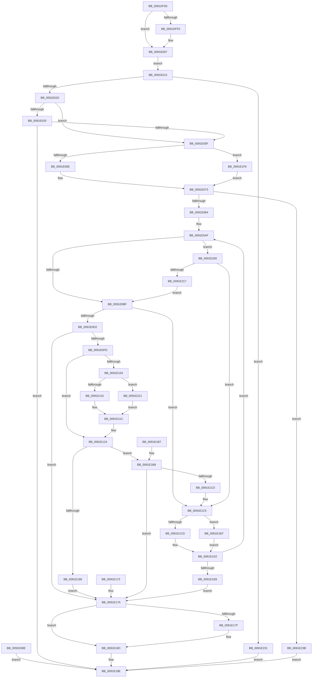

# NtGetNextProcess

- RVA: `0x0091DF50`–`0x0091E245` (길이 `757` bytes)
- VA: `0x000000014091DF50`
- 실행 섹션: `PAGE`
- PDB 이름 있음: `예`; PDB Function 태그: `아니요`
- unwind 정보 RVA: `0x0008B3D0`
- 디코드: `167`개 명령, `757/757` bytes 표시
- 미해석 바이트: `0` (있으면 어셈블리에 `.byte`로 보존)

> 이 문서는 커널 이미지의 기계어와 PDB 기호를 분석해 생성했습니다. 4번과 5번은 함수 원형과 자료형을 바이너리 사용 방식에서 추정한 C 해석이며 원본 소스 복구 결과는 아닙니다.

## 1. Dependencies

- 직접 호출 지점: **16**; 고유 호출 대상: **13**
- 직접 호출자로 확인된 함수: **0**
- RIP 상대 이미지 참조: **3**

### Outgoing calls
- `0x0091DFA2` → [memset](../../text/6C/memset_function_006C6C40.md) (function, `0x006C6C40`)
- `0x0091DFB7` → [memset](../../text/6C/memset_function_006C6C40.md) (function, `0x006C6C40`)
- `0x0091E052` → [ObpReferenceObjectByHandleWithTag](../86/ObpReferenceObjectByHandleWithTag_function_00869650.md) (function, `0x00869650`)
- `0x0091E06E` → [PsGetNextProcess](PsGetNextProcess_function_0091C900.md) (function, `0x0091C900`)
- `0x0091E08E` → [SeSinglePrivilegeCheck](../87/SeSinglePrivilegeCheck_function_00871E20.md) (function, `0x00871E20`)
- `0x0091E0A5` → [PsGetCurrentServerSilo](../../text/22/PsGetCurrentServerSilo_function_00225710.md) (function, `0x00225710`)
- `0x0091E0C5` → [PsIsProcessInSilo](../../text/41/PsIsProcessInSilo_function_004185E0.md) (function, `0x004185E0`)
- `0x0091E0F2` → [SeCreateAccessState](../8C/SeCreateAccessState_function_008C6AC0.md) (function, `0x008C6AC0`)
- `0x0091E150` → [ObOpenObjectByPointer](../8B/ObOpenObjectByPointer_function_008B7420.md) (function, `0x008B7420`)
- `0x0091E15F` → [SeDeleteAccessState](../8C/SeDeleteAccessState_function_008C5F70.md) (function, `0x008C5F70`)
- `0x0091E187` → [ObfDereferenceObjectWithTag](../../text/2F/ObfDereferenceObjectWithTag_function_002F78E0.md) (function, `0x002F78E0`)
- `0x0091E199` → [_security_check_cookie](../../text/6A/_security_check_cookie_function_006AC640.md) (function, `0x006AC640`)
- `0x0091E1CD` → [PsGetNextProcess](PsGetNextProcess_function_0091C900.md) (function, `0x0091C900`)
- `0x0091E1EF` → [PsGetPreviousProcess](PsGetPreviousProcess_function_0091E24C.md) (function, `0x0091E24C`)
- `0x0091E1F6` → [PsGetPreviousProcess](PsGetPreviousProcess_function_0091E24C.md) (function, `0x0091E24C`)
- `0x0091E206` → [PspLockUnlockProcessExclusive](../../text/41/PspLockUnlockProcessExclusive_function_00419B48.md) (function, `0x00419B48`)

### Direct callers
- 이 함수 시작 RVA로 연결되는 직접 call은 확인되지 않았습니다. 간접 호출은 완전히 역산할 수 없습니다.

### Static image references
- `0x0091DF65` → RVA `0x00E0A740` (`.data`; read)
- `0x0091E025` → RVA `0x00FC6A98` (`ALMOSTRO`; read)
- `0x0091E087` → RVA `0x00FD9A80` (`PAGEDATA`; read)

## 2. Other-region calls and transfers

- 다른 실행 섹션으로 향하는 call: **7**
  - `0x0091DFA2` → [memset](../../text/6C/memset_function_006C6C40.md) (`PAGE` → `.text`)
  - `0x0091DFB7` → [memset](../../text/6C/memset_function_006C6C40.md) (`PAGE` → `.text`)
  - `0x0091E0A5` → [PsGetCurrentServerSilo](../../text/22/PsGetCurrentServerSilo_function_00225710.md) (`PAGE` → `.text`)
  - `0x0091E0C5` → [PsIsProcessInSilo](../../text/41/PsIsProcessInSilo_function_004185E0.md) (`PAGE` → `.text`)
  - `0x0091E187` → [ObfDereferenceObjectWithTag](../../text/2F/ObfDereferenceObjectWithTag_function_002F78E0.md) (`PAGE` → `.text`)
  - `0x0091E199` → [_security_check_cookie](../../text/6A/_security_check_cookie_function_006AC640.md) (`PAGE` → `.text`)
  - `0x0091E206` → [PspLockUnlockProcessExclusive](../../text/41/PspLockUnlockProcessExclusive_function_00419B48.md) (`PAGE` → `.text`)
- 별도 외부 분기/꼬리 이동을 확인하지 못했습니다.

## 3. Assembly (complete function range)

```asm
0091DF50  48 89 5C 24 10                  mov qword ptr [rsp + 0x10], rbx
0091DF55  56                              push rsi
0091DF56  41 54                           push r12
0091DF58  41 55                           push r13
0091DF5A  41 56                           push r14
0091DF5C  41 57                           push r15
0091DF5E  48 81 EC 20 02 00 00            sub rsp, 0x220
0091DF65  48 8B 05 D4 C7 4E 00            mov rax, qword ptr [rip + 0x4ec7d4]
0091DF6C  48 33 C4                        xor rax, rsp
0091DF6F  48 89 84 24 10 02 00 00         mov qword ptr [rsp + 0x210], rax
0091DF77  45 8B F9                        mov r15d, r9d
0091DF7A  41 8B F0                        mov esi, r8d
0091DF7D  89 54 24 50                     mov dword ptr [rsp + 0x50], edx
0091DF81  48 8B D9                        mov rbx, rcx
0091DF84  4C 8B AC 24 70 02 00 00         mov r13, qword ptr [rsp + 0x270]
0091DF8C  48 83 64 24 58 00               and qword ptr [rsp + 0x58], 0
0091DF92  33 D2                           xor edx, edx
0091DF94  41 B8 A0 00 00 00               mov r8d, 0xa0
0091DF9A  48 8D 8C 24 90 00 00 00         lea rcx, [rsp + 0x90]
0091DFA2  E8 99 8C DA FF                  call 0x1406c6c40
0091DFA7  33 D2                           xor edx, edx
0091DFA9  41 B8 E0 00 00 00               mov r8d, 0xe0
0091DFAF  48 8D 8C 24 30 01 00 00         lea rcx, [rsp + 0x130]
0091DFB7  E8 84 8C DA FF                  call 0x1406c6c40
0091DFBC  48 83 64 24 60 00               and qword ptr [rsp + 0x60], 0
0091DFC2  65 48 8B 04 25 88 01 00 00      mov rax, qword ptr gs:[0x188]
0091DFCB  44 8A A0 32 02 00 00            mov r12b, byte ptr [rax + 0x232]
0091DFD2  41 8A C4                        mov al, r12b
0091DFD5  F6 D8                           neg al
0091DFD7  45 1B F6                        sbb r14d, r14d
0091DFDA  41 81 E6 00 FE FE FF            and r14d, 0xfffefe00
0091DFE1  41 81 C6 F2 1F 01 00            add r14d, 0x11ff2
0091DFE8  44 23 F6                        and r14d, esi
0091DFEB  45 84 E4                        test r12b, r12b
0091DFEE  74 17                           je 0x14091e007
0091DFF0  48 B9 00 00 FF FF FF 7F 00 00   movabs rcx, 0x7fffffff0000
0091DFFA  4C 3B E9                        cmp r13, rcx
0091DFFD  49 0F 42 CD                     cmovb rcx, r13
0091E001  48 8B 01                        mov rax, qword ptr [rcx]
0091E004  48 89 01                        mov qword ptr [rcx], rax
0091E007  49 83 65 00 00                  and qword ptr [r13], 0
0091E00C  EB 05                           jmp 0x14091e013
0091E00E  E9 7B 01 00 00                  jmp 0x14091e18e
0091E013  41 F7 C7 FE FF FF FF            test r15d, 0xfffffffe
0091E01A  0F 85 11 02 00 00               jne 0x14091e231
0091E020  48 85 DB                        test rbx, rbx
0091E023  74 3A                           je 0x14091e05f
0091E025  4C 8B 05 6C 8A 6A 00            mov r8, qword ptr [rip + 0x6a8a6c]
0091E02C  48 83 64 24 38 00               and qword ptr [rsp + 0x38], 0
0091E032  48 83 64 24 30 00               and qword ptr [rsp + 0x30], 0
0091E038  48 8D 44 24 58                  lea rax, [rsp + 0x58]
0091E03D  48 89 44 24 28                  mov qword ptr [rsp + 0x28], rax
0091E042  C7 44 24 20 50 73 45 6E         mov dword ptr [rsp + 0x20], 0x6e457350
0091E04A  45 8A CC                        mov r9b, r12b
0091E04D  33 D2                           xor edx, edx
0091E04F  48 8B CB                        mov rcx, rbx
0091E052  E8 F9 B5 F4 FF                  call 0x140869650
0091E057  85 C0                           test eax, eax
0091E059  0F 88 2F 01 00 00               js 0x14091e18e
0091E05F  41 83 E7 01                     and r15d, 1
0091E063  48 8B 4C 24 58                  mov rcx, qword ptr [rsp + 0x58]
0091E068  0F 85 88 01 00 00               jne 0x14091e1f6
0091E06E  E8 8D E8 FF FF                  call 0x14091c900
0091E073  48 8B D8                        mov rbx, rax
0091E076  48 89 44 24 48                  mov qword ptr [rsp + 0x48], rax
0091E07B  48 85 C0                        test rax, rax
0091E07E  0F 84 B7 01 00 00               je 0x14091e23b
0091E084  41 8A D4                        mov dl, r12b
0091E087  48 8B 0D F2 B9 6B 00            mov rcx, qword ptr [rip + 0x6bb9f2]
0091E08E  E8 8D 3D F5 FF                  call 0x140871e20
0091E093  88 44 24 40                     mov byte ptr [rsp + 0x40], al
0091E097  65 48 8B 34 25 88 01 00 00      mov rsi, qword ptr gs:[0x188]
0091E0A0  48 89 74 24 78                  mov qword ptr [rsp + 0x78], rsi
0091E0A5  E8 66 76 90 FF                  call 0x140225710
0091E0AA  48 89 44 24 68                  mov qword ptr [rsp + 0x68], rax
0091E0AF  F7 83 F4 01 00 00 00 00 00 04   test dword ptr [rbx + 0x1f4], 0x4000000
0091E0B9  0F 84 41 01 00 00               je 0x14091e200
0091E0BF  48 8B D0                        mov rdx, rax
0091E0C2  48 8B CB                        mov rcx, rbx
0091E0C5  E8 16 A5 AF FF                  call 0x1404185e0
0091E0CA  84 C0                           test al, al
0091E0CC  0F 84 F3 00 00 00               je 0x14091e1c5
0091E0D2  4C 8B 0D BF 89 6A 00            mov r9, qword ptr [rip + 0x6a89bf]
0091E0D9  49 83 C1 4C                     add r9, 0x4c
0091E0DD  44 8B 44 24 50                  mov r8d, dword ptr [rsp + 0x50]
0091E0E2  48 8D 94 24 30 01 00 00         lea rdx, [rsp + 0x130]
0091E0EA  48 8D 8C 24 90 00 00 00         lea rcx, [rsp + 0x90]
0091E0F2  E8 C9 89 FA FF                  call 0x1408c6ac0
0091E0F7  8B F0                           mov esi, eax
0091E0F9  85 C0                           test eax, eax
0091E0FB  78 7D                           js 0x14091e17a
0091E0FD  80 7C 24 40 00                  cmp byte ptr [rsp + 0x40], 0
0091E102  74 20                           je 0x14091e124
0091E104  8B 84 24 A0 00 00 00            mov eax, dword ptr [rsp + 0xa0]
0091E10B  0F BA E0 19                     bt eax, 0x19
0091E10F  0F 82 0C 01 00 00               jb 0x14091e221
0091E115  09 84 24 A4 00 00 00            or dword ptr [rsp + 0xa4], eax
0091E11C  83 A4 24 A0 00 00 00 00         and dword ptr [rsp + 0xa0], 0
0091E124  48 8D 44 24 60                  lea rax, [rsp + 0x60]
0091E129  48 89 44 24 30                  mov qword ptr [rsp + 0x30], rax
0091E12E  44 88 64 24 28                  mov byte ptr [rsp + 0x28], r12b
0091E133  48 8B 05 5E 89 6A 00            mov rax, qword ptr [rip + 0x6a895e]
0091E13A  48 89 44 24 20                  mov qword ptr [rsp + 0x20], rax
0091E13F  45 33 C9                        xor r9d, r9d
0091E142  4C 8D 84 24 90 00 00 00         lea r8, [rsp + 0x90]
0091E14A  41 8B D6                        mov edx, r14d
0091E14D  48 8B CB                        mov rcx, rbx
0091E150  E8 CB 92 F9 FF                  call 0x1408b7420
0091E155  8B F0                           mov esi, eax
0091E157  48 8D 8C 24 90 00 00 00         lea rcx, [rsp + 0x90]
0091E15F  E8 0C 7E FA FF                  call 0x1408c5f70
0091E164  85 F6                           test esi, esi
0091E166  78 50                           js 0x14091e1b8
0091E168  48 8B 44 24 60                  mov rax, qword ptr [rsp + 0x60]
0091E16D  49 89 45 00                     mov qword ptr [r13], rax
0091E171  EB 07                           jmp 0x14091e17a
0091E173  8B F0                           mov esi, eax
0091E175  48 8B 5C 24 48                  mov rbx, qword ptr [rsp + 0x48]
0091E17A  48 85 DB                        test rbx, rbx
0091E17D  74 0D                           je 0x14091e18c
0091E17F  BA 50 73 45 6E                  mov edx, 0x6e457350
0091E184  48 8B CB                        mov rcx, rbx
0091E187  E8 54 97 9D FF                  call 0x1402f78e0
0091E18C  8B C6                           mov eax, esi
0091E18E  48 8B 8C 24 10 02 00 00         mov rcx, qword ptr [rsp + 0x210]
0091E196  48 33 CC                        xor rcx, rsp
0091E199  E8 A2 E4 D8 FF                  call 0x1406ac640
0091E19E  48 8B 9C 24 58 02 00 00         mov rbx, qword ptr [rsp + 0x258]
0091E1A6  48 81 C4 20 02 00 00            add rsp, 0x220
0091E1AD  41 5F                           pop r15
0091E1AF  41 5E                           pop r14
0091E1B1  41 5D                           pop r13
0091E1B3  41 5C                           pop r12
0091E1B5  5E                              pop rsi
0091E1B6  C3                              ret
0091E1B7  CC                              int3
0091E1B8  81 FE 22 00 00 C0               cmp esi, 0xc0000022
0091E1BE  75 BA                           jne 0x14091e17a
0091E1C0  48 8B 74 24 78                  mov rsi, qword ptr [rsp + 0x78]
0091E1C5  48 8B CB                        mov rcx, rbx
0091E1C8  45 85 FF                        test r15d, r15d
0091E1CB  75 22                           jne 0x14091e1ef
0091E1CD  E8 2E E7 FF FF                  call 0x14091c900
0091E1D2  48 8B D8                        mov rbx, rax
0091E1D5  48 89 44 24 48                  mov qword ptr [rsp + 0x48], rax
0091E1DA  48 85 C0                        test rax, rax
0091E1DD  48 8B 44 24 68                  mov rax, qword ptr [rsp + 0x68]
0091E1E2  0F 85 C7 FE FF FF               jne 0x14091e0af
0091E1E8  BE 1A 00 00 80                  mov esi, 0x8000001a
0091E1ED  EB 8B                           jmp 0x14091e17a
0091E1EF  E8 58 00 00 00                  call 0x14091e24c
0091E1F4  EB DC                           jmp 0x14091e1d2
0091E1F6  E8 51 00 00 00                  call 0x14091e24c
0091E1FB  E9 73 FE FF FF                  jmp 0x14091e073
0091E200  48 8B D6                        mov rdx, rsi
0091E203  48 8B CB                        mov rcx, rbx
0091E206  E8 3D B9 AF FF                  call 0x140419b48
0091E20B  F7 83 F4 01 00 00 00 00 00 04   test dword ptr [rbx + 0x1f4], 0x4000000
0091E215  74 AE                           je 0x14091e1c5
0091E217  48 8B 44 24 68                  mov rax, qword ptr [rsp + 0x68]
0091E21C  E9 9E FE FF FF                  jmp 0x14091e0bf
0091E221  81 8C 24 A4 00 00 00 FF FF 1F 00  or dword ptr [rsp + 0xa4], 0x1fffff
0091E22C  E9 EB FE FF FF                  jmp 0x14091e11c
0091E231  B8 0D 00 00 C0                  mov eax, 0xc000000d
0091E236  E9 53 FF FF FF                  jmp 0x14091e18e
0091E23B  B8 1A 00 00 80                  mov eax, 0x8000001a
0091E240  E9 49 FF FF FF                  jmp 0x14091e18e
```

## 4. C-style interpretation (structured pseudocode)

```c
__int64 __fastcall NtGetNextProcess(__int64 a1, int a2, int a3, int a4, __int64 a5)
{
    __int64 result;
    __int64 v_r14;
    __int64 v_r15;
    __int64 v_rsp;
    unsigned __int64 v_stack_m118;
    unsigned int v_stack_m1A4;
    unsigned int v_stack_m1A8;
    unsigned __int64 v_stack_m1B8;
    unsigned __int64 v_stack_m1D0;
    unsigned __int64 v_stack_m1E0;
    unsigned __int64 v_stack_m1E8;
    unsigned __int64 v_stack_m1F0;
    unsigned int v_stack_m1F8;
    unsigned __int64 v_stack_m200;
    unsigned __int8 v_stack_m208;
    unsigned __int64 v_stack_m210;
    unsigned __int64 v_stack_m218;
    unsigned __int64 v_stack_m220;
    unsigned int v_stack_m228;
    unsigned __int64 v_stack_m38;
    unsigned __int64 v_stack_p10;
    unsigned __int64 v_stack_p48;
    unsigned __int64 v_stack_p68;
    unsigned __int64 v_stack_p78;
    unsigned int v_stack_pA4;

    v_stack_p10 = v_rbx;
    v_rsp = (v_rsp) - (544);
    result = (*(unsigned __int64 *)(v_rip + 5162964)) ^ (v_rsp);
    v_stack_m38 = result;
    v_stack_m1F8 = a2;
    a2 = 0;
    result = memset(v_stack_m1B8, a2, 160, a4);
    a2 = 0;
    result = memset(v_stack_m118, a2, 224, a4);
    result = (unsigned __int8)(-((unsigned __int8)(*(unsigned __int8 *)(*(unsigned __int64 *)(gs_base + (0 + 392)) + 562))));
    v_r14 = (unsigned int)((v_r14) & (0xFFFEFE00ULL));
    v_r14 = (unsigned int)((v_r14) + (0x11FF2ULL));
    v_r14 = (unsigned int)((v_r14) & ((unsigned int)((unsigned int)(a3))));
    if ((unsigned __int8)(*(unsigned __int8 *)(*(unsigned __int64 *)(gs_base + (0 + 392)) + 562)) != 0) {
        a1 = v_stack_m118;
        if (a5 < v_stack_m118) { a1 = a5; }
        result = *(unsigned __int64 *)(a1);
        *(unsigned __int64 *)(a1) = result;
    }
    goto loc_0091E013;
loc_0091E013:
    if ((((unsigned int)((unsigned int)(a4))) & (0xFFFFFFFEULL)) != 0) goto loc_0091E231;
    if (a1 == 0) goto loc_0091E05F;
    v_stack_m220 = v_stack_m1F0;
    v_stack_m228 = 0x6E457350ULL;
    a2 = 0;
    result = ObpReferenceObjectByHandleWithTag(a1, a2, *(unsigned __int64 *)(v_rip + 6982252), (unsigned __int8)(*(unsigned __int8 *)(*(unsigned __int64 *)(gs_base + (0 + 392)) + 562)));
    if (sign_flag) goto loc_0091E18E;
loc_0091E05F:
    v_r15 = (unsigned int)(((unsigned int)(a4)) & (1));
    if (condition_is_not_equal) goto loc_0091E1F6;
    result = PsGetNextProcess(v_stack_m1F0, a2, *(unsigned __int64 *)(v_rip + 6982252), (unsigned __int8)(*(unsigned __int8 *)(*(unsigned __int64 *)(gs_base + (0 + 392)) + 562)));
loc_0091E073:
    v_stack_m200 = result;
    if (result == 0) goto loc_0091E23B;
    result = SeSinglePrivilegeCheck(*(unsigned __int64 *)(v_rip + 7059954), (unsigned __int8)(*(unsigned __int8 *)(*(unsigned __int64 *)(gs_base + (0 + 392)) + 562)), *(unsigned __int64 *)(v_rip + 6982252), (unsigned __int8)(*(unsigned __int8 *)(*(unsigned __int64 *)(gs_base + (0 + 392)) + 562)));
    v_stack_m208 = (unsigned __int8)(result);
    v_stack_m1D0 = *(unsigned __int64 *)(gs_base + (0 + 392));
    result = PsGetCurrentServerSilo(*(unsigned __int64 *)(v_rip + 7059954), (unsigned __int8)(*(unsigned __int8 *)(*(unsigned __int64 *)(gs_base + (0 + 392)) + 562)), *(unsigned __int64 *)(v_rip + 6982252), (unsigned __int8)(*(unsigned __int8 *)(*(unsigned __int64 *)(gs_base + (0 + 392)) + 562)));
    v_stack_m1E0 = result;
loc_0091E0AF:
    if (((*(unsigned int *)(result + 500)) & (0x4000000ULL)) == 0) goto loc_0091E200;
loc_0091E0BF:
    result = PsIsProcessInSilo(result, result, *(unsigned __int64 *)(v_rip + 6982252), (unsigned __int8)(*(unsigned __int8 *)(*(unsigned __int64 *)(gs_base + (0 + 392)) + 562)));
    if ((unsigned __int8)(result) == 0) goto loc_0091E1C5;
    a4 = (*(unsigned __int64 *)(v_rip + 6982079)) + (76);
    result = SeCreateAccessState(v_stack_m1B8, v_stack_m118, (unsigned int)(v_stack_m1F8), a4);
    if (sign_flag) goto loc_0091E17A;
    if (v_stack_m208 == 0) goto loc_0091E124;
    if (v_stack_m208 < 0) goto loc_0091E221;
loc_0091E11C:
loc_0091E124:
    v_stack_m218 = v_stack_m1E8;
    v_stack_m220 = (unsigned __int8)(*(unsigned __int8 *)(*(unsigned __int64 *)(gs_base + (0 + 392)) + 562));
    v_stack_m228 = *(unsigned __int64 *)(v_rip + 6981982);
    a4 = 0;
    result = ObOpenObjectByPointer(result, (unsigned int)((unsigned int)(v_r14)), v_stack_m1B8, a4);
    result = SeDeleteAccessState(v_stack_m1B8, (unsigned int)((unsigned int)(v_r14)), v_stack_m1B8, a4);
    if (sign_flag) goto loc_0091E1B8;
    *(unsigned __int64 *)(a5) = v_stack_m1E8;
    goto loc_0091E17A;
loc_0091E17A:
    result = v_stack_m1E8;
    if (result != 0) {
        a2 = 0x6E457350ULL;
        a1 = result;
        result = ObfDereferenceObjectWithTag(a1, a2, v_stack_m1B8, a4);
    }
loc_0091E18E:
    a1 = (v_stack_m38) ^ (v_rsp);
    result = _security_check_cookie(a1, a2, v_stack_m1B8, a4);
    v_rsp = (v_rsp) + (544);
    return result;
loc_0091E1B8:
    if (((unsigned int)((unsigned int)((unsigned int)(result)))) != 0xC0000022ULL) goto loc_0091E17A;
loc_0091E1C5:
    if ((unsigned int)(v_r15) != 0) goto loc_0091E1EF;
    result = PsGetNextProcess(v_stack_p10, a2, v_stack_m1B8, a4);
loc_0091E1D2:
    v_stack_p48 = result;
    if (result != 0) goto loc_0091E0AF;
    goto loc_0091E17A;
loc_0091E1EF:
    result = PsGetPreviousProcess(v_stack_p10, a2, v_stack_m1B8, a4);
    goto loc_0091E1D2;
loc_0091E1F6:
    result = PsGetPreviousProcess(v_stack_p10, a2, v_stack_m1B8, a4);
    goto loc_0091E073;
loc_0091E200:
    result = PspLockUnlockProcessExclusive(result, (unsigned int)(0x8000001AULL), v_stack_m1B8, a4);
    if (((*(unsigned int *)(result + 500)) & (0x4000000ULL)) == 0) goto loc_0091E1C5;
    goto loc_0091E0BF;
loc_0091E221:
    goto loc_0091E11C;
loc_0091E231:
    goto loc_0091E18E;
loc_0091E23B:
    goto loc_0091E18E;
}
```

## 5. (Beta) C Style

```c
int64_t NtGetNextProcess(int64_t Arg1, int32_t Arg2, int32_t Arg3, int32_t Arg4, int64_t Arg5)
{
    int64_t result;
    int64_t local_r14;
    int64_t local_r15;
    int64_t local_rsp;
    uint64_t v_stack_m118;
    uint32_t v_stack_m1A4;
    uint32_t v_stack_m1A8;
    uint64_t v_stack_m1B8;
    uint64_t v_stack_m1D0;
    uint64_t v_stack_m1E0;
    uint64_t v_stack_m1E8;
    uint64_t v_stack_m1F0;
    uint32_t v_stack_m1F8;
    uint64_t v_stack_m200;
    uint8_t v_stack_m208;
    uint64_t v_stack_m210;
    uint64_t v_stack_m218;
    uint64_t v_stack_m220;
    uint32_t v_stack_m228;
    uint64_t v_stack_m38;
    uint64_t v_stack_p10;
    uint64_t v_stack_p48;
    uint64_t v_stack_p68;
    uint64_t v_stack_p78;
    uint32_t v_stack_pA4;

    v_stack_p10 = local_rbx;
    local_rsp = (local_rsp) - (544);
    result = (*(uint64_t *)(v_rip + 0x4EC7D4)) ^ (local_rsp);
    v_stack_m38 = result;
    v_stack_m1F8 = Arg2;
    Arg2 = 0;
    result = memset(v_stack_m1B8, Arg2, 160, Arg4);
    Arg2 = 0;
    result = memset(v_stack_m118, Arg2, 224, Arg4);
    result = (uint8_t)(-((uint8_t)(*(uint8_t *)(*(uint64_t *)(gs_base + (0 + 0x188)) + 0x232))));
    local_r14 = (uint32_t)((local_r14) & (0xFFFEFE00ULL));
    local_r14 = (uint32_t)((local_r14) + (0x11FF2ULL));
    local_r14 = (uint32_t)((local_r14) & ((uint32_t)((uint32_t)(Arg3))));
    if ((uint8_t)(*(uint8_t *)(*(uint64_t *)(gs_base + (0 + 0x188)) + 0x232)) != 0) {
        Arg1 = v_stack_m118;
        if (Arg5 < v_stack_m118) { Arg1 = Arg5; }
        result = *(uint64_t *)(Arg1);
        *(uint64_t *)(Arg1) = result;
    }
    goto loc_0091E013;
loc_0091E013:
    if ((((uint32_t)((uint32_t)(Arg4))) & (0xFFFFFFFEULL)) != 0) goto loc_0091E231;
    if (Arg1 == 0) goto loc_0091E05F;
    v_stack_m220 = v_stack_m1F0;
    v_stack_m228 = 0x6E457350ULL;
    Arg2 = 0;
    result = ObpReferenceObjectByHandleWithTag(Arg1, Arg2, *(uint64_t *)(v_rip + 0x6A8A6C), (uint8_t)(*(uint8_t *)(*(uint64_t *)(gs_base + (0 + 0x188)) + 0x232)));
    if (sign_flag) goto loc_0091E18E;
loc_0091E05F:
    local_r15 = (uint32_t)(((uint32_t)(Arg4)) & (1));
    if (condition_is_not_equal) goto loc_0091E1F6;
    result = PsGetNextProcess(v_stack_m1F0, Arg2, *(uint64_t *)(v_rip + 0x6A8A6C), (uint8_t)(*(uint8_t *)(*(uint64_t *)(gs_base + (0 + 0x188)) + 0x232)));
loc_0091E073:
    v_stack_m200 = result;
    if (result == 0) goto loc_0091E23B;
    result = SeSinglePrivilegeCheck(*(uint64_t *)(v_rip + 0x6BB9F2), (uint8_t)(*(uint8_t *)(*(uint64_t *)(gs_base + (0 + 0x188)) + 0x232)), *(uint64_t *)(v_rip + 0x6A8A6C), (uint8_t)(*(uint8_t *)(*(uint64_t *)(gs_base + (0 + 0x188)) + 0x232)));
    v_stack_m208 = (uint8_t)(result);
    v_stack_m1D0 = *(uint64_t *)(gs_base + (0 + 0x188));
    result = PsGetCurrentServerSilo(*(uint64_t *)(v_rip + 0x6BB9F2), (uint8_t)(*(uint8_t *)(*(uint64_t *)(gs_base + (0 + 0x188)) + 0x232)), *(uint64_t *)(v_rip + 0x6A8A6C), (uint8_t)(*(uint8_t *)(*(uint64_t *)(gs_base + (0 + 0x188)) + 0x232)));
    v_stack_m1E0 = result;
loc_0091E0AF:
    if (((*(uint32_t *)(result + 0x1F4)) & (0x4000000ULL)) == 0) goto loc_0091E200;
loc_0091E0BF:
    result = PsIsProcessInSilo(result, result, *(uint64_t *)(v_rip + 0x6A8A6C), (uint8_t)(*(uint8_t *)(*(uint64_t *)(gs_base + (0 + 0x188)) + 0x232)));
    if ((uint8_t)(result) == 0) goto loc_0091E1C5;
    Arg4 = (*(uint64_t *)(v_rip + 0x6A89BF)) + (76);
    result = SeCreateAccessState(v_stack_m1B8, v_stack_m118, (uint32_t)(v_stack_m1F8), Arg4);
    if (sign_flag) goto loc_0091E17A;
    if (v_stack_m208 == 0) goto loc_0091E124;
    if (v_stack_m208 < 0) goto loc_0091E221;
loc_0091E11C:
loc_0091E124:
    v_stack_m218 = v_stack_m1E8;
    v_stack_m220 = (uint8_t)(*(uint8_t *)(*(uint64_t *)(gs_base + (0 + 0x188)) + 0x232));
    v_stack_m228 = *(uint64_t *)(v_rip + 0x6A895E);
    Arg4 = 0;
    result = ObOpenObjectByPointer(result, (uint32_t)((uint32_t)(local_r14)), v_stack_m1B8, Arg4);
    result = SeDeleteAccessState(v_stack_m1B8, (uint32_t)((uint32_t)(local_r14)), v_stack_m1B8, Arg4);
    if (sign_flag) goto loc_0091E1B8;
    *(uint64_t *)(Arg5) = v_stack_m1E8;
    goto loc_0091E17A;
loc_0091E17A:
    result = v_stack_m1E8;
    if (result != 0) {
        Arg2 = 0x6E457350ULL;
        Arg1 = result;
        result = ObfDereferenceObjectWithTag(Arg1, Arg2, v_stack_m1B8, Arg4);
    }
loc_0091E18E:
    Arg1 = (v_stack_m38) ^ (local_rsp);
    result = _security_check_cookie(Arg1, Arg2, v_stack_m1B8, Arg4);
    local_rsp = (local_rsp) + (544);
    return result;
loc_0091E1B8:
    if (((uint32_t)((uint32_t)((uint32_t)(result)))) != 0xC0000022ULL) goto loc_0091E17A;
loc_0091E1C5:
    if ((uint32_t)(local_r15) != 0) goto loc_0091E1EF;
    result = PsGetNextProcess(v_stack_p10, Arg2, v_stack_m1B8, Arg4);
loc_0091E1D2:
    v_stack_p48 = result;
    if (result != 0) goto loc_0091E0AF;
    goto loc_0091E17A;
loc_0091E1EF:
    result = PsGetPreviousProcess(v_stack_p10, Arg2, v_stack_m1B8, Arg4);
    goto loc_0091E1D2;
loc_0091E1F6:
    result = PsGetPreviousProcess(v_stack_p10, Arg2, v_stack_m1B8, Arg4);
    goto loc_0091E073;
loc_0091E200:
    result = PspLockUnlockProcessExclusive(result, (uint32_t)(0x8000001AULL), v_stack_m1B8, Arg4);
    if (((*(uint32_t *)(result + 0x1F4)) & (0x4000000ULL)) == 0) goto loc_0091E1C5;
    goto loc_0091E0BF;
loc_0091E221:
    goto loc_0091E11C;
loc_0091E231:
    goto loc_0091E18E;
loc_0091E23B:
    goto loc_0091E18E;
}
```

## 6. Execution-region graph

[열기: 2D/3D 그래프와 함수 탐색 컨트롤 패널](../../../control-panel.html?section=page&rva=0x0091DF50&view=graph)

- 2D 그래프는 위에서 아래로 흐르고, 3D 그래프는 빈 공간을 드래그해 회전합니다. Shift+드래그는 이동, 휠은 확대·축소, 함수 노드 선택은 대상 보고서 이동입니다.

### Static fallback


