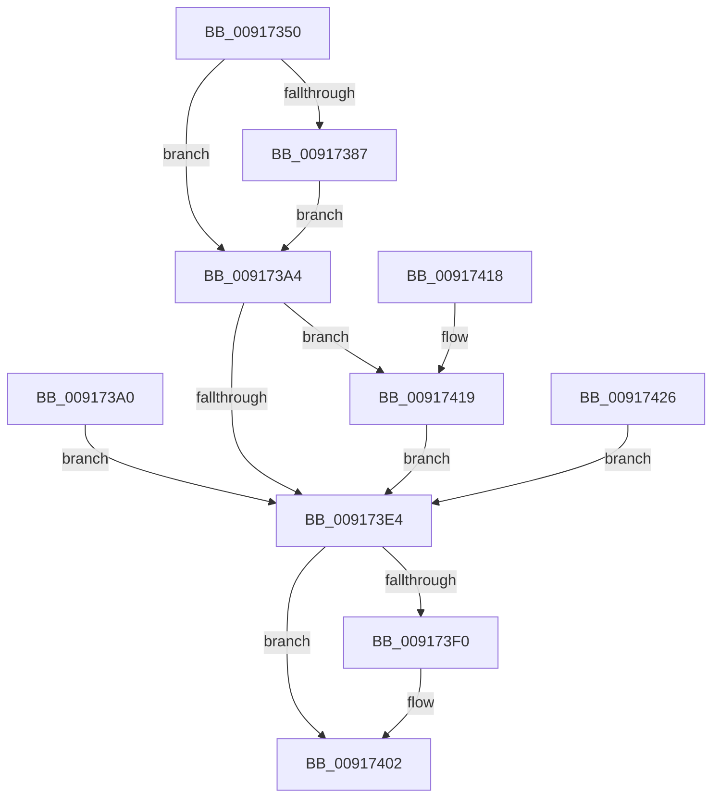

# NtOpenJobObject

- RVA: `0x00917350`–`0x0091742A` (길이 `218` bytes)
- VA: `0x0000000140917350`
- 실행 섹션: `PAGE`
- PDB 이름 있음: `예`; PDB Function 태그: `아니요`
- unwind 정보 RVA: `0x0008A9CC`
- 디코드: `59`개 명령, `218/218` bytes 표시
- 미해석 바이트: `0` (있으면 어셈블리에 `.byte`로 보존)

> 이 문서는 커널 이미지의 기계어와 PDB 기호를 분석해 생성했습니다. 4번과 5번은 함수 원형과 자료형을 바이너리 사용 방식에서 추정한 C 해석이며 원본 소스 복구 결과는 아닙니다.

## 1. Dependencies

- 직접 호출 지점: **3**; 고유 호출 대상: **3**
- 직접 호출자로 확인된 함수: **0**
- RIP 상대 이미지 참조: **2**

### Outgoing calls
- `0x009173AB` → [PsGetCurrentSilo](../../text/40/PsGetCurrentSilo_function_004094A0.md) (function, `0x004094A0`)
- `0x009173D9` → [ObOpenObjectByNameEx](../89/ObOpenObjectByNameEx_function_0089A8A0.md) (function, `0x0089A8A0`)
- `0x009173FD` → [EtwTraceJob](EtwTraceJob_function_00917C38.md) (function, `0x00917C38`)

### Direct callers
- 이 함수 시작 RVA로 연결되는 직접 call은 확인되지 않았습니다. 간접 호출은 완전히 역산할 수 없습니다.

### Static image references
- `0x009173A4` → RVA `0x00FC6C58` (`ALMOSTRO`; read)
- `0x009173E4` → RVA `0x00FC6B00` (`ALMOSTRO`; read)

## 2. Other-region calls and transfers

- 다른 실행 섹션으로 향하는 call: **1**
  - `0x009173AB` → [PsGetCurrentSilo](../../text/40/PsGetCurrentSilo_function_004094A0.md) (`PAGE` → `.text`)
- 별도 외부 분기/꼬리 이동을 확인하지 못했습니다.

## 3. Assembly (complete function range)

```asm
00917350  48 8B C4                        mov rax, rsp
00917353  48 89 58 08                     mov qword ptr [rax + 8], rbx
00917357  48 89 70 10                     mov qword ptr [rax + 0x10], rsi
0091735B  57                              push rdi
0091735C  41 56                           push r14
0091735E  41 57                           push r15
00917360  48 83 EC 50                     sub rsp, 0x50
00917364  4D 8B F0                        mov r14, r8
00917367  44 8B FA                        mov r15d, edx
0091736A  48 8B F9                        mov rdi, rcx
0091736D  48 83 60 20 00                  and qword ptr [rax + 0x20], 0
00917372  65 48 8B 04 25 88 01 00 00      mov rax, qword ptr gs:[0x188]
0091737B  40 8A B0 32 02 00 00            mov sil, byte ptr [rax + 0x232]
00917382  40 84 F6                        test sil, sil
00917385  74 1D                           je 0x1409173a4
00917387  48 BA 00 00 FF FF FF 7F 00 00   movabs rdx, 0x7fffffff0000
00917391  48 3B CA                        cmp rcx, rdx
00917394  48 0F 42 D1                     cmovb rdx, rcx
00917398  48 8B 02                        mov rax, qword ptr [rdx]
0091739B  48 89 02                        mov qword ptr [rdx], rax
0091739E  EB 04                           jmp 0x1409173a4
009173A0  8B D8                           mov ebx, eax
009173A2  EB 40                           jmp 0x1409173e4
009173A4  48 8B 1D AD F8 6A 00            mov rbx, qword ptr [rip + 0x6af8ad]
009173AB  E8 F0 20 AF FF                  call 0x1404094a0
009173B0  48 8D 8C 24 88 00 00 00         lea rcx, [rsp + 0x88]
009173B8  48 89 4C 24 38                  mov qword ptr [rsp + 0x38], rcx
009173BD  48 89 44 24 30                  mov qword ptr [rsp + 0x30], rax
009173C2  48 83 64 24 28 00               and qword ptr [rsp + 0x28], 0
009173C8  44 89 7C 24 20                  mov dword ptr [rsp + 0x20], r15d
009173CD  45 33 C9                        xor r9d, r9d
009173D0  44 8A C6                        mov r8b, sil
009173D3  48 8B D3                        mov rdx, rbx
009173D6  49 8B CE                        mov rcx, r14
009173D9  E8 C2 34 F8 FF                  call 0x14089a8a0
009173DE  8B D8                           mov ebx, eax
009173E0  85 C0                           test eax, eax
009173E2  79 35                           jns 0x140917419
009173E4  F7 05 12 F7 6A 00 00 00 08 00   test dword ptr [rip + 0x6af712], 0x80000
009173EE  74 12                           je 0x140917402
009173F0  41 B9 22 07 00 00               mov r9d, 0x722
009173F6  44 8B C3                        mov r8d, ebx
009173F9  33 D2                           xor edx, edx
009173FB  33 C9                           xor ecx, ecx
009173FD  E8 36 08 00 00                  call 0x140917c38
00917402  8B C3                           mov eax, ebx
00917404  48 8B 5C 24 70                  mov rbx, qword ptr [rsp + 0x70]
00917409  48 8B 74 24 78                  mov rsi, qword ptr [rsp + 0x78]
0091740E  48 83 C4 50                     add rsp, 0x50
00917412  41 5F                           pop r15
00917414  41 5E                           pop r14
00917416  5F                              pop rdi
00917417  C3                              ret
00917418  CC                              int3
00917419  48 8B 8C 24 88 00 00 00         mov rcx, qword ptr [rsp + 0x88]
00917421  48 89 0F                        mov qword ptr [rdi], rcx
00917424  EB BE                           jmp 0x1409173e4
00917426  8B D8                           mov ebx, eax
00917428  EB BA                           jmp 0x1409173e4
```

## 4. C-style interpretation (structured pseudocode)

```c
__int64 __fastcall NtOpenJobObject(__int64 a1, int a2, __int64 a3, int a4)
{
    __int64 result;
    __int64 v_rsp;
    unsigned __int64 v_stack_m30;
    unsigned __int64 v_stack_m38;
    unsigned __int64 v_stack_m40;
    unsigned int v_stack_m48;
    unsigned __int64 v_stack_p10;
    unsigned __int64 v_stack_p20;
    unsigned __int64 v_stack_p8;
    unsigned __int64 v_stack_p88;

    *(unsigned __int64 *)(v_rsp + 8) = v_rbx;
    *(unsigned __int64 *)(v_rsp + 16) = v_rsi;
    v_rsp = (v_rsp) - (80);
    if ((unsigned __int8)(*(unsigned __int8 *)(*(unsigned __int64 *)(gs_base + (0 + 392)) + 562)) == 0) goto loc_009173A4;
    if (a1 < a2) { a2 = a1; }
    *(unsigned __int64 *)(a2) = *(unsigned __int64 *)(a2);
    goto loc_009173A4;
loc_009173A4:
    result = PsGetCurrentSilo(a1, a2, a3, a4);
    v_stack_m30 = v_stack_p20;
    v_stack_m38 = result;
    v_stack_m48 = (unsigned int)((unsigned int)(a2));
    a4 = 0;
    result = ObOpenObjectByNameEx(a3, *(unsigned __int64 *)(v_rip + 7010477), (unsigned __int8)(*(unsigned __int8 *)(*(unsigned __int64 *)(gs_base + (0 + 392)) + 562)), a4);
    if (!sign_flag) goto loc_00917419;
loc_009173E4:
    if (((*(unsigned int *)(v_rip + 7010066)) & (0x80000ULL)) != 0) {
        a4 = 0x722ULL;
        a3 = (unsigned int)((unsigned int)((unsigned int)(result)));
        a2 = 0;
        a1 = 0;
        result = EtwTraceJob(a1, a2, a3, a4);
    }
    v_rsp = (v_rsp) + (80);
    return (unsigned int)((unsigned int)((unsigned int)((unsigned int)(result))));
loc_00917419:
    *(unsigned __int64 *)(a1) = v_stack_p88;
    goto loc_009173E4;
}
```

## 5. (Beta) C Style

```c
int64_t NtOpenJobObject(void *Arg1, int32_t Arg2, int64_t Arg3, int32_t Arg4)
{
    uint8_t *arg1 = (uint8_t *)Arg1;

    int64_t result;
    int64_t local_rsp;
    uint64_t v_stack_m30;
    uint64_t v_stack_m38;
    uint64_t v_stack_m40;
    uint32_t v_stack_m48;
    uint64_t v_stack_p10;
    uint64_t v_stack_p20;
    uint64_t v_stack_p8;
    uint64_t v_stack_p88;

    *(uint64_t *)(local_rsp + 0x8) = local_rbx;
    *(uint64_t *)(local_rsp + 0x10) = local_rsi;
    local_rsp = (local_rsp) - (80);
    if ((uint8_t)(*(uint8_t *)(*(uint64_t *)(gs_base + (0 + 0x188)) + 0x232)) == 0) goto loc_009173A4;
    if (Arg1 < Arg2) { Arg2 = Arg1; }
    *(uint64_t *)(Arg2) = *(uint64_t *)(Arg2);
    goto loc_009173A4;
loc_009173A4:
    result = PsGetCurrentSilo(Arg1, Arg2, Arg3, Arg4);
    v_stack_m30 = v_stack_p20;
    v_stack_m38 = result;
    v_stack_m48 = (uint32_t)((uint32_t)(Arg2));
    Arg4 = 0;
    result = ObOpenObjectByNameEx(Arg3, *(uint64_t *)(v_rip + 0x6AF8AD), (uint8_t)(*(uint8_t *)(*(uint64_t *)(gs_base + (0 + 0x188)) + 0x232)), Arg4);
    if (!sign_flag) goto loc_00917419;
loc_009173E4:
    if (((*(uint32_t *)(v_rip + 0x6AF712)) & (0x80000ULL)) != 0) {
        Arg4 = 0x722ULL;
        Arg3 = (uint32_t)((uint32_t)((uint32_t)(result)));
        Arg2 = 0;
        Arg1 = 0;
        result = EtwTraceJob(Arg1, Arg2, Arg3, Arg4);
    }
    local_rsp = (local_rsp) + (80);
    return (uint32_t)((uint32_t)((uint32_t)((uint32_t)(result))));
loc_00917419:
    *(uint64_t *)(arg1) = v_stack_p88;
    goto loc_009173E4;
}
```

### 관측된 메모리 오프셋

구조체 형식이 확인되지 않은 접근은 인자 기준의 오프셋으로만 기록했습니다.

| 기준 인자 | 오프셋 표현 | 폭 (bit) | 접근 |
|---|---:|---:|---|
| `Arg1` | `+ 0x0` | `64` | `W` |

## 6. Execution-region graph

[열기: 2D/3D 그래프와 함수 탐색 컨트롤 패널](../../../control-panel.html?section=page&rva=0x00917350&view=graph)

- 2D 그래프는 위에서 아래로 흐르고, 3D 그래프는 빈 공간을 드래그해 회전합니다. Shift+드래그는 이동, 휠은 확대·축소, 함수 노드 선택은 대상 보고서 이동입니다.

### Static fallback


