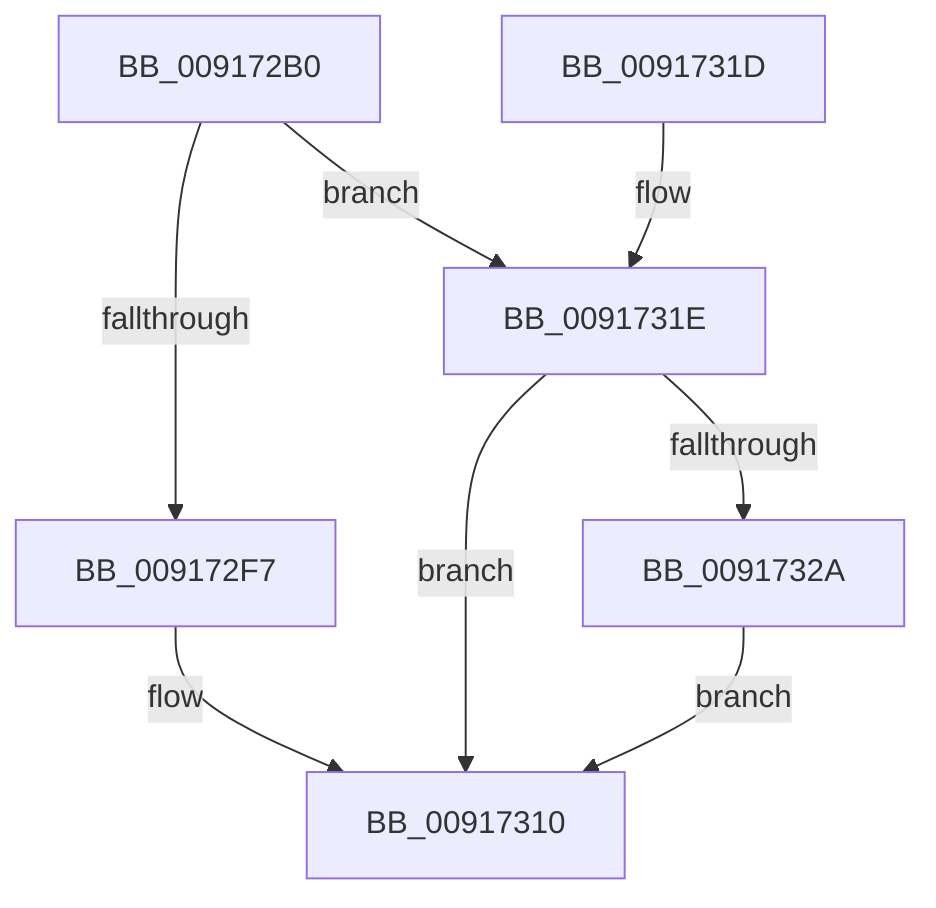

# NtTerminateJobObject

- RVA: `0x009172B0`–`0x0091733E` (길이 `142` bytes)
- VA: `0x00000001409172B0`
- 실행 섹션: `PAGE`
- PDB 이름 있음: `예`; PDB Function 태그: `아니요`
- unwind 정보 RVA: `0x0008A9BC`
- 디코드: `37`개 명령, `142/142` bytes 표시
- 미해석 바이트: `0` (있으면 어셈블리에 `.byte`로 보존)

> 이 문서는 커널 이미지의 기계어와 PDB 기호를 분석해 생성했습니다. 4번과 5번은 함수 원형과 자료형을 바이너리 사용 방식에서 추정한 C 해석이며 원본 소스 복구 결과는 아닙니다.

## 1. Dependencies

- 직접 호출 지점: **4**; 고유 호출 대상: **4**
- 직접 호출자로 확인된 함수: **0**
- RIP 상대 이미지 참조: **2**

### Outgoing calls
- `0x009172EC` → [ObReferenceObjectByHandle](../86/ObReferenceObjectByHandle_function_00868DB0.md) (function, `0x00868DB0`)
- `0x00917301` → [PspTerminateAllProcessesInJobHierarchy](PspTerminateAllProcessesInJobHierarchy_function_00917B7C.md) (function, `0x00917B7C`)
- `0x0091730B` → [ObfDereferenceObject](../../text/2F/ObfDereferenceObject_function_002F9350.md) (function, `0x002F9350`)
- `0x00917337` → [EtwTraceJob](EtwTraceJob_function_00917C38.md) (function, `0x00917C38`)

### Direct callers
- 이 함수 시작 RVA로 연결되는 직접 call은 확인되지 않았습니다. 간접 호출은 완전히 역산할 수 없습니다.

### Static image references
- `0x009172D1` → RVA `0x00FC6C58` (`ALMOSTRO`; read)
- `0x0091731E` → RVA `0x00FC6B00` (`ALMOSTRO`; read)

## 2. Other-region calls and transfers

- 다른 실행 섹션으로 향하는 call: **1**
  - `0x0091730B` → [ObfDereferenceObject](../../text/2F/ObfDereferenceObject_function_002F9350.md) (`PAGE` → `.text`)
- 별도 외부 분기/꼬리 이동을 확인하지 못했습니다.

## 3. Assembly (complete function range)

```asm
009172B0  4C 8B DC                        mov r11, rsp
009172B3  49 89 5B 08                     mov qword ptr [r11 + 8], rbx
009172B7  57                              push rdi
009172B8  48 83 EC 30                     sub rsp, 0x30
009172BC  65 48 8B 04 25 88 01 00 00      mov rax, qword ptr gs:[0x188]
009172C5  8B FA                           mov edi, edx
009172C7  49 83 63 F0 00                  and qword ptr [r11 - 0x10], 0
009172CC  BA 08 00 00 00                  mov edx, 8
009172D1  4C 8B 05 80 F9 6A 00            mov r8, qword ptr [rip + 0x6af980]
009172D8  49 83 63 18 00                  and qword ptr [r11 + 0x18], 0
009172DD  44 8A 88 32 02 00 00            mov r9b, byte ptr [rax + 0x232]
009172E4  49 8D 43 18                     lea rax, [r11 + 0x18]
009172E8  49 89 43 E8                     mov qword ptr [r11 - 0x18], rax
009172EC  E8 BF 1A F5 FF                  call 0x140868db0
009172F1  8B D8                           mov ebx, eax
009172F3  85 C0                           test eax, eax
009172F5  78 27                           js 0x14091731e
009172F7  48 8B 4C 24 50                  mov rcx, qword ptr [rsp + 0x50]
009172FC  45 33 C0                        xor r8d, r8d
009172FF  8B D7                           mov edx, edi
00917301  E8 76 08 00 00                  call 0x140917b7c
00917306  48 8B 4C 24 50                  mov rcx, qword ptr [rsp + 0x50]
0091730B  E8 40 20 9E FF                  call 0x1402f9350
00917310  8B C3                           mov eax, ebx
00917312  48 8B 5C 24 40                  mov rbx, qword ptr [rsp + 0x40]
00917317  48 83 C4 30                     add rsp, 0x30
0091731B  5F                              pop rdi
0091731C  C3                              ret
0091731D  CC                              int3
0091731E  F7 05 D8 F7 6A 00 00 00 08 00   test dword ptr [rip + 0x6af7d8], 0x80000
00917328  74 E6                           je 0x140917310
0091732A  41 B9 21 07 00 00               mov r9d, 0x721
00917330  44 8B C3                        mov r8d, ebx
00917333  33 D2                           xor edx, edx
00917335  33 C9                           xor ecx, ecx
00917337  E8 FC 08 00 00                  call 0x140917c38
0091733C  EB D2                           jmp 0x140917310
```

## 4. C-style interpretation (structured pseudocode)

```c
__int64 __fastcall NtTerminateJobObject(__int64 a1, int a2)
{
    __int64 result;
    __int64 v_rsp;
    unsigned __int64 v_stack_p18;
    unsigned __int64 v_stack_p8;

    *(unsigned __int64 *)(v_rsp + 8) = v_rbx;
    v_rsp = (v_rsp) - (48);
    *(unsigned __int64 *)(v_rsp - 24) = v_rsp + 24;
    result = ObReferenceObjectByHandle(a1, 8, *(unsigned __int64 *)(v_rip + 7010688), *(unsigned __int8 *)(*(unsigned __int64 *)(gs_base + (0 + 392)) + 562));
    if (sign_flag) goto loc_0091731E;
    a3 = 0;
    result = PspTerminateAllProcessesInJobHierarchy(v_stack_p18, (unsigned int)((unsigned int)((unsigned int)(a2))), a3, *(unsigned __int8 *)(*(unsigned __int64 *)(gs_base + (0 + 392)) + 562));
    result = ObfDereferenceObject(v_stack_p18, (unsigned int)((unsigned int)((unsigned int)(a2))), a3, *(unsigned __int8 *)(*(unsigned __int64 *)(gs_base + (0 + 392)) + 562));
loc_00917310:
    v_rsp = (v_rsp) + (48);
    return (unsigned int)((unsigned int)((unsigned int)((unsigned int)(result))));
loc_0091731E:
    if (((*(unsigned int *)(v_rip + 7010264)) & (0x80000ULL)) == 0) goto loc_00917310;
    a2 = 0;
    a1 = 0;
    result = EtwTraceJob(a1, a2, (unsigned int)((unsigned int)(v_stack_p8)), (unsigned int)(0x721ULL));
    goto loc_00917310;
}
```

## 5. (Beta) C Style

```c
int64_t NtTerminateJobObject(int64_t Arg1, int32_t Arg2)
{
    int64_t result;
    int64_t local_rsp;
    uint64_t v_stack_p18;
    uint64_t v_stack_p8;

    *(uint64_t *)(local_rsp + 0x8) = local_rbx;
    local_rsp = (local_rsp) - (48);
    *(uint64_t *)(local_rsp - 0x18) = local_rsp + 24;
    result = ObReferenceObjectByHandle(Arg1, 8, *(uint64_t *)(v_rip + 0x6AF980), *(uint8_t *)(*(uint64_t *)(gs_base + (0 + 0x188)) + 0x232));
    if (sign_flag) goto loc_0091731E;
    a3 = 0;
    result = PspTerminateAllProcessesInJobHierarchy(v_stack_p18, (uint32_t)((uint32_t)((uint32_t)(Arg2))), a3, *(uint8_t *)(*(uint64_t *)(gs_base + (0 + 0x188)) + 0x232));
    result = ObfDereferenceObject(v_stack_p18, (uint32_t)((uint32_t)((uint32_t)(Arg2))), a3, *(uint8_t *)(*(uint64_t *)(gs_base + (0 + 0x188)) + 0x232));
loc_00917310:
    local_rsp = (local_rsp) + (48);
    return (uint32_t)((uint32_t)((uint32_t)((uint32_t)(result))));
loc_0091731E:
    if (((*(uint32_t *)(v_rip + 0x6AF7D8)) & (0x80000ULL)) == 0) goto loc_00917310;
    Arg2 = 0;
    Arg1 = 0;
    result = EtwTraceJob(Arg1, Arg2, (uint32_t)((uint32_t)(v_stack_p8)), (uint32_t)(0x721ULL));
    goto loc_00917310;
}
```

## 6. Execution-region graph

[열기: 2D/3D 그래프와 함수 탐색 컨트롤 패널](../../../control-panel.html?section=page&rva=0x009172B0&view=graph)

- 2D 그래프는 위에서 아래로 흐르고, 3D 그래프는 빈 공간을 드래그해 회전합니다. Shift+드래그는 이동, 휠은 확대·축소, 함수 노드 선택은 대상 보고서 이동입니다.

### Static fallback


