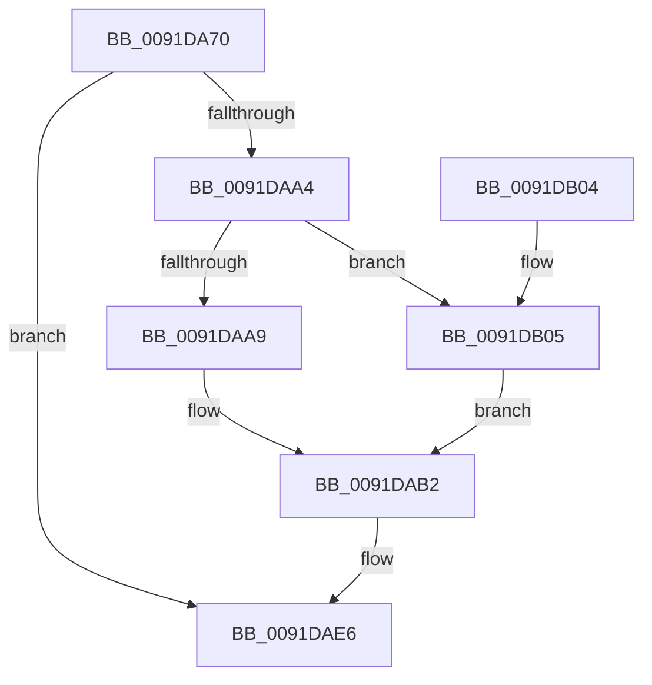

# ObFindHandleForObject

- RVA: `0x0091DA70`–`0x0091DB0C` (길이 `156` bytes)
- VA: `0x000000014091DA70`
- 실행 섹션: `PAGE`
- PDB 이름 있음: `예`; PDB Function 태그: `아니요`
- unwind 정보 RVA: `0x00089A98`
- 디코드: `42`개 명령, `156/156` bytes 표시
- 미해석 바이트: `0` (있으면 어셈블리에 `.byte`로 보존)

> 이 문서는 커널 이미지의 기계어와 PDB 기호를 분석해 생성했습니다. 4번과 5번은 함수 원형과 자료형을 바이너리 사용 방식에서 추정한 C 해석이며 원본 소스 복구 결과는 아닙니다.

## 1. Dependencies

- 직접 호출 지점: **3**; 고유 호출 대상: **3**
- 직접 호출자로 확인된 함수: **0**
- RIP 상대 이미지 참조: **1**

### Outgoing calls
- `0x0091DA97` → [ObReferenceProcessHandleTable](../89/ObReferenceProcessHandleTable_function_00893B70.md) (function, `0x00893B70`)
- `0x0091DACD` → [ExEnumHandleTable](ExEnumHandleTable_function_0091DB20.md) (function, `0x0091DB20`)
- `0x0091DADB` → [ExReleaseRundownProtection](../../text/34/ExReleaseRundownProtection_function_00349E80.md) (function, `0x00349E80`)

### Direct callers
- 이 함수 시작 RVA로 연결되는 직접 call은 확인되지 않았습니다. 간접 호출은 완전히 역산할 수 없습니다.

### Static image references
- `0x0091DABC` → RVA `0x0091DD70` (`ObpEnumFindHandleProcedure`; read)

## 2. Other-region calls and transfers

- 다른 실행 섹션으로 향하는 call: **1**
  - `0x0091DADB` → [ExReleaseRundownProtection](../../text/34/ExReleaseRundownProtection_function_00349E80.md) (`PAGE` → `.text`)
- 별도 외부 분기/꼬리 이동을 확인하지 못했습니다.

## 3. Assembly (complete function range)

```asm
0091DA70  48 8B C4                        mov rax, rsp
0091DA73  48 89 58 08                     mov qword ptr [rax + 8], rbx
0091DA77  48 89 68 10                     mov qword ptr [rax + 0x10], rbp
0091DA7B  48 89 70 18                     mov qword ptr [rax + 0x18], rsi
0091DA7F  48 89 78 20                     mov qword ptr [rax + 0x20], rdi
0091DA83  41 56                           push r14
0091DA85  48 83 EC 40                     sub rsp, 0x40
0091DA89  49 8B E9                        mov rbp, r9
0091DA8C  4D 8B F0                        mov r14, r8
0091DA8F  48 8B DA                        mov rbx, rdx
0091DA92  48 8B F1                        mov rsi, rcx
0091DA95  33 FF                           xor edi, edi
0091DA97  E8 D4 60 F7 FF                  call 0x140893b70
0091DA9C  48 8B C8                        mov rcx, rax
0091DA9F  48 85 C0                        test rax, rax
0091DAA2  74 42                           je 0x14091dae6
0091DAA4  48 85 DB                        test rbx, rbx
0091DAA7  74 5C                           je 0x14091db05
0091DAA9  48 8D 43 D0                     lea rax, [rbx - 0x30]
0091DAAD  48 89 44 24 20                  mov qword ptr [rsp + 0x20], rax
0091DAB2  4C 8B 4C 24 70                  mov r9, qword ptr [rsp + 0x70]
0091DAB7  4C 8D 44 24 20                  lea r8, [rsp + 0x20]
0091DABC  48 8D 15 AD 02 00 00            lea rdx, [rip + 0x2ad]
0091DAC3  4C 89 74 24 28                  mov qword ptr [rsp + 0x28], r14
0091DAC8  48 89 6C 24 30                  mov qword ptr [rsp + 0x30], rbp
0091DACD  E8 4E 00 00 00                  call 0x14091db20
0091DAD2  48 8D 8E E8 01 00 00            lea rcx, [rsi + 0x1e8]
0091DAD9  8A D8                           mov bl, al
0091DADB  E8 A0 C3 A2 FF                  call 0x140349e80
0091DAE0  84 DB                           test bl, bl
0091DAE2  40 0F 95 C7                     setne dil
0091DAE6  48 8B 5C 24 50                  mov rbx, qword ptr [rsp + 0x50]
0091DAEB  40 8A C7                        mov al, dil
0091DAEE  48 8B 7C 24 68                  mov rdi, qword ptr [rsp + 0x68]
0091DAF3  48 8B 6C 24 58                  mov rbp, qword ptr [rsp + 0x58]
0091DAF8  48 8B 74 24 60                  mov rsi, qword ptr [rsp + 0x60]
0091DAFD  48 83 C4 40                     add rsp, 0x40
0091DB01  41 5E                           pop r14
0091DB03  C3                              ret
0091DB04  CC                              int3
0091DB05  48 89 7C 24 20                  mov qword ptr [rsp + 0x20], rdi
0091DB0A  EB A6                           jmp 0x14091dab2
```

## 4. C-style interpretation (structured pseudocode)

```c
__int64 __fastcall ObFindHandleForObject(__int64 a1, __int64 a2, __int64 a3, __int64 a4, __int64 a5)
{
    __int64 result;
    __int64 v_rdi;
    __int64 v_rsp;
    unsigned __int64 v_stack_m18;
    unsigned __int64 v_stack_m20;
    unsigned __int64 v_stack_m28;
    unsigned __int64 v_stack_p10;
    unsigned __int64 v_stack_p18;
    unsigned __int64 v_stack_p20;
    unsigned __int64 v_stack_p8;

    *(unsigned __int64 *)(v_rsp + 8) = v_rbx;
    *(unsigned __int64 *)(v_rsp + 16) = v_rbp;
    *(unsigned __int64 *)(v_rsp + 24) = v_rsi;
    *(unsigned __int64 *)(v_rsp + 32) = v_rdi;
    v_rsp = (v_rsp) - (64);
    v_rdi = 0;
    result = ObReferenceProcessHandleTable(a1, a2, a3, a4);
    if (result == 0) goto loc_0091DAE6;
    if (a2 == 0) goto loc_0091DB05;
    v_stack_m28 = a2 - 48;
loc_0091DAB2:
    v_stack_m20 = a3;
    v_stack_m18 = a4;
    result = ExEnumHandleTable(result, v_rip + 685, v_stack_m28, a5);
    result = ExReleaseRundownProtection(a1 + 488, v_rip + 685, v_stack_m28, a5);
    v_rdi = ((unsigned __int8)((unsigned __int8)(result)) != 0) ? 1 : 0;
loc_0091DAE6:
    v_rsp = (v_rsp) + (64);
    return (unsigned __int8)(v_rdi);
loc_0091DB05:
    v_stack_p20 = v_stack_p20;
    goto loc_0091DAB2;
}
```

## 5. (Beta) C Style

```c
int64_t ObFindHandleForObject(void *Arg1, int64_t Arg2, int64_t Arg3, int64_t Arg4, int64_t Arg5)
{
    uint8_t *arg1 = (uint8_t *)Arg1;

    int64_t result;
    int64_t local_rdi;
    int64_t local_rsp;
    uint64_t v_stack_m18;
    uint64_t v_stack_m20;
    uint64_t v_stack_m28;
    uint64_t v_stack_p10;
    uint64_t v_stack_p18;
    uint64_t v_stack_p20;
    uint64_t v_stack_p8;

    *(uint64_t *)(local_rsp + 0x8) = local_rbx;
    *(uint64_t *)(local_rsp + 0x10) = local_rbp;
    *(uint64_t *)(local_rsp + 0x18) = local_rsi;
    *(uint64_t *)(local_rsp + 0x20) = local_rdi;
    local_rsp = (local_rsp) - (64);
    local_rdi = 0;
    result = ObReferenceProcessHandleTable(Arg1, Arg2, Arg3, Arg4);
    if (result == 0) goto loc_0091DAE6;
    if (Arg2 == 0) goto loc_0091DB05;
    v_stack_m28 = Arg2 - 48;
loc_0091DAB2:
    v_stack_m20 = Arg3;
    v_stack_m18 = Arg4;
    result = ExEnumHandleTable(result, v_rip + 685, v_stack_m28, Arg5);
    result = ExReleaseRundownProtection(Arg1 + 488, v_rip + 685, v_stack_m28, Arg5);
    local_rdi = ((uint8_t)((uint8_t)(result)) != 0) ? 1 : 0;
loc_0091DAE6:
    local_rsp = (local_rsp) + (64);
    return (uint8_t)(local_rdi);
loc_0091DB05:
    v_stack_p20 = v_stack_p20;
    goto loc_0091DAB2;
}
```

### 관측된 메모리 오프셋

구조체 형식이 확인되지 않은 접근은 인자 기준의 오프셋으로만 기록했습니다.

| 기준 인자 | 오프셋 표현 | 폭 (bit) | 접근 |
|---|---:|---:|---|
| `Arg1` | `+ 0x1E8` | `64` | `R` |

## 6. Execution-region graph

[열기: 2D/3D 그래프와 함수 탐색 컨트롤 패널](../../../control-panel.html?section=page&rva=0x0091DA70&view=graph)

- 2D 그래프는 위에서 아래로 흐르고, 3D 그래프는 빈 공간을 드래그해 회전합니다. Shift+드래그는 이동, 휠은 확대·축소, 함수 노드 선택은 대상 보고서 이동입니다.

### Static fallback


