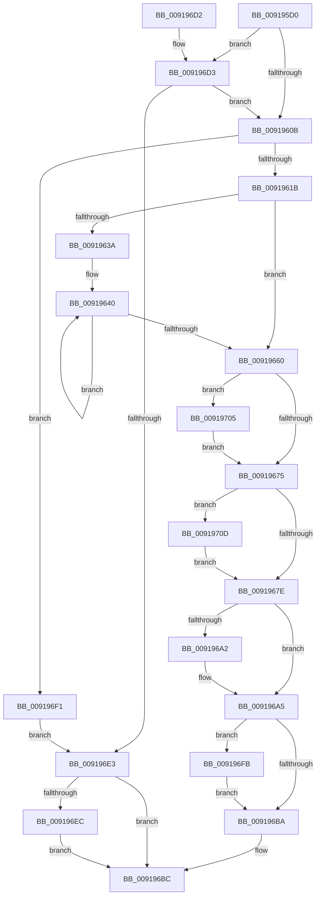

# ObGetProcessHandleCount

- RVA: `0x009195D0`–`0x00919715` (길이 `325` bytes)
- VA: `0x00000001409195D0`
- 실행 섹션: `PAGE`
- PDB 이름 있음: `예`; PDB Function 태그: `아니요`
- unwind 정보 RVA: `0x0008ACF0`
- 디코드: `89`개 명령, `325/325` bytes 표시
- 미해석 바이트: `0` (있으면 어셈블리에 `.byte`로 보존)

> 이 문서는 커널 이미지의 기계어와 PDB 기호를 분석해 생성했습니다. 4번과 5번은 함수 원형과 자료형을 바이너리 사용 방식에서 추정한 C 해석이며 원본 소스 복구 결과는 아닙니다.

## 1. Dependencies

- 직접 호출 지점: **3**; 고유 호출 대상: **3**
- 직접 호출자로 확인된 함수: **6**
- RIP 상대 이미지 참조: **1**

### Outgoing calls
- `0x009196D6` → [ExfAcquireRundownProtection](../../text/34/ExfAcquireRundownProtection_function_0034C050.md) (function, `0x0034C050`)
- `0x009196F4` → [ExReleaseRundownProtection](../../text/34/ExReleaseRundownProtection_function_00349E80.md) (function, `0x00349E80`)
- `0x009196FE` → [ExfReleaseRundownProtection](../../text/34/ExfReleaseRundownProtection_function_00349EB0.md) (function, `0x00349EB0`)

### Direct callers
- [EtwpPsProvTraceProcess](../8A/EtwpPsProvTraceProcess_function_008A3954.md) at `0x008A3E24`
- [EtwTraceAppStateChange](../8A/EtwTraceAppStateChange_function_008A452C.md) at `0x008A47CF`
- [EtwpProcessPerfCtrsRundown](../8A/EtwpProcessPerfCtrsRundown_function_008A5E08.md) at `0x008A5E43`
- [ExpCopyProcessInfo](ExpCopyProcessInfo_function_00919134.md) at `0x00919174`
- [ExpGetProcessInformation](ExpGetProcessInformation_function_0091A878.md) at `0x0091B2D1`
- [NtQueryInformationProcess](../9A/NtQueryInformationProcess_function_009AA250.md) at `0x009ACE60`

### Static image references
- `0x0091961B` → RVA `0x00FD9B18` (`PAGEDATA`; read)

## 2. Other-region calls and transfers

- 다른 실행 섹션으로 향하는 call: **3**
  - `0x009196D6` → [ExfAcquireRundownProtection](../../text/34/ExfAcquireRundownProtection_function_0034C050.md) (`PAGE` → `.text`)
  - `0x009196F4` → [ExReleaseRundownProtection](../../text/34/ExReleaseRundownProtection_function_00349E80.md) (`PAGE` → `.text`)
  - `0x009196FE` → [ExfReleaseRundownProtection](../../text/34/ExfReleaseRundownProtection_function_00349EB0.md) (`PAGE` → `.text`)
- 별도 외부 분기/꼬리 이동을 확인하지 못했습니다.

## 3. Assembly (complete function range)

```asm
009195D0  48 89 5C 24 10                  mov qword ptr [rsp + 0x10], rbx
009195D5  48 89 74 24 18                  mov qword ptr [rsp + 0x18], rsi
009195DA  48 89 7C 24 20                  mov qword ptr [rsp + 0x20], rdi
009195DF  41 56                           push r14
009195E1  48 83 EC 20                     sub rsp, 0x20
009195E5  4C 8B F2                        mov r14, rdx
009195E8  48 8D B9 E8 01 00 00            lea rdi, [rcx + 0x1e8]
009195EF  48 8B D9                        mov rbx, rcx
009195F2  0F 0D 0F                        prefetchw byte ptr [rdi]
009195F5  48 8B 07                        mov rax, qword ptr [rdi]
009195F8  48 83 E0 FE                     and rax, 0xfffffffffffffffe
009195FC  4C 8D 40 02                     lea r8, [rax + 2]
00919600  F0 4C 0F B1 07                  lock cmpxchg qword ptr [rdi], r8
00919605  0F 85 C8 00 00 00               jne 0x1409196d3
0091960B  48 8B 9B 00 03 00 00            mov rbx, qword ptr [rbx + 0x300]
00919612  48 85 DB                        test rbx, rbx
00919615  0F 84 D6 00 00 00               je 0x1409196f1
0091961B  44 8B 1D F6 04 6C 00            mov r11d, dword ptr [rip + 0x6c04f6]
00919622  48 8D 43 40                     lea rax, [rbx + 0x40]
00919626  33 F6                           xor esi, esi
00919628  49 C1 E3 06                     shl r11, 6
0091962C  4C 03 D8                        add r11, rax
0091962F  44 8B D6                        mov r10d, esi
00919632  44 8B CE                        mov r9d, esi
00919635  49 3B C3                        cmp rax, r11
00919638  73 26                           jae 0x140919660
0091963A  66 0F 1F 44 00 00               nop word ptr [rax + rax]
00919640  4C 63 40 18                     movsxd r8, dword ptr [rax + 0x18]
00919644  8B 50 1C                        mov edx, dword ptr [rax + 0x1c]
00919647  4D 03 D0                        add r10, r8
0091964A  44 3B C2                        cmp r8d, edx
0091964D  44 0F 4E C2                     cmovle r8d, edx
00919651  48 83 C0 40                     add rax, 0x40
00919655  41 8B C8                        mov ecx, r8d
00919658  4C 03 C9                        add r9, rcx
0091965B  49 3B C3                        cmp rax, r11
0091965E  72 E0                           jb 0x140919640
00919660  4D 85 D2                        test r10, r10
00919663  B8 FF FF FF FF                  mov eax, 0xffffffff
00919668  49 0F 49 F2                     cmovns rsi, r10
0091966C  48 3B F0                        cmp rsi, rax
0091966F  0F 8F 90 00 00 00               jg 0x140919705
00919675  4C 3B C8                        cmp r9, rax
00919678  0F 8F 8F 00 00 00               jg 0x14091970d
0091967E  8B 03                           mov eax, dword ptr [rbx]
00919680  48 C1 E8 02                     shr rax, 2
00919684  48 69 D8 FF 00 00 00            imul rbx, rax, 0xff
0091968B  48 C1 EB 08                     shr rbx, 8
0091968F  48 3B F3                        cmp rsi, rbx
00919692  48 0F 4E DE                     cmovle rbx, rsi
00919696  4C 3B CB                        cmp r9, rbx
00919699  4C 0F 4F CB                     cmovg r9, rbx
0091969D  4D 85 F6                        test r14, r14
009196A0  74 03                           je 0x1409196a5
009196A2  45 89 0E                        mov dword ptr [r14], r9d
009196A5  0F 0D 0F                        prefetchw byte ptr [rdi]
009196A8  48 8B 07                        mov rax, qword ptr [rdi]
009196AB  48 83 E0 FE                     and rax, 0xfffffffffffffffe
009196AF  48 8D 50 FE                     lea rdx, [rax - 2]
009196B3  F0 48 0F B1 17                  lock cmpxchg qword ptr [rdi], rdx
009196B8  75 41                           jne 0x1409196fb
009196BA  8B C3                           mov eax, ebx
009196BC  48 8B 5C 24 38                  mov rbx, qword ptr [rsp + 0x38]
009196C1  48 8B 74 24 40                  mov rsi, qword ptr [rsp + 0x40]
009196C6  48 8B 7C 24 48                  mov rdi, qword ptr [rsp + 0x48]
009196CB  48 83 C4 20                     add rsp, 0x20
009196CF  41 5E                           pop r14
009196D1  C3                              ret
009196D2  CC                              int3
009196D3  48 8B CF                        mov rcx, rdi
009196D6  E8 75 29 A3 FF                  call 0x14034c050
009196DB  84 C0                           test al, al
009196DD  0F 85 28 FF FF FF               jne 0x14091960b
009196E3  33 F6                           xor esi, esi
009196E5  8B C6                           mov eax, esi
009196E7  4D 85 F6                        test r14, r14
009196EA  74 D0                           je 0x1409196bc
009196EC  41 89 36                        mov dword ptr [r14], esi
009196EF  EB CB                           jmp 0x1409196bc
009196F1  48 8B CF                        mov rcx, rdi
009196F4  E8 87 07 A3 FF                  call 0x140349e80
009196F9  EB E8                           jmp 0x1409196e3
009196FB  48 8B CF                        mov rcx, rdi
009196FE  E8 AD 07 A3 FF                  call 0x140349eb0
00919703  EB B5                           jmp 0x1409196ba
00919705  48 8B F0                        mov rsi, rax
00919708  E9 68 FF FF FF                  jmp 0x140919675
0091970D  4C 8B C8                        mov r9, rax
00919710  E9 69 FF FF FF                  jmp 0x14091967e
```

## 4. C-style interpretation (structured pseudocode)

```c
__int64 __fastcall ObGetProcessHandleCount(__int64 a1, __int64 a2)
{
    __int64 result;
    __int64 v_r10;
    __int64 v_r11;
    __int64 v_rbx;
    __int64 v_rsi;
    __int64 v_rsp;
    unsigned __int64 v_stack_p10;
    unsigned __int64 v_stack_p18;
    unsigned __int64 v_stack_p20;

    v_stack_p10 = v_rbx;
    v_stack_p18 = v_rsi;
    v_stack_p20 = v_rdi;
    v_rsp = (v_rsp) - (32);
    result = (*(unsigned __int64 *)(a1 + 488)) & (-2);
    if (condition_is_not_equal) goto loc_009196D3;
loc_0091960B:
    if (*(unsigned __int64 *)(a1 + 768) == 0) goto loc_009196F1;
    v_rsi = 0;
    v_r11 = ((unsigned int)(*(unsigned int *)(v_rip + 7079158))) << (6);
    v_r11 = (v_r11) + (*(unsigned __int64 *)(a1 + 768) + 64);
    if ((*(unsigned __int64 *)(a1 + 768) + 64) >= v_r11) goto loc_00919660;
loc_00919640:
    v_r10 = (0) + ((int)(*(unsigned int *)(*(unsigned __int64 *)(a1 + 768) + 64 + 24)));
    a3 = (int)(*(unsigned int *)(*(unsigned __int64 *)(a1 + 768) + 64 + 24));
    if (((unsigned int)((int)(*(unsigned int *)(*(unsigned __int64 *)(a1 + 768) + 64 + 24)))) <= ((unsigned int)((unsigned int)(*(unsigned int *)(*(unsigned __int64 *)(a1 + 768) + 64 + 28))))) { a3 = (unsigned int)((unsigned int)(*(unsigned int *)(*(unsigned __int64 *)(a1 + 768) + 64 + 28))); }
    result = (*(unsigned __int64 *)(a1 + 768) + 64) + (64);
    a4 = (0) + ((unsigned int)((unsigned int)(a3)));
    if (result < v_r11) goto loc_00919640;
loc_00919660:
    if (!sign_flag) { v_rsi = v_r10; }
    if (v_rsi > ((unsigned int)(0xFFFFFFFFULL))) goto loc_00919705;
loc_00919675:
    if (a4 > ((unsigned int)(0xFFFFFFFFULL))) goto loc_0091970D;
loc_0091967E:
    result = ((unsigned int)(*(unsigned int *)(*(unsigned __int64 *)(a1 + 768)))) >> (2);
    v_rbx = (*(unsigned __int64 *)(a1 + 768)) * (result);
    v_rbx = (v_rbx) >> (8);
    if (v_rsi <= v_rbx) { v_rbx = v_rsi; }
    if (a4 > v_rbx) { a4 = v_rbx; }
    if (a2 != 0) {
        *(unsigned int *)(a2) = (unsigned int)(a4);
    }
    result = (*(unsigned __int64 *)(a1 + 488)) & (-2);
    if (condition_is_not_equal) goto loc_009196FB;
loc_009196BA:
loc_009196BC:
    v_rsp = (v_rsp) + (32);
    return (unsigned int)((unsigned int)(v_rbx));
loc_009196D3:
    result = ExfAcquireRundownProtection(v_stack_p20, result - 2, a3, a4);
    if ((unsigned __int8)(result) != 0) goto loc_0091960B;
loc_009196E3:
    v_rsi = 0;
    if (a2 == 0) goto loc_009196BC;
    *(unsigned int *)(a2) = 0;
    goto loc_009196BC;
loc_009196F1:
    result = ExReleaseRundownProtection(v_stack_p20, result - 2, a3, a4);
    goto loc_009196E3;
loc_009196FB:
    result = ExfReleaseRundownProtection(v_stack_p20, result - 2, a3, a4);
    goto loc_009196BA;
loc_00919705:
    goto loc_00919675;
loc_0091970D:
    goto loc_0091967E;
}
```

## 5. (Beta) C Style

```c
int64_t ObGetProcessHandleCount(void *Arg1, int64_t Arg2)
{
    uint8_t *arg1 = (uint8_t *)Arg1;

    int64_t result;
    int64_t local_r10;
    int64_t local_r11;
    int64_t local_rbx;
    int64_t local_rsi;
    int64_t local_rsp;
    uint64_t v_stack_p10;
    uint64_t v_stack_p18;
    uint64_t v_stack_p20;

    v_stack_p10 = local_rbx;
    v_stack_p18 = local_rsi;
    v_stack_p20 = local_rdi;
    local_rsp = (local_rsp) - (32);
    result = (*(uint64_t *)(arg1 + 0x1E8)) & (-2);
    if (condition_is_not_equal) goto loc_009196D3;
loc_0091960B:
    if (*(uint64_t *)(arg1 + 0x300) == 0) goto loc_009196F1;
    local_rsi = 0;
    local_r11 = ((uint32_t)(*(uint32_t *)(v_rip + 0x6C04F6))) << (6);
    local_r11 = (local_r11) + (*(uint64_t *)(arg1 + 0x300) + 64);
    if ((*(uint64_t *)(arg1 + 0x300) + 64) >= local_r11) goto loc_00919660;
loc_00919640:
    local_r10 = (0) + ((int32_t)(*(uint32_t *)(*(uint64_t *)(arg1 + 0x300) + 0x40 + 0x18)));
    a3 = (int32_t)(*(uint32_t *)(*(uint64_t *)(arg1 + 0x300) + 0x40 + 0x18));
    if (((uint32_t)((int32_t)(*(uint32_t *)(*(uint64_t *)(arg1 + 0x300) + 0x40 + 0x18)))) <= ((uint32_t)((uint32_t)(*(uint32_t *)(*(uint64_t *)(arg1 + 0x300) + 0x40 + 0x1C))))) { a3 = (uint32_t)((uint32_t)(*(uint32_t *)(*(uint64_t *)(arg1 + 0x300) + 0x40 + 0x1C))); }
    result = (*(uint64_t *)(arg1 + 0x300) + 64) + (64);
    a4 = (0) + ((uint32_t)((uint32_t)(a3)));
    if (result < local_r11) goto loc_00919640;
loc_00919660:
    if (!sign_flag) { local_rsi = local_r10; }
    if (local_rsi > ((uint32_t)(0xFFFFFFFFULL))) goto loc_00919705;
loc_00919675:
    if (a4 > ((uint32_t)(0xFFFFFFFFULL))) goto loc_0091970D;
loc_0091967E:
    result = ((uint32_t)(*(uint32_t *)(*(uint64_t *)(arg1 + 0x300)))) >> (2);
    local_rbx = (*(uint64_t *)(arg1 + 0x300)) * (result);
    local_rbx = (local_rbx) >> (8);
    if (local_rsi <= local_rbx) { local_rbx = local_rsi; }
    if (a4 > local_rbx) { a4 = local_rbx; }
    if (Arg2 != 0) {
        *(uint32_t *)(Arg2) = (uint32_t)(a4);
    }
    result = (*(uint64_t *)(arg1 + 0x1E8)) & (-2);
    if (condition_is_not_equal) goto loc_009196FB;
loc_009196BA:
loc_009196BC:
    local_rsp = (local_rsp) + (32);
    return (uint32_t)((uint32_t)(local_rbx));
loc_009196D3:
    result = ExfAcquireRundownProtection(v_stack_p20, result - 2, a3, a4);
    if ((uint8_t)(result) != 0) goto loc_0091960B;
loc_009196E3:
    local_rsi = 0;
    if (Arg2 == 0) goto loc_009196BC;
    *(uint32_t *)(Arg2) = 0;
    goto loc_009196BC;
loc_009196F1:
    result = ExReleaseRundownProtection(v_stack_p20, result - 2, a3, a4);
    goto loc_009196E3;
loc_009196FB:
    result = ExfReleaseRundownProtection(v_stack_p20, result - 2, a3, a4);
    goto loc_009196BA;
loc_00919705:
    goto loc_00919675;
loc_0091970D:
    goto loc_0091967E;
}
```

### 관측된 메모리 오프셋

구조체 형식이 확인되지 않은 접근은 인자 기준의 오프셋으로만 기록했습니다.

| 기준 인자 | 오프셋 표현 | 폭 (bit) | 접근 |
|---|---:|---:|---|
| `Arg1` | `+ 0x0` | `8` | `R` |
| `Arg1` | `+ 0x0` | `64` | `R` |
| `Arg1` | `+ 0x1E8` | `64` | `R` |
| `Arg1` | `+ 0x300` | `64` | `R` |

## 6. Execution-region graph

[열기: 2D/3D 그래프와 함수 탐색 컨트롤 패널](../../../control-panel.html?section=page&rva=0x009195D0&view=graph)

- 2D 그래프는 위에서 아래로 흐르고, 3D 그래프는 빈 공간을 드래그해 회전합니다. Shift+드래그는 이동, 휠은 확대·축소, 함수 노드 선택은 대상 보고서 이동입니다.

### Static fallback


